# Activity Management

**Odoo 19.0** · LGPL-3 · Category: Productivity

A full **activity management app** on top of Odoo's standard activities (`mail.activity`). It works with every
model that has activities: contacts, leads, sales, invoices, tasks, tickets and so on.
- **Dashboard** with live counters, filters, a to-do table and breakdowns per type and per user.
- **History**: done and cancelled activities stay visible, with who did what and why.
- **Cancel with a reason**, and **mark as done with feedback**, from any list or form.
- **Supervisors and teams**, plus **tags and priority**.
- **Mass scheduling** (several records × several users), **recurring activities** and **time tracking**.
- **Reminder digest**: one e-mail per user per day.


## Features

**Dashboard** (*Activities › Dashboard*)
- Five counters: **Overdue, Today, Planned, Done, Cancelled**. Click one to open the matching list.
- **Scope:** *Mine*, *My team* (supervisors) or *Everyone* (managers).
- **Filters:** period (today, this week, this month, last 30 days), activity type, user, document model and tag.
- **Open activities table:** sorted by due date, with priority stars and tags. Click to open the activity or its
  document, or **✓ to mark it as done** (feedback dialog).
- **Open by type** and **open by user** bars; click a bar to filter on it.

**Lists and views**
- *My Activities*, *My Team*, *All Activities* and *History* menus.
- List, kanban (by type), calendar, pivot, graph and form views.
- Overdue rows in red and today's in orange.
- Filters: *Open, Overdue, Today, Planned, Done, Cancelled, Important or urgent, Recurring*.
- Group by type, user, supervisor, document model, status or week.

**Done and cancelled activities**
- **Mark as done** asks for a feedback. *Done & schedule next* opens Odoo's scheduler on the same document.
  The activity is archived, not deleted, with `Done by` and the date.
- **Cancel** asks for a reason. The activity is archived as *Cancelled*, and a note is posted on the document.
  The assignee and the supervisor are notified (the supervisor part can be switched off).
- **Reopen** a cancelled activity.

**Organisation**
- **Supervisor per user** (user form › *Activities* tab). It is copied to every activity of that user and can
  be changed per activity.
- **Tags** (with colours) and **priority** (normal, important, urgent).

**Productivity**
- **Recurring activities:** *repeat every N days / weeks / months / years*. Marking one as done creates the next
  one with the same type, user, tags, priority and estimate.
- **Time tracking:** estimated / spent / remaining hours, and a **start / stop timer** that stops by itself when
  the activity is done or cancelled.
- **Mass scheduling:** choose models in the settings. They get *Action › Schedule activities*, which creates one
  activity per selected record and per user, with deadline, priority, tags and supervisor.
- **Reminder digest:** a daily job sends each user one message listing the activities due within N days, and
  optionally the overdue ones. It never sends the same activity twice in a day.

## Screenshots

| | |
| --- | --- |
| **Dashboard: my scope**<br>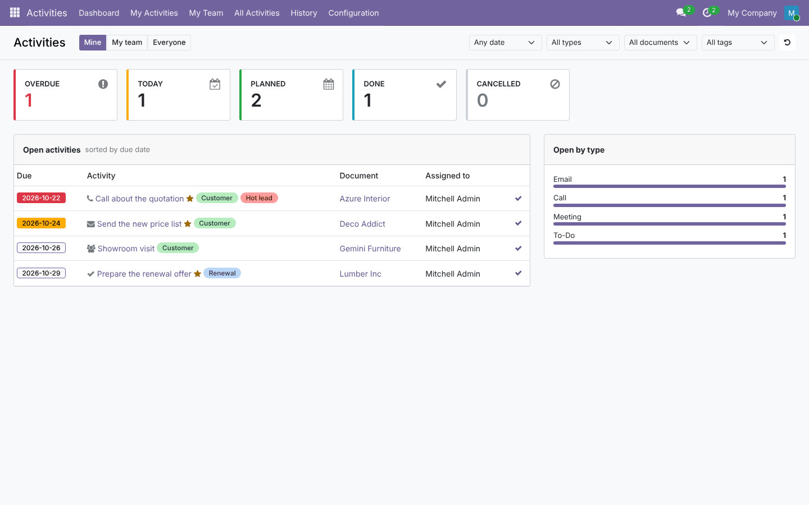 | **My activities (list)**<br>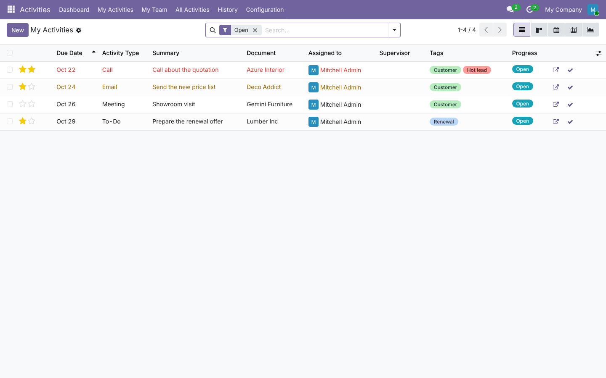 |
| **Kanban by activity type**<br>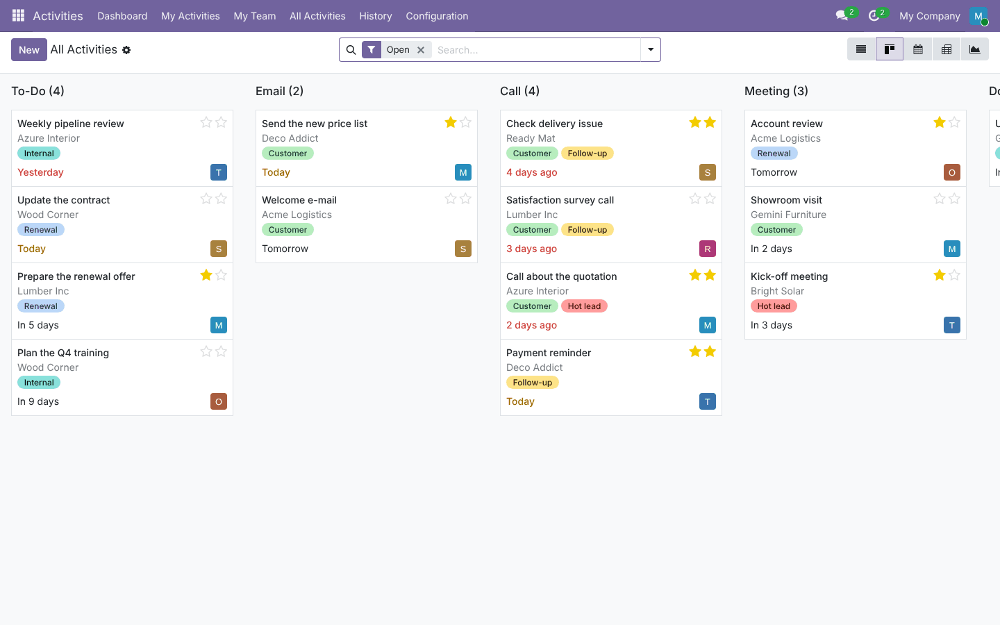 | **Team view, grouped by user**<br>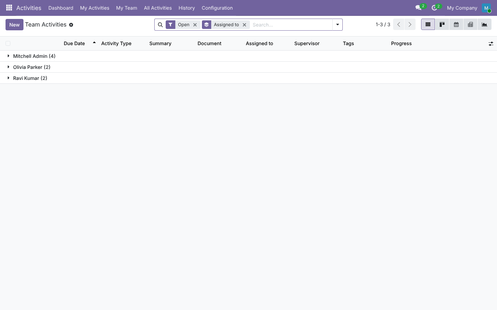 |
| **Calendar**<br>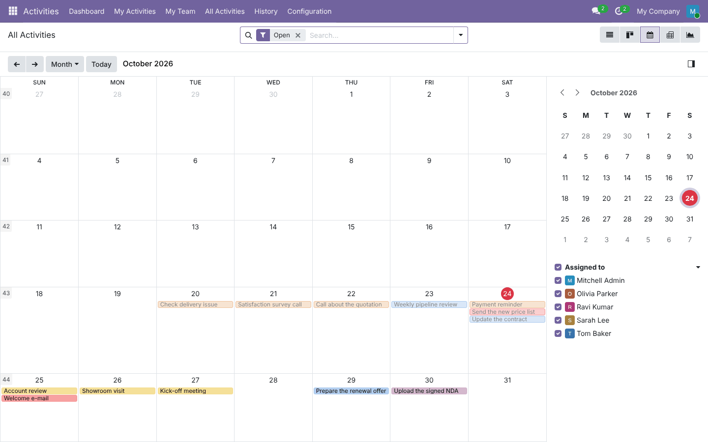 | **Pivot: users × status**<br>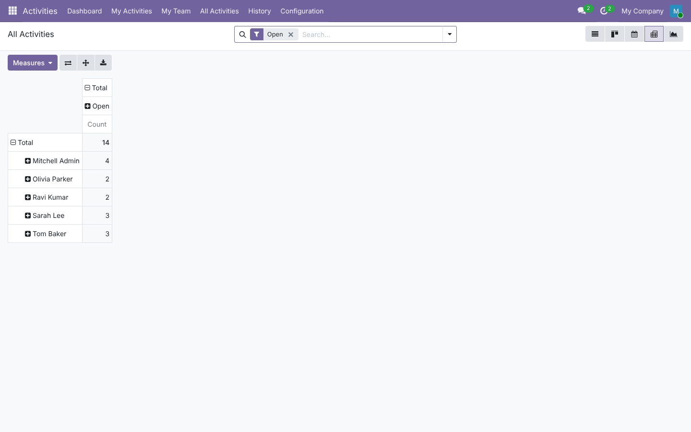 |
| **Activity form: time and recurrence**<br> | **Mark as done with feedback**<br>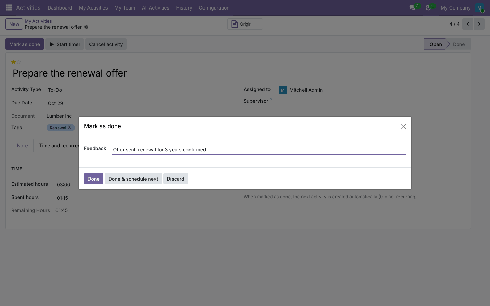 |
| **Cancel with a reason**<br>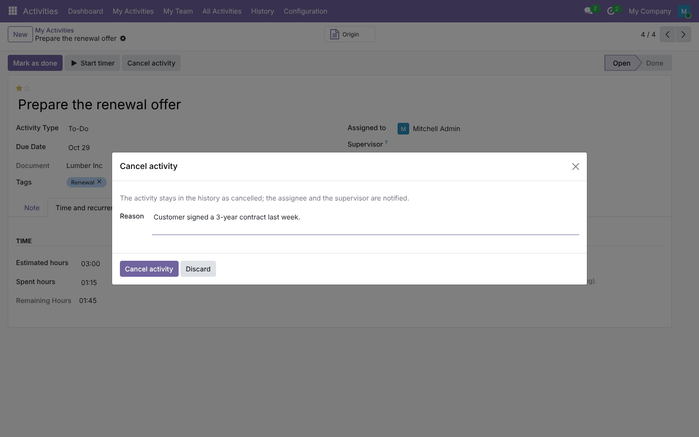 | **Cancelled activity in the history**<br>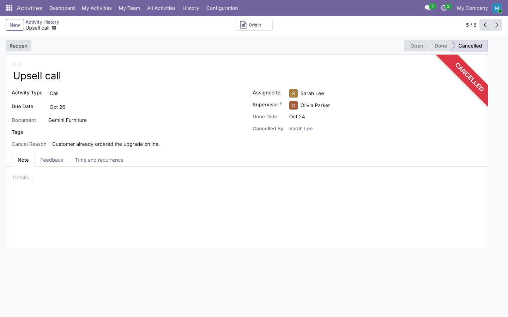 |
| **History: done and cancelled**<br> | **Mass scheduling from contacts**<br>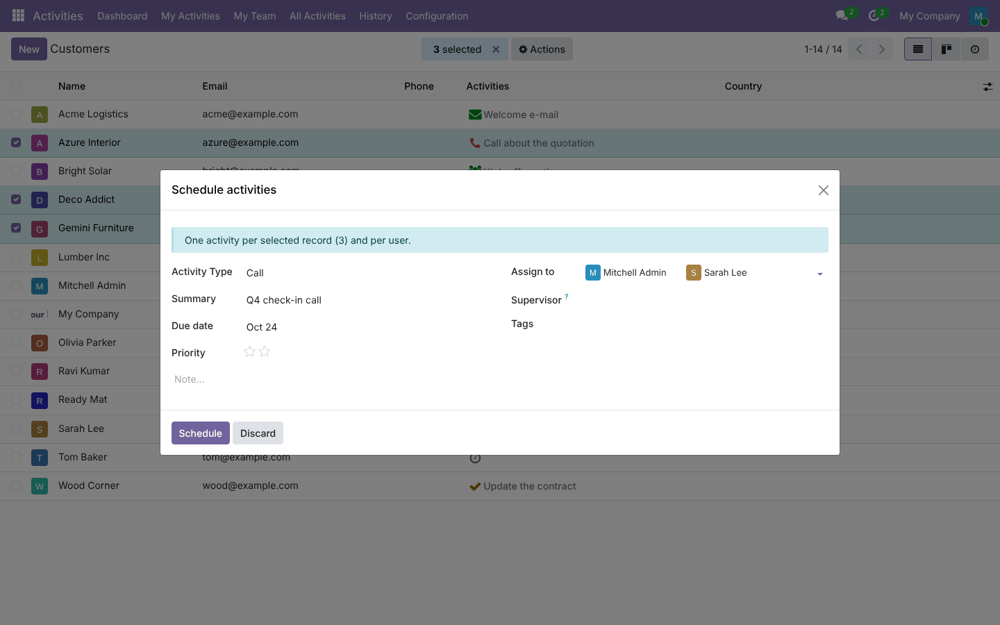 |

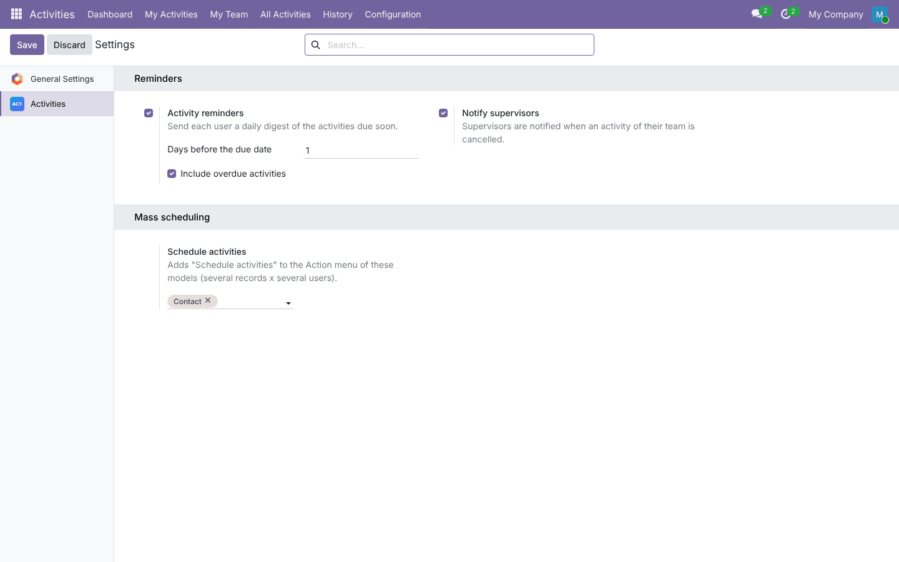

## Installation

Add `19.0/` of this repository to your addons path and install **Activity Management**. It depends on `mail` and
`base_setup` and needs no extra Python package.

## Configuration

1. **Access** (*Settings › Users › Activities*):
   - every internal user manages their own activities;
   - **Supervisor**: the *My team* scope and menu;
   - **Manager**: *All Activities*, *Everyone*, configuration and settings. Administrators get it by default.
2. **Supervisors:** on each user, *Activities* tab › *Activity supervisor*.
3. **Activities › Configuration › Settings:**
   - reminders: on/off, days before the due date, include overdue;
   - notify supervisors on cancellation;
   - models with *Schedule activities* in their Action menu.
4. **Configuration › Tags** and **Activity Types** (Odoo's own types).

## Technical overview

| Part | Role |
| --- | --- |
| `models/mail_activity.py` | Inherits `mail.activity`: supervisor, tags, priority, progress (open/done/cancelled), cancel/reopen, timer, recurrence in `_action_done`, reminder cron, `get_dashboard_data` |
| `models/mail_activity_tag.py` | Tags (unique per company) |
| `models/res_users.py` | `activity_supervisor_id` / supervised users |
| `wizard/` | Done (feedback), cancel (reason), mass scheduling + Action-menu bindings |
| `static/src/dashboard/` | OWL client action `activity_management.dashboard` (`/odoo/activity-dashboard`) |
| `security/` | Supervisor and manager groups, access rights |

Done activities are **archived** by Odoo 19 itself. Cancelled ones are archived too, with `cancelled = True`.
The stored `progress` field tells them apart. All dashboard queries run with the **user's access rights**.

## Tests

```bash
tools/run_tests.sh 19.0 /path/to/odoo19 activity_management
```

There are 13 tests:
- supervisor and progress;
- done wizard and history;
- cancel with reason, with notifications, refusal and reopen;
- supervisor notification switched off;
- recurrence;
- timer;
- mass scheduling and Action-menu bindings from the settings;
- reminder digest (one per user, due window, overdue, once a day) and the disabled case;
- dashboard counters per scope, with KPI domains matching the lists;
- unique tags;
- a browser **tour** that marks an activity as done from the dashboard, then opens the history.

## Full guide

[docs/activity_management.md](../../docs/activity_management.md)

---
Author: Aditya Shah · License: LGPL-3
