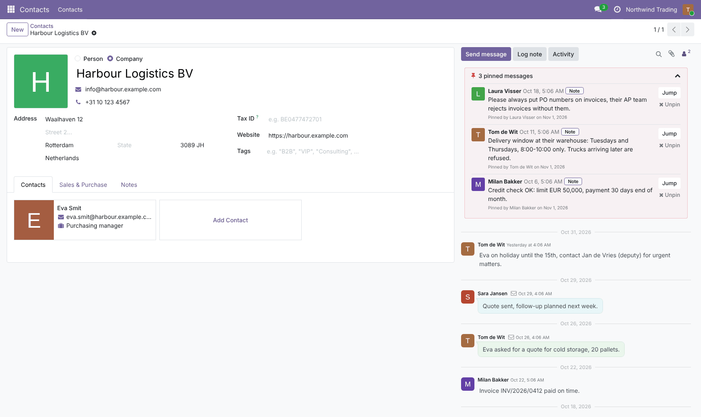
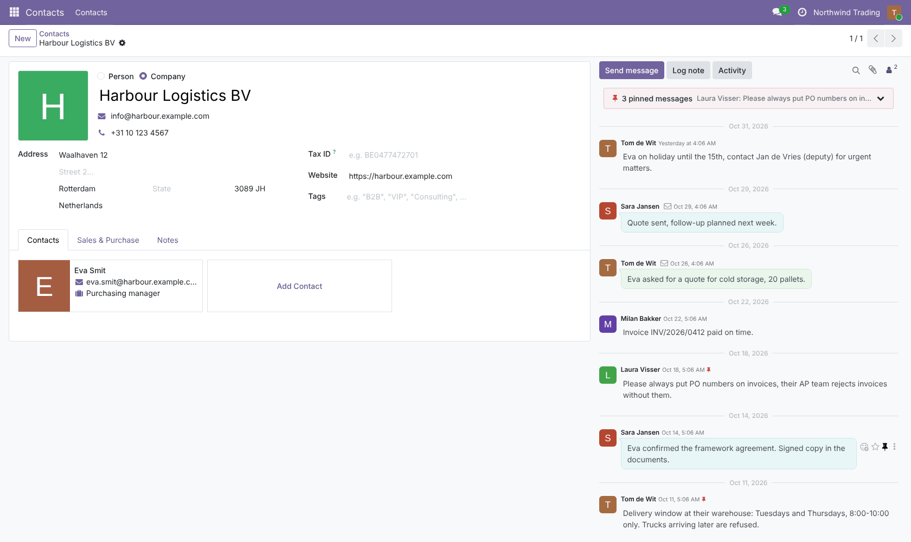
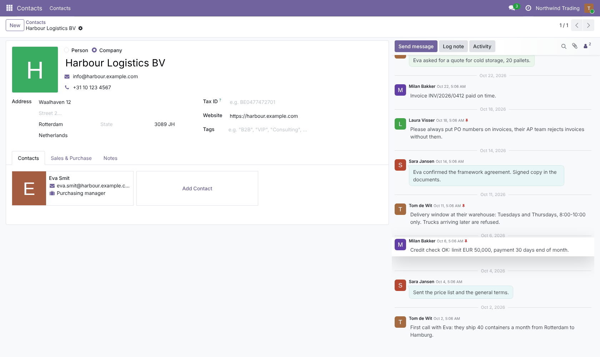
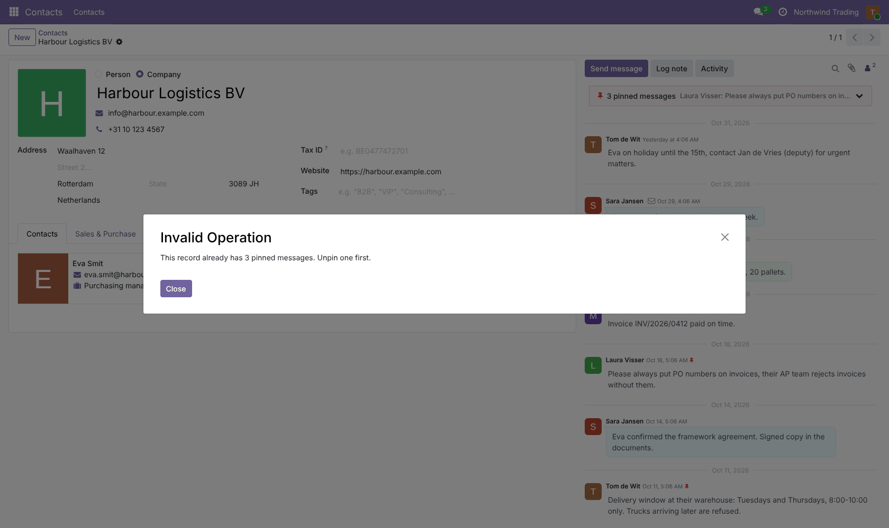
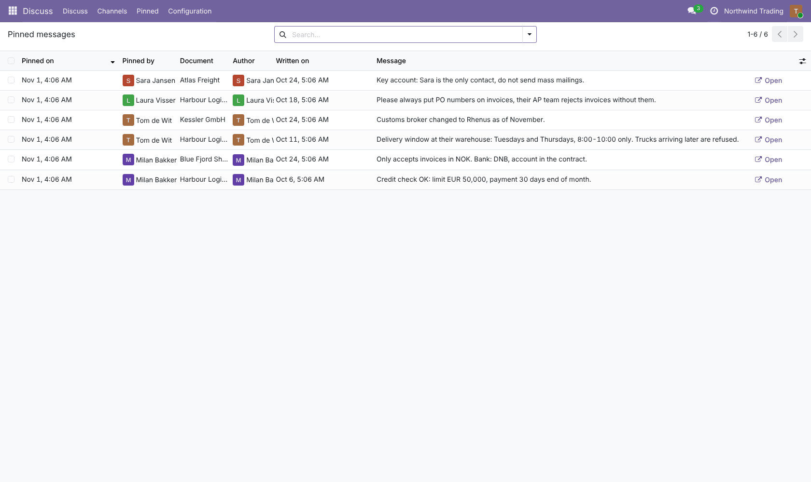
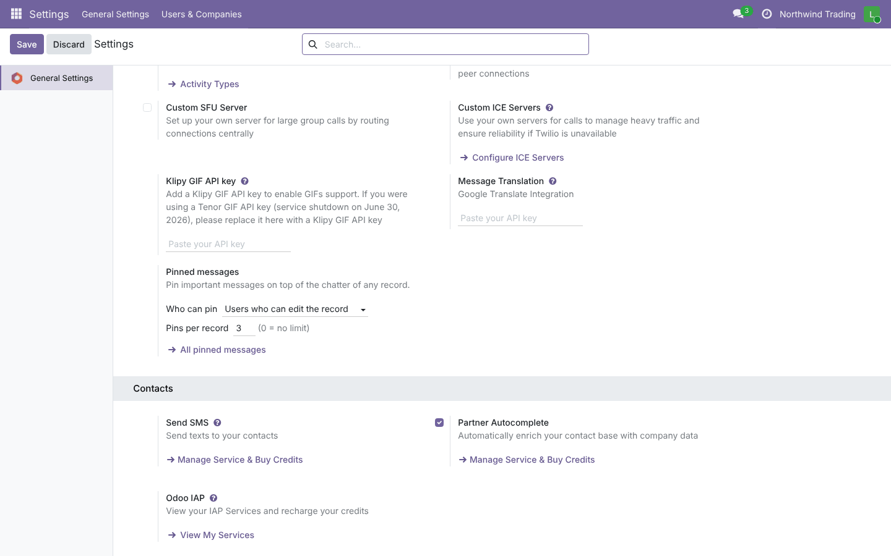

# Chatter: Pin Messages

**Odoo 19.0** · LGPL-3 · Category: Productivity / Discuss

**Pin important messages and notes in the chatter of any record** (contacts, sales orders, tasks, tickets, …)
so they stay on top: delivery instructions, payment terms, "never call before 10", …



## Features

- **Pin / Unpin** in the actions of a message or a note in the chatter (Odoo 19 only allows pins in Discuss
  channels).
- **Pinned bar** on top of the chatter:
  - collapsed: the number of pins and the latest one;
  - open: author, date, text, **who pinned it and when**, **Jump** (scrolls to the message and highlights it, even
    if it was not loaded yet) and **Unpin**.
- **Pin icon** next to the date of pinned messages.
- Pins **load with the record**, also for old messages further down the chatter.
- **Rules** (*Settings › General Settings › Discuss › Pinned messages*):
  - **who can pin**: users who can edit the record (default) or everyone who can see it;
  - **pins per record** (default 5, 0 = no limit);
  - only messages and notes can be pinned (not tracking or system notifications), only by internal users.
- Pinning does not change the message (no new write date, no notification).
- **Overview**: *Discuss › Pinned* lists all pinned messages of all records with the document, author, who pinned
  it, and an *Open* button.

## Screenshots

| | |
| --- | --- |
| **Pinned bar (collapsed)**<br> | **Pinned bar (open)**<br> |
| **Pin action on a message**<br> | **Jump to a pinned message**<br> |
| **Limit reached**<br> | **All pinned messages**<br> |
| **Settings**<br> | |

## Installation

Add `19.0/` of this repository to your addons path and install **Chatter: Pin Messages**.
- **Odoo dependencies**: `mail`.
- **Python**: nothing extra.

## Configuration

*Settings › General Settings › Discuss › Pinned messages*: who can pin, pins per record.

## Technical overview

| Part | Role |
| --- | --- |
| `mail.thread.chatter_set_message_pin()` | Checks the rules, sets `pinned_at` / `pinned_by_id` by SQL, returns store data |
| `mail.thread.chatter_pinned_messages()` | Pinned messages of a record (read-only route) |
| `mail.message.pinned_by_id` | Who pinned |
| `static/src/message_actions.js` | *Pin* / *Unpin* message action for record threads |
| `static/src/pinned_bar/` | Pinned bar component in the chatter |
| `static/src/thread_model_patch.js` | Fetch / toggle pins on the thread |
| `views/mail_message_views.xml` | *Pinned* overview list |

## Tests

```bash
tools/run_tests.sh 19.0 /path/to/odoo19 chatter_pin_message
```

The tests cover:
- pin / unpin, who pinned, unchanged write date;
- messages of another record and tracking messages refused;
- the limit (and 0 = no limit);
- access: edit right by default, read right when allowed, portal users refused;
- the overview action and the settings;
- a browser tour: pin from the message actions, pin icon, bar count, who pinned, jump, unpin from the bar, and
  two pins made in the same second.

## Full guide

[docs/chatter_pin_message.md](../../docs/chatter_pin_message.md) · Odoo 20.0: [`20.0/chatter_pin_message`](../../20.0/chatter_pin_message)

---
Author: Aditya Shah · License: LGPL-3
