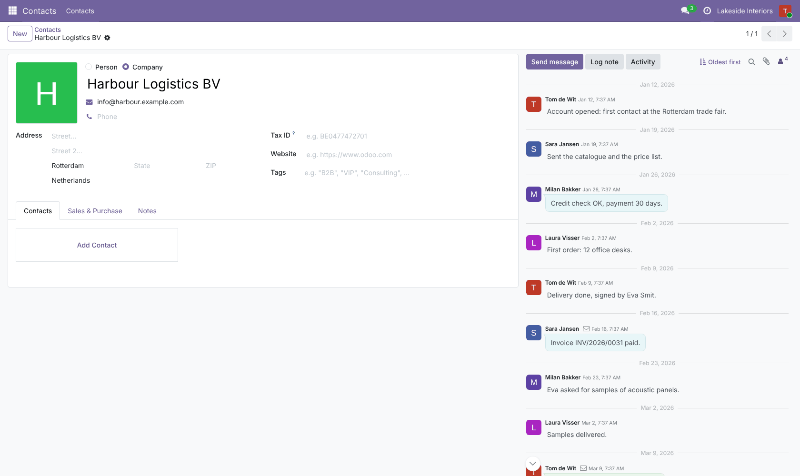
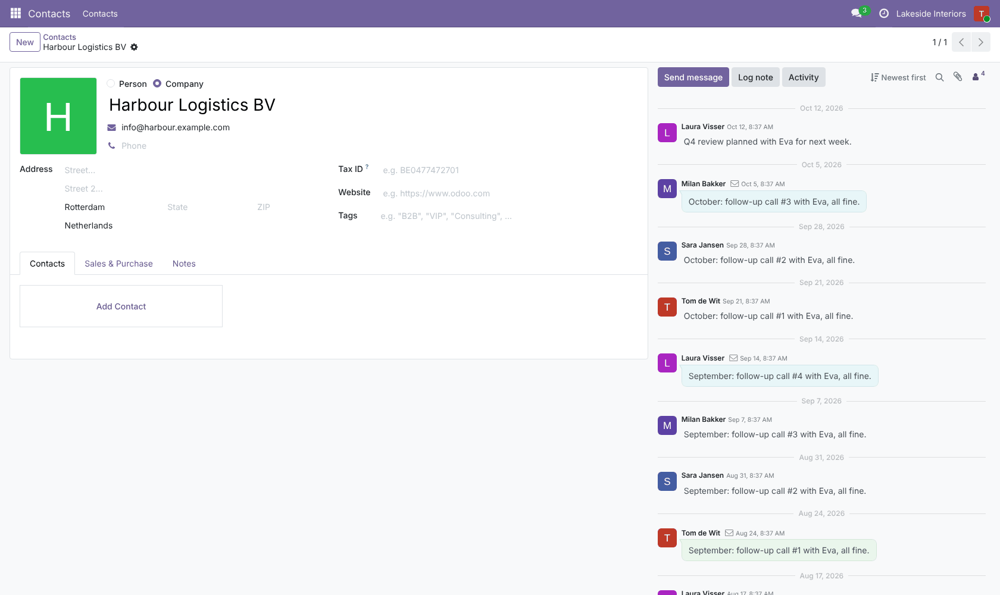
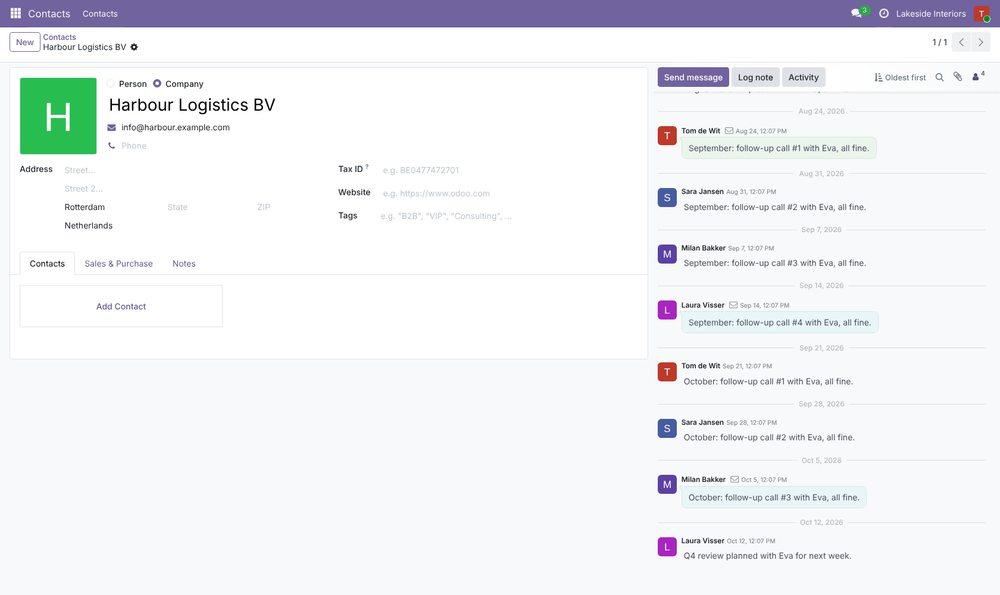
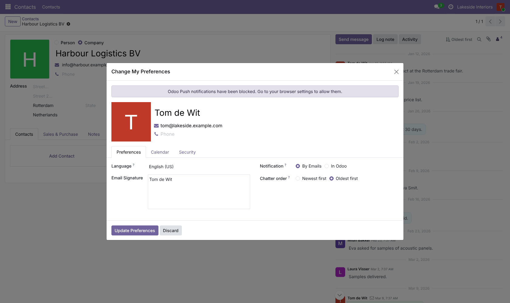
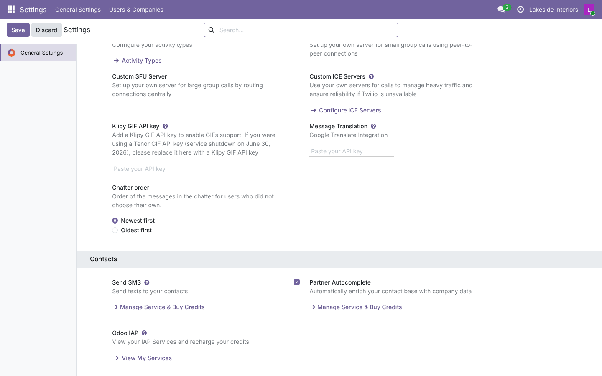

# Chatter: Sort by Date

**Odoo 19.0** · LGPL-3 · Category: Productivity / Discuss

Read the chatter of any record **oldest first** (like a story, from the first message) or **newest first**
(Odoo's default), with a toggle in the chatter that each user's choice is remembered for.



## Features

- **Toggle in the chatter top bar**: *Newest first* ⇄ *Oldest first*, for every record with a chatter.
- **Oldest first really starts at the first message**: the chatter loads the first messages of the record (not
  only the latest 30 reversed); **newer messages load when you scroll down**, in order, until the latest one.
- **Remembered per user**: the last choice is kept for all records and sessions.
- **Preferences**: *My Preferences › Chatter order*; empty means the company default.
- **Company default** (*Settings › General Settings › Discuss › Chatter order*) for users who never chose.
- Discuss channels and the Inbox keep their own order.

## Screenshots

| | |
| --- | --- |
| **Newest first (default)**<br> | **Oldest first: from the first message**<br> |
| **Oldest first: scrolled to the end**<br> | **My Preferences**<br> |
| **Company default**<br> | |

## Installation

Add `19.0/` of this repository to your addons path and install **Chatter: Sort by Date**.
- **Odoo dependencies**: `mail`.
- **Python**: nothing extra.

## Configuration

- *Settings › General Settings › Discuss › Chatter order*: default for everyone.
- Each user: the toggle in the chatter, or *My Preferences › Chatter order*.

## Technical overview

| Part | Role |
| --- | --- |
| `res.users.chatter_message_order` | The user's choice (self-readable / writeable) |
| `res.users.chatter_set_message_order()` | Saves the choice from the toggle |
| `ir.http.session_info()` | Sends the effective order (user or company default) to the web client |
| `static/src/chatter_patch.*` | Toggle button, `order` of the chatter thread |
| `static/src/thread_model_patch.js` | Oldest first: load from the first message (`after: -1`), newer pages on scroll |

## Tests

```bash
tools/run_tests.sh 19.0 /path/to/odoo19 chatter_sort_by_date
```

The tests cover:
- the effective order (user, company default, fallback), the toggle method, the preferences write;
- the setting;
- the session info;
- two browser tours on a record with 35 notes: newest first, toggle to oldest first (the very first note on top),
  choice remembered after reloading, back to newest first.

## Full guide

[docs/chatter_sort_by_date.md](../../docs/chatter_sort_by_date.md) · Odoo 20.0: [`20.0/chatter_sort_by_date`](../../20.0/chatter_sort_by_date)

---
Author: Aditya Shah · License: LGPL-3
