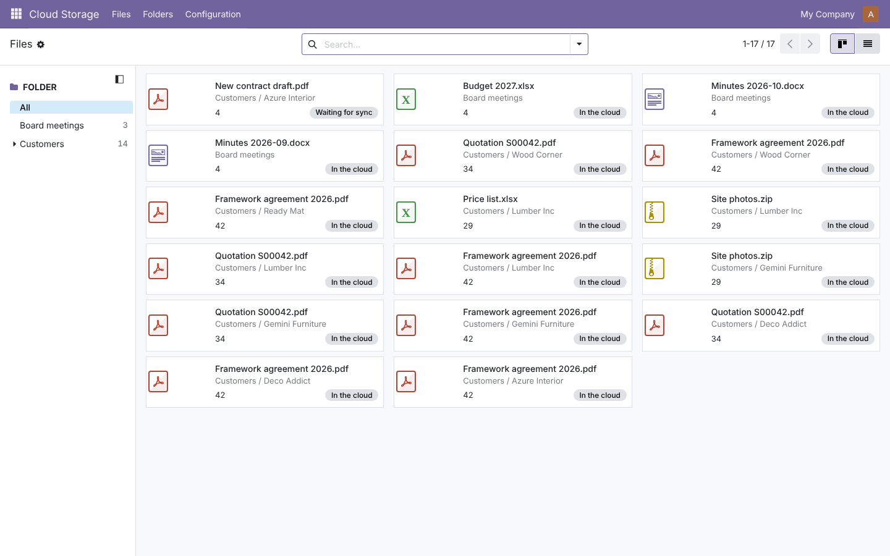
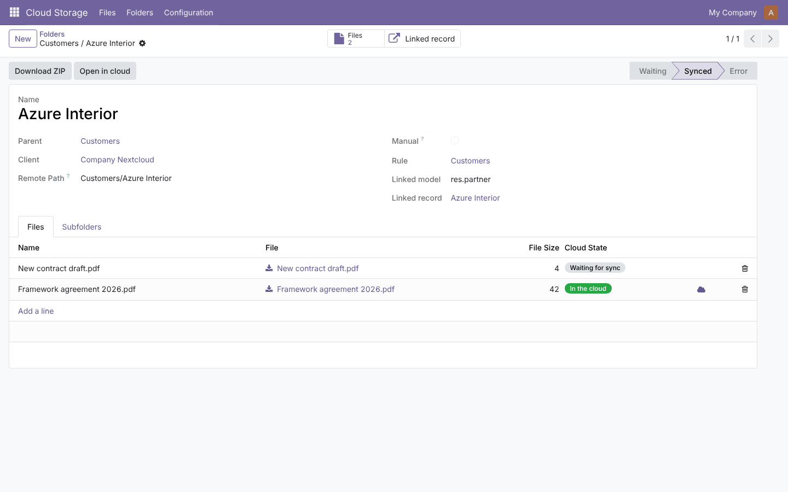
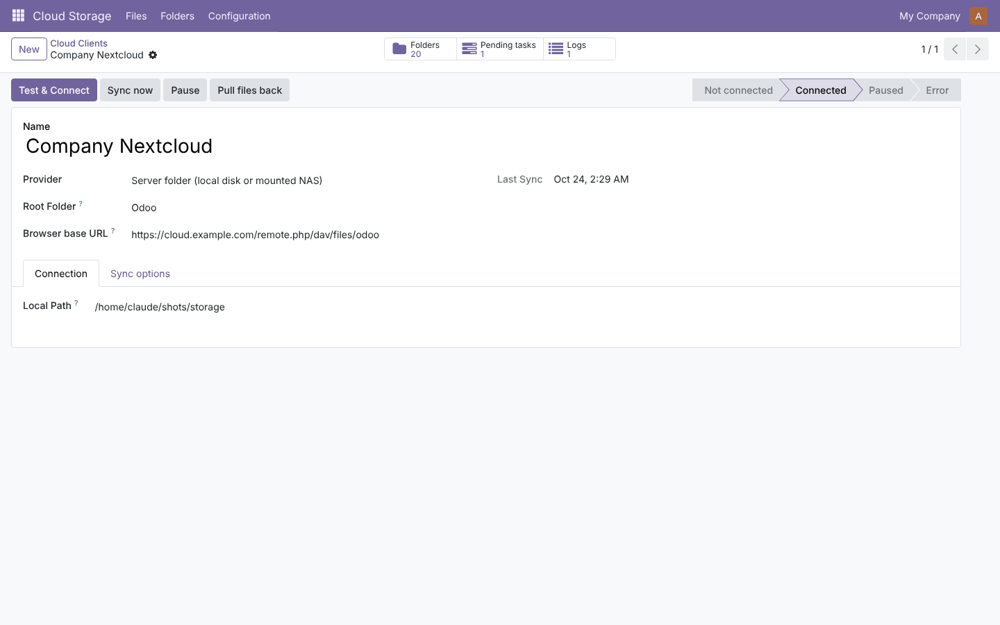
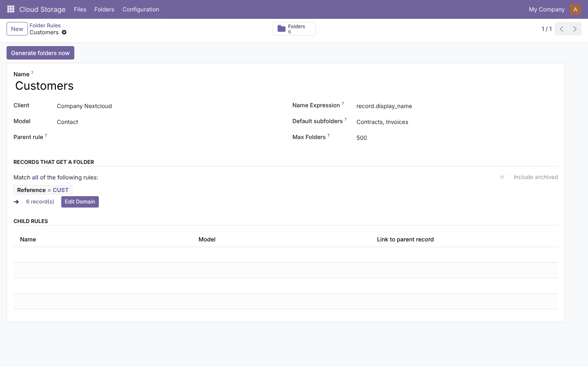
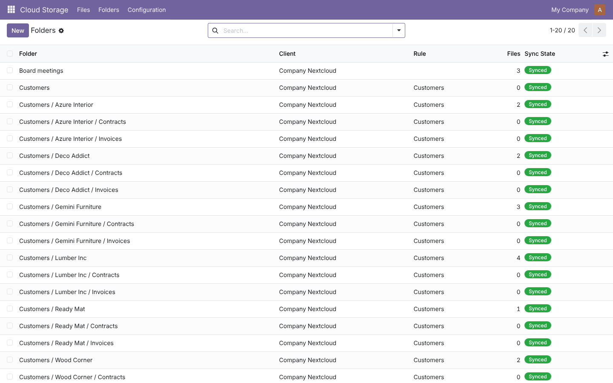
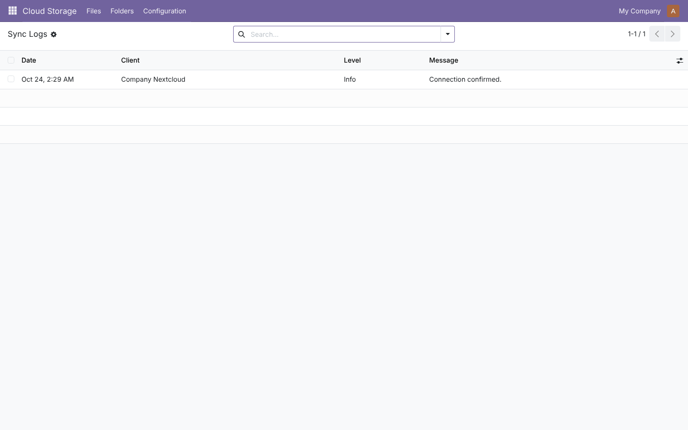

# Cloud Storage Sync

**Odoo 19.0** · LGPL-3 · Category: Productivity / Documents

Folders for your attachments, generated automatically from your records, and synced both ways with a
**WebDAV** storage (Nextcloud, ownCloud, Synology, QNAP, TrueNAS) or a **folder on the server** (local disk, mounted NAS).



## Features

- **Folder rules**: one folder per record of any model (customers, projects, employees…), with a filter,
  a folder-name expression, nested rules (Customers › Contacts), default subfolders and a maximum number of folders.
- **Manual folders** with access restricted to selected users or groups.
- **Direct sync** (Odoo → cloud), **backward sync** (files and folders added in the cloud appear in Odoo),
  **reverse sync** (*Pull files back* brings cloud-only files into Odoo).
- **Keep files only in the cloud**: after upload, the Odoo copy becomes a link, saving filestore space.
- **Sync queue** with priorities, retries, pause/resume, and **sync logs** with automatic cleanup.
- **File manager**: folder tree on the left, kanban/list of files, **ZIP download** of any folder.
- Secrets visible to administrators only; path-traversal protection for server folders.

## Screenshots

| | |
| --- | --- |
| **Folder with its files and sync state**<br> | **Cloud client: connection and sync options**<br> |
| **Folder rule: one folder per matching record**<br> | **Folder tree generated by the rule**<br> |



## Installation

1. Add `19.0/` of this repository to your addons path.
2. *Apps* › update the apps list › install **Cloud Storage Sync**.
3. No extra Python package is needed.

## Configuration

1. **Cloud Storage › Configuration › Cloud Clients › New**
   - *WebDAV*: URL (Nextcloud: `https://<host>/remote.php/dav/files/<user>`), user, app password.
   - *Server folder*: an absolute path writable by the Odoo service user.
   - Optional *Browser base URL* to open files in the cloud and to use *Keep files only in the cloud*.
2. Click **Test & Connect**.
3. **Folder Rules › New**: pick a model, a filter and optional default subfolders, then **Generate folders now**.
4. Give users the **Cloud Storage / File Manager** group (administrators get **Administrator**).

## Usage

- Attach a file to a record that has a folder (chatter, attachments): it is queued and uploaded by the next sync.
- **Cloud Storage › Files**: browse every synced file by folder; **Folders**: open a folder, upload files, create subfolders, download a ZIP.
- Files added directly in the storage are imported on the next backward sync (every 30 minutes, or *Sync now* on the client).

Scheduled actions: generate folders (15 min), process the queue (5 min), backward sync (30 min).
System parameters: `cloud_storage_sync.max_attempts` (default 5), `cloud_storage_sync.log_retention_days` (default 30).

## Technical overview

| Model | Role |
| --- | --- |
| `cloud.storage.client` | Connection to one storage (provider, root folder, options) |
| `cloud.storage.rule` | Generates folders from records |
| `cloud.storage.folder` | Folder tree, linked record, remote path, access restrictions |
| `cloud.storage.queue` | Pending operations: mkdir, upload, move, delete, pull |
| `cloud.storage.log` | Sync history |
| `ir.attachment` (extended) | `cloud_folder_id`, `cloud_path`, `cloud_state` |

Providers live in `models/providers.py` behind one interface; adding a back-end means adding one class.

## Tests

```bash
tools/run_tests.sh 19.0 /path/to/odoo19 cloud_storage_sync
```

Covers folder rules, sync in every direction, WebDAV requests (mocked), retries, access rights and the ZIP download.

## Full guide

Planning, architecture, development, testing and deployment from dev to production:
[docs/cloud_storage_sync.md](../../docs/cloud_storage_sync.md)

---
Author: Aditya Shah · License: LGPL-3
