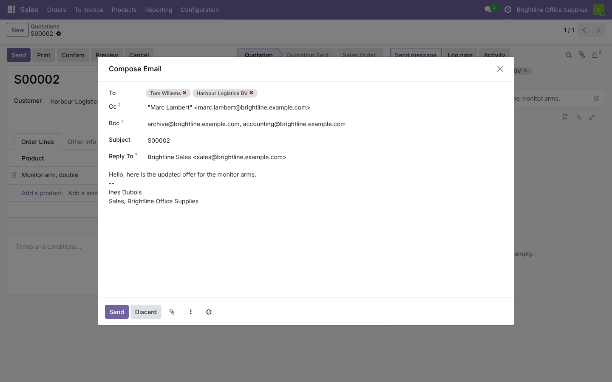
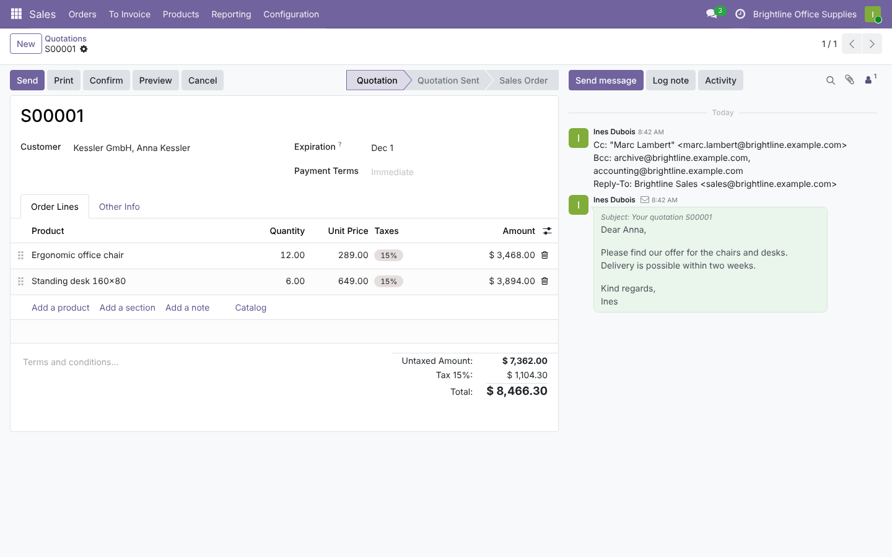
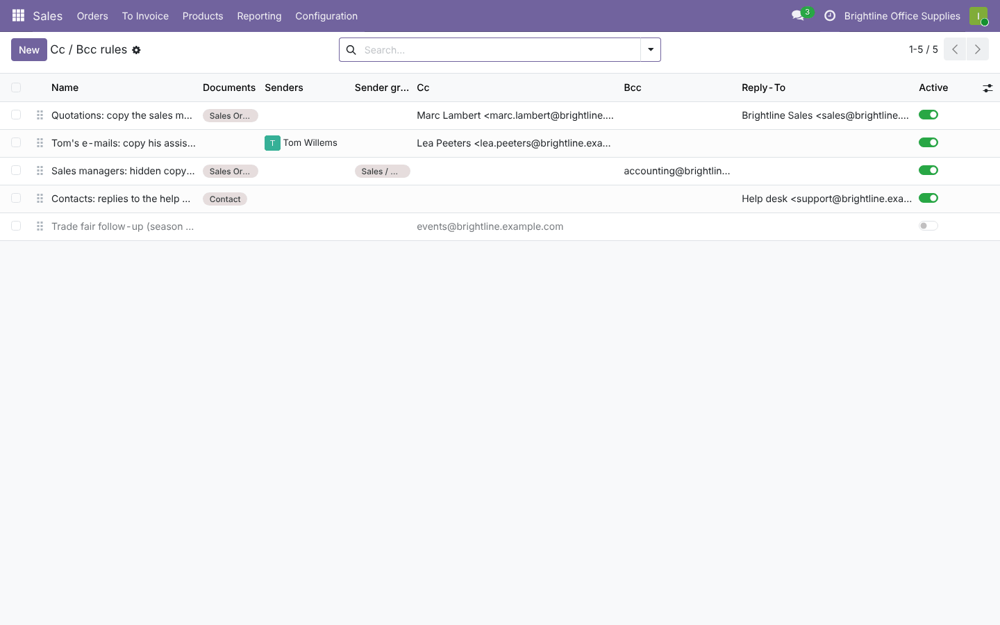
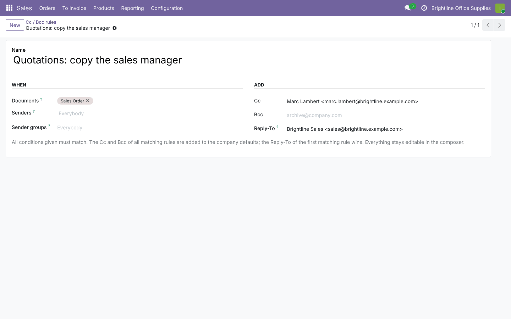
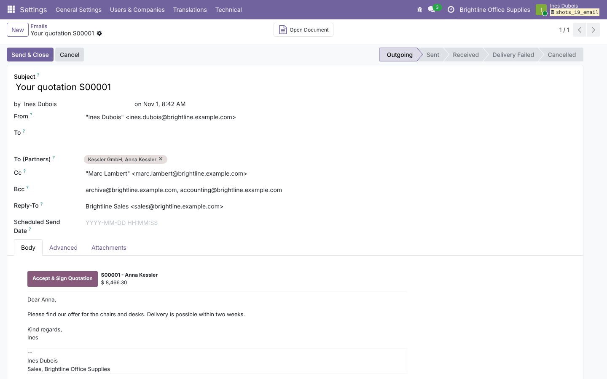

# E-mail Cc, Bcc and Reply-To

**Odoo 19.0** · LGPL-3 · Category: Productivity/Discuss

**Cc, Bcc and Reply-To fields in the e-mail composer of every document**, filled in automatically from company
defaults and from rules per document type, sender and sender group. The Bcc is really sent (SMTP envelope only,
never in the headers) and the chatter keeps a note of who was in copy.



## Features

- **Composer** (*Send message › full composer*, *Send by e-mail* buttons): **Cc** and **Bcc** e-mail addresses
  (any address, no contact needed) and **Reply-To**; proposed values stay editable before sending.
- **Company defaults** (*Settings › General Settings › Emails › Cc, Bcc and Reply-To*): e.g. a Bcc to the archive
  mailbox on every e-mail.
- **Rules** (*Rules per document and sender* in the same setting), as many as needed:
  - **when**: documents (quotations, contacts, tasks…), senders, sender groups, company — empty means all;
  - **add**: Cc, Bcc, Reply-To;
  - all matching rules add their Cc and Bcc (no duplicates; an address in Cc is not repeated in Bcc); the
    Reply-To of the first matching rule wins, then the company default.
- **Sending**:
  - Cc is a real `Cc:` header on the e-mail to the recipients (once per message, not once per recipient);
  - Bcc addresses receive the same e-mail through the SMTP envelope, **never written in the headers**;
  - Reply-To replaces the usual reply address (replies then go to that mailbox instead of the chatter).
- **Chatter note** under the sent message listing its Cc, Bcc and Reply-To (internal note, employees only).
- **Mass mailing mode** (composer on several records): Cc and Bcc on every e-mail.
- **Outgoing e-mails** (*Settings › Technical › Emails*): new *Bcc* field.
- Log notes never get Cc or Bcc. Invalid addresses are refused when saving a rule or sending.

## Screenshots

| | |
| --- | --- |
| **Composer with proposed Cc, Bcc and Reply-To**<br> | **Note in the chatter**<br> |
| **Rules**<br> | **A rule**<br> |
| **Company defaults**<br> | **Outgoing e-mail with its Bcc**<br> |

## Installation

Add `19.0/` of this repository to your addons path and install **E-mail Cc, Bcc and Reply-To**.
- **Odoo dependencies**: `mail`.
- **Python**: nothing extra.

## Configuration

1. *Settings › General Settings › Emails › Cc, Bcc and Reply-To*: company defaults.
2. *Rules per document and sender*: create rules (also in *Settings › Technical › Email › Cc / Bcc Rules* in
   debug mode). Rules are managed by administrators and read by all employees.

## Technical overview

| Part | Role |
| --- | --- |
| `mail.cc.rule` | Conditions, addresses, `_get_defaults(model, user)` |
| `res.company` / settings | Company Cc, Bcc, Reply-To |
| `mail.compose.message` | `extra_email_cc`, `extra_email_bcc` (computed defaults), Reply-To default, values passed on, chatter note |
| `mail.message` | `extra_email_cc`, `extra_email_bcc` (employees only) |
| `mail.thread` | Cc / Bcc copied on the first notification e-mail of the message |
| `mail.mail` / `ir.mail_server` | `email_bcc` field; Bcc added to the SMTP envelope only |

## Tests

```bash
tools/run_tests.sh 19.0 /path/to/odoo19 email_enhancement
```

The tests cover: defaults from the company and rules (documents, senders, groups, duplicates, Reply-To order);
sending with Cc and Bcc (one e-mail with Cc, Bcc in the SMTP envelope once and in no header, chatter note);
log notes; mass mailing; address validation.

## Full guide

[docs/email_enhancement.md](../../docs/email_enhancement.md) · Odoo 20.0: [`20.0/email_enhancement`](../../20.0/email_enhancement)

---
Author: Aditya Shah · License: LGPL-3
