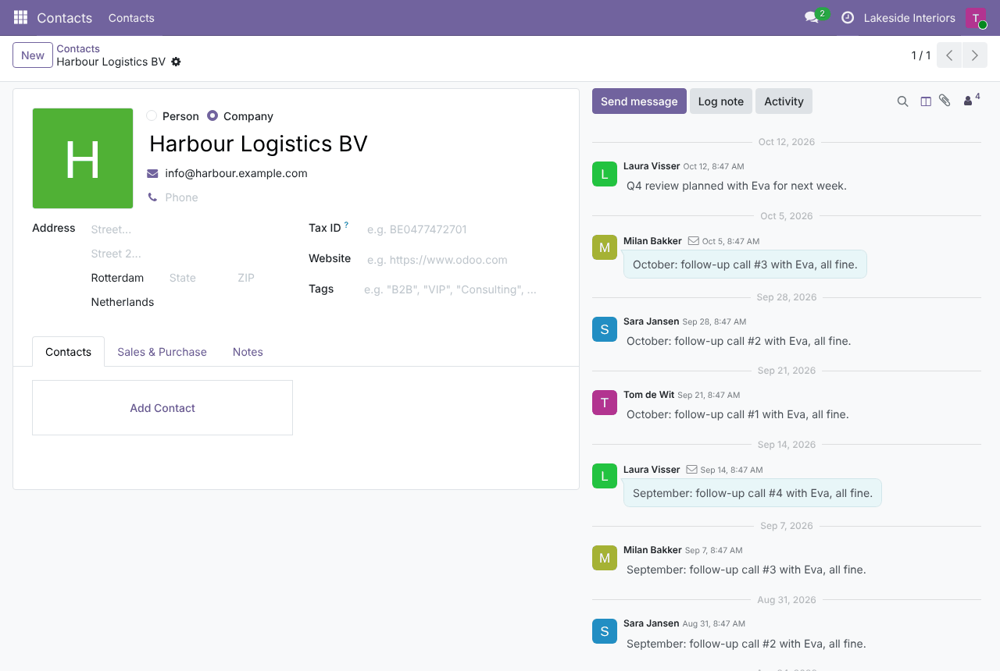
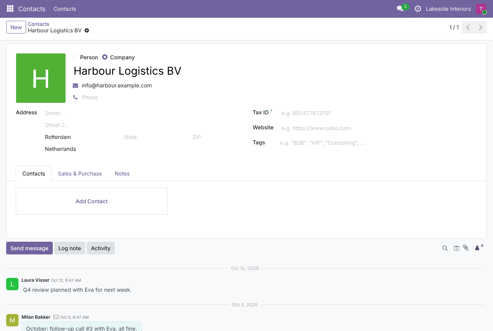
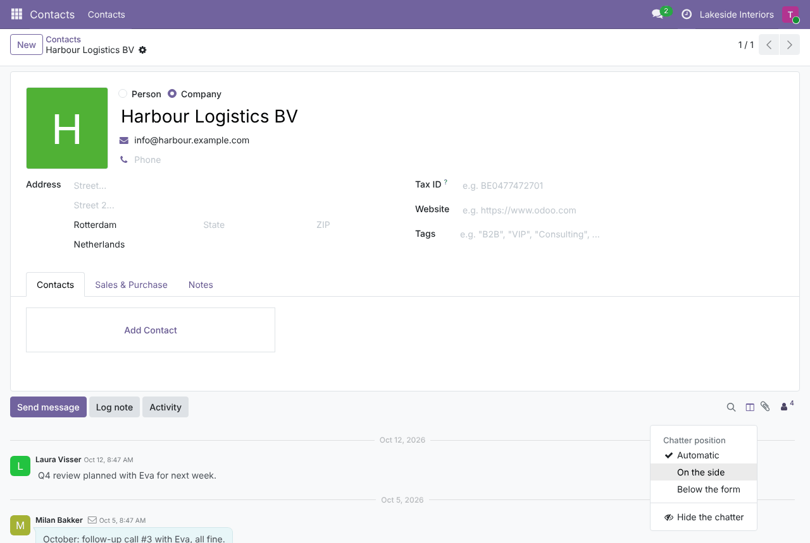
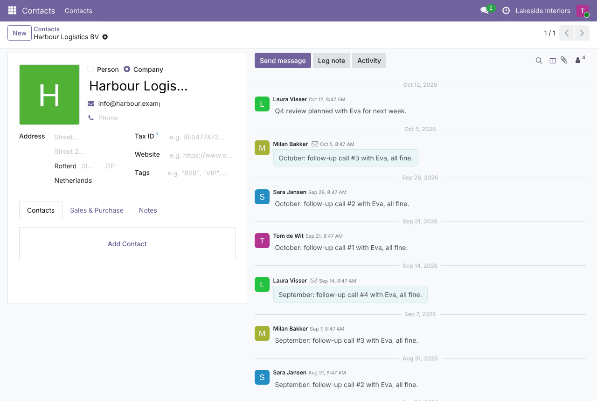
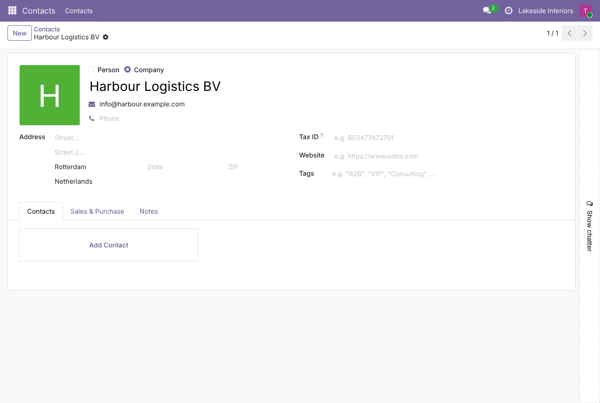
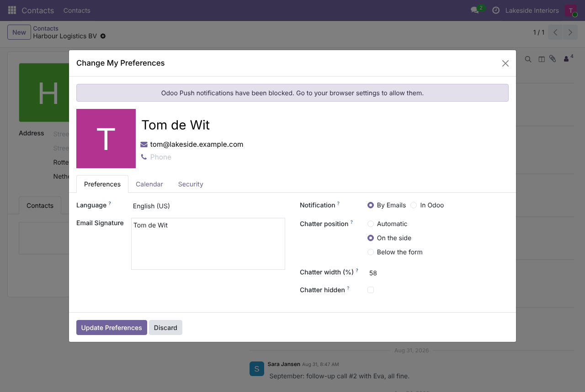
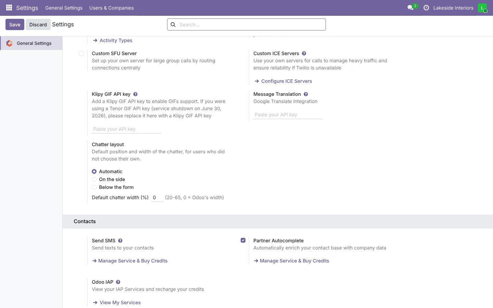

# Flexible Chatter

**Odoo 19.0** · LGPL-3 · Category: Productivity / Discuss

Put the chatter **where you want it**:
- **automatic** (Odoo's default), **on the side** (also on laptop screens) or **below the form**;
- **drag its width**;
- **fold it** when you need room for the form.

Each user's layout is remembered; the company sets the default.



## Features

- **Layout menu** in the chatter top bar (columns icon):
  - *Automatic*: on the side on extra-large screens, below the form otherwise (Odoo);
  - *On the side*: form and chatter side by side from medium-size screens (≥ 992 px);
  - *Below the form*: always below, even on wide screens;
  - *Default width* (when the width was changed);
  - *Hide the chatter*.
- **Resize**: drag the left edge of the chatter on the side (20 % – 65 % of the page).
- **Fold**: a thin *Show chatter* bar replaces the chatter (on the side or below); click it to open the chatter
  again.
- **Remembered per user** (position, width, folded) for all records; also in *My Preferences*.
- **Company default** (*Settings › General Settings › Discuss › Chatter layout*): position and width.
- Odoo's attachment preview layout is kept when a document is previewed next to the form.

## Screenshots

| | |
| --- | --- |
| **Automatic (below on this screen size)**<br> | **Layout menu**<br> |
| **On the side**<br> | **Dragged wider**<br> |
| **Folded**<br> | **My Preferences**<br> |
| **Company default**<br> | |

## Installation

Add `19.0/` of this repository to your addons path and install **Flexible Chatter**.
- **Odoo dependencies**: `mail`.
- **Python**: nothing extra.

## Configuration

- *Settings › General Settings › Discuss › Chatter layout*: default position and width (0 = Odoo's width).
- Each user: the layout menu in the chatter, the left edge of the chatter, or *My Preferences*.

## Technical overview

| Part | Role |
| --- | --- |
| `res.users` | `chatter_position`, `chatter_width`, `chatter_hidden` (self-editable), `flexible_chatter_save()` |
| `ir.http.session_info()` | Effective layout (user or company default) for the web client |
| `static/src/form_renderer_patch.js` | Maps Odoo's chatter layout (side / bottom) to the chosen position |
| `static/src/chatter_patch.*` | Layout menu, resize by dragging, folded bar |
| `static/src/flexible_chatter.scss` | Width, drag handle, folded state, side by side below the XXL breakpoint |

## Tests

```bash
tools/run_tests.sh 19.0 /path/to/odoo19 flexible_chatter
```

The tests cover:
- effective layout (user, company default), saving from the chatter with width limits, invalid position,
  preferences write and width check;
- the settings; the session info;
- a browser tour: automatic (below), on the side, fold, open again, below the form, saved for the user.

## Full guide

[docs/flexible_chatter.md](../../docs/flexible_chatter.md) · Odoo 20.0: [`20.0/flexible_chatter`](../../20.0/flexible_chatter)

---
Author: Aditya Shah · License: LGPL-3
