# Helpdesk Ticket Management

**Odoo 19.0** · LGPL-3 · Category: Services/Helpdesk

A complete **helpdesk for Odoo Community**. It covers:
- tickets, teams and stages;
- **SLA policies** on working hours;
- tickets **by e-mail** and from the **customer portal**;
- **satisfaction ratings** and **automatic assignment**;
- **checklists**, **timers**, merging, mass update and auto-close;
- a **dashboard**.

Every model uses its own `support.*` name, so the module can be installed next to the Enterprise Helpdesk app
without conflict.


## Features

**Tickets**
- Reference (`TCK00001`), subject, description, customer (name, e-mail, phone), team, assignee, **other assignees**,
  priority (low → urgent), type, category, sub-category, tags, source (e-mail, portal, phone, internal).
- Kanban by stage (priority bar, SLA badge, checklist progress, running timer), list, calendar, pivot, graph and
  activity views.
- Many filters: *My tickets, Unassigned, Urgent, SLA failed, Customer answered, Waiting on customer, Running
  timers*, plus group-bys.
- **Stage history** through the tracking-duration statusbar, and a **Resolution** tab (closed on/by, last replies).
- Smart buttons on the contact form (tickets) and on tickets (SLA, hours).
- **PDF ticket** report.

**Teams and stages**
- Teams have:
  - a leader and members;
  - a default team per company;
  - an **e-mail alias** (`support@…` creates tickets in that team);
  - working hours;
  - auto-close after N days without an answer from the customer;
  - ratings on/off.
- **Assignment:** manual, **balanced** (the member with the fewest open tickets) or **round robin**.
- Stages can be shared or per team, and can be closing or folded.
- Each stage has a **colour** (used on the dashboard) and an **e-mail template**. *New* sends the acknowledgement;
  *Solved* sends the resolution with **rating links**.

**SLA policies**
- Defined per team, minimum priority, ticket types, tags and customers (a company covers its contacts).
- Target: reach a stage within N **working hours** of the team calendar, public holidays included.
- Each ticket gets one status per policy: **ongoing / reached / failed**, with the deadline and how late it was.
  Moving to the target stage, a later one, or closing reaches it. A job marks overdue statuses as failed, and a
  status reached late stays failed.
- **SLA Analysis** report (pivot/graph per policy, team, agent).

**E-mail and replies**
- Incoming e-mails create tickets; unknown senders become contacts. Replies are threaded on the ticket.
- **Who answered last**: customer or support, with dates.
  - When support answers, the ticket moves to *Waiting on Customer*.
  - When the customer answers, it moves back to *In Progress*.
  - Both stages are configurable. Closed tickets are not moved.
- **Auto-close**: tickets waiting on the customer for N days are closed with a note.

**Customer portal**
- *My Account › Support Tickets*: list with search, filters (open, closed, all) and sorting.
- The ticket page has the description, the resolution, a **conversation** (portal chatter) and a **PDF download**.
- **New ticket** form: team, type, category, priority, description and attachments, with a size limit. It can be
  switched off.
- Portal users see the tickets of their company. Access tokens work for shared links.

**Ratings**: smiley links in the *Solved* e-mail; ratings appear on the ticket and in *Reporting › Customer
Ratings*, and on the dashboard.

**Productivity**
- **Checklists**: templates loaded automatically per ticket type or on demand, with done by/when and progress.
- **Timers**:
  - start / stop on the ticket, and **several agents at once**;
  - optionally, several tickets per agent;
  - timers stop by themselves when the ticket is closed;
  - manual time entries and a *Time Spent* report.
- **Merge tickets**: conversation, attachments, followers, checklist and time move to the kept ticket, and the
  others are closed and archived. You are warned when the tickets belong to different customers.
- **Mass update**: team, assignee, stage, priority, type, tags (add / remove) and followers.
- **WhatsApp**: prepares a message with the portal link, opens WhatsApp, and logs the message on the ticket.

**Dashboard** (`/odoo/helpdesk-dashboard`)
- Counters: open, unassigned, urgent, SLA failed, SLA due in 24 h, closed today, satisfaction. Each counter
  opens the matching tickets.
- Breakdowns: open tickets by stage (in the stage colours), priority, team and agent.
- The next SLA deadlines.
- New tickets per day over the last 14 days.
- Scopes: *My tickets, My teams, All*, plus a team filter.

**Access**
- **User**: tickets of their teams, assigned to them, followed, or without team.
- **Team Leader**: plus the teams they lead, and reporting.
- **Administrator**: everything and the configuration.
- Multi-company rules.

## Screenshots

| | |
| --- | --- |
| **Tickets kanban**<br>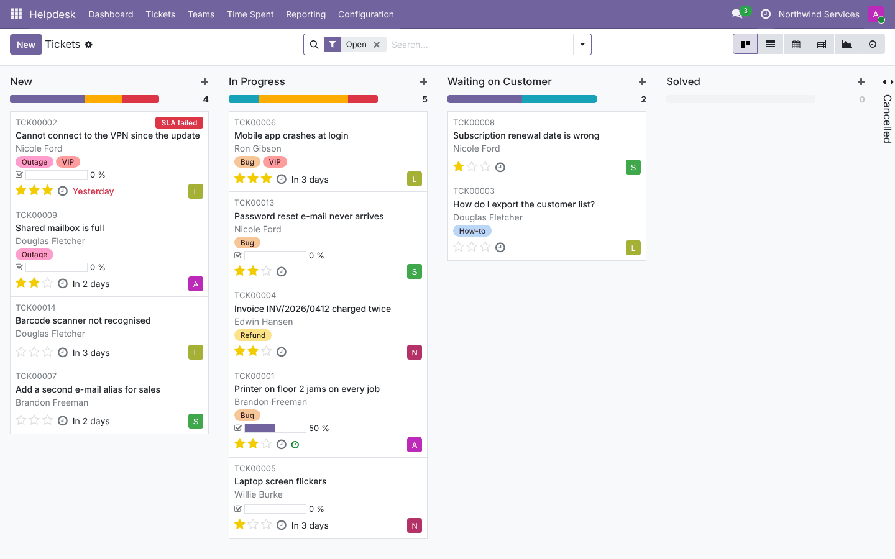 | **Tickets list**<br>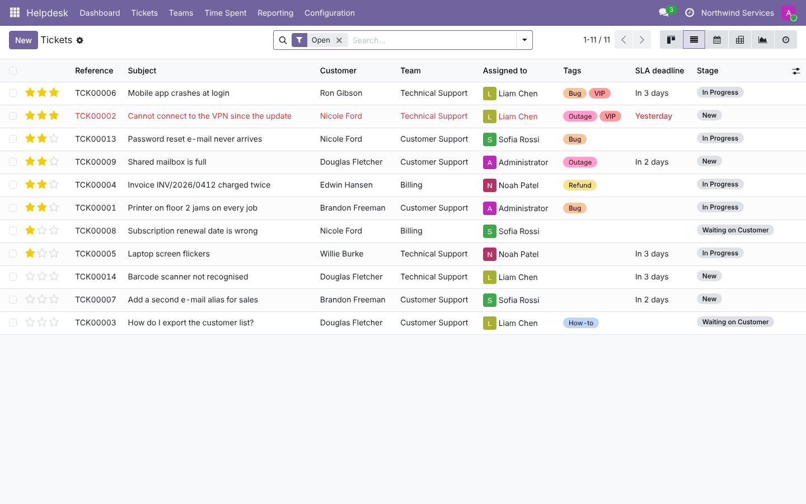 |
| **Ticket with conversation and running timer**<br> | **Checklist**<br>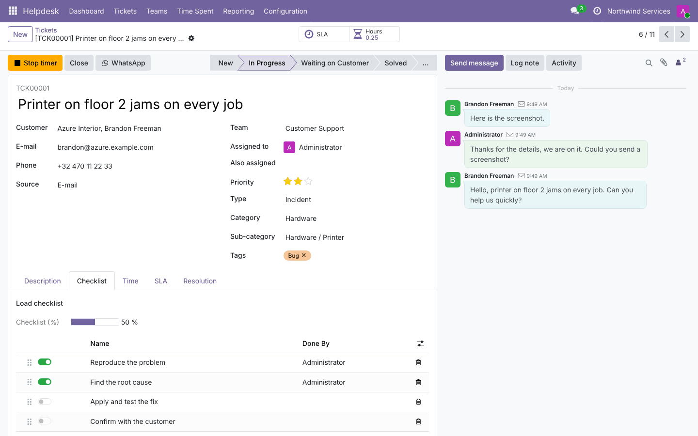 |
| **SLA statuses of a ticket**<br>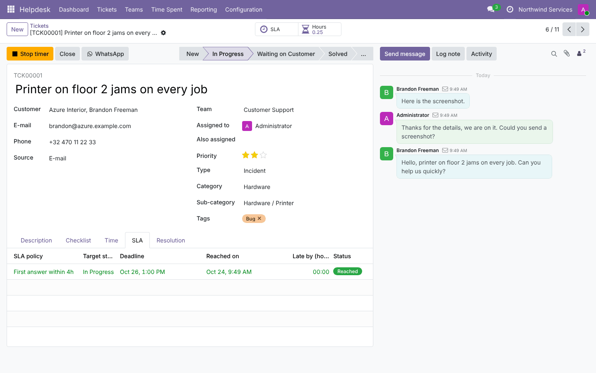 | **Teams overview**<br>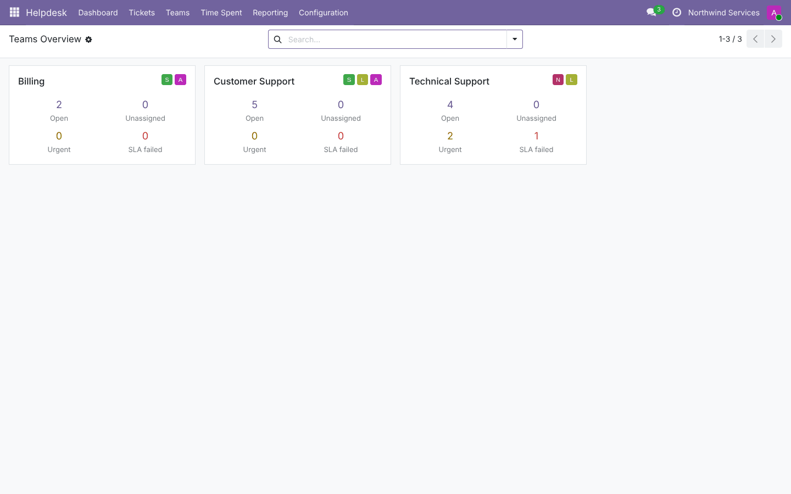 |
| **Team: assignment, alias, working hours**<br>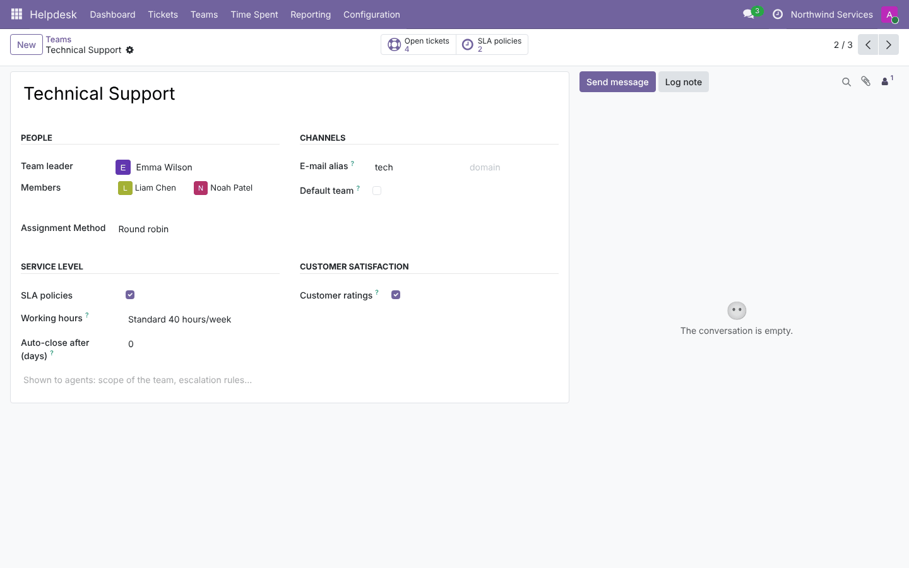 | **SLA policies**<br>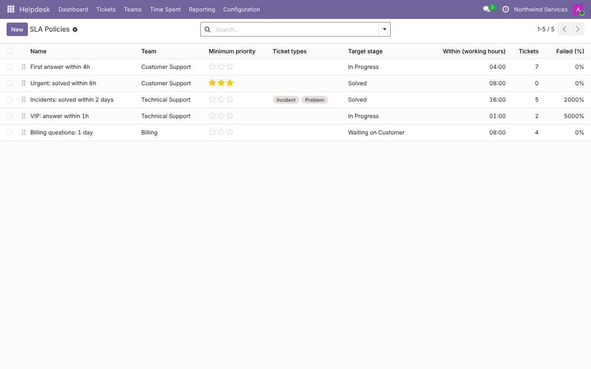 |
| **SLA analysis**<br>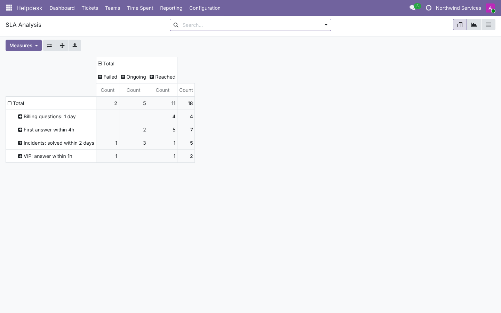 | **Customer ratings**<br>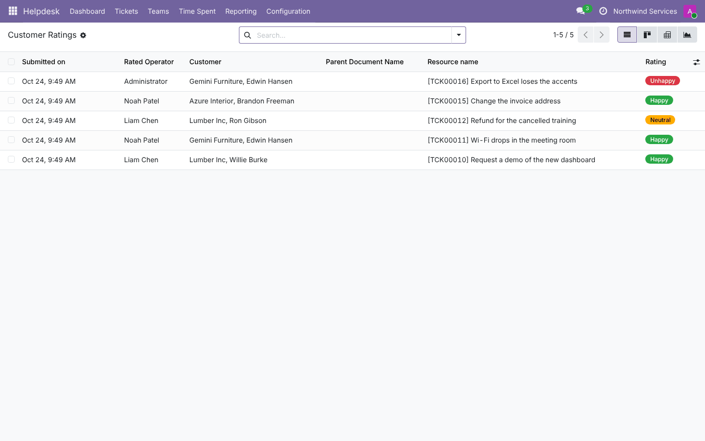 |
| **Merge tickets**<br>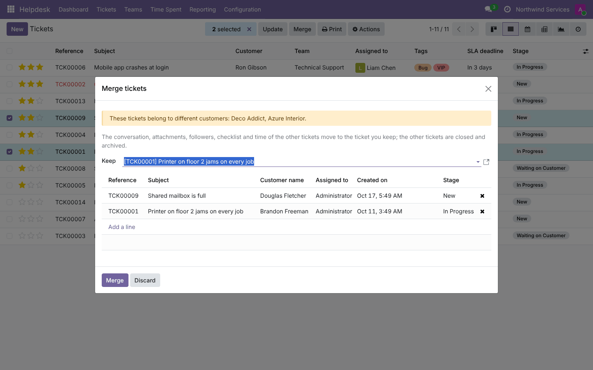 | **Mass update**<br>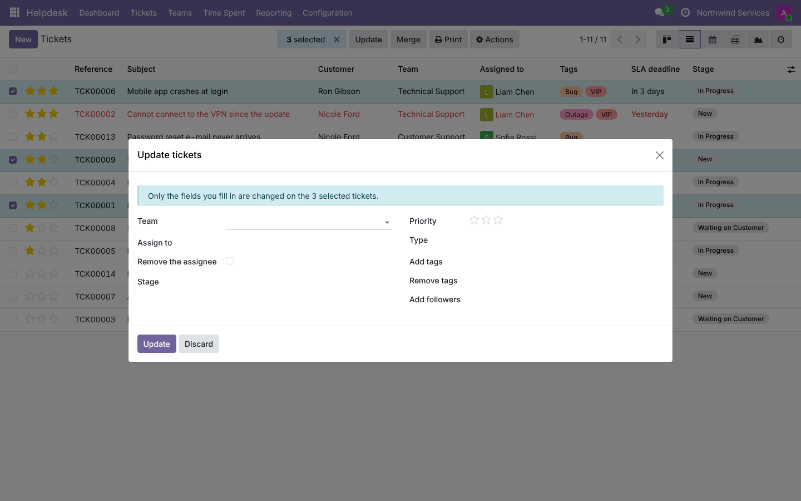 |
| **Send by WhatsApp**<br>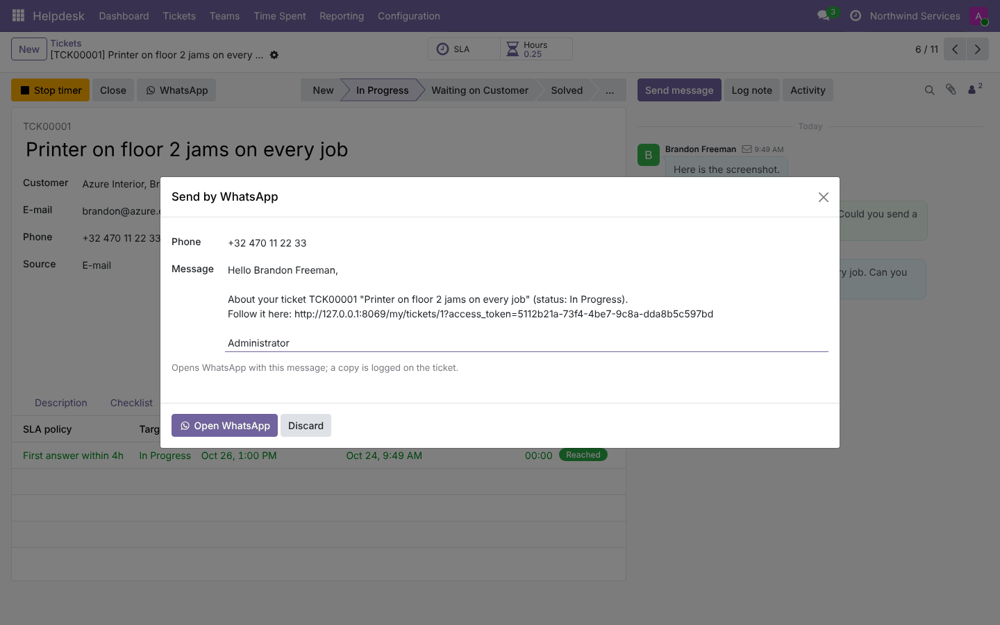 | **Settings**<br>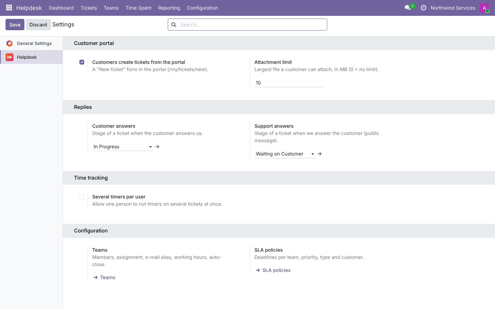 |
| **Portal: my tickets**<br>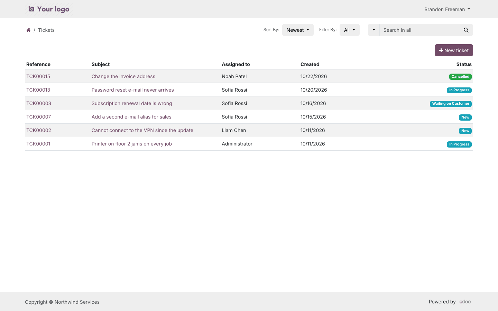 | **Portal: ticket and conversation**<br> |
| **Portal: new ticket**<br>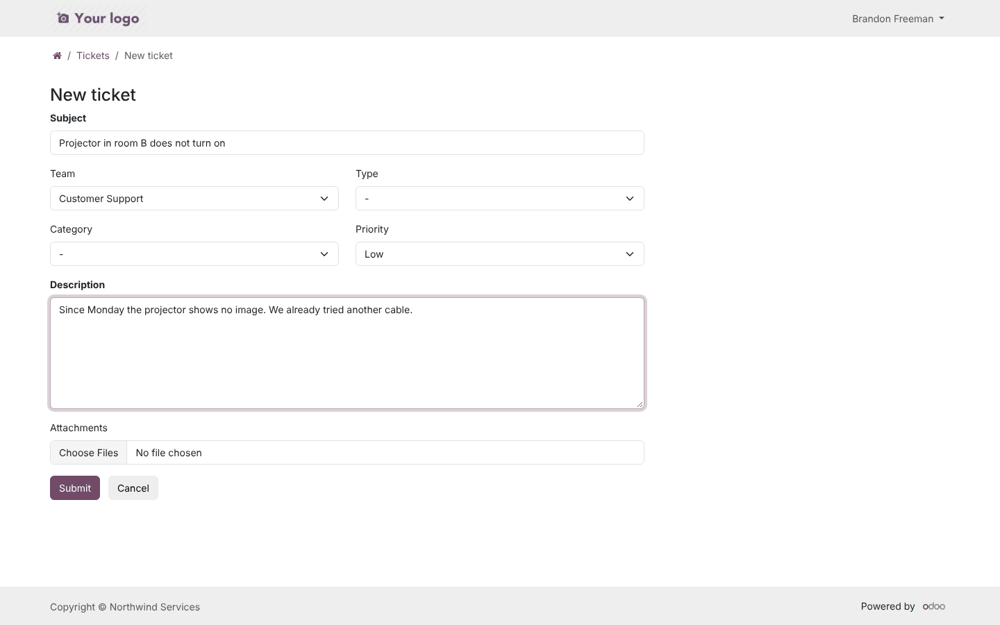 | |

## Installation

Add `19.0/` of this repository to your addons path and install **Helpdesk Ticket Management**. It depends on
`mail`, `portal`, `rating`, `resource` and `base_setup`, with no extra Python package.

## Configuration

1. **Helpdesk › Configuration › Teams:**
   - members and leader;
   - assignment method;
   - e-mail alias (needs an alias domain: *Settings › General › Alias domain*);
   - working hours;
   - auto-close.
2. **Stages**: order, closing stages, templates, colours.
3. **SLA Policies**, **Ticket Types**, **Categories**, **Tags**, **Checklists**.
4. **Settings:**
   - portal ticket creation and attachment limit;
   - stages after a customer or support reply;
   - several timers per user.
5. Give people the **Helpdesk** access (User / Team Leader / Administrator). For customers, grant portal access
   from the contact (*Action › Grant portal access*).

## Technical overview

| Part | Role |
| --- | --- |
| `support.ticket` | Ticket (`portal.mixin`, `mail.thread.cc`, `rating.mixin`, `mail.activity.mixin`, tracking duration); assignment, SLA, replies, timers, checklist, mail gateway, crons, dashboard data |
| `support.team` | Teams, mail alias (`mail.alias.mixin`), assignment, counters |
| `support.stage`, `support.ticket.type`, `support.category`, `support.tag` | Configuration |
| `support.sla`, `support.ticket.sla` | Policies and per-ticket statuses (deadline on `resource.calendar.plan_hours`) |
| `support.checklist.template(.line)`, `support.ticket.checklist` | Checklists |
| `support.time.entry` | Timers and manual time |
| `wizard/` | Merge, mass update, WhatsApp |
| `controllers/portal.py` + `views/portal_templates.xml` | Portal list, page, new-ticket form, PDF |
| `static/src/dashboard/` | OWL client action |

## Tests

```bash
tools/run_tests.sh 19.0 /path/to/odoo19 helpdesk_ticket_management
```

There are 28 tests:
- defaults and sequence, assignment methods, team stages, closing and reopening;
- checklists, multi-user timers, partner counts, dashboard counters (with the KPI domains checked);
- WhatsApp;
- SLA: working-hour deadlines (weekend skipped, 24/7 without a calendar), matching by priority, type, tag and
  customer, reach, fail, late;
- mail: alias, gateway creation and threaded replies, reply tracking and stage moves, closed tickets, stage
  e-mails with rating links and applying a rating, auto-close;
- merge and mass update;
- record rules for users, leaders and portal users;
- portal pages: list, detail, access token, new ticket with attachment, size limit, switch-off;
- two browser tours (dashboard → ticket → assign → timer, and portal ticket creation).

## Full guide

[docs/helpdesk_ticket_management.md](../../docs/helpdesk_ticket_management.md)

---
Author: Aditya Shah · License: LGPL-3
