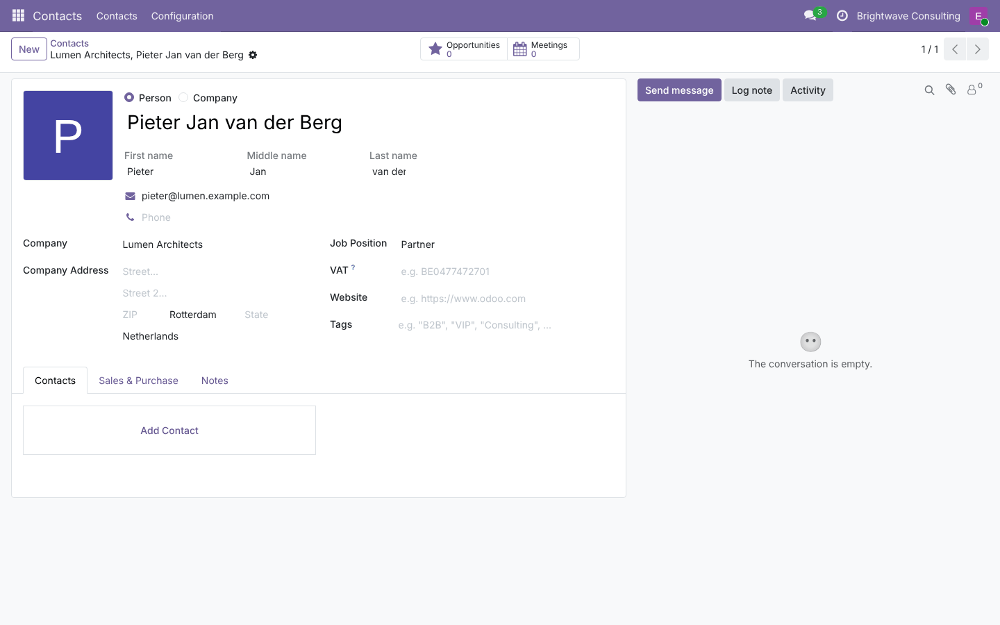
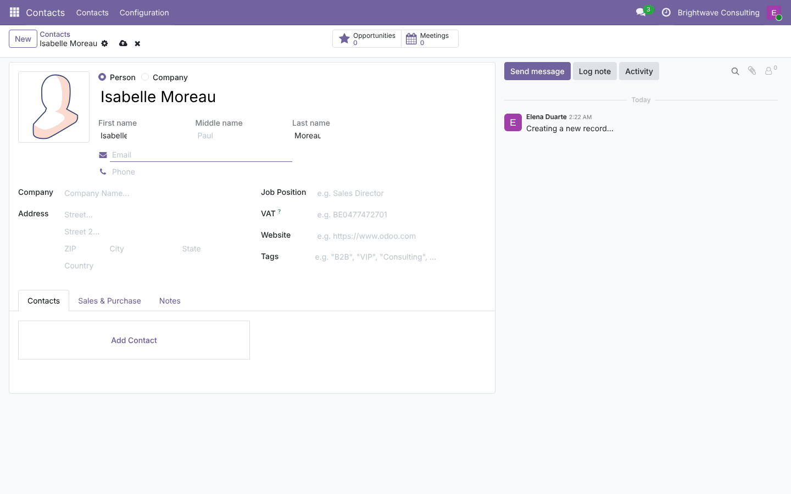
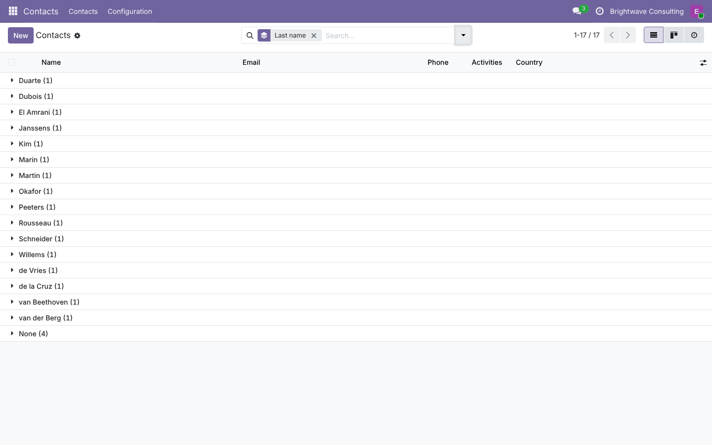
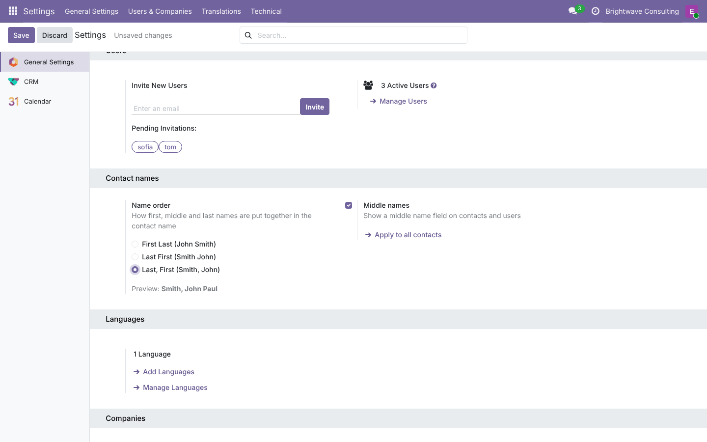
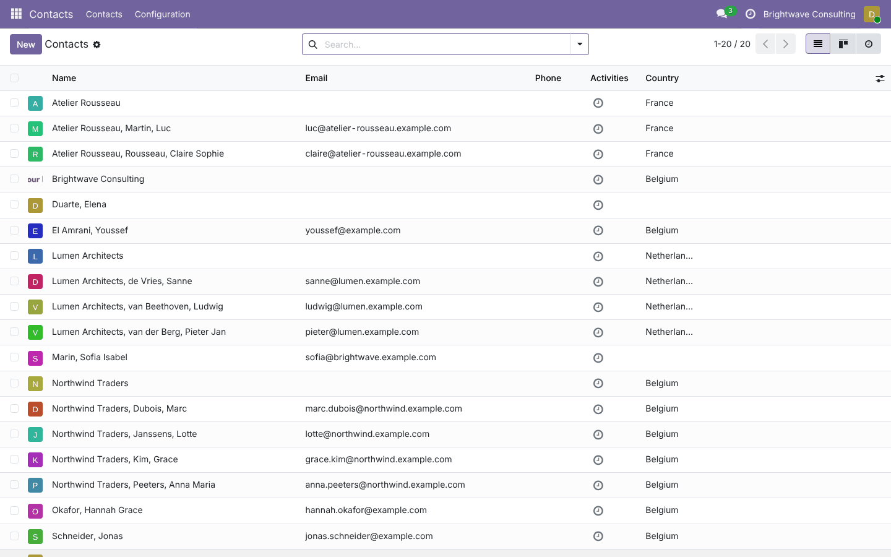
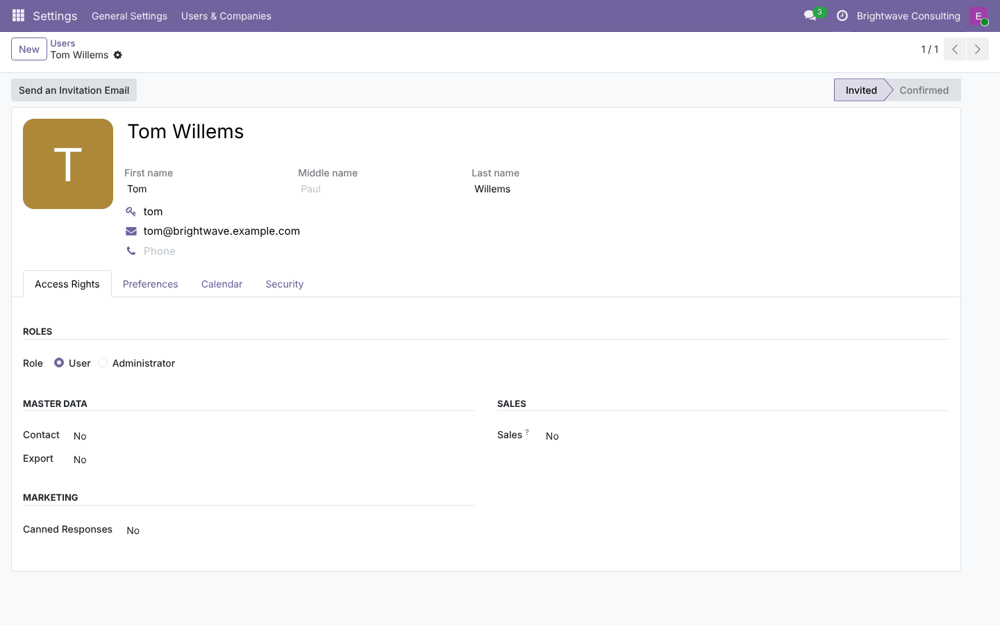
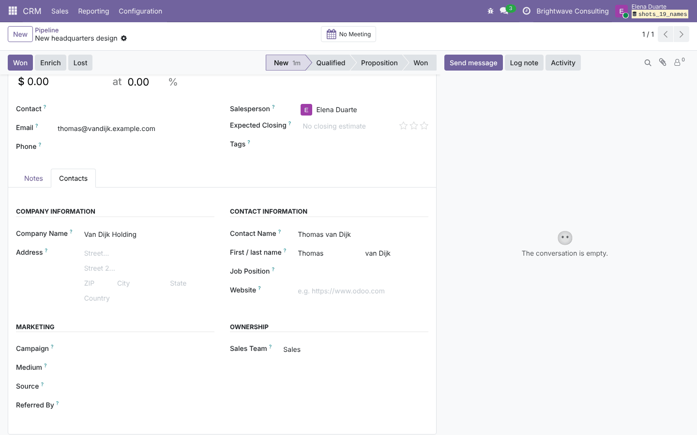
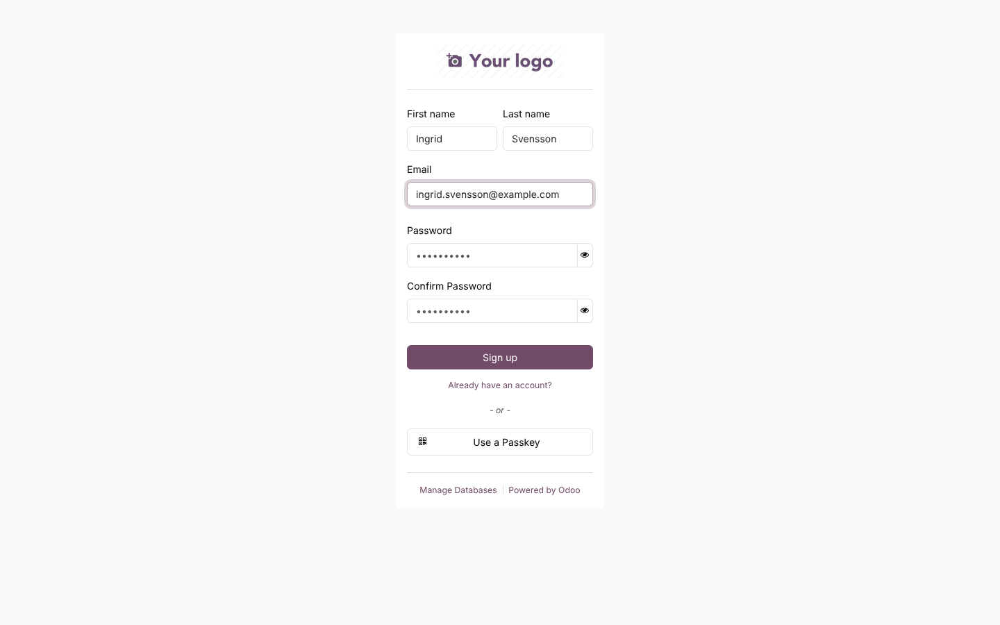

# Contact First, Middle and Last Name

**Odoo 19.0** · LGPL-3 · Category: Sales / CRM

**Separate first, middle and last name for people** in Contacts, Users, CRM leads and the sign-up form. The
usual *Name* field stays and is built from the parts in the order you choose:
- *John Smith*;
- *Smith John*;
- *Smith, John*.

Names typed or imported as one text are split automatically, and particles stay with the last name
(*Ludwig **van Beethoven***, *Maria **de la Cruz***).



## Features

- **Contacts**: *First name*, *Middle name* (optional) and *Last name* under the name of people.
  - Typing the parts fills the name.
  - Typing a full name fills the parts.
  - Companies keep a plain name.
- **Name order** (*Settings › General Settings › Contact names*): *First Last*, *Last First* or *Last, First*,
  with a live preview. **Apply to all contacts** rewrites every person's name in the new order (names that
  were never split are first split in the old order).
- **Middle names** on/off.
- **Automatic splitting** of names coming from imports, quick create, e-mail gateway or other apps:
  - several first names: *Jean Paul Sartre* → *Jean Paul* / *Sartre*, or *Jean* / *Paul* / *Sartre* with middle
    names on;
  - particles kept with the last name: van, von, de, der, da, di, du, del, la, le, ter, el, al, bin, …;
  - *Last, First* typed with a comma is understood in any order setting.
- **Contacts list and search**:
  - optional *First name* / *Last name* columns;
  - search on first or last name;
  - *Group by › Last name*;
  - *Missing first or last name* filter;
  - *Split names* in the *Action* menu to split selected contacts again.
- **Users**: the same fields on the user form; users are allowed to change their own name parts.
- **CRM**: *First / last name* of the lead's contact; the contact created when converting a lead gets them.
- **Sign-up** (portal / website): *First name* and *Last name* fields instead of a single *Name* field.
- **Installation**: the names of existing people are split once.

## Screenshots

| | |
| --- | --- |
| **Contact**<br> | **New contact: the name is built from the parts**<br> |
| **Contacts grouped by last name**<br> | **Settings: order, preview, middle names**<br> |
| **After "Apply to all contacts" with "Last, First"**<br> | **User form**<br> |
| **CRM: contact first / last name**<br> | **Sign-up form**<br> |

## Installation

Add `19.0/` of this repository to your addons path and install **Contact First, Middle and Last Name**.
- **Odoo dependencies**: `contacts`, `crm`, `auth_signup`.
- **Python**: nothing extra.

## Configuration

*Settings › General Settings › Contact names*:
- choose the **name order** and turn **middle names** on or off;
- click **Apply to all contacts** to rewrite existing names in that order.

## People and companies

Odoo 19 has a *Person / Company* switch: only persons get name parts.

## Technical overview

| Part | Role |
| --- | --- |
| `models/name_tools.py` | `split_name()` / `join_name()`: pure Python, with particles and the three orders |
| `res.partner` | `first_name`, `middle_name`, `last_name`; name ⇄ parts in `create` / `write` and onchanges; mass actions |
| `res.users` | Creation from the parts; parts editable by the user |
| `crm.lead` | `contact_first_name`, `contact_last_name`; values given to the new contact |
| `res.config.settings` | Order, middle names, preview, *Apply to all contacts* |
| `controllers/main.py` | Sign-up: first / last name in, name and parts out |

## Tests

```bash
tools/run_tests.sh 19.0 /path/to/odoo19 partner_first_last_name
```

The tests cover:
- splitting and joining (particles, commas, middle names, one-word names, spaces);
- create / write in both directions and several records at once;
- the three orders and middle names;
- *Apply to all contacts* and the *Split names* action;
- form onchanges;
- users (creation and self-edit);
- CRM leads and lead conversion;
- the installation hook;
- a browser tour of the sign-up form.

## Full guide

[docs/partner_first_last_name.md](../../docs/partner_first_last_name.md) · Odoo 20.0: [`20.0/partner_first_last_name`](../../20.0/partner_first_last_name)

---
Author: Aditya Shah · License: LGPL-3
