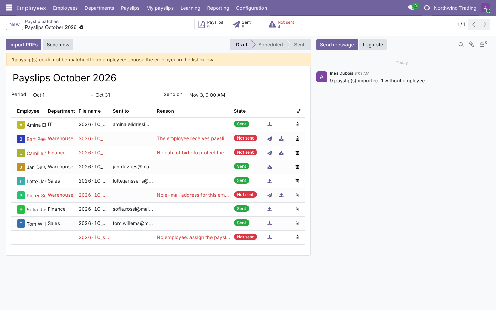
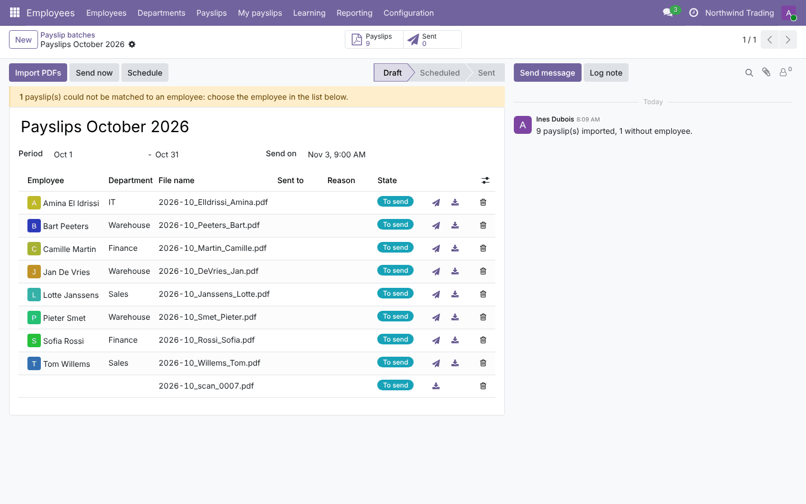
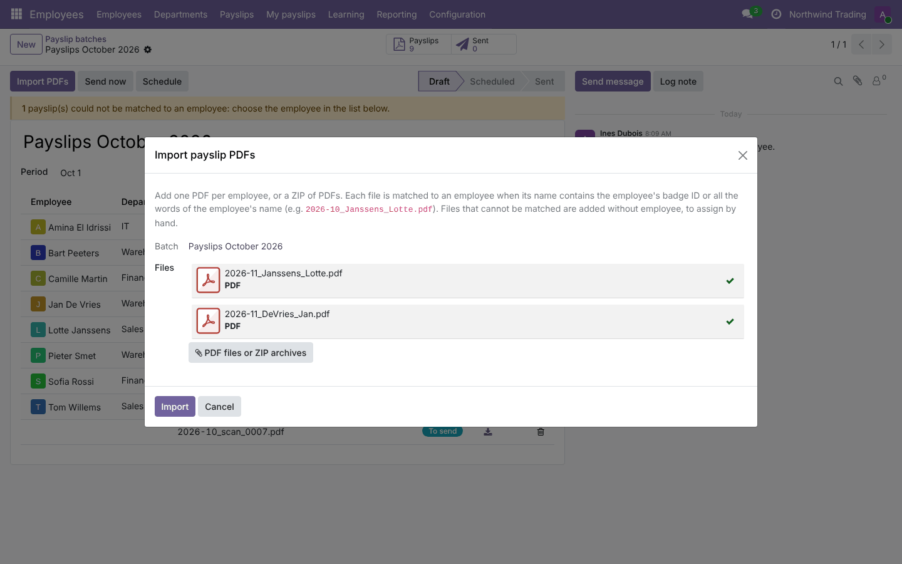
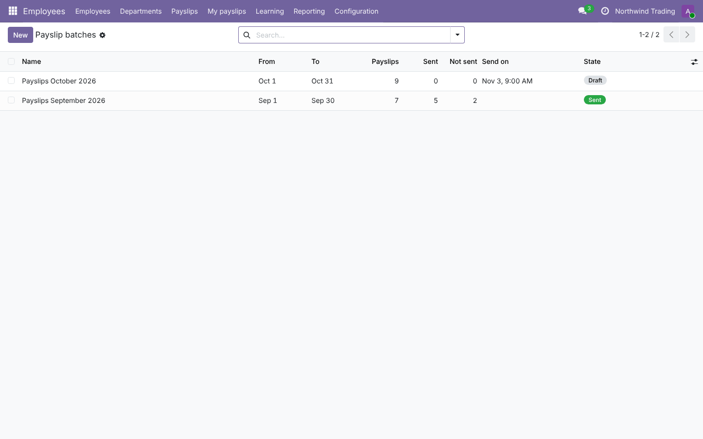
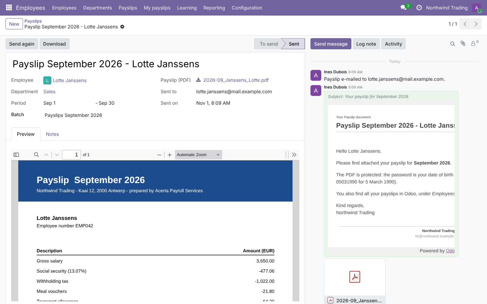
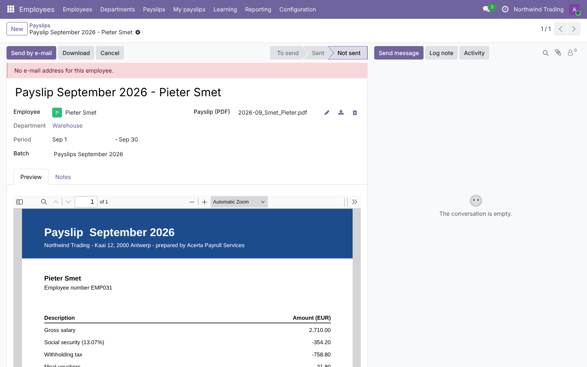
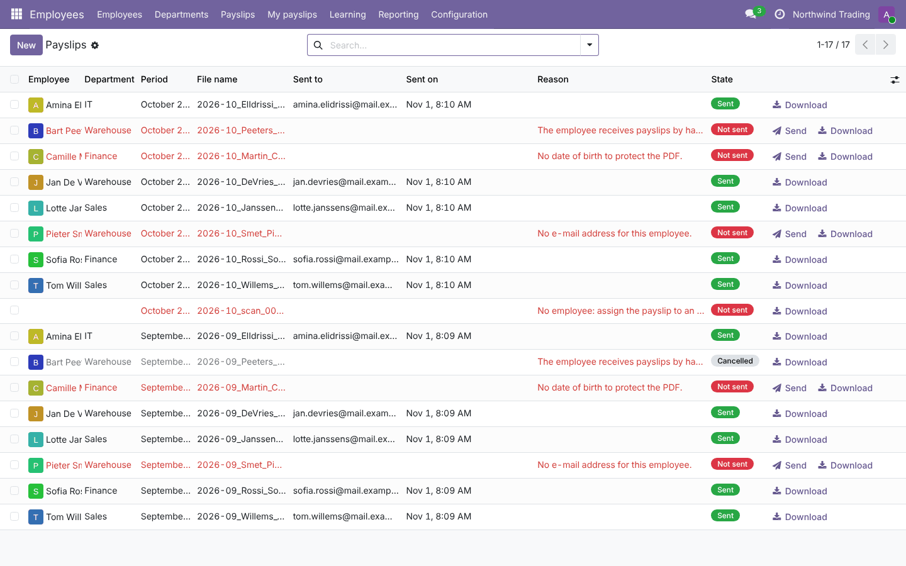
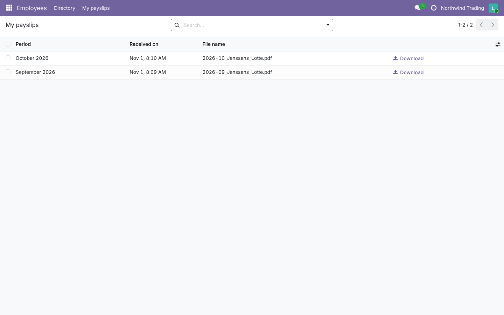
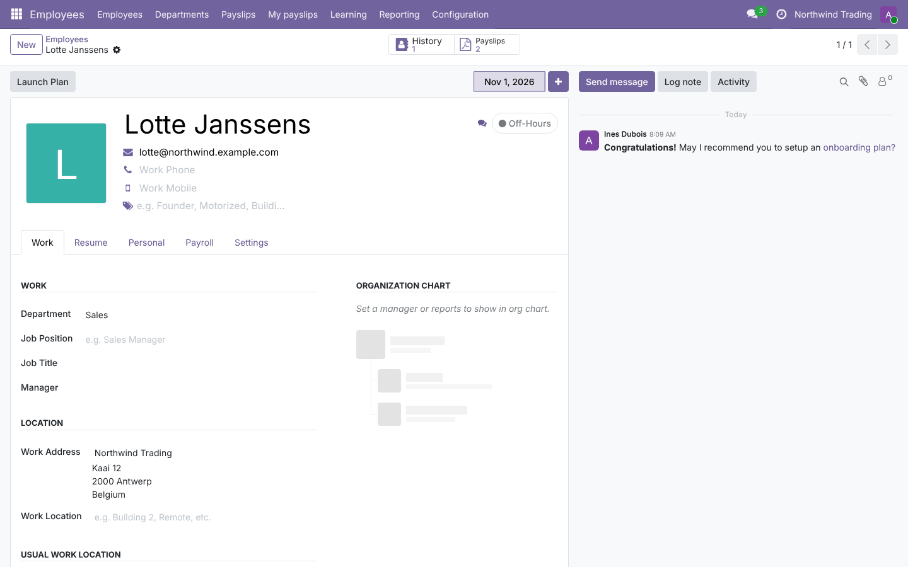
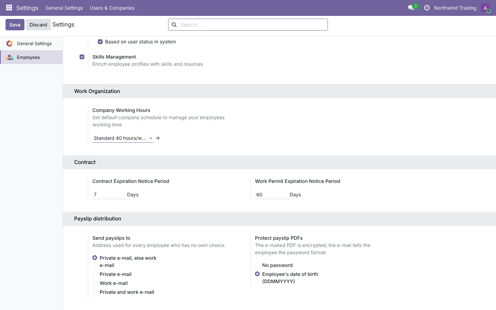

# Payslip Distribution by E-mail

**Odoo 19.0** · LGPL-3 · Category: Human Resources

Odoo Community has no payroll: payslips usually come as PDFs from a payroll provider or accountant. This module
**distributes those PDFs**:
- import a month of payslips (PDFs or a ZIP);
- match each file to its employee;
- **e-mail** them, optionally **password-protected**, now or at a scheduled time;
- employees find their payslips in Odoo under **My payslips**.



## Features

- **Batches** per period (*Payslips October 2026*): *Draft* → *Scheduled* → *Sent*, with counters (payslips,
  sent, not sent) and a warning for files without employee.
- **Import PDFs** (one per employee, or ZIP archives of PDFs). A file is matched to an employee when its name
  contains:
  - the employee's **badge ID** (`EMP042.pdf`), or
  - all words of the employee's name, in any order, accents ignored (`2026-10_Janssens_Lotte.pdf`), or glued
    (`DeVries_Jan.pdf`).
  Unclear files (no match, several matches, a second file for the same person) are imported without employee to
  assign by hand.
- **Send now** or **Schedule** (a scheduled action sends at the chosen date and time).
- **E-mail** with the PDF attached, sent only to the employee (no followers):
  - company setting: private e-mail else work e-mail, private only, work only, or both;
  - per employee: same choices, or **do not e-mail** (hand delivered);
  - **PDF password** (optional): the employee's date of birth (DDMMYYYY); the e-mail explains it. The PDF kept in
    Odoo stays readable for HR.
- **Not sent** payslips show the reason (no e-mail, no date of birth, no employee, hand delivered); fix and send
  again. *Send again* for sent ones; *Send by e-mail* on a selection in the list.
- **Payslip form** with PDF preview, chatter log of what was sent to whom.
- **My payslips** for every employee with a user: their sent payslips, with download (and only theirs).
- **Payslips** smart button on the employee; *Payslips by e-mail* choice on the employee (private information).
- Role **Payslip distribution: Officer**.

## Screenshots

| | |
| --- | --- |
| **Batch ready to send**<br> | **Import PDFs**<br> |
| **Batch after sending**<br> | **Batches**<br> |
| **Payslip sent (PDF preview, e-mail log)**<br> | **Payslip not sent, with the reason**<br> |
| **All payslips**<br> | **My payslips (employee)**<br> |
| **Employee**<br> | **Settings**<br> |

## Installation

Add `19.0/` of this repository to your addons path and install **Payslip Distribution by E-mail**.
- **Odoo dependencies**: `hr`, `mail`.
- **Python**: `pypdf` (already required by Odoo) for the password protection.

## Configuration

1. *Settings › Users*: give HR the **Payslip distribution: Officer** role.
2. *Settings › Employees › Payslip distribution*: where to send, PDF password.
3. Employees: private / work e-mail, date of birth (for the password), badge ID (for matching); *Payslips by
   e-mail* for exceptions.
4. Outgoing mail server configured.

## Technical overview

| Part | Role |
| --- | --- |
| `hr.payslip.document` | One payslip PDF: employee, period, state, matching, protected PDF, sending |
| `hr.payslip.document.batch` | Period batch: import, send now, schedule, counters, scheduled action |
| `hr.payslip.import.wizard` | PDFs / ZIP upload and matching |
| `hr.employee` | Payslip e-mail choice, addresses, smart button |
| `res.company` / settings | Default addresses, PDF password |
| Security | Officers: everything; employees: read their own sent payslips |

Model names do not clash with Odoo Enterprise payroll (`hr.payslip`).

## Tests

```bash
tools/run_tests.sh 19.0 /path/to/odoo19 payslip_send_email
```

The tests cover:
- names and period labels;
- file name matching (badge, word order, accents, glued words, ambiguous names);
- the import wizard with PDFs and a ZIP, unmatched and duplicate files;
- recipients for every mode and employee choice;
- sending: e-mail, attachment, reasons for not sent, batch done;
- password protection (encrypted attachment opens with the date of birth, stored PDF unchanged);
- scheduling and the scheduled action;
- employee access (own sent payslips only, read-only, no batches).

## Full guide

[docs/payslip_send_email.md](../../docs/payslip_send_email.md) · Odoo 20.0: [`20.0/payslip_send_email`](../../20.0/payslip_send_email)

---
Author: Aditya Shah · License: LGPL-3
