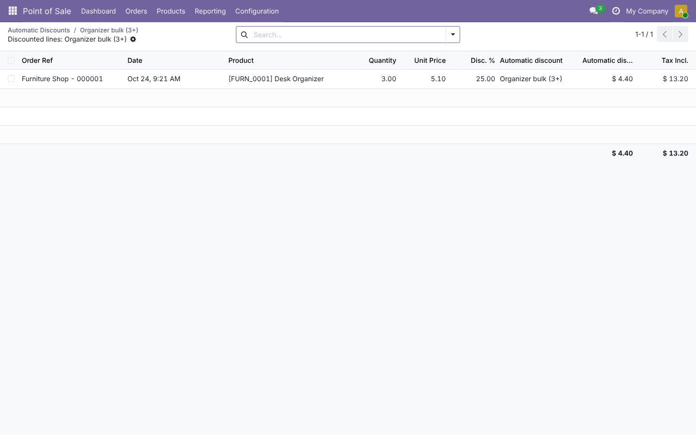
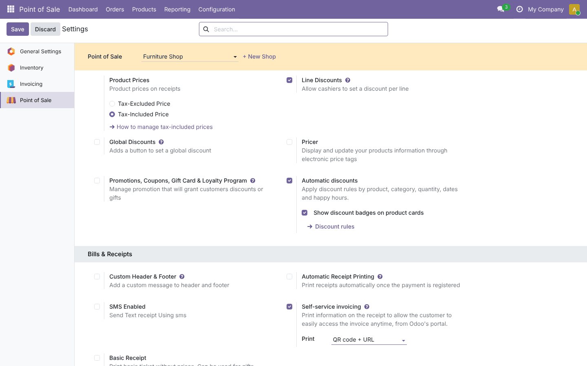

# POS Product Auto Discount

**Odoo 19.0** · LGPL-3 · Category: Point of Sale

**Automatic discounts** in the Point of Sale. You define rules once in the backend, and the register applies them
by itself:
- on chosen products or POS categories;
- from a minimum quantity;
- between two dates;
- during happy hours.

Cashiers see the discount on the product cards, on each order line and on the receipt. Managers see how much
each rule gave away.


## Features

- **Rules** with:
  - a discount %;
  - what they apply to: *products*, *POS categories* (sub-categories included) or *all products*;
  - a **minimum quantity** on the line;
  - **start/end dates**;
  - a **happy hour** window, which can cross midnight, for example 22:00 → 02:00;
  - the points of sale where they apply (empty means all).
- **Automatic in the register**: the discount is set when a product is added and checked again whenever the
  quantity changes. For example, 10% from 1 unit becomes 25% from 3 units. When several rules match, the
  highest discount wins.
- **The cashier stays in control**: a discount changed by hand on a line is kept and never overwritten.
  Refunds, combo items and reward lines are not touched.
- **Visible saving**:
  - a **-15%** badge on product cards (optional);
  - the rule name on the order line and on the receipt, next to Odoo's "x% discount off on <original price>".
- **Status** of each rule: *Running*, *Scheduled* or *Expired*.
- **Report**: each order line remembers its rule. The rule shows the number of lines and the **amount given**
  (tax included), and opens the list of discounted lines.

## Screenshots

| | |
| --- | --- |
| **Rules with status**<br> | **Rule with lines and amount given**<br> |
| **Receipt with rule names and total discounts**<br> | **Discounted lines of a rule**<br> |



## Installation

1. Add `19.0/` of this repository to your addons path.
2. Install **POS Product Auto Discount** (it depends on `point_of_sale` only).

## Configuration

1. **Point of Sale › Configuration › Settings**, choose the shop, then **Pricing › Automatic discounts**.
   Optionally keep **Show discount badges on product cards** ticked.
2. **Discount rules** (also under **Point of Sale › Products › Automatic Discounts**) › **New**:
   - name and discount %;
   - *Applies on* products, POS categories or all products;
   - optional minimum quantity, dates, happy hour and points of sale.
3. Reload the register, or close and reopen the session, to load new or changed rules.

## Usage

- Add products as usual: matching lines get their discount and show the rule name.
- Add more units and the discount follows the quantity tiers.
- To give a different discount, use the numpad **%** key. The line keeps the cashier's value.
- The receipt shows the original price, the discount and the rule name, plus Odoo's *Discounts* total.

## Technical overview

| Part | Role |
| --- | --- |
| `pos.auto.discount` | The rule: discount, target (products / categories / all), min qty, dates, hours, POS, company. It also computes the status and the stats |
| `pos.config` | `auto_discount_enabled` and `auto_discount_badge`. Sends the rules the register may use (this POS or all, same company, not expired) in the config data as `_pos_auto_discounts` |
| `pos.order.line` | `auto_discount_ref`, an integer set by the register. From it the line stores the `auto_discount_id` rule and the `auto_discount_amount` saved |
| `auto_discount.js` | `bestRule`, `inHours` and `ruleMatchesProduct`. Patches order lines (apply on quantity change, keep manual discounts, merge with auto-discounted lines) and `addLineToCurrentOrder` |
| `product_card_patch.js` + `auto_discount.xml` | Badge on product cards; rule name on order lines and the receipt |

Access: POS users can read rules; POS managers can manage them.

## Tests

```bash
tools/run_tests.sh 19.0 /path/to/odoo19 pos_product_auto_discount
```

**Python tests** cover:
- the rules sent to each register: other shop, expired and disabled rules are left out;
- the status;
- the constraints: discount range, negative quantity, missing products or categories, dates, hours;
- the settings button.

The **browser tour** runs these checks in a real register:
- the rule logic, including happy hours across midnight, parent categories, quantity tiers and start dates;
- the -10% badge, and no badge for an expired rule;
- 10% then 25% at 3 units, with the rule name;
- a product with no rule;
- a manual 5% that is kept when the quantity changes;
- paying the order.

The test then checks the saved lines, the rule, the amount given and the report.

## Full guide

[docs/pos_product_auto_discount.md](../../docs/pos_product_auto_discount.md)

---
Author: Aditya Shah · License: LGPL-3
