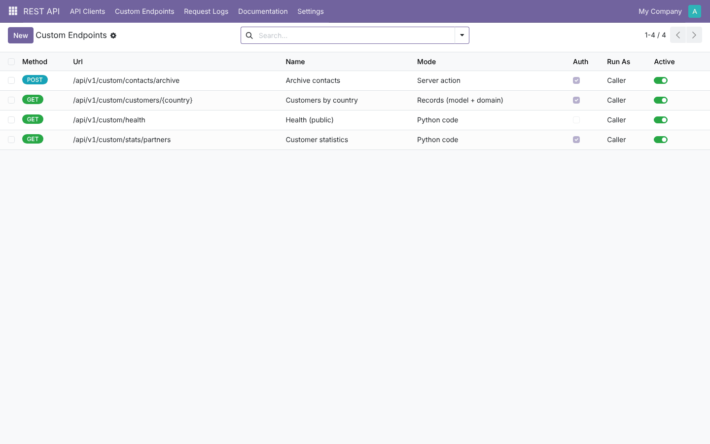
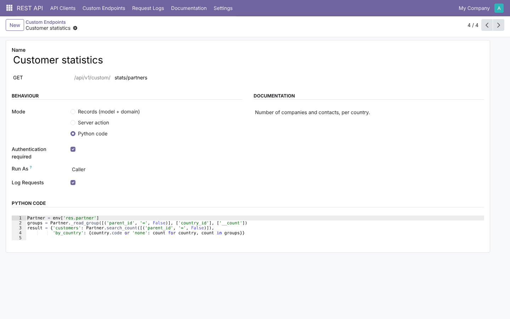
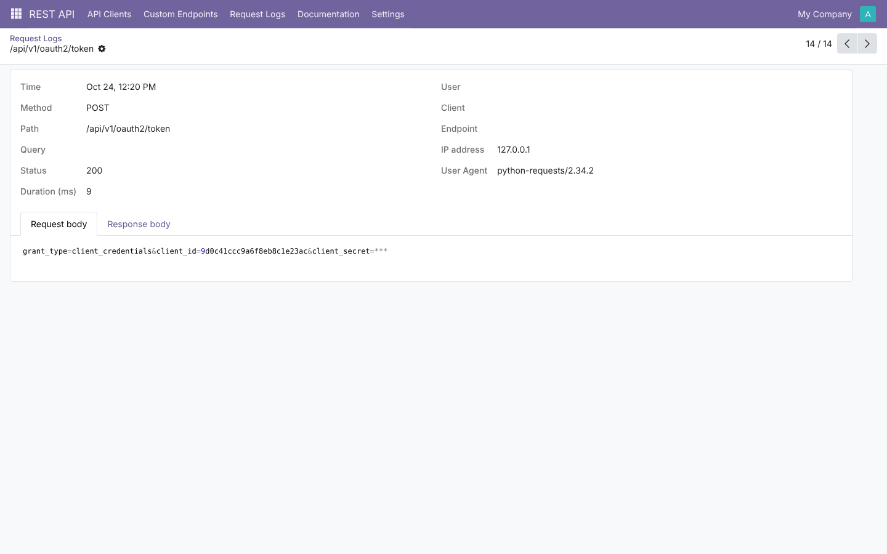
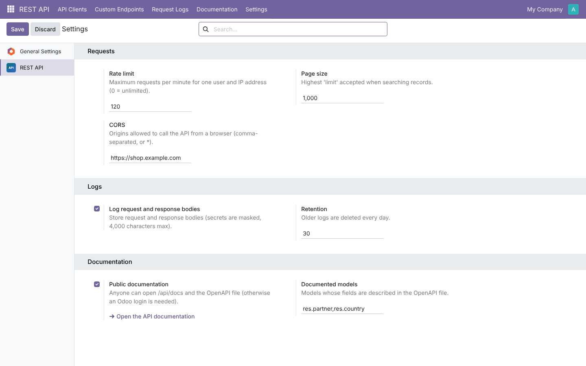

# REST API Gateway

**Odoo 19.0** · LGPL-3 · Category: Technical

A **RESTful JSON API** for Odoo, under `/api/v1`, for mobile apps, websites, middleware and scripts.
- **Authentication:** API keys, Basic auth or OAuth2 client credentials.
- **Data:** CRUD on any model, method calls, file downloads and reports.
- **Custom endpoints:** configured in the backend.
- **Documentation:** an **interactive page** generated from an **OpenAPI** file.
- **Operations:** request logs, rate limits and CORS.

Every call runs **with the access rights of the authenticated user**, so Odoo's access rules and record rules
apply as they do in the web client.


## Features

**Authentication**
- **Bearer API key**: personal Odoo API keys (*Preferences › Account Security › New API key*).
- **Basic auth**: `login:password` or `login:API key`, checked by Odoo's own login (brute-force protection
  included).
- **OAuth2 client credentials**: clients have an ID and secret. Secrets and tokens are stored **hashed**, tokens
  expire, and the client runs as a chosen user. A client can be limited to some models or made **read-only**.
  Tokens can be revoked one by one or all at once.

**Endpoints**

| Method | Path | Action |
| --- | --- | --- |
| GET | `/api/v1/ping` | Health check (public) |
| GET | `/api/v1/me` | Server version, database, user, company, client |
| POST | `/api/v1/oauth2/token`, `/oauth2/revoke` | Get / revoke an access token |
| GET | `/api/v1/{model}?domain=&fields=&limit=&offset=&order=&context=` | Search: `{count, limit, offset, records}` |
| POST | `/api/v1/{model}` | Create one record (or a list) → `201 {id}` / `{ids}` |
| GET / PUT / PATCH / DELETE | `/api/v1/{model}/{id}` | Read / update / delete |
| POST | `/api/v1/{model}/call/{method}` | Call a public method: `{"ids": [...], "args": [...], "kwargs": {...}}` |
| GET | `/api/v1/{model}/{id}/{field}/download` | Download a binary field (image, document...) |
| GET | `/api/v1/report/{report}/{ids}?format=pdf\|html` | Print a report |
| any | `/api/v1/custom/...` | Your custom endpoints |

- **Clear errors**: `{"error": {"code", "message", "status"}}`.

  | Status | Meaning |
  | --- | --- |
  | 400 | Bad input or a database constraint |
  | 401 | Not authenticated |
  | 403 | Access rights |
  | 404 | Not found |
  | 429 | Rate limit |
  | 500 | Server error (the traceback is in the server log only) |

  Failed requests are rolled back.
- **Private methods** (starting with `_`) and `@api.private` methods cannot be called, as with Odoo's own RPC.

**Custom endpoints** (*REST API › Custom Endpoints*), at `/api/v1/custom/<path>`. Paths can capture values,
e.g. `customers/{country}`. Three modes:
- **Records**: a model, a domain that can use `params`, fields, limit and order.
- **Server action**: runs on the `ids` you send.
- **Python code**: sandboxed (`safe_eval`), with `env`, `user`, `params`, `body` and `headers`; you set
  `result`.

Each endpoint can be public or authenticated, run as the **caller** or as **superuser** (public endpoints cannot
run code as superuser), and have its own log switch.

**Documentation**
- `/api/v1/openapi.json` is an OpenAPI 3 file covering every route, your custom endpoints, and field schemas for
  the models you choose.
- `/api/docs` is an interactive page with search and **Try it**. It shows the answer and the matching **curl**
  command. It needs no external scripts.
- The documentation can be public, or limited to people logged in to Odoo.

**Operations**
- **Request logs**: time, method, path, status, duration, user, client, IP and user agent. Bodies are optional,
  truncated, and have secrets masked. There is a graph per day and errors are highlighted. Logs are deleted after
  N days by a daily job, which also removes expired tokens.
- **Rate limit**: N requests per minute per user and IP address, answered with `429` and `Retry-After`.
- **CORS**: allowed origins, preflight `OPTIONS` handled.
- **Page size cap** for searches.

## Screenshots

| | |
| --- | --- |
| **Docs: every route, public or not**<br> | **OAuth2 client with active tokens**<br> |
| **Custom endpoints**<br> | **Python code endpoint**<br> |
| **Request logs (real calls)**<br> | **Log detail: the client secret is masked**<br> |



## Installation

1. Add `19.0/` of this repository to your addons path and install **REST API Gateway** (depends on `web` and
   `base_setup`; no extra Python package).
2. The API needs to know the database. Either run one database per server (`--db-filter`), or send the header
   `X-Odoo-Database: <name>` (supported by Odoo itself).

## Quick start

```bash
# 1. with a personal API key
curl -H "Authorization: Bearer $ODOO_API_KEY" "https://odoo.example.com/api/v1/res.partner?fields=name,email&limit=5"

# 2. with an OAuth2 client (REST API › API Clients › New › Generate secret)
TOKEN=$(curl -s -d grant_type=client_credentials -d client_id=$ID -d client_secret=$SECRET \
        https://odoo.example.com/api/v1/oauth2/token | jq -r .access_token)
curl -X POST -H "Authorization: Bearer $TOKEN" -H "Content-Type: application/json" \
     -d '{"name": "New customer", "email": "new@example.com"}' https://odoo.example.com/api/v1/res.partner
```

Then open **REST API › Documentation** (`/api/docs`) to explore and try every route.

## Configuration

**REST API › Settings** (or *Settings › REST API*):
- rate limit;
- maximum page size;
- CORS origins;
- body logging and retention;
- public documentation;
- documented models.

The menu is visible to administrators (*Settings* group).

## Technical overview

| Part | Role |
| --- | --- |
| `controllers/main.py` | Routes, authentication (API key, Basic, OAuth token), JSON (de)serialization, error mapping, rollback on error, logging, rate limit, CORS |
| `rest.api.client` / `rest.api.token` | OAuth2 clients (hashed secret, run-as user, allowed models, read-only, token lifetime) and hashed tokens |
| `rest.api.endpoint` | Custom endpoints (path matching with `{params}`, three modes) and the OpenAPI generator |
| `rest.api.log` | Request log, masking, rate-limit counter, daily cleanup |
| `views/docs_templates.xml` + `static/src/docs/` | Documentation page (vanilla JS, no CDN) |

Routes are `auth="none"` and declared **read-write**, because Odoo 19 makes `auth="none"` routes read-only by
default and the API writes logs and tokens. After authentication the request switches to the user
(`request.update_env`), so every call runs with that user's rights.

## Tests

```bash
tools/run_tests.sh 19.0 /path/to/odoo19 rest_api_gateway
```

There are 11 tests, all of them real HTTP calls to a running test server:
- authentication: missing, wrong, Bearer key, Basic password, Basic key;
- CRUD and batch create;
- access rights, unknown model, bad domain, bad fields, invalid JSON and constraint errors, with rollback and
  logging;
- method calls, with private methods refused;
- the OAuth2 flow: wrong secret, unsupported grant, token, allowed models, read-only, revoke;
- custom endpoints in all modes, with public, caller and superuser runs and validation;
- body masking and the rate limit;
- binary download and the HTML report;
- the OpenAPI file, docs access rules and CORS;
- the docs page in Chrome: **Try it** on `/ping` returns 200;
- the log cleanup job.

## Full guide

[docs/rest_api_gateway.md](../../docs/rest_api_gateway.md)

---
Author: Aditya Shah · License: LGPL-3
