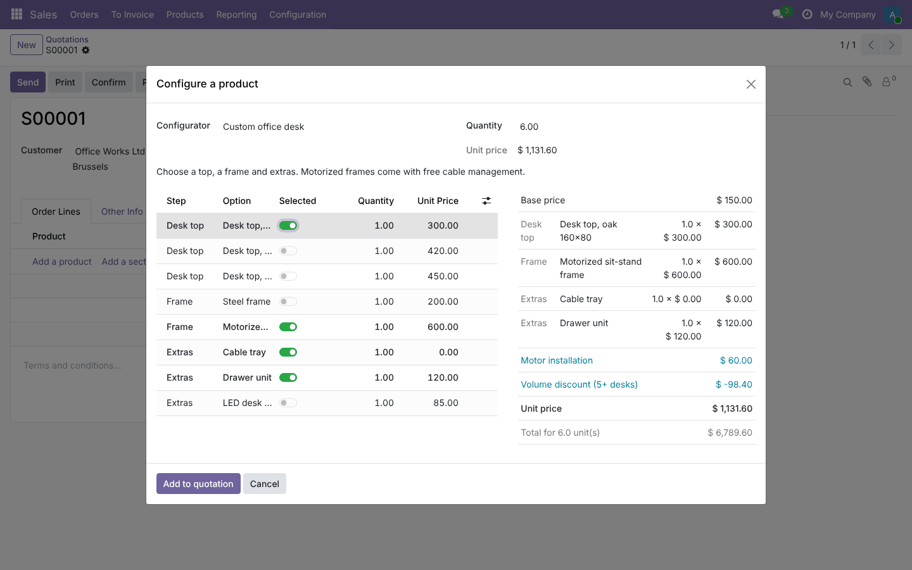
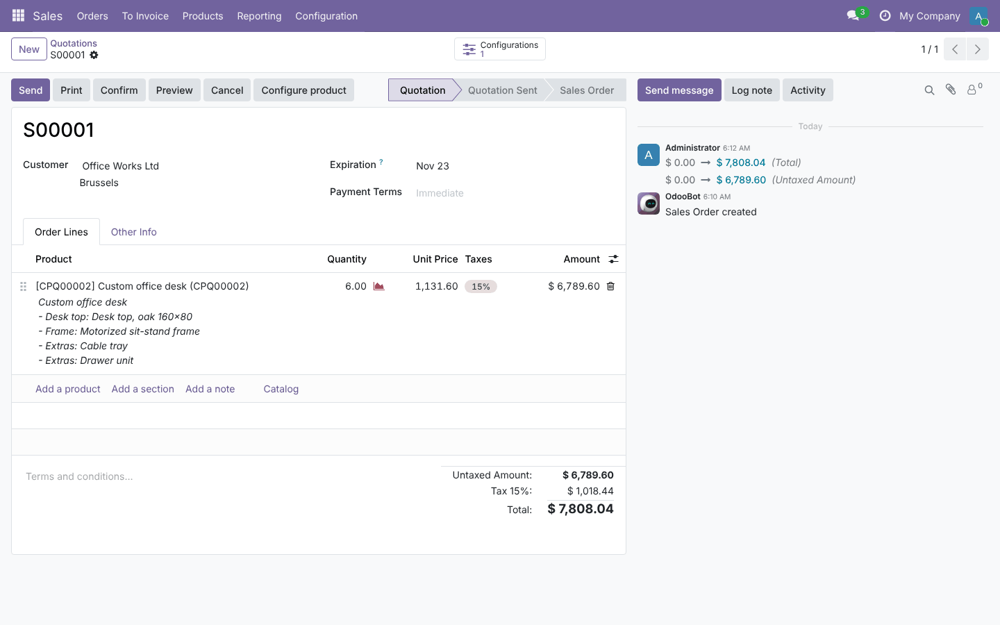
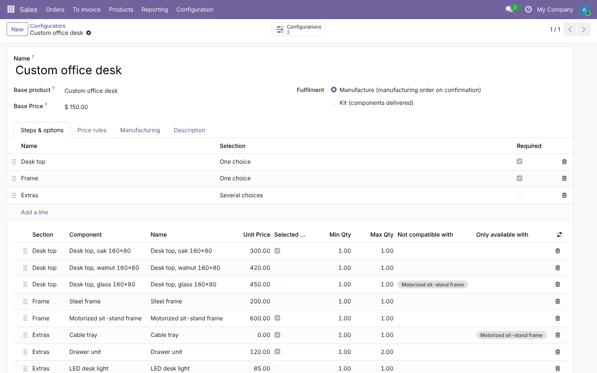
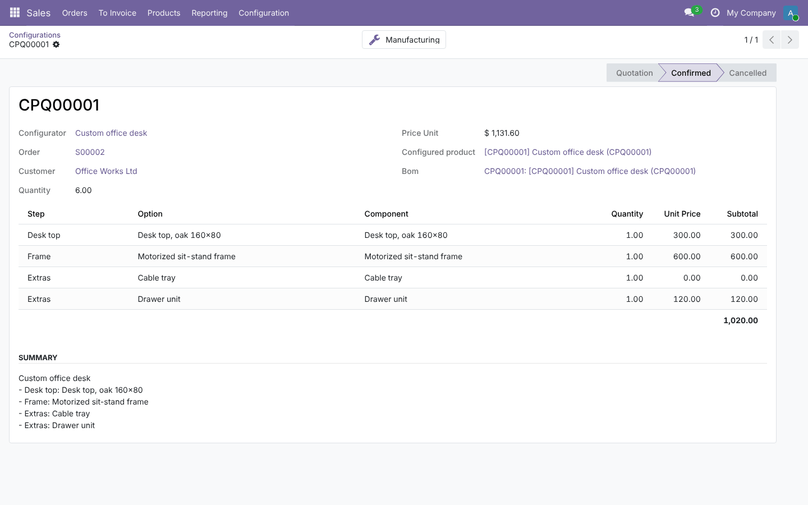
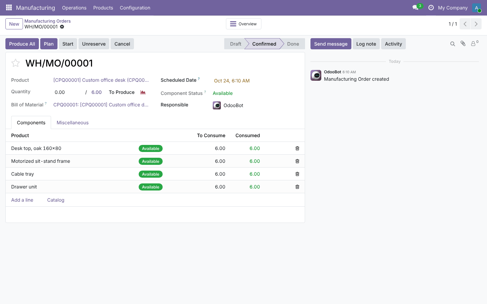

# CPQ Product Configurator

**Odoo 19.0** · LGPL-3 · Category: Sales

**Configure – Price – Quote** for made-to-order products. Sales people configure a custom product step by step
directly on the quotation; compatibility rules keep the configuration valid, the price is recalculated live with a
full breakdown, component stock is visible, and the confirmed order produces the bill of materials and the
manufacturing order (or ships the components as a kit).



## Features

- **Configurators** per custom product: base price, **steps** (one choice / several choices, required or optional),
  **options** = components with a price, default selection, min / max / default quantity.
- **Rules**: *not compatible with* (exclusions), *requires one of*, *only available with* (conditional options).
- **Price rules**: fixed surcharge or percentage when options are selected, **quantity breaks** (discount from N units).
- **Live pricing**: unit price, breakdown per option and rule, total for the quantity — updated at every click.
- **Live stock**: free quantity of each component, in red when it does not cover the order.
- **On the quotation**: *Configure product* button; the line gets a readable description of the choices and a
  locked configured price.
- **Generated**: one product and one bill of materials per configuration (components and quantities), with
  manufacturing **operations** (optionally only for some options).
- **On confirmation**: a **manufacturing order** is created and confirmed (fulfilment *Manufacture*), or the BoM is
  a **kit** and the delivery contains the components (fulfilment *Kit*).
- **Configured Products** menu and smart buttons on quotations (configurations, manufacturing orders).

## Screenshots

| | |
| --- | --- |
| **Quotation with the configured line**<br> | **Configurator: steps, options and rules**<br> |
| **Configuration record**<br> | **Manufacturing order created on confirmation**<br> |

## Installation

1. Add `19.0/` of this repository to your addons path.
2. Install **CPQ Product Configurator** (depends on Sales, Inventory and Manufacturing).

## Configuration

1. **Sales › Configuration › Product Configurators › New** (Sales administrators).
2. Pick the **base product** (its category, taxes and unit are reused), the **base price** and the **fulfilment** (Manufacture or Kit).
3. *Steps & options*: create steps, then options (component, price, limits, default) and their rules.
4. *Price rules*: surcharges, percentages, quantity discounts. *Manufacturing*: operations and work centers.
   Enable *Manufacturing › Settings › Work Orders* to see operations on manufacturing orders.

## Usage

1. On a quotation, click **Configure product**, pick the configurator and the quantity.
2. Toggle options; the right panel shows the price breakdown and any rule that is not met.
3. **Add to quotation**. Confirm the order: the manufacturing order (or kit delivery) is created.

## Technical overview

| Model | Role |
| --- | --- |
| `cpq.configurator`, `cpq.section`, `cpq.option` | Configurable product, steps, options and their rules |
| `cpq.price.rule`, `cpq.operation` | Pricing rules, manufacturing operations |
| `cpq.configure.wizard` (+ line) | Interactive configuration with live rules, pricing and stock |
| `cpq.configuration` (+ line) | Saved configuration: options, price, generated product, BoM, MOs |
| `sale.order` / `sale.order.line` / `mrp.production` | Button, smart buttons, MO creation, locked price |

## Tests

```bash
tools/run_tests.sh 19.0 /path/to/odoo19 sale_cpq_configurator
```

Defaults and price, price rules with quantity break, every rule type, conditional options, product + BoM +
operations generation, price locked on quantity change, MO on confirmation, kit delivery, cancellation, wizard
through the form, stock availability, access rights.

## Full guide

[docs/sale_cpq_configurator.md](../../docs/sale_cpq_configurator.md)

---
Author: Aditya Shah · License: LGPL-3
