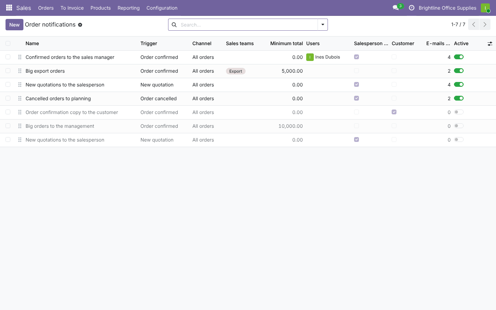
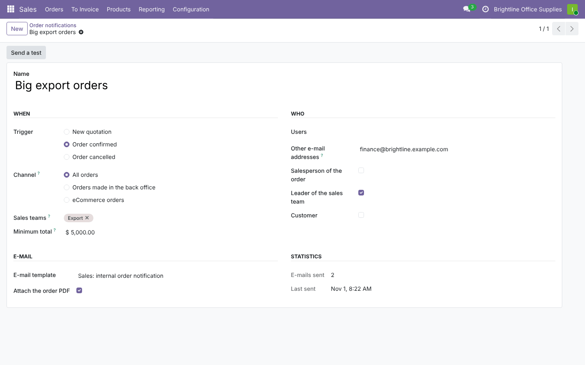
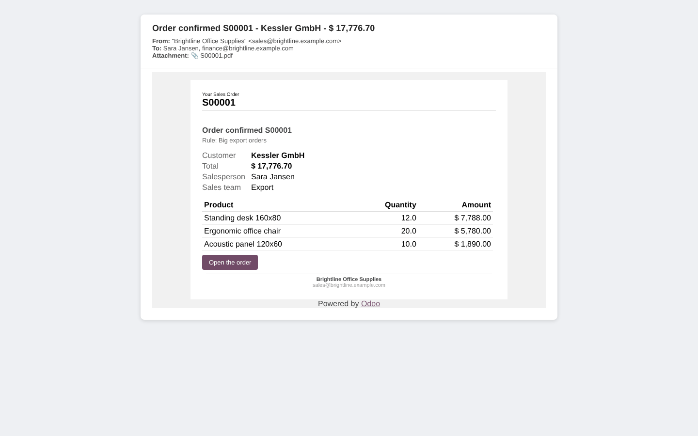
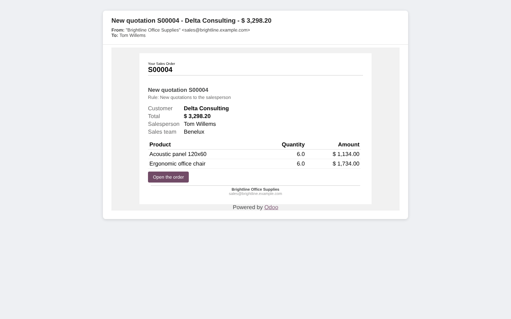
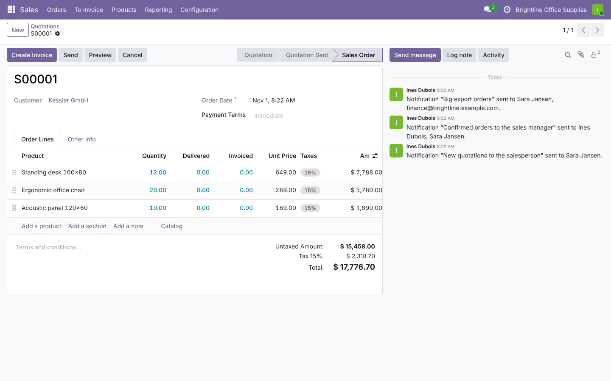
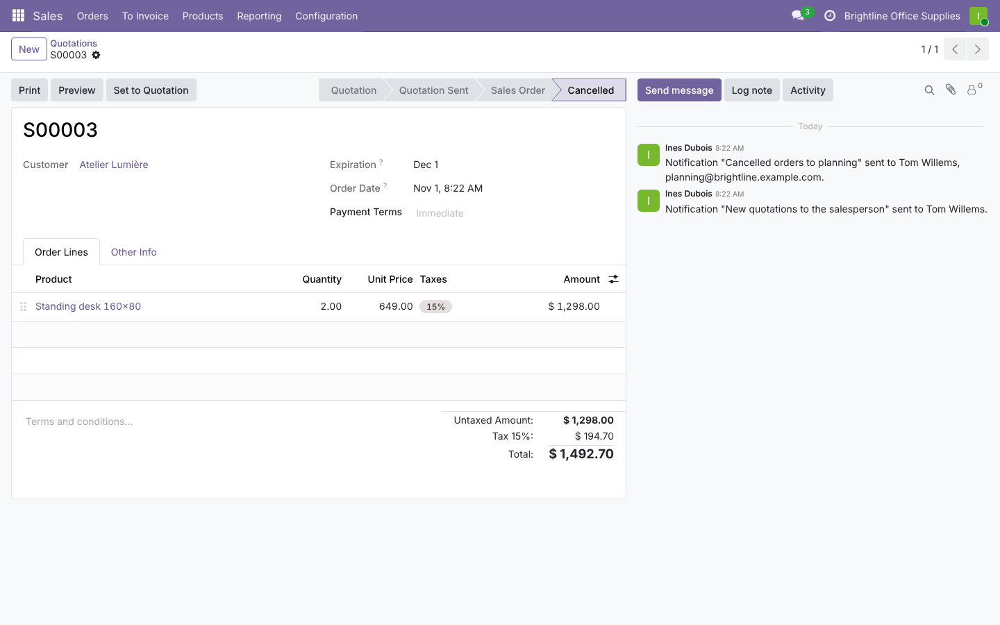

# Sales Order E-mail Notifications

**Odoo 19.0** · LGPL-3 · Category: Sales

**Rules that tell the right people about new quotations, confirmed orders and cancellations** by e-mail: the
sales manager for every confirmed order, finance for big export orders, the warehouse for cancellations, the
salesperson for new quotations, the customer for a confirmation copy.



## Features

- **Notification rules** (*Sales › Configuration › Order Notifications*), as many as needed:
  - **when**: new quotation, order confirmed, order cancelled;
  - **which orders**: all, back office or eCommerce (with the eCommerce app), sales teams, minimum total (in the
    company currency), company;
  - **who**: users, other e-mail addresses, the salesperson, the sales team leader, the customer;
  - **e-mail**: template (a ready one is included), customer template, order PDF attached.
- **Internal e-mail** with the order summary (customer, total, salesperson, team, delivery date, lines) and an
  *Open the order* button; it does **not** appear in the order's chatter nor in the customer portal.
- **Log** on the order: *Notification "Big export orders" sent to Sara Jansen, finance@…*; counter and last date
  on the rule.
- **Send a test** from the rule (last order).
- People are never notified twice by the same rule (a user's address in the list is skipped).
- eCommerce carts never trigger *New quotation* rules (they are created long before they are orders).
- Rules are managed by Sales administrators; salespeople confirming orders still trigger them.
- Two example rules are installed archived.

## Screenshots

| | |
| --- | --- |
| **Rules**<br> | **A rule**<br> |
| **E-mail received for a big order**<br> | **E-mail for a new quotation**<br> |
| **Log on the order**<br> | **Cancelled order**<br> |

## Installation

Add `19.0/` of this repository to your addons path and install **Sales Order E-mail Notifications**.
- **Odoo dependencies**: `sale` (the eCommerce channel works when `website_sale` is installed).
- **Python**: nothing extra.

## Configuration

*Sales › Configuration › Order Notifications*: create rules; *Send a test* to check the e-mail. Outgoing mail
server configured.

## Technical overview

| Part | Role |
| --- | --- |
| `sale.order.notification.rule` | Conditions, recipients, template, PDF, `_matches()`, `_send()`, test |
| `sale.order` | `create` (back-office quotations), `action_confirm`, `_action_cancel` call the rules |
| `mail_template_order_notification` | Internal e-mail template |

## Tests

```bash
tools/run_tests.sh 19.0 /path/to/odoo19 sale_order_email_notification
```

The tests cover:
- confirmed orders: users, addresses, salesperson, team leader, no duplicates, counter, log, e-mail out of the
  chatter;
- new quotation and cancellation triggers;
- filters: sales team, minimum total, channel;
- customer copy and PDF attachment;
- archived rules, *Send a test*;
- address validation;
- access (salespeople read rules, cannot change them, still trigger them).

## Full guide

[docs/sale_order_email_notification.md](../../docs/sale_order_email_notification.md) · Odoo 20.0: [`20.0/sale_order_email_notification`](../../20.0/sale_order_email_notification)

---
Author: Aditya Shah · License: LGPL-3
