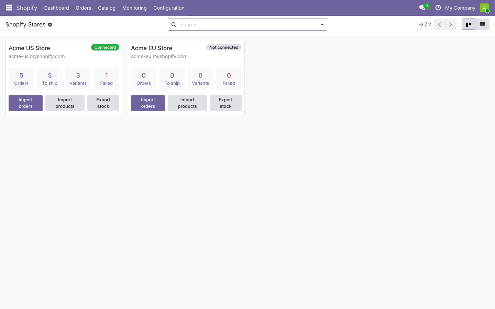
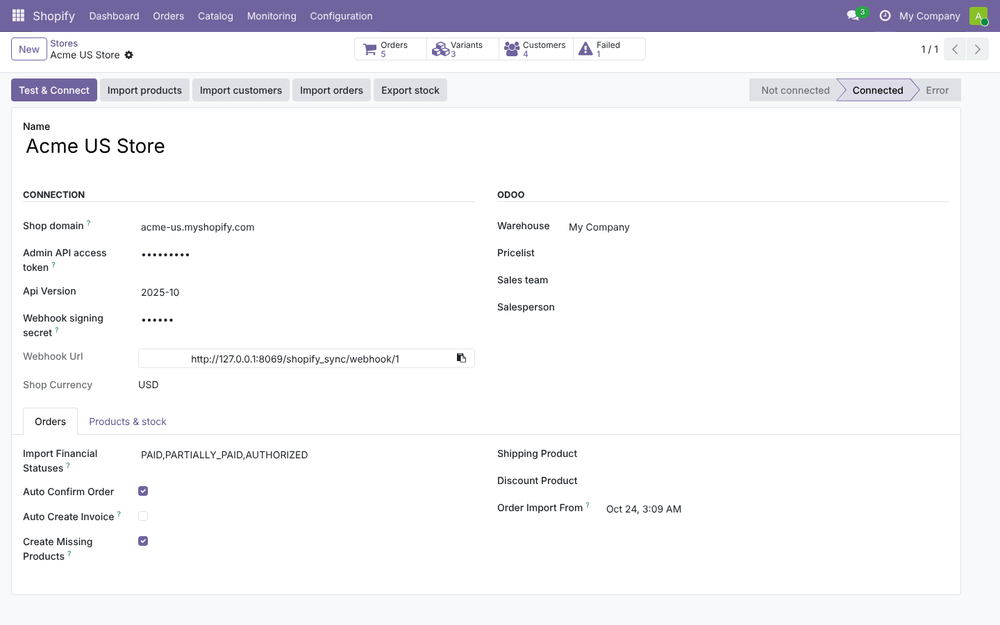
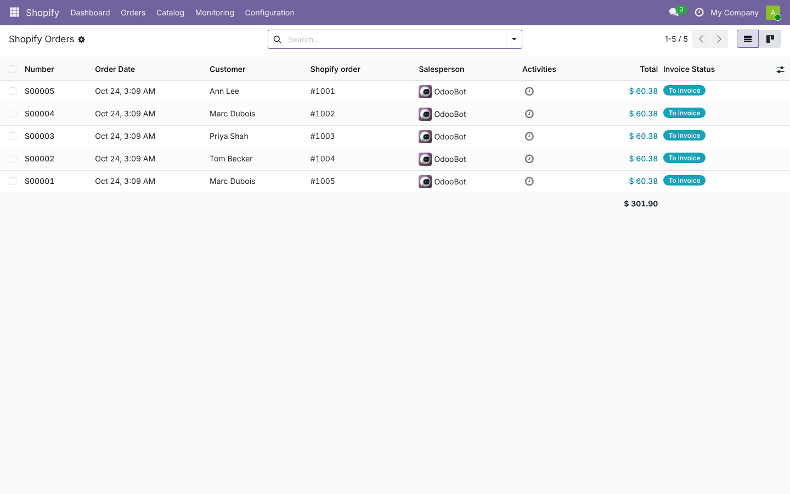
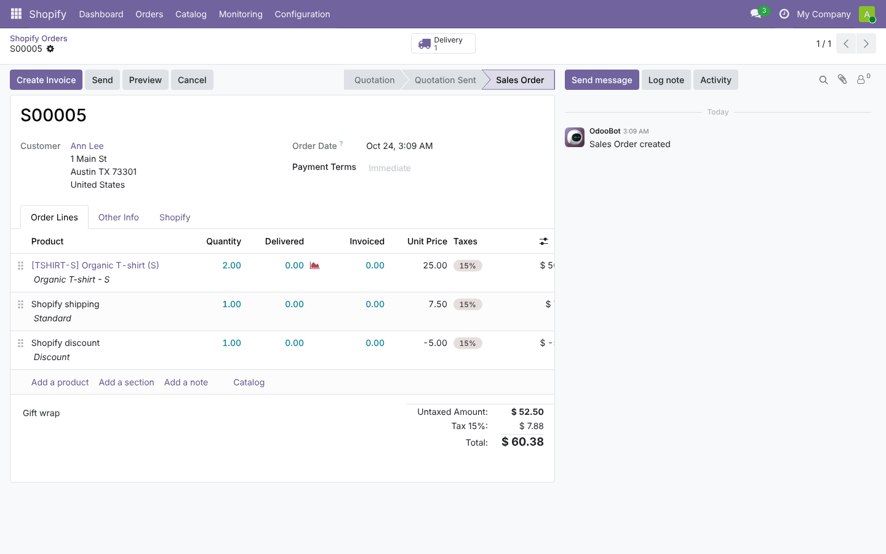
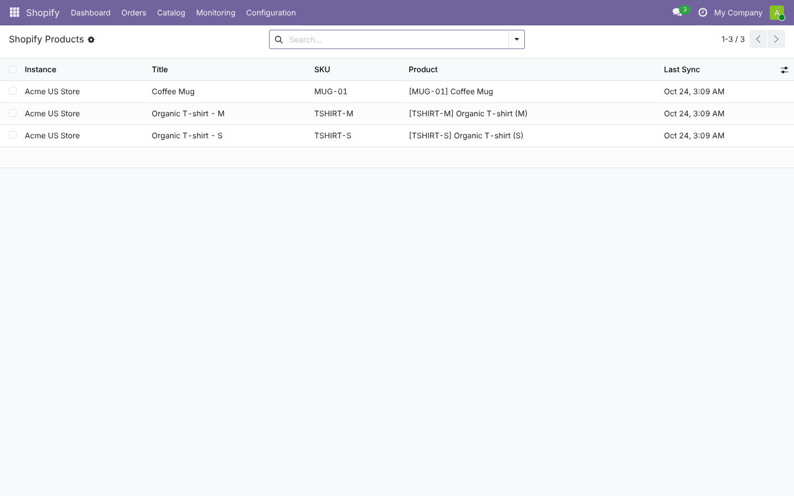
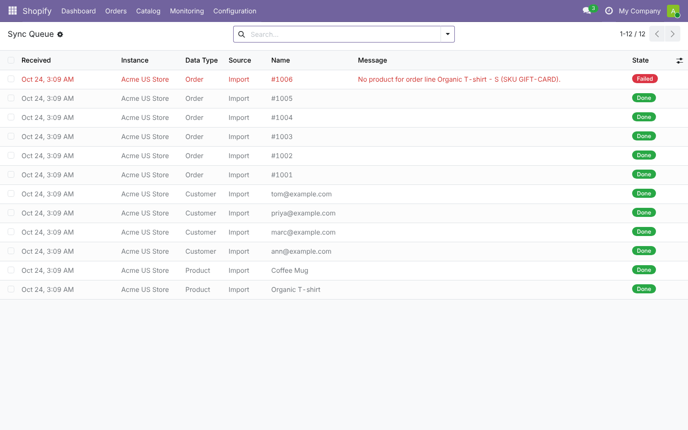
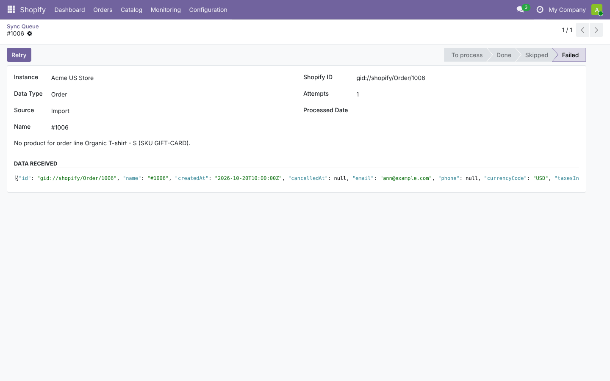

# Shopify Sync

**Odoo 19.0** · LGPL-3 · Category: Sales

Connect one or more **Shopify** stores to Odoo: import products, customers and orders, push stock levels,
send fulfillments with tracking numbers, and receive real-time **webhooks**, all through a sync queue with retries and logs.



## Features

- **Multi-store dashboard**: orders, orders to ship, mapped variants and failed sync items per store.
- **Products**: import products and variants (options become Odoo attributes), matching existing products by
  mapping, SKU or barcode; export Odoo products (with variants) to Shopify.
- **Customers**: import with default address, matched by email to avoid duplicates.
- **Orders**: import by financial status (paid, partially paid, authorized…), with customer, invoice/delivery addresses,
  lines, shipping and discounts; optional auto-confirmation and auto-invoicing of paid orders;
  cancellations in Shopify cancel the Odoo order (or create an activity if already delivered/invoiced).
- **Stock**: export free, on-hand or forecasted quantities per Shopify location ↔ Odoo warehouse.
- **Fulfillment**: validating the delivery in Odoo marks the Shopify order fulfilled (with the tracking number).
- **Webhooks** with HMAC-SHA256 signature check: orders, products, customers.
- **Sync queue** (retry failed items after fixing the cause) and **logs**.

## Screenshots

| | |
| --- | --- |
| **Store configuration**<br> | **Imported Shopify orders**<br> |
| **Order with shipping and discount lines**<br> | **Product / variant mapping**<br> |
| **Sync queue**<br> | **A failed item, with the data received and Retry**<br> |

## Installation

1. Add `19.0/` of this repository to your addons path.
2. Install **Shopify Sync** (depends on Sales and Inventory).

## Configuration

1. In Shopify: *Settings › Apps and sales channels › Develop apps › Create an app*. Give the Admin API scopes
   `read/write_products`, `read/write_customers`, `read/write_orders`, `read/write_inventory`,
   `read/write_fulfillments`, `read_locations`, `read/write_merchant_managed_fulfillment_orders`. Install it and copy the **Admin API access token** and the **API secret key**.
2. In Odoo: **Shopify › Configuration › Stores › New**: shop domain (`my-store.myshopify.com`), token, secret,
   warehouse, optional pricelist (must use the store currency), sales team and salesperson. Click **Test & Connect**:
   locations are imported; map each one to a warehouse in *Products & stock*.
3. Webhooks (optional, for real time): in Shopify *Settings › Notifications › Webhooks*, add `orders/create`,
   `orders/updated`, `orders/cancelled`, `products/update`, `customers/create` pointing to the **Webhook URL** shown on the store.

## Usage

- **Dashboard** buttons (or scheduled actions): *Import orders* (every 15 min), *Export stock* (hourly), queue processing (every 5 min).
- **Products › Export to Shopify** (action menu on products) creates or updates them in Shopify.
- **Monitoring › Sync Queue**: failed items show the reason and the data received; fix it (e.g. create the missing SKU) and click **Retry**.

## Technical overview

| Model | Role |
| --- | --- |
| `shopify.instance` | Store, credentials (admins only), workflow options, GraphQL client, import/export logic |
| `shopify.location` | Shopify location ↔ Odoo warehouse |
| `shopify.product.map` / `shopify.customer.map` | Shopify IDs ↔ Odoo products / partners |
| `shopify.queue` | Incoming data (imports and webhooks) processed with savepoints and retries |
| `shopify.log` | Operation log |
| `sale.order` (extended) | Store, Shopify order id/name, financial and fulfillment status (unique per store) |
| `stock.picking` (extended) | Sends the fulfillment when an outgoing delivery is validated |

Uses the Shopify **GraphQL Admin API** (version configurable, default `2025-10`).

## Tests

```bash
tools/run_tests.sh 19.0 /path/to/odoo19 shopify_sync
```

The Shopify API is replaced by an in-memory fake: connection, product/customer/order imports, matching, status filters,
cancellations, retries, currency checks, stock and fulfillment exports, product export, webhook signatures.

## Full guide

[docs/shopify_sync.md](../../docs/shopify_sync.md): planning, architecture, development, testing, deployment dev → prod.

---
Author: Aditya Shah · License: LGPL-3
