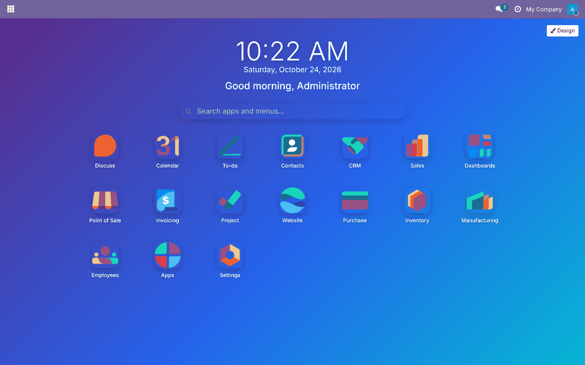
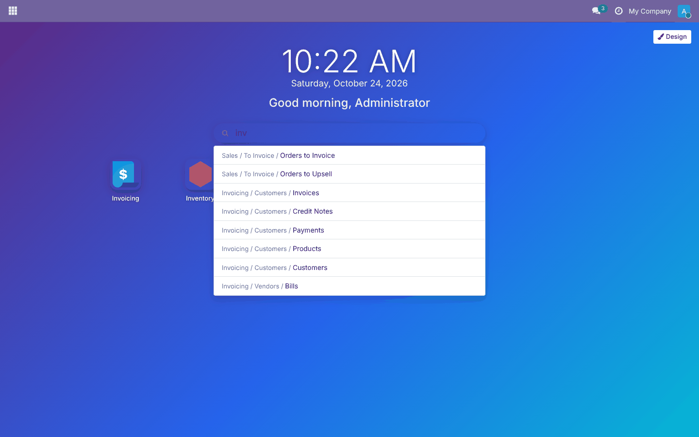
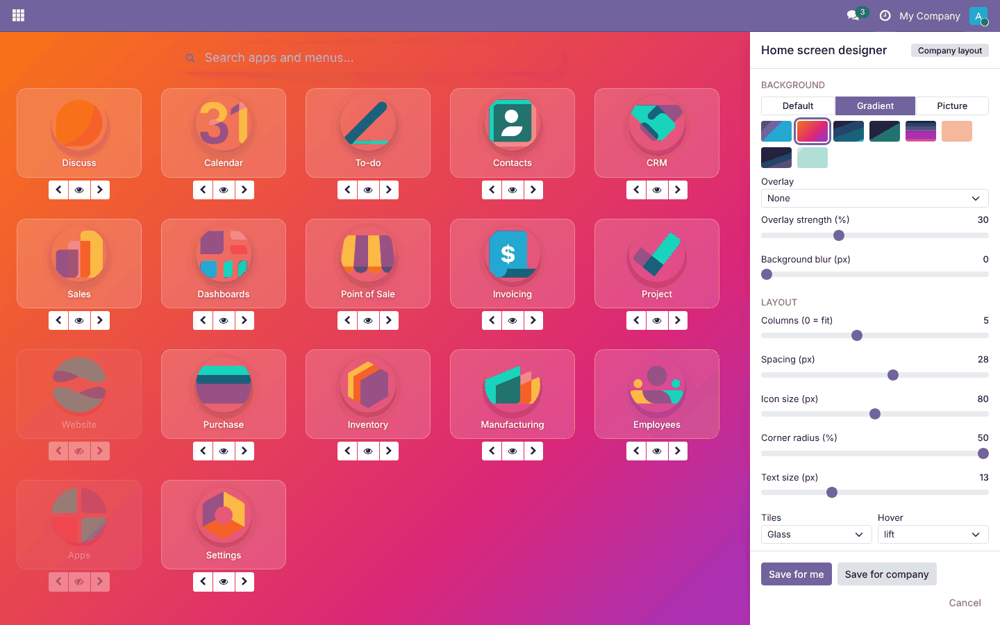
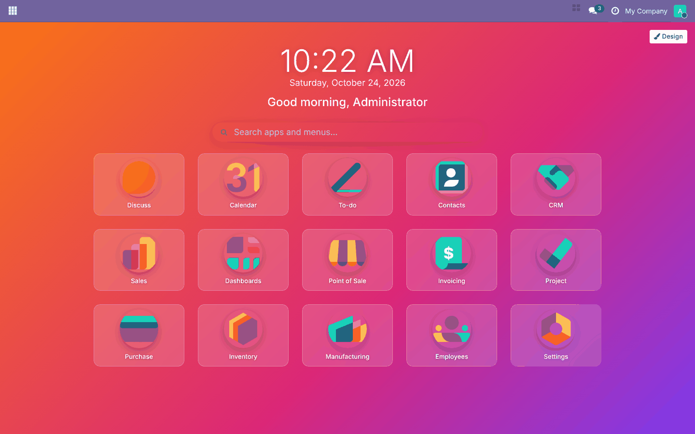
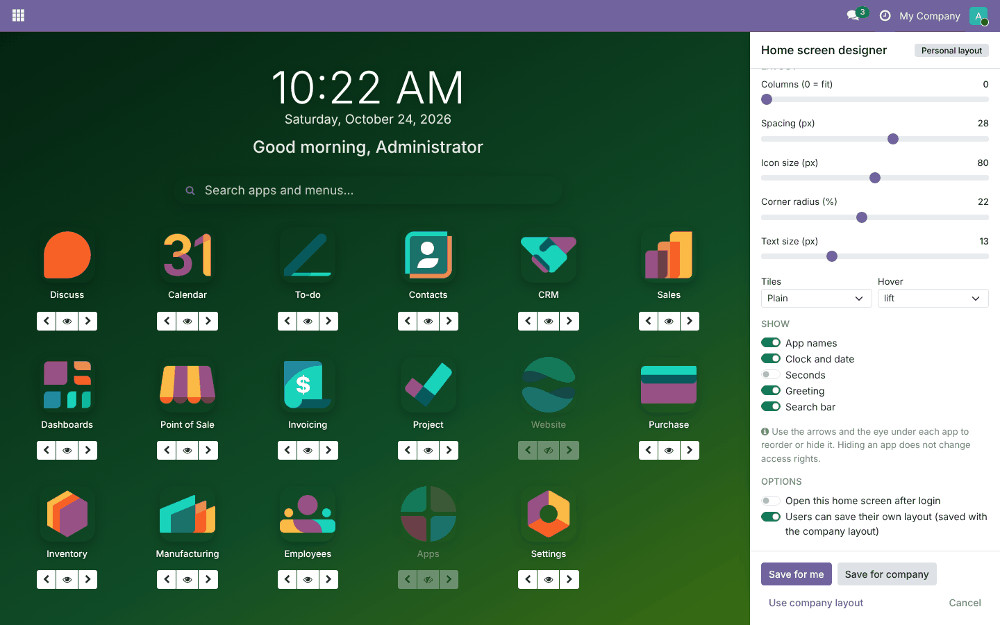

# Home Screen Designer

**Odoo 19.0** · LGPL-3 · Category: Productivity

A full **home screen** for the Odoo backend:
- a clock and date, and a greeting with the user's first name;
- a search across apps **and menus**;
- a grid of your apps.

A **live designer** changes the background, layout, icon style, app order and visibility. Each user can save a
personal layout, and administrators save the company layout that everyone else gets.



## Features

- **Home screen** at `/odoo/home-screen`. It opens from the grid button in the top bar, and optionally after
  login.
- **Header**: clock (optional seconds), date in the user's language, and "Good morning/afternoon/evening, <first name>".
- **Search**: filters the apps as you type and lists matching menus with their path (*Invoicing / Customers /
  Invoices*). **Enter** opens the first result and **Escape** clears the search.
- **App grid**:
  - columns: fit to screen, or 3 to 12;
  - spacing: 0 to 48 px;
  - icon size: 32 to 128 px;
  - corner radius: square to round;
  - text size, with names on or off;
  - **plain** or **glass** tiles;
  - **lift**, **grow** or **bounce** hover effect.
- **Background**:
  - Odoo's default, one of **8 gradients**, or **your own picture**;
  - a light or dark overlay with adjustable strength;
  - blur.
- **Apps**: reorder them with the arrows and hide them with the eye. Hidden apps disappear from the home screen
  and its search; access rights are not changed.
- **Live preview**: every change shows at once. **Save for me**, **Save for company** (admins), **Use company
  layout** (forget the personal one) and **Cancel**.
- **Who sees what**:
  - users see their personal layout, otherwise the company layout, otherwise the default;
  - admins can turn off personal layouts for the company.
- **Open after login**: a switch in the designer sets the home screen as the user's home action.

## Screenshots

| | |
| --- | --- |
| **Search apps and menus**<br> | **Live designer: gradient, glass tiles, round icons, hidden apps**<br> |
| **Saved personal layout**<br> | **Designer options: overlay, show/hide, login, company switch**<br> |

## Installation

1. Add `19.0/` of this repository to your addons path.
2. Install **Home Screen Designer** (depends on `web` and `base_setup`).

## Usage

1. Click the **grid** icon in the top bar, or go to `/odoo/home-screen`.
2. Click **Design**, change the settings and check the preview, then click **Save for me**. Administrators can
   also click **Save for company**.
3. To start on the home screen, switch on **Open this home screen after login** before saving.
4. **Use company layout** removes your personal layout.

## Technical overview

| Part | Role |
| --- | --- |
| `home.screen.layout` | One record per user (personal) or per company (`user_id` empty). It holds the background (type, gradient, picture, overlay, blur), grid (columns, spacing), icons (size, radius, text, tiles, hover), header switches, and app order and hidden apps (JSON lists of menu XML IDs). Unique indexes allow one per user and one per company |
| `get_home_screen` / `save_home_screen` / `reset_home_screen` | Resolve the effective layout (personal → company → default), check rights, clean values (known keys only, numbers clamped, selections checked) |
| `res.company.home_screen_allow_user_layout` | Company switch for personal layouts |
| Record rule | Users read their own layout and their companies' layouts |
| `HomeScreen` (OWL client action `web_home_screen_designer.home`) | Apps and menus from the menu service; CSS custom properties for the layout; designer panel |
| Systray item | Grid button opening the home screen |

## Tests

```bash
tools/run_tests.sh 19.0 /path/to/odoo19 web_home_screen_designer
```

**Python tests** cover:
- the default, company, personal and reset layouts;
- other users still seeing the company layout;
- value cleaning, both clamped values and refused ones;
- rights: non-admins cannot save the company layout, the record rule, and the company switch;
- *open after login*;
- the background picture URL.

The **browser tour** runs these steps:
1. Checks the apps, clock and greeting.
2. Searches an app and then a menu.
3. In the designer: chooses the sunset gradient, sets 4 columns, hides *Apps* and moves *Settings* first.
4. Saves, checks *Apps* is hidden, then opens *Settings*.

The test then checks the saved record.

## Full guide

[docs/web_home_screen_designer.md](../../docs/web_home_screen_designer.md)

---
Author: Aditya Shah · License: LGPL-3
