# Cash on Delivery: OTP and Collections

**Odoo 19.0** · LGPL-3 · Category: Website / eCommerce

Makes Odoo's own **Cash on Delivery** payment method usable end to end:
- the customer gets a **delivery code (OTP)** when the order is confirmed;
- the delivery person **collects the cash** only with that code;
- the manager registers the **cash deposit**, which invoices and pays the order;
- **rules** decide when Cash on Delivery is offered.

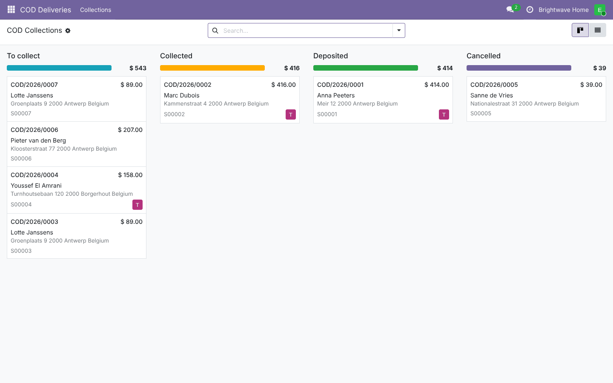

## Features

- **Checkout**: the *Cash on Delivery* method of Odoo (module `delivery`) stays the one the customer picks.
  Extra rules on top of Odoo's (delivery method must accept cash, countries, currencies, maximum amount):
  - **minimum order amount**;
  - **excluded product categories**: no Cash on Delivery if the cart holds a product of such a category or of
    one of its sub-categories (gift cards, made-to-order items, …).
- **Delivery code (OTP)**:
  - a random code of 4 to 10 digits (6 by default) is created when the order is confirmed;
  - the customer sees it on the **confirmation page**, in **My account › Orders** and in an **e-mail**;
  - salespeople see it on the sales order and can **send a new code**;
  - the code can be turned off: the driver then only confirms the amount.
- **Collections** (`COD/2026/0001`), one per Cash on Delivery order:
  - *To collect* → *Collected* → *Deposited*, or *Cancelled*;
  - kanban by state with the amount per column, list with totals, search by driver, order, customer;
  - customer, phone (call / SMS), delivery address, amount due, delivery person, notes, chatter.
- **Collect** wizard for the delivery person:
  - delivery code + amount received (must be the amount due);
  - a wrong code shows the attempts left and is logged; after **5 wrong codes** the collection is locked until a
    new code is sent.
- **Cancel** with a reason (refused, nobody home, no cash, wrong address, other): the pending payment is
  cancelled; **Reset to collect** reopens it.
- **Cash deposited** (sales managers):
  - creates and posts the invoice if the order has none;
  - registers the payment in the **cash journal** of the provider;
  - marks the payment transaction done, so the order shows as paid.
- **Collection receipt** (PDF) with customer and delivery person signature lines.
- **Delivery persons**: a *Delivery person* group and a **COD Deliveries** app; they see the collections assigned
  to them or to nobody.
- Menus: *COD Deliveries*, *Sales › Orders › COD Collections*, *Website › eCommerce › Orders › COD Collections*.

## Screenshots

| | |
| --- | --- |
| **Checkout: Cash on Delivery**<br>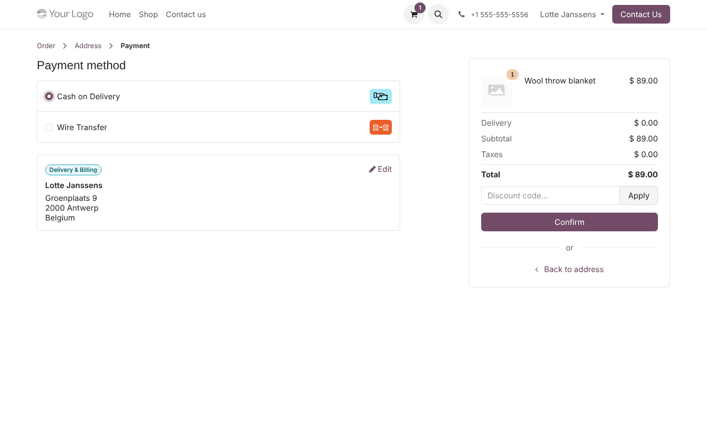 | **Confirmation page with the delivery code**<br>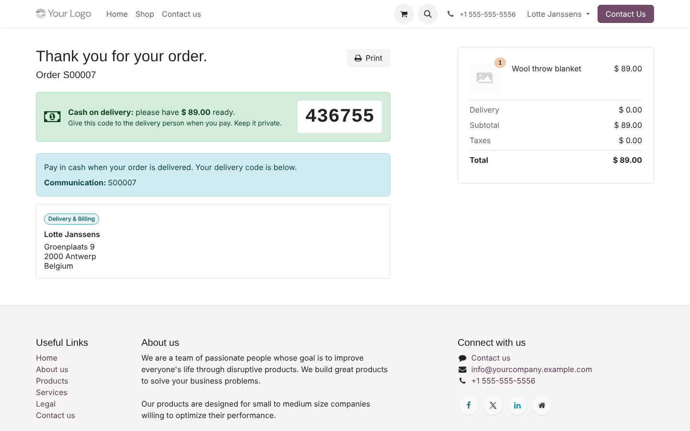 |
| **Customer portal**<br>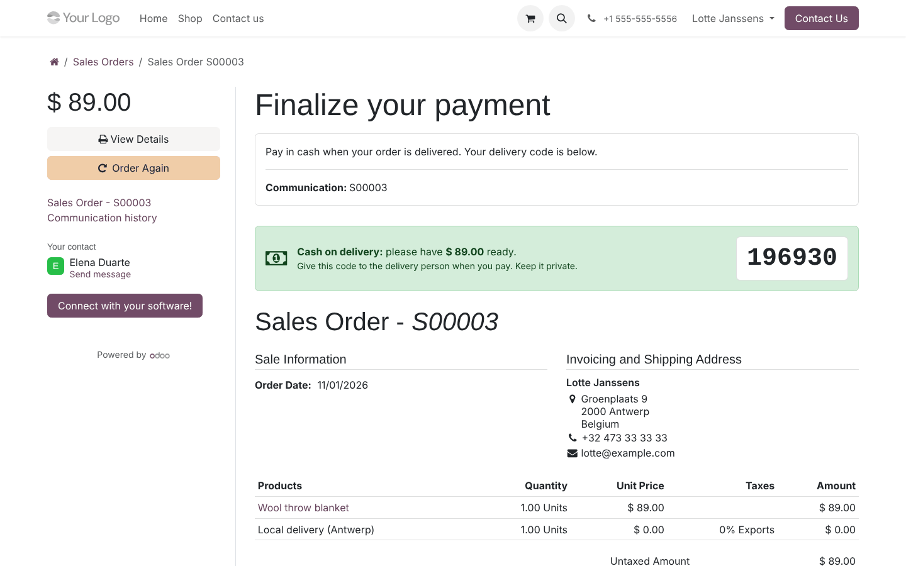 | **Sales order: code, e-mail and smart button**<br>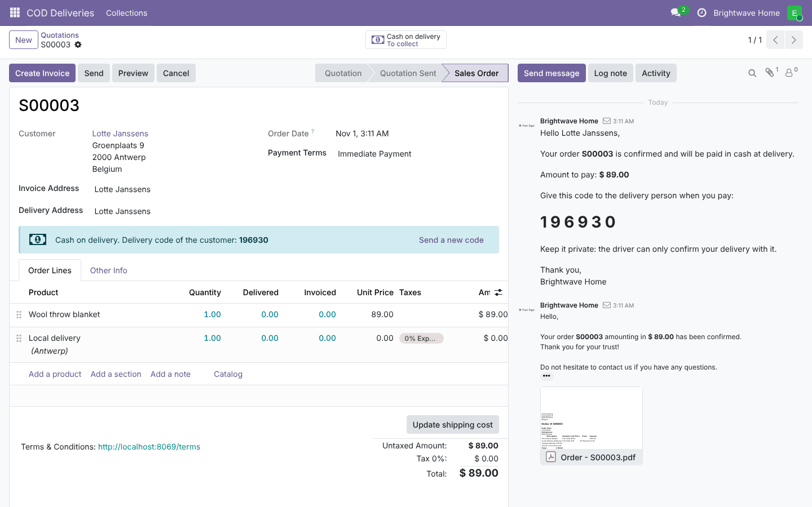 |
| **Collection to collect**<br>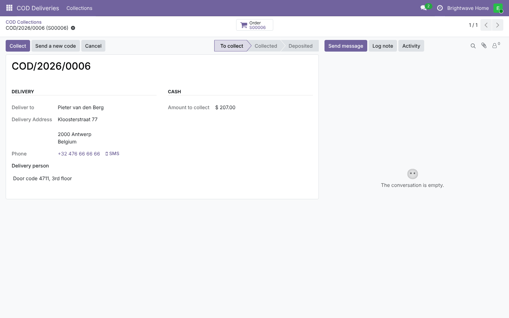 | **Wrong code in the Collect wizard**<br>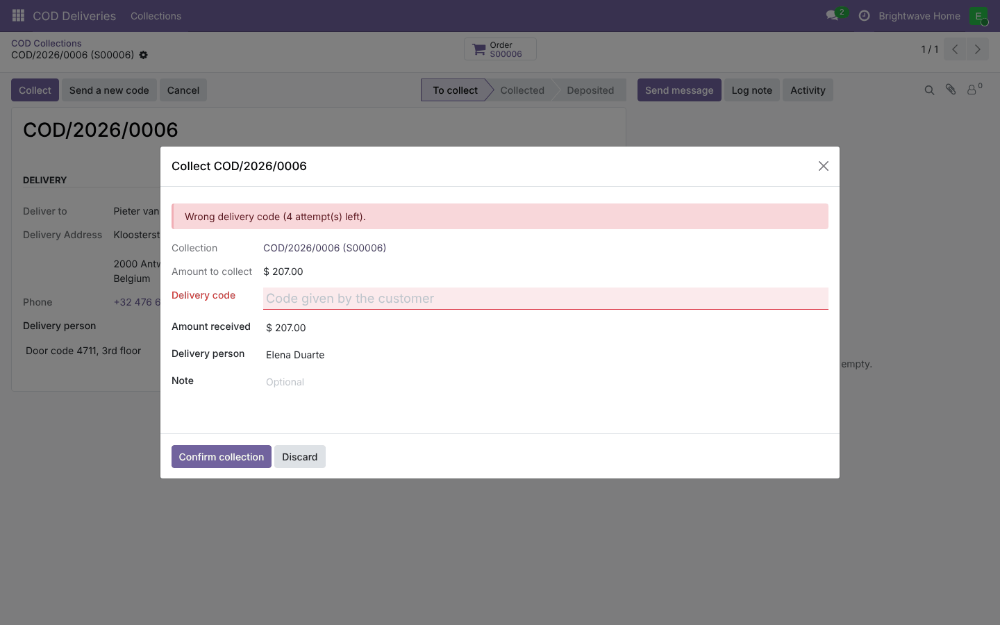 |
| **Collected**<br>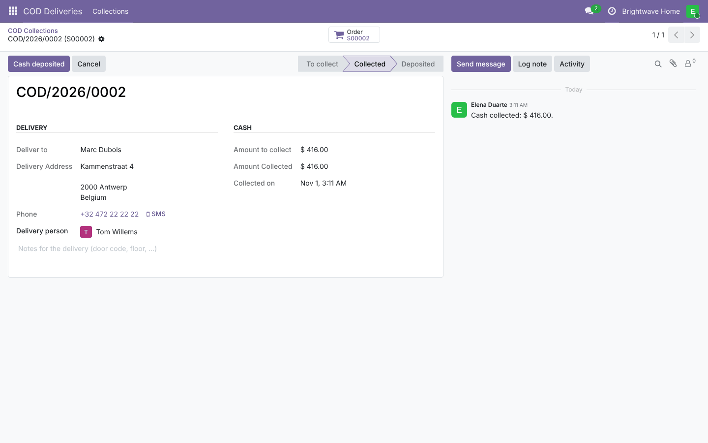 | **Deposited: invoice and payment**<br>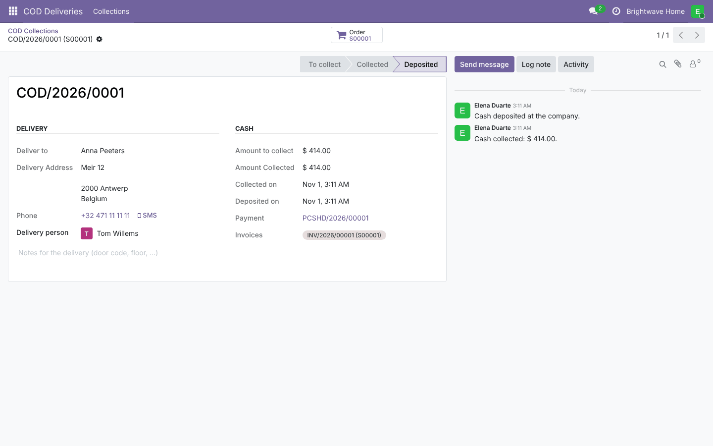 |
| **Cancelled with a reason**<br>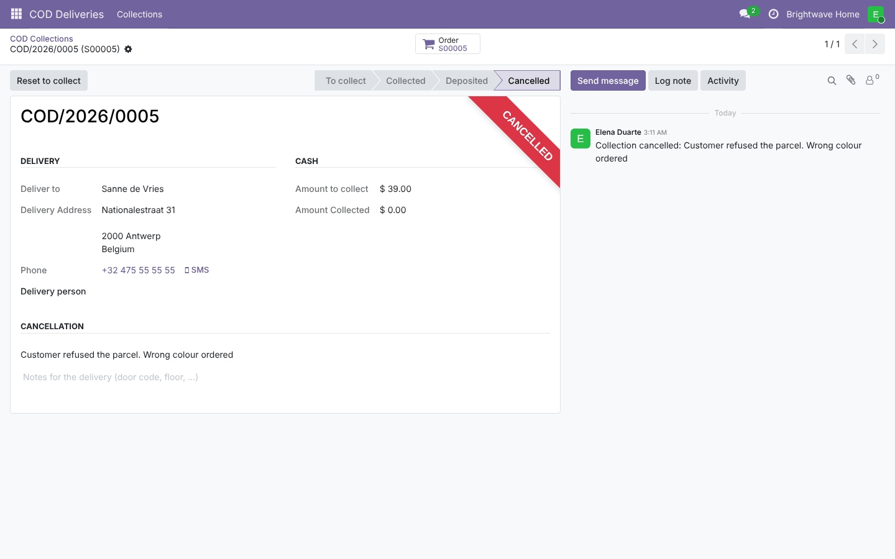 | **Delivery person's list**<br>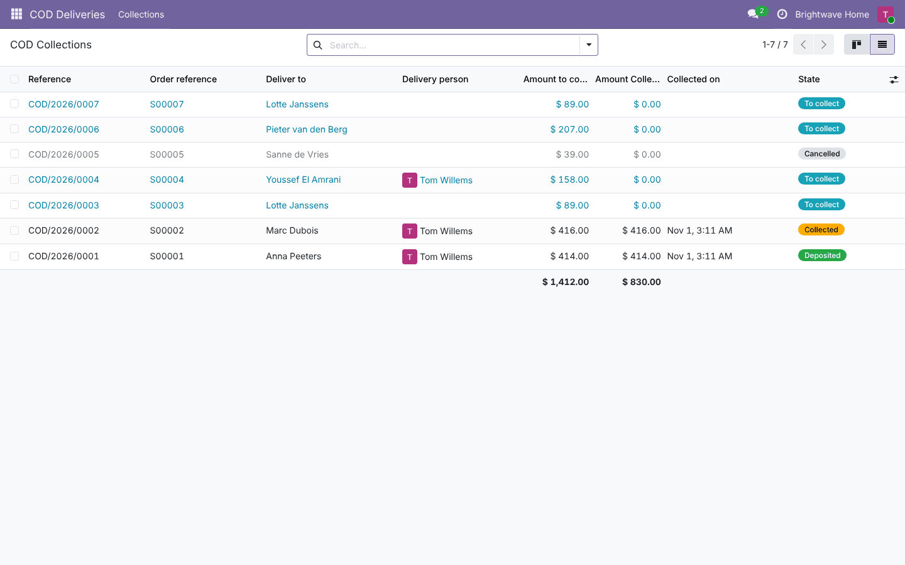 |
| **Provider settings**<br>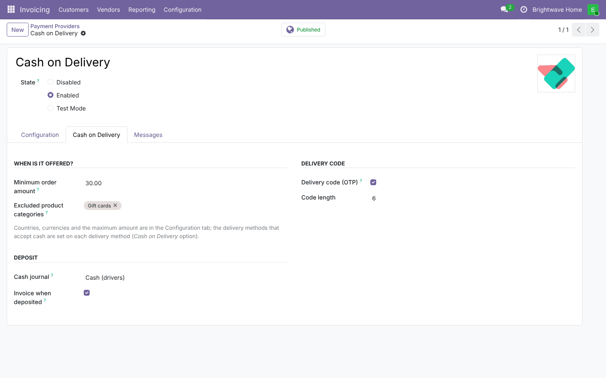 | **Collection receipt**<br>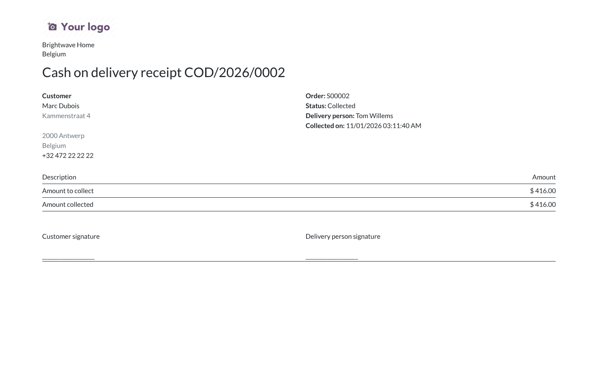 |

## Installation

Add `19.0/` of this repository to your addons path and install **Cash on Delivery: OTP and Collections**.
- **Odoo dependencies**: `website_sale`, `delivery`, `account`.
- **Python**: nothing extra.

## Configuration

1. *Website › Configuration › Payment Providers › Cash on Delivery*: publish it.
   - *Configuration* tab: countries, currencies and maximum amount.
   - *Cash on Delivery* tab: **minimum order amount**, excluded categories, delivery code on/off and length, **cash journal**, invoice on
     deposit.
2. *Website › Configuration › Shipping Methods*: tick **Cash on Delivery** on the methods your drivers deliver.
3. *Settings › Users*: give drivers the **Delivery person** role (*Cash on Delivery* section).

## Technical overview

| Part | Role |
| --- | --- |
| `payment.provider` | COD settings; `_get_compatible_providers` filters on the minimum amount and the categories and fills the availability report |
| `payment.transaction` | `_post_process`: when a COD order is confirmed, create the code and the collection |
| `sale.order` | `cod_otp`, `cod_state`, `is_cod`, collections smart button, *Send a new code* |
| `sale.cod.collection` | The collection: code check with attempt limit, collect, deposit (invoice + payment), cancel |
| `sale.cod.collect.wizard` / `sale.cod.cancel.wizard` | Driver forms |
| `views/templates.xml` | Code box on the confirmation page and the portal order |
| `report/` | Collection receipt |

## Tests

```bash
tools/run_tests.sh 19.0 /path/to/odoo19 website_sale_cod
```

The tests cover:
- availability rules (minimum amount, categories and sub-categories, delivery method rule);
- code and collection created at confirmation;
- collect with the right code, wrong codes, the attempt limit and a new code;
- deposit: invoice, payment, paid transaction, no duplicate payment;
- cancel and reset; flow without code;
- driver access rules and the receipt;
- the portal code box and a browser tour of a driver collecting with a wrong then a right code.

## Full guide

[docs/website_sale_cod.md](../../docs/website_sale_cod.md) · Odoo 20.0: [`20.0/website_sale_cod`](../../20.0/website_sale_cod)

---
Author: Aditya Shah · License: LGPL-3
