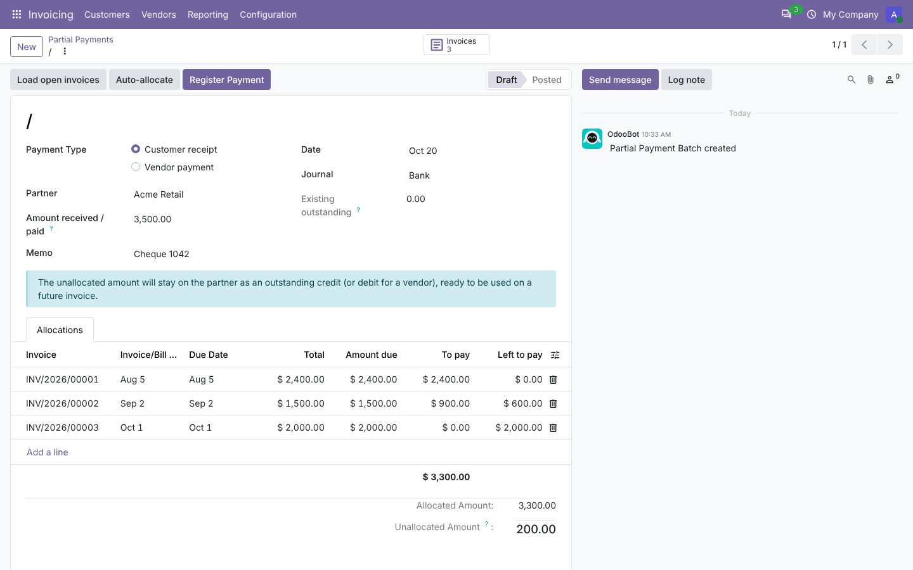
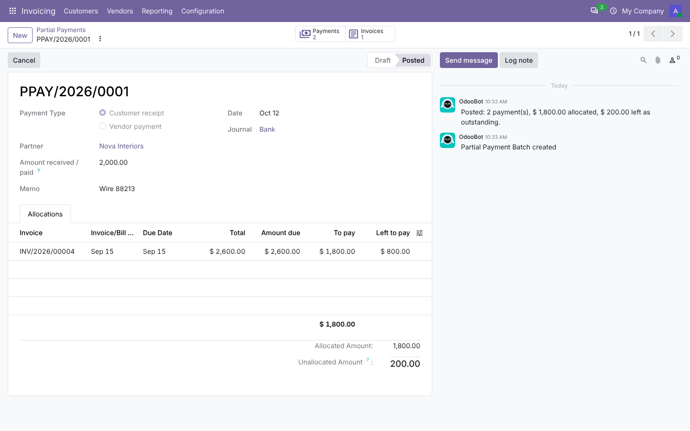
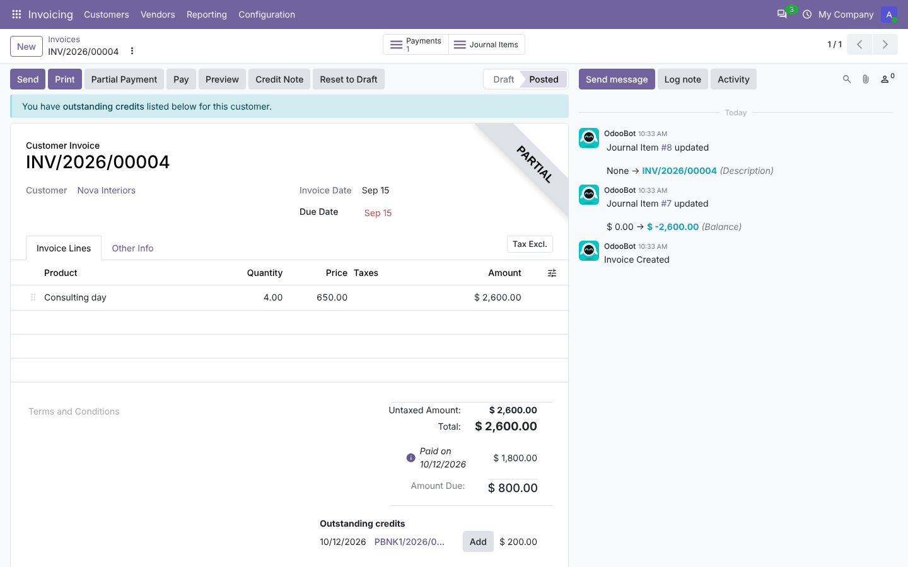
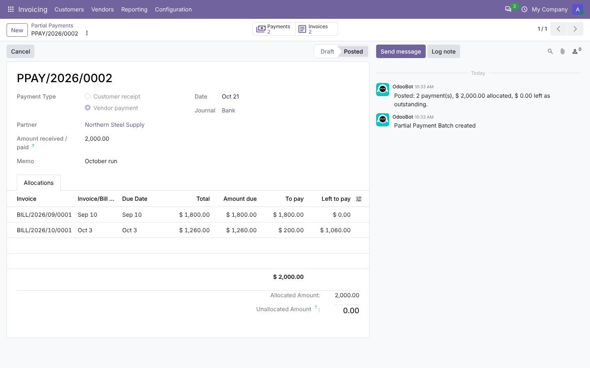
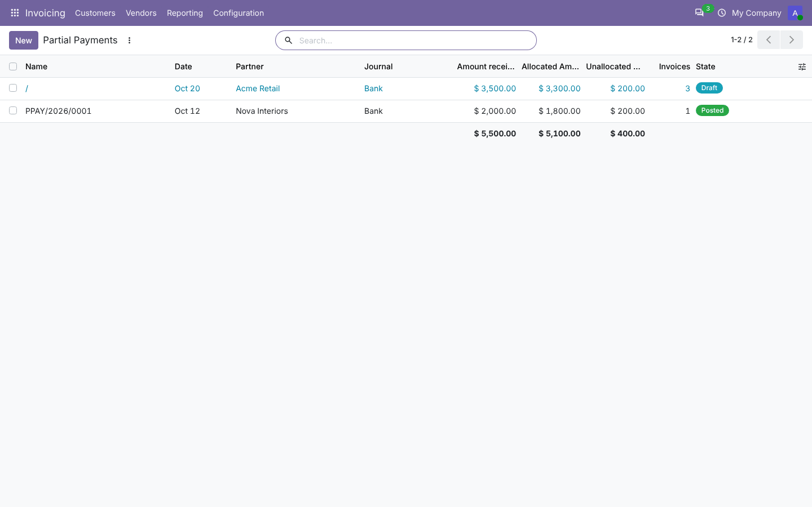

# Invoice Partial Payments

**Odoo 20.0** · LGPL-3 · Category: Accounting

Register **one customer receipt or vendor payment** and **split it across several invoices or bills**, with the
amount you choose for each one. Invoices that are not fully covered stay open with their remaining balance. The
**part you don't allocate stays on the partner as an outstanding credit** (or debit for vendors), ready to use
on a future invoice.



## Features

- **Partial payment batches** under *Invoicing › Customers › Partial Payments* and *Vendors › Partial Payments*:
  - partner, bank or cash journal, date, memo;
  - the **amount received or paid**;
  - one **allocation line per invoice**: total, amount due, **to pay**, left to pay.
- **Load open invoices** adds every open invoice or bill of the partner, oldest due date first. **Auto-allocate**
  spreads the amount over them in that order.
- **Register Payment** creates one standard payment per allocation with exactly that amount, and keeps the
  invoice open for the rest. The unallocated amount becomes one more payment that stays as outstanding credit.
- **Checks** before posting:
  - an amount must be entered;
  - allocations cannot exceed the amount received, and each line cannot exceed its amount due;
  - each invoice must belong to the partner and payment type, be open and in the same currency;
  - no invoice may appear twice.

  Warnings in the form show over-allocation and the unallocated rest. The partner's **existing outstanding**
  credit or debit is shown too.
- **Partial Payment** button on posted, unpaid invoices and bills opens a batch with the invoice and its amount
  due already filled in.
- **History**:
  - each batch keeps its number (`PPAY/2026/0001`), its payments and invoices (smart buttons) and a chatter log;
  - the list shows totals received, allocated and unallocated.
- **Cancel** a batch to cancel its payments; the invoices get their balance back. A cancelled batch can be reset
  to draft.

## Screenshots

| | |
| --- | --- |
| **Posted batch: rest left as outstanding credit**<br> | **Invoice partly paid, with the credit ready to use**<br> |
| **Vendor bills paid with auto-allocation**<br> | **Batch history with totals**<br> |

## Installation

1. Add `20.0/` of this repository to your addons path.
2. Install **Invoice Partial Payments** (depends on `account`).

## Usage

1. **Invoicing › Customers › Partial Payments › New**, or click **Partial Payment** on an invoice.
2. Choose the customer, journal and date, and enter the **amount received**.
3. Click **Load open invoices** and type the amount for each invoice, or click **Auto-allocate**.
4. Click **Register Payment**. Each invoice shows its payment and remaining balance, and the rest appears under
   *Outstanding credits* on the customer's invoices.

Vendors work the same way under *Invoicing › Vendors › Partial Payments*.

## Technical overview

| Part | Role |
| --- | --- |
| `account.partial.payment` | Batch: type, partner, journal, currency, date, amount, memo, lines, allocated/unallocated, existing outstanding, state, payments; actions (load, auto-allocate, post, cancel, reset) |
| `account.partial.payment.line` | Invoice, due date, total, amount due (before the batch once posted), to pay, left to pay, payment |
| Posting | One `account.payment.register` per allocation (amount, *keep open*), so Odoo's own reconciliation, taxes on payment and exchange rules apply. The rest is a plain `account.payment` without an invoice |
| `account.payment.partial_batch_id` | Link from payments to their batch |
| `account.move.action_partial_payment` | Opens a pre-filled batch from an invoice or bill |

Access: billing users (*Invoicing / Billing*) manage batches, and read-only accountants can read them.
Batches are restricted per company.

## Tests

```bash
tools/run_tests.sh 20.0 /path/to/odoo20 account_invoice_partial_payment
```

The tests use `AccountTestInvoicingCommon` and cover:
- a customer receipt split over two invoices, with the rest left as outstanding credit;
- a full payment;
- vendor bills;
- every check;
- load and auto-allocate (oldest first, no duplicates);
- cancel and reset;
- the button on the invoice.

## Full guide

[docs/account_invoice_partial_payment.md](../../docs/account_invoice_partial_payment.md)

---
Author: Aditya Shah · License: LGPL-3
