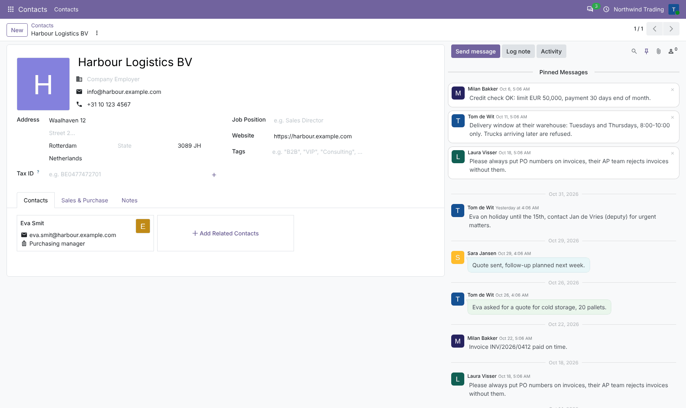
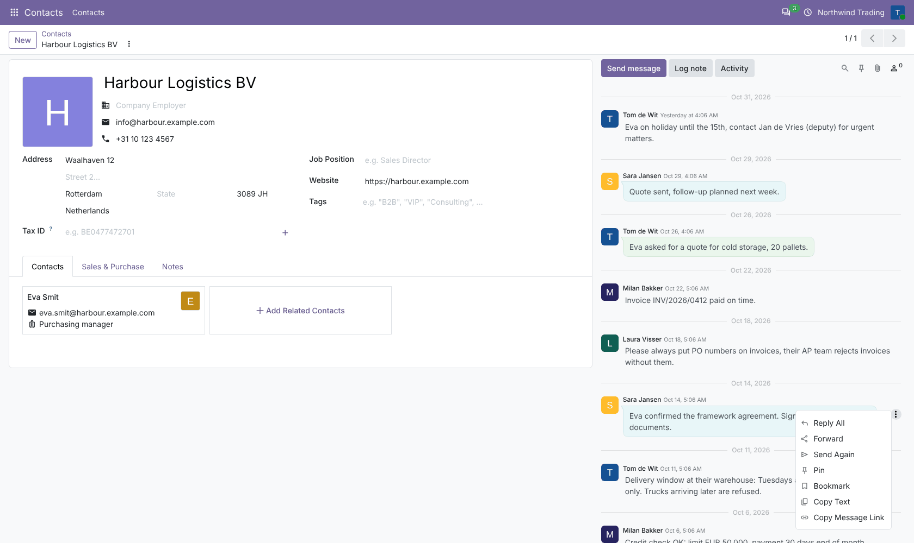
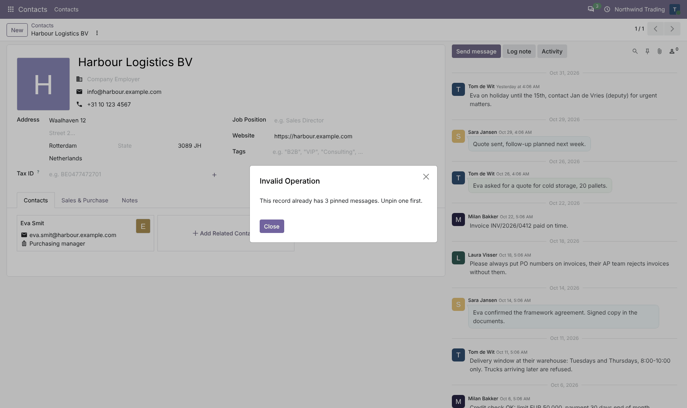
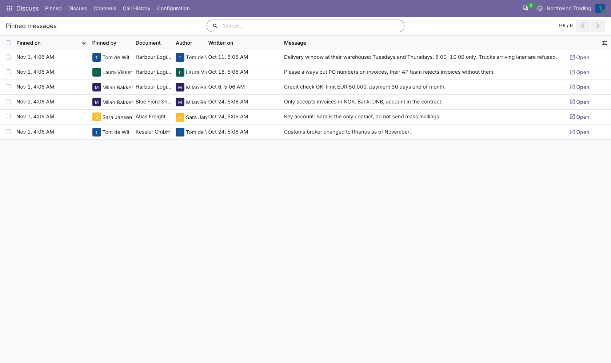
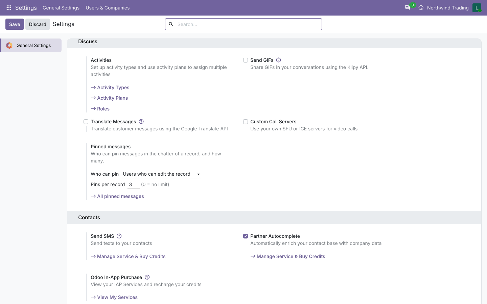

# Chatter: Pin Messages

**Odoo 20.0** · LGPL-3 · Category: Productivity / Discuss

Odoo 20 can already pin messages in the chatter of a record (message action *Pin* and the *Pinned Messages*
panel). This module adds what is missing to use it as a team:
- **rules**: who can pin and how many pins per record;
- **who pinned** each message;
- an **overview of all pinned messages** across records.



## Features

- **Who can pin** (*Settings › General Settings › Discuss › Pinned messages*):
  - users who can edit the record (default);
  - or everyone who can see it (Odoo's own behaviour).
- **Pins per record** (default 5, 0 = no limit): pinning one more shows a clear message.
- Only **messages and notes** can be pinned (not tracking or system notifications), only by **internal users**.
- **Pinned by**: the user who pinned is stored on the message (also in Discuss channels).
- **Overview**: *Discuss › Pinned* lists all pinned messages of all records (channels excluded) with the
  document, author, who pinned it and when, and an *Open* button.
- Discuss channels keep Odoo's own rules (no limit, channel permissions).

## Screenshots

| | |
| --- | --- |
| **Odoo's Pinned Messages panel in the chatter**<br> | **Pin action on a message**<br> |
| **Limit reached**<br> | **All pinned messages, with who pinned**<br> |
| **Settings**<br> | |

## Installation

Add `20.0/` of this repository to your addons path and install **Chatter: Pin Messages**.
- **Odoo dependencies**: `mail`.
- **Python**: nothing extra.

## Configuration

*Settings › General Settings › Discuss › Pinned messages*: who can pin, pins per record.

## Technical overview

| Part | Role |
| --- | --- |
| `mail.thread.set_message_pin()` (override) | Checks the rules on records, then Odoo's pin; stores who pinned |
| `mail.message.pinned_by_id` | Who pinned |
| `views/mail_message_views.xml` | *Pinned* overview list |
| `res.config.settings` | `chatter_pin_message.access`, `chatter_pin_message.max` |

## Tests

```bash
tools/run_tests.sh 20.0 /path/to/odoo20 chatter_pin_message
```

The tests cover:
- pin / unpin, who pinned, unchanged write date, pinning twice;
- messages of another record and tracking messages refused;
- the limit (and 0 = no limit);
- access: edit right by default, read right when allowed, portal users refused;
- the overview action and the settings;
- Discuss channels: no limit, who pinned stored.

## Full guide

[docs/chatter_pin_message.md](../../docs/chatter_pin_message.md) · Odoo 19.0: [`19.0/chatter_pin_message`](../../19.0/chatter_pin_message)

---
Author: Aditya Shah · License: LGPL-3
