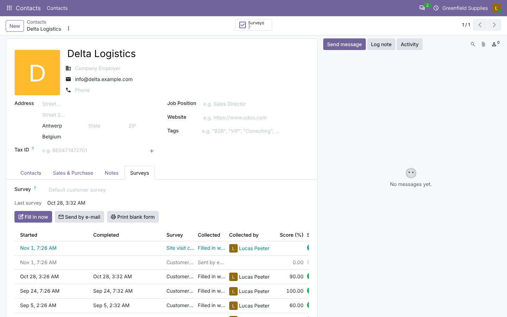
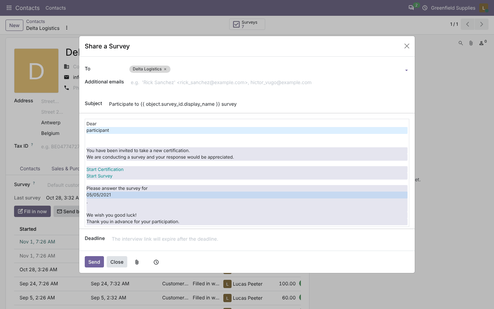
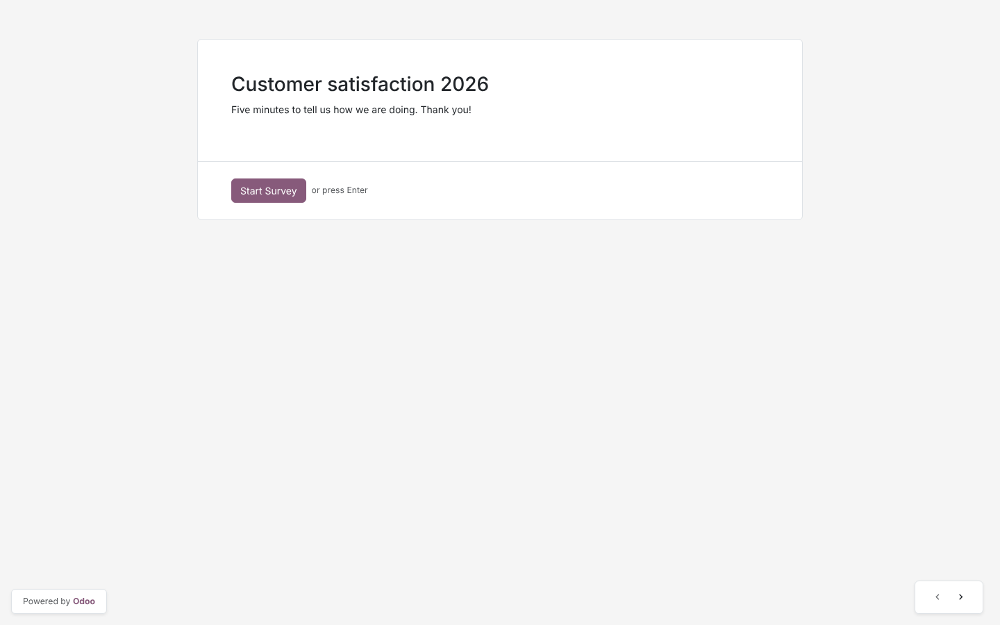
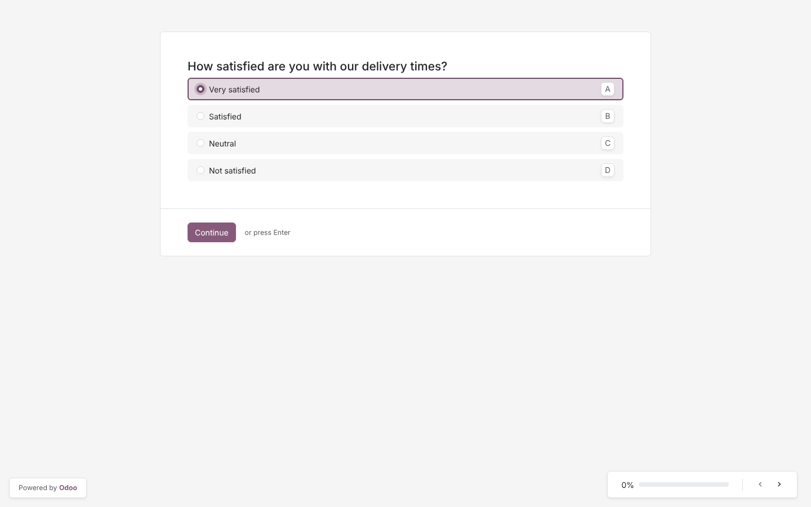
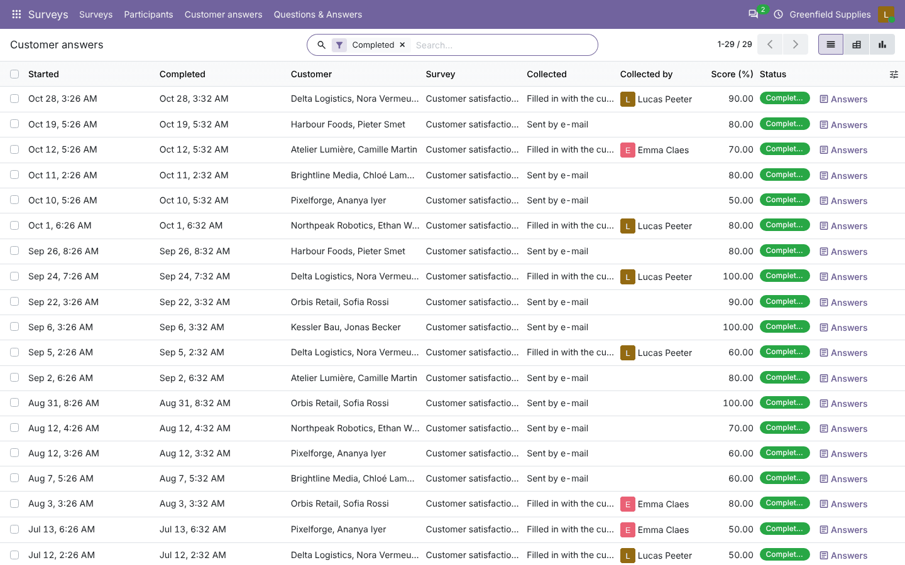
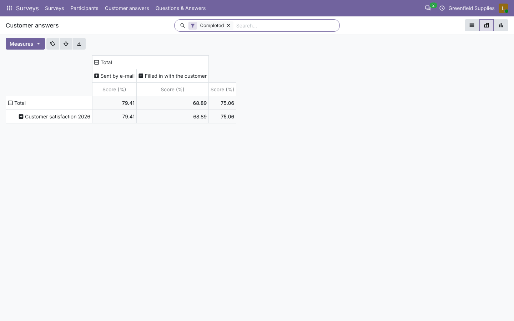
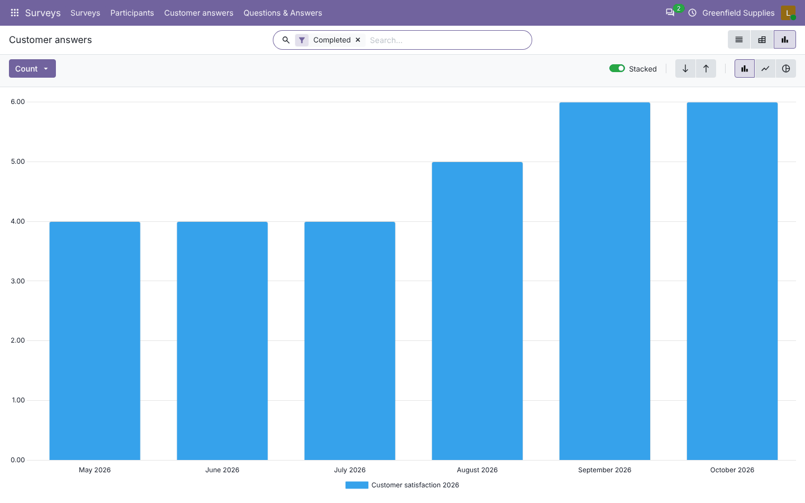
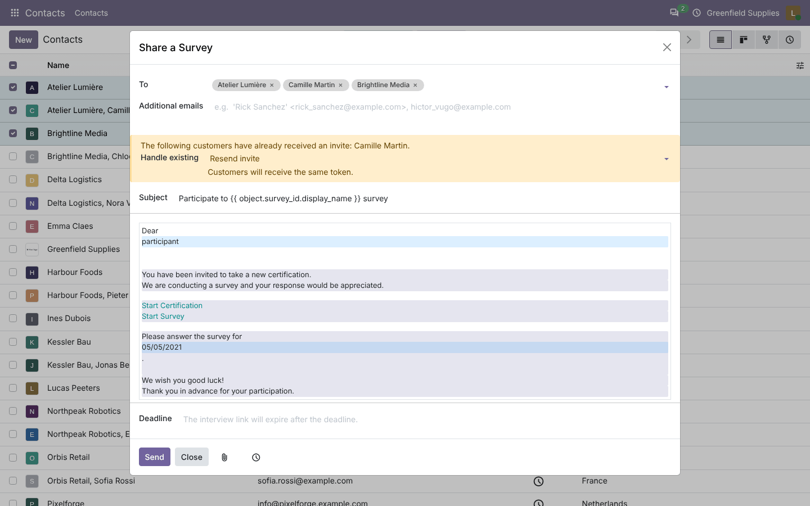
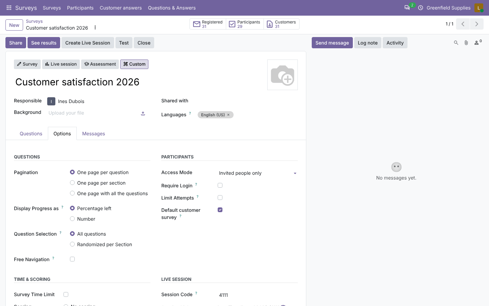

# Customer Surveys

**Odoo 20.0** · LGPL-3 · Category: Marketing / Surveys

Run **surveys from the customer's contact form**:
- **send** a survey by e-mail;
- **fill it in with the customer** during a visit or a phone call;
- **print** a blank form;
- follow **answers and scores** on the contact;
- analyse them by survey, salesperson, country and month.



## Features

- **Surveys tab on contacts** (Survey officers):
  - the **survey** of the contact (empty = the default customer survey);
  - **Fill in now**: opens the survey in a new tab; the employee answers with the customer;
  - **Send by e-mail**: Odoo's survey invitation, pre-filled with the contact;
  - **Print blank form** for paper answers;
  - **answers list** of the contact (and, on a company, of all its contacts): survey, how it was collected, who
    collected it, score, status, with **Answers** (printable answers), **Continue** (visit in progress) and
    **Remind** (e-mail not answered yet).
- **Surveys** smart button and **last survey** date on the contact.
- **Send survey to many contacts**: select contacts in the list, *Actions › Send survey*.
- **Default customer survey**: tick it on one survey (*Options* tab); only one survey keeps it.
- On every answer: **Customer**, **Collected** (*Sent by e-mail* / *Filled in with the customer*) and
  **Collected by**.
- Answers sent by Odoo's own invitations to customers count as customer answers too; answers of employees for
  themselves do not.
- **Customer answers** menu (*Surveys*): list, pivot (average score by survey and collection mode) and graph by
  month; filters *Completed*, *In progress*, *My customers*, *Collected by me*; group by survey, customer,
  salesperson, country, month.
- **Customers** smart button on the survey.
- Scores are **averaged** when grouped (instead of summed).

## Screenshots

| | |
| --- | --- |
| **Surveys tab of a customer**<br> | **Send by e-mail**<br> |
| **Fill in now: start**<br> | **Fill in now: question**<br> |
| **Customer answers**<br> | **Average score by collection mode**<br> |
| **Answers per month**<br> | **Send to several contacts**<br> |
| **Default customer survey**<br> | |

## Installation

Add `20.0/` of this repository to your addons path and install **Customer Surveys**.
- **Odoo dependencies**: `contacts`, `survey`.
- **Python**: nothing extra.

## Configuration

1. *Surveys*: create the survey; on the *Options* tab tick **Default customer survey** (optional) and keep the
   access mode *Invited people only* for personal links.
2. *Settings › Users*: give the people who survey customers the **Surveys: User** role.
3. On a contact, choose another survey in the *Surveys* tab if needed.

## Technical overview

| Part | Role |
| --- | --- |
| `survey.user_input` | `customer_partner_id`, `customer_mode`, `customer_collected_by_id`, stored country / salesperson / company; averaged score |
| `survey.survey` | `customer_default` (one survey), *Customers* button |
| `res.partner` | survey of the contact, answers (contact and its children), count, last date, actions |
| `views/res_partner_views.xml` | *Surveys* tab, smart button, *Send survey* list action |
| `views/survey_user_input_views.xml` | *Customer answers* list / pivot / graph / search |

## Tests

```bash
tools/run_tests.sh 20.0 /path/to/odoo20 customer_survey
```

The tests cover:
- one default survey;
- sending by e-mail (wizard pre-filled, answers marked as e-mail, contact survey over the default);
- filling in with the customer (participant = employee, customer set, new answer even with limited attempts,
  continue);
- counts, last date, company showing its contacts' answers, answers action;
- employee answers vs native invitations;
- no survey configured; blank print;
- the *Send survey* list action;
- the employee opening the visit survey in the browser.

## Full guide

[docs/customer_survey.md](../../docs/customer_survey.md) · Odoo 19.0: [`19.0/customer_survey`](../../19.0/customer_survey)

---
Author: Aditya Shah · License: LGPL-3
