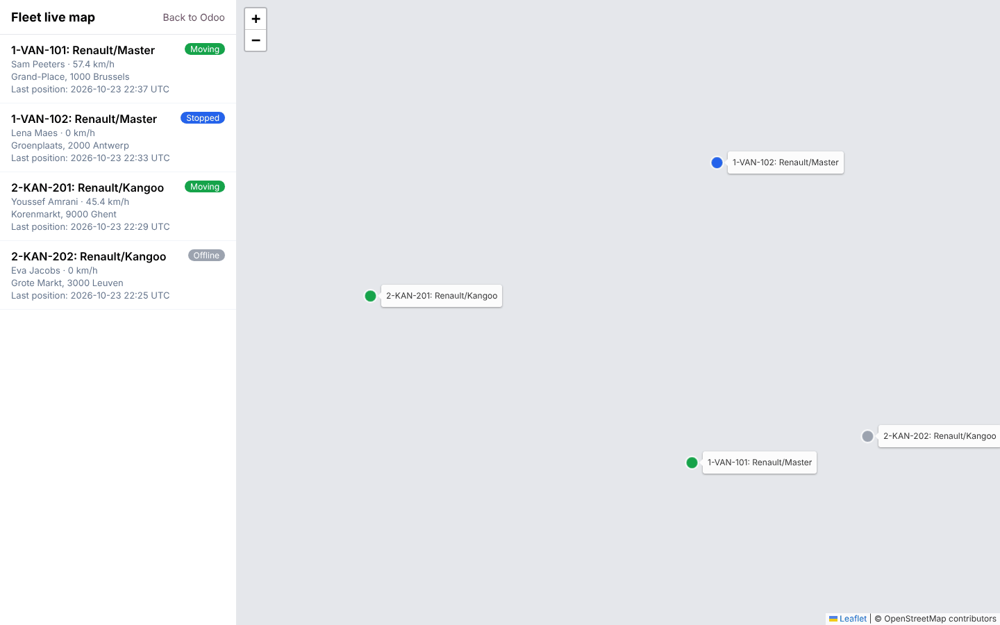
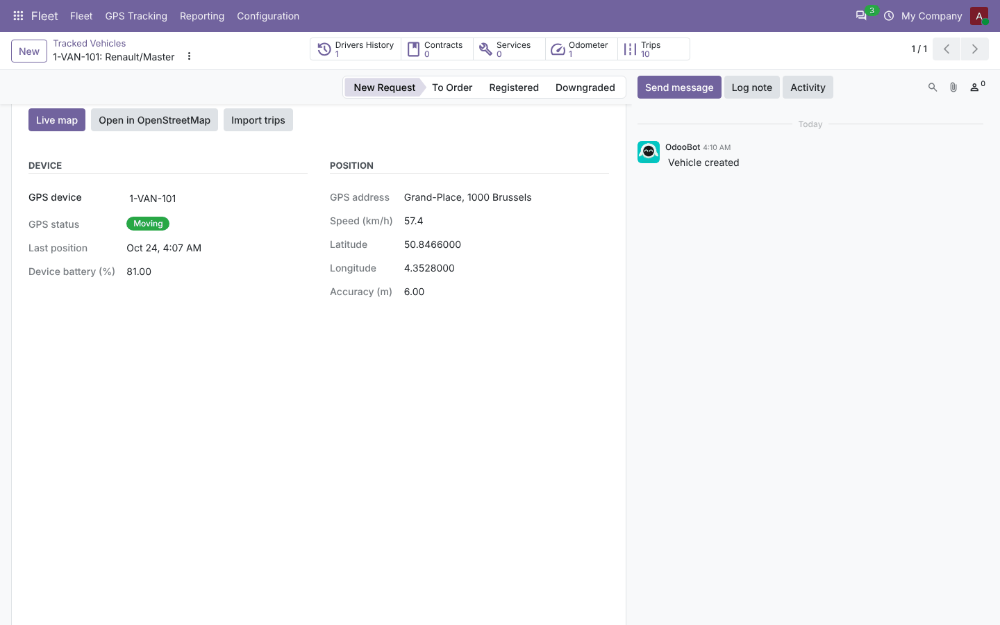
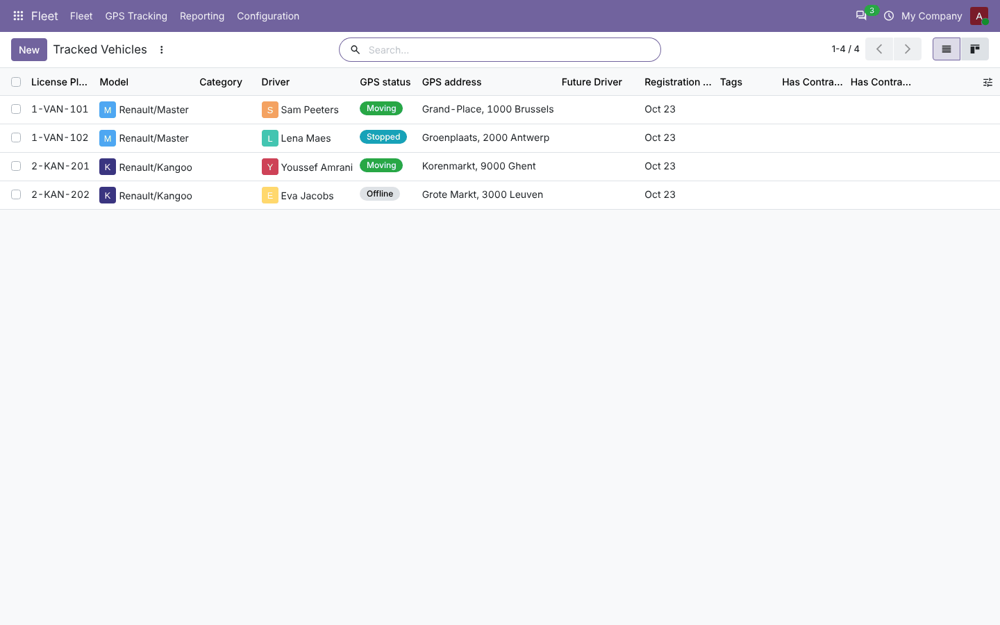
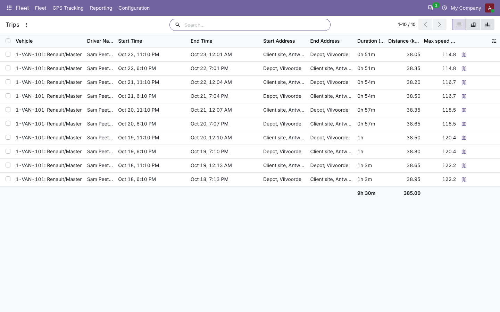
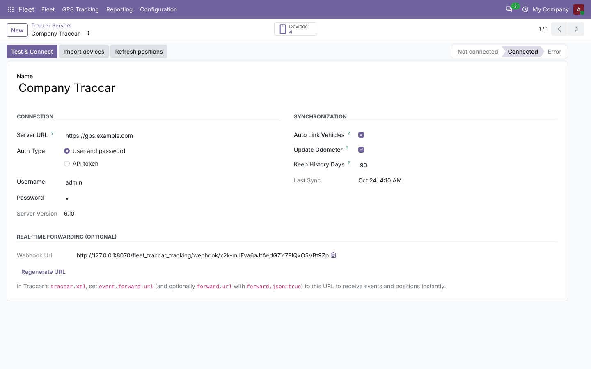
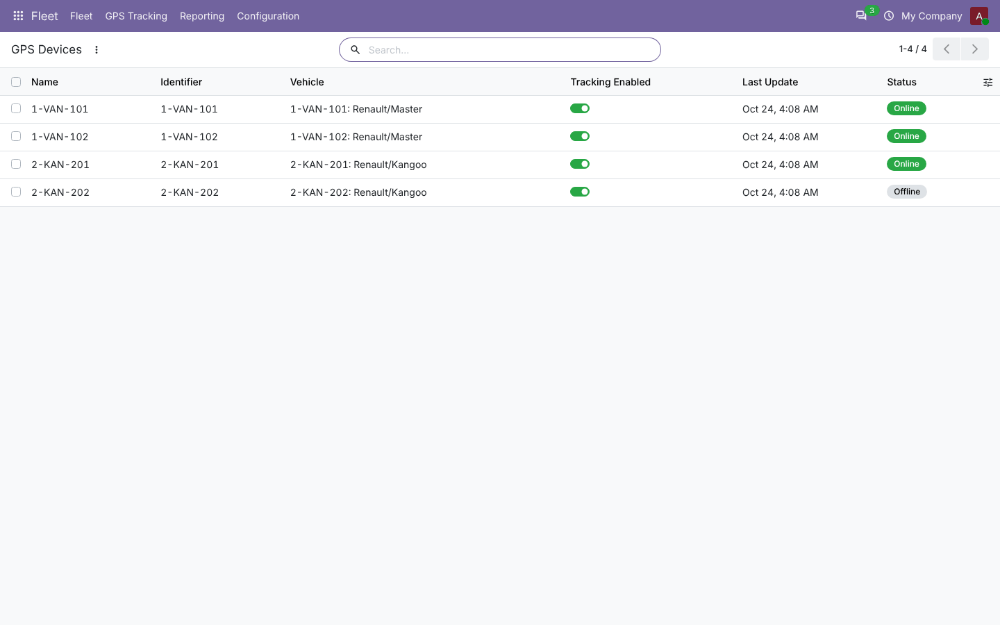
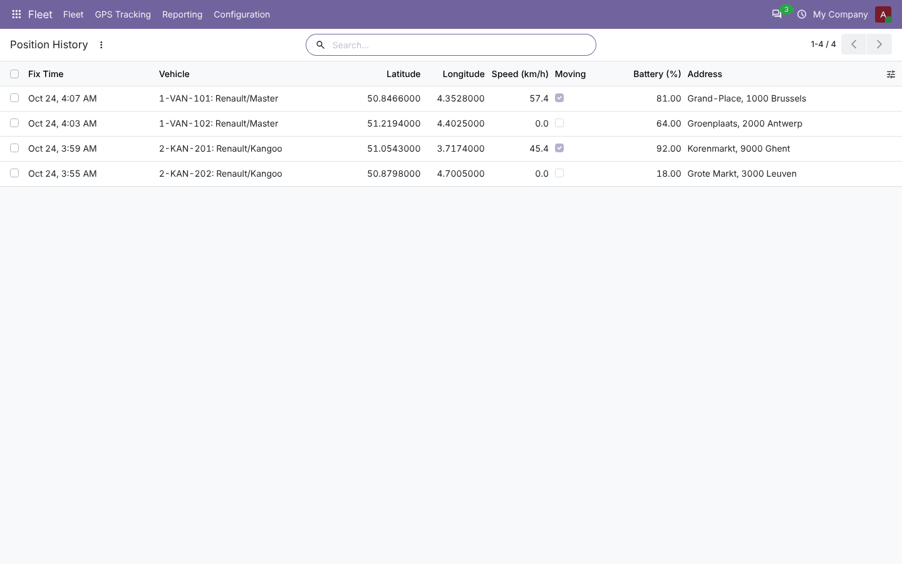

# Fleet GPS Tracking (Traccar)

**Odoo 20.0** · LGPL-3 · Category: Fleet

Connect Odoo **Fleet** to a **Traccar** GPS server (self-hosted or traccar.org). Drivers run the free
Traccar Client app on their phone (or vehicles carry a GPS tracker); Odoo shows where every vehicle is,
whether it is moving, its trips and its odometer.



*Live map of the fleet. The screenshot was taken offline, so the OpenStreetMap background tiles do not appear.*

## Features

- **Live map** of all tracked vehicles (Leaflet + OpenStreetMap, bundled in the module), colored by status
  (moving / stopped / offline), auto-refreshed every 30 seconds, with a vehicle list and popups.
- **Live data on each vehicle**: position, address, speed, motion status, last fix time, device battery, accuracy,
  and an embedded map in a *GPS Tracking* tab.
- **Devices** imported from Traccar and linked to vehicles automatically by license plate; tracking can be switched off per device.
- **Trips** imported from the Traccar trips report (daily, or on demand for any period): start/end, addresses,
  duration, distance, average and max speed, driver; list, pivot and graph views; route link.
- **Position history** with automatic cleanup after N days.
- **Odometer**: Traccar's total distance creates fleet odometer readings.
- **Real-time events** (optional): Traccar event/position forwarding to a secret URL; alarms such as overspeed are posted on the vehicle.
- Scheduled refresh every 2 minutes (configurable in Scheduled Actions).

## Screenshots

| | |
| --- | --- |
| **Vehicle: GPS Tracking tab**<br> | **Tracked vehicles with status and location**<br> |
| **Trips with duration and distance totals**<br> | **Traccar server configuration**<br> |
| **GPS devices linked to vehicles**<br> | **Position history**<br> |

## Installation

1. Add `20.0/` of this repository to your addons path.
2. Install **Fleet GPS Tracking (Traccar)** (depends on Fleet). No extra Python package.

## Configuration

1. **Traccar side**: create a device per vehicle. Use the vehicle's **license plate as the device identifier**
   (or name) so Odoo links them automatically. On each driver's phone, install *Traccar Client* and set the same identifier and your server URL.
2. **Fleet › Configuration › Traccar Servers › New**: server URL, then either user/password or an API token
   (Traccar › Settings › Preferences › Token). Click **Test & Connect**, then **Import devices**.
3. Check **GPS Tracking › GPS Devices**: link any device that was not matched to its vehicle.
4. Optional real time: copy the server's forwarding URL into Traccar's `traccar.xml`:
   `<entry key='event.forward.url'>…</entry>` (and `forward.url` + `forward.json=true` for positions).

## Usage

- **Fleet › GPS Tracking › Live Map**: the whole fleet; click a vehicle in the list to zoom on it.
- On a vehicle, *GPS Tracking* tab: live data, **Live map**, **Open in OpenStreetMap**, **Import trips**.
- **GPS Tracking › Trips**: group by vehicle or day, pivot by week, export to Excel.

## Technical overview

| Model | Role |
| --- | --- |
| `traccar.server` | Connection (credentials visible to fleet managers only), sync options, webhook token, crons |
| `traccar.device` | Traccar device ↔ vehicle (one device per vehicle), status, tracking switch |
| `traccar.position` | Position history (speeds converted from knots to km/h, times to UTC) |
| `traccar.trip` | Trips from the Traccar trips report (unique per device and start time) |
| `fleet.vehicle` (extended) | Live GPS fields, map, trips, odometer update |

Routes: `/fleet_traccar_tracking/map` (+ `/map/data` JSON) for logged-in users, `/fleet_traccar_tracking/webhook/<token>` for Traccar.

## Tests

```bash
tools/run_tests.sh 20.0 /path/to/odoo20 fleet_traccar_tracking
```

The Traccar API is mocked: connection and error state, device import and auto-linking, positions (UTC, km/h,
motion, offline, odometer, no duplicates), disabled tracking, trips import, access rights, webhook with token, live map page and JSON.

## Full guide

[docs/fleet_traccar_tracking.md](../../docs/fleet_traccar_tracking.md)

---
Author: Aditya Shah · License: LGPL-3 · Bundles Leaflet 1.9.4 (BSD-2-Clause, see `static/lib/leaflet/LICENSE`)
