# HubSpot Connector

**Odoo 20.0** · LGPL-3 · Category: Sales/CRM

**Two-way synchronization** between HubSpot and Odoo, using a HubSpot **private app token**.

| HubSpot | Odoo | Import | Export |
| --- | --- | --- | --- |
| Companies | Contacts (companies) | ✔ | ✔ |
| Contacts (+ company association) | Contacts (persons, parent company) | ✔ | ✔ |
| Products | Products | ✔ | ✔ |
| Deals (+ contact / company) | CRM leads or opportunities, stage, won / lost | ✔ | ✔ |
| Quotes (+ line items) | Quotations (draft / sent) | ✔ | ✔ |
| Invoices (+ line items) | Customer invoices (draft) | ✔ | ✔ |
| Notes | Log notes in the chatter | ✔ | ✔ |
| Tasks | Activities (done when completed) | ✔ | ✔ |
| Meetings | Calendar events with attendees | ✔ | ✔ |
| E-mails | Logged e-mails in the chatter | ✔ | ✔ |

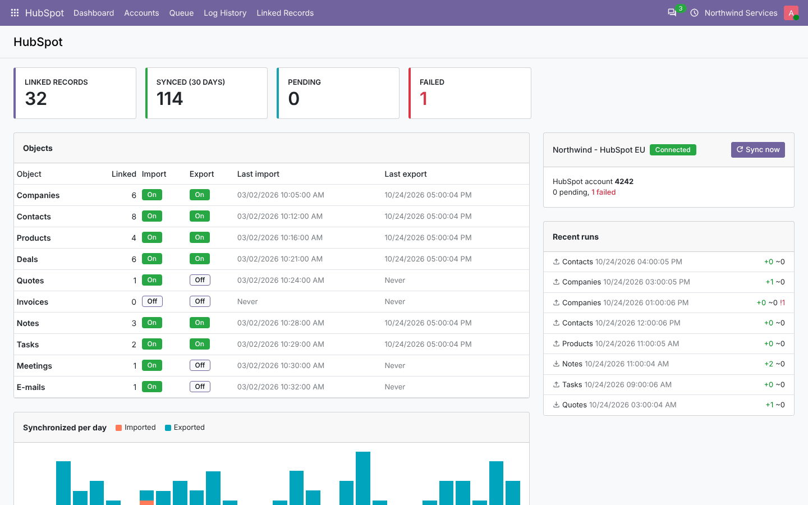

## Features

- **Per object, per direction**:
  - toggles to switch import and export on or off;
  - an incremental sync (only what changed since the last run);
  - an *Import now* / *Export now* button;
  - a reset for a full synchronization.
- **Queue**:
  - every object becomes a job, processed one by one in its own savepoint, so one failure does not stop the
    others;
  - failed jobs are **retried** up to N times;
  - **429 / 5xx answers are retried** with back-off;
  - pagination is automatic, and newer jobs replace pending ones for the same object;
  - a *Retry* button and the error text are on each job.
- **No duplicates**:
  - contacts are matched by e-mail, companies by domain or name, products by SKU, in both directions;
  - an Odoo record is never merged into a HubSpot object that is already linked.
- **No ping-pong**: each link stores a fingerprint of the synchronized values. Unchanged records are skipped, so
  an imported record is not exported back.
- **Conflicts**: choose *HubSpot wins* or *Odoo wins* when a record changed on both sides.
- **Owners → users**: matched by e-mail and editable. **Deal stages → CRM stages**: matched by name and editable,
  with won and lost handled.
- **Custom field mapping**: any stored Odoo field ↔ any HubSpot property, per object and direction. Values are
  converted (numbers, booleans, dates, selections, many2one by name).
- **Webhooks (real time)**: `/hubspot/webhook/<account>`. The **v3 signature** is checked (HMAC-SHA256, 5-minute
  replay window). Creations and changes are queued; deletions archive the Odoo record.
- **Dashboard**:
  - linked records and synchronized jobs over 30 days;
  - pending and failed jobs;
  - a per-object table with last import and export;
  - a daily import/export chart;
  - recent runs;
  - *Sync now* per account.
- **Log history** per run (queued, created, updated, skipped, failed).
- **Linked records** list, plus a **HubSpot** button on contacts, leads, products, quotations and invoices that
  opens the HubSpot record.
- **Export to HubSpot** action on those lists (choose the account, send now or queue).
- **Multi-account and multi-company.**
- Scheduled actions: *HubSpot: synchronize* (every 15 min) and the cleanup of old jobs.

## Screenshots

| | |
| --- | --- |
| **Account: objects and directions**<br>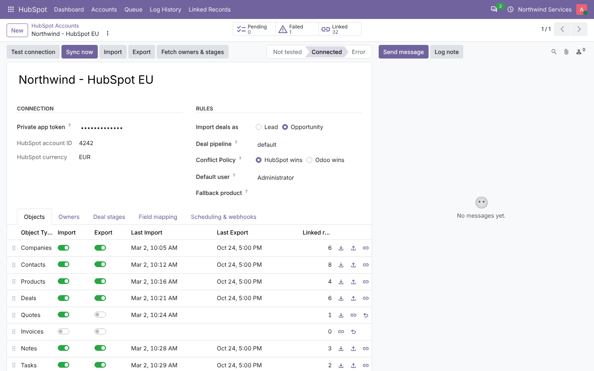 | **Owners mapped to users**<br>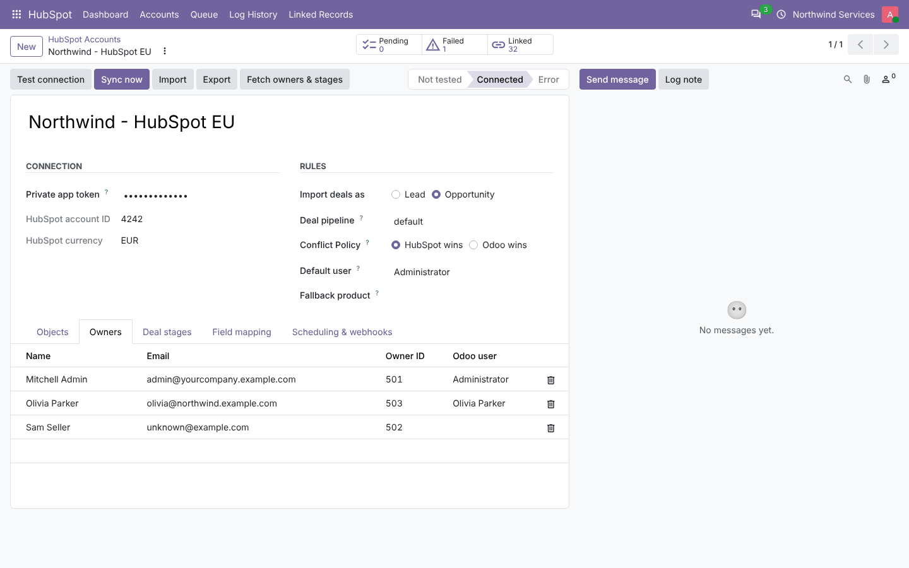 |
| **Deal stages mapped to CRM stages**<br>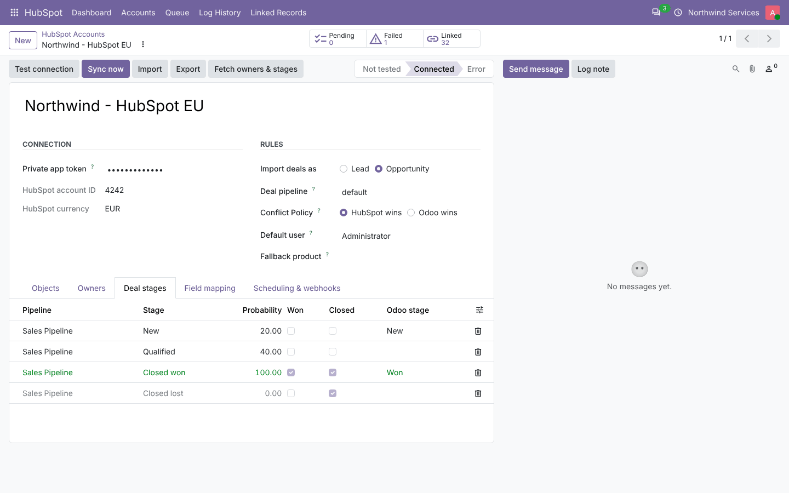 | **Custom field mapping**<br>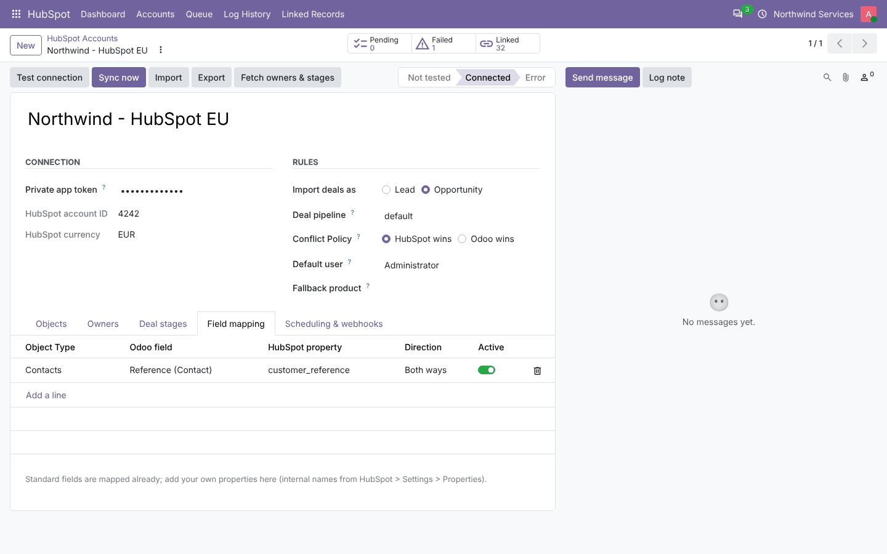 |
| **Queue, retries and webhooks settings**<br>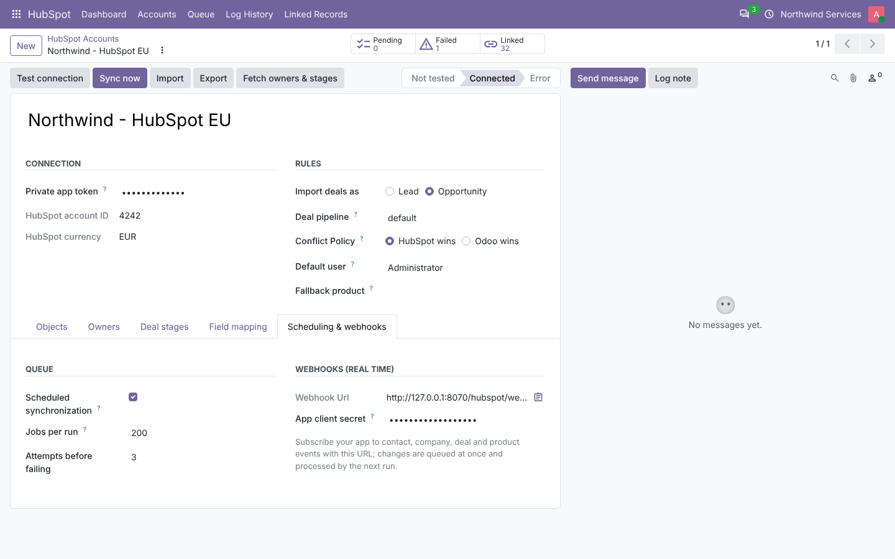 | **Queue**<br>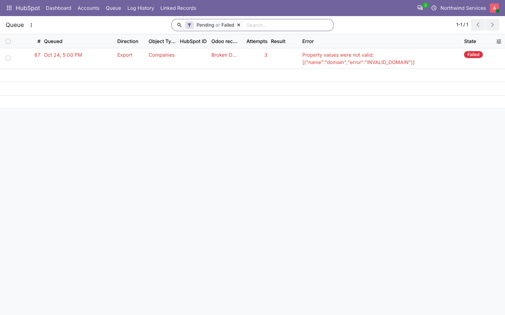 |
| **A failed job with HubSpot's error**<br>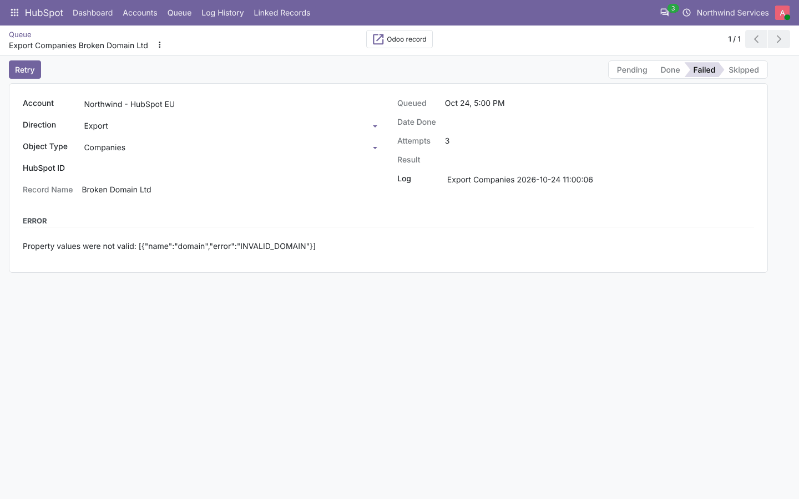 | **Log history**<br>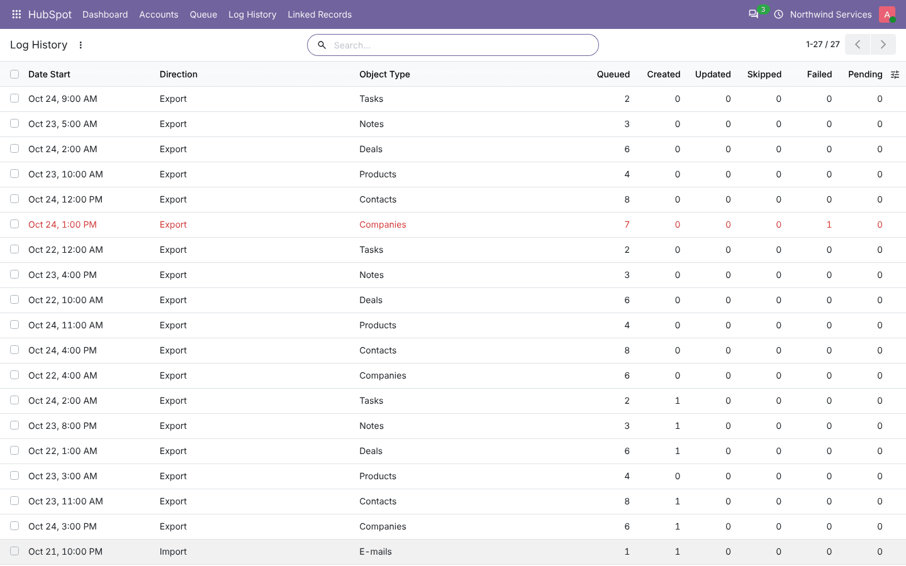 |
| **Linked records**<br>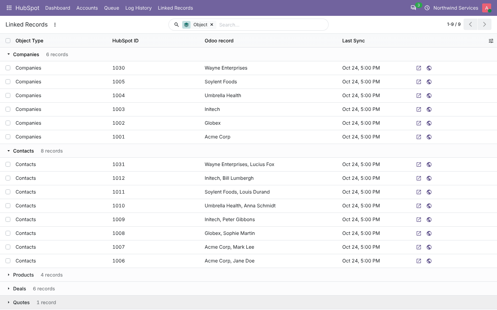 | **Contact with HubSpot button and imported note**<br>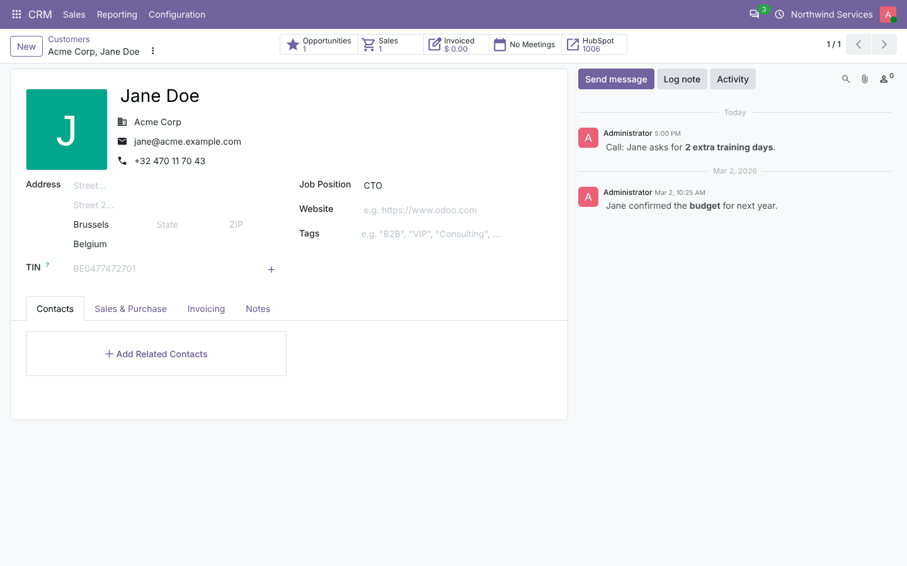 |
| **Imported deal**<br>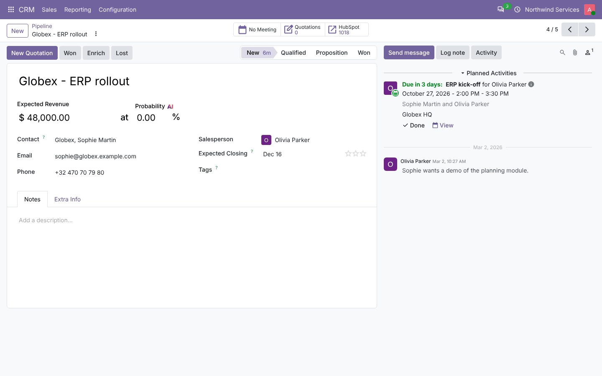 | **Imported quote with line items**<br>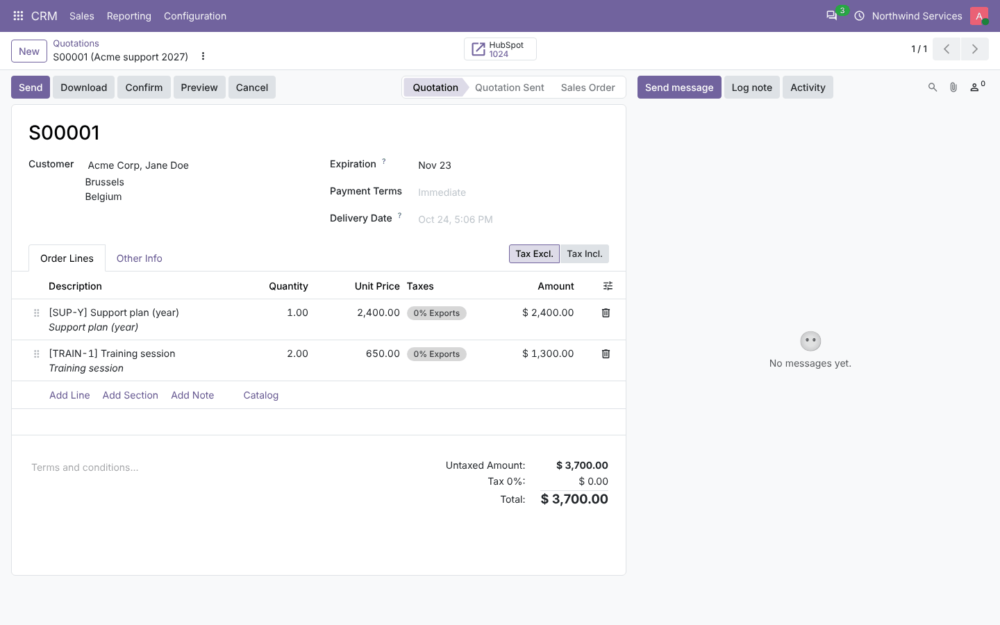 |
| **Export from a list**<br>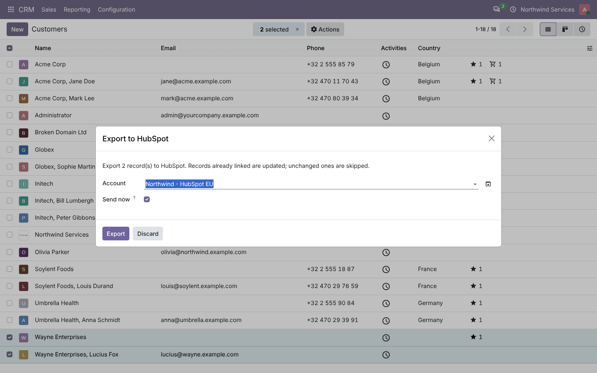 | |

## Installation

Add `20.0/` of this repository to your addons path and install **HubSpot Connector**.
- **Odoo dependencies**: `crm`, `sale`, `calendar`.
- **Python**: `requests`.

## Configuration

1. **In HubSpot**, open *Settings › Integrations › Private Apps › Create*. Give the app the scopes you need:
   - `crm.objects.contacts/companies/deals` (read and write);
   - `crm.objects.owners.read`;
   - `e-commerce` for products and line items;
   - `crm.objects.quotes`, `crm.objects.invoices`;
   - `sales-email-read`.

   Then copy the **access token**.
2. **In Odoo**, go to *HubSpot › Accounts › New*:
   - paste the token, then *Test connection*. This also fetches owners and deal pipelines.
   - Check the **Owners** and **Deal stages** mappings.
   - Choose deals as leads or opportunities, the export pipeline, the conflict policy, the default user and the
     fallback product.
   - **Objects**: switch import and export per object, then click *Sync now*.
3. **Optional, webhooks**: in the app's *Webhooks* tab, set the target URL shown in *Scheduling & webhooks*.
   Subscribe to contact, company, deal and product events, and paste the app's **client secret** in Odoo.
4. Access: *Settings › Users › HubSpot › Configuration Manager* (administrators have it).

## Technical overview

| Part | Role |
| --- | --- |
| `models/hubspot_client.py` | Plain-Python API client: auth, retries, pagination, search, batch read, v4 associations, signature check |
| `hubspot.account` / `hubspot.object` | Connection, rules, per-object toggles and sync dates, scheduled sync, dashboard data |
| `hubspot.sync` | Mapping engine: `_import_<object>` / `_export_<object>` / `_after_export_<object>` per object, fingerprints, de-duplication, associations |
| `hubspot.queue` / `hubspot.log` | Jobs (payload, state, attempts, error, result) and runs |
| `hubspot.record` | Links Odoo record ↔ HubSpot object (+ fingerprint, extra data such as created line items) |
| `hubspot.owner`, `hubspot.stage`, `hubspot.field.mapping` | Mappings |
| `hubspot.linked.mixin` | `hubspot_id` / `hubspot_url` and the HubSpot button on partners, leads, products, orders, invoices |
| `controllers/webhook.py` | Signed webhook endpoint |
| `static/src/dashboard/` | OWL dashboard |

## Odoo 20 notes

- **Companies**: in Odoo 20 a partner is a company when it has a VAT number (`is_company` is computed). Imported
  HubSpot companies are recognised by their link instead, and exported companies are partners with a VAT,
  contacts, or a company link.
- **Misc**: typed settings getters, `ir.access.csv`, OWL 3 and Material Symbols on the dashboard.

## Tests

```bash
tools/run_tests.sh 20.0 /path/to/odoo20 hubspot_connector
```

There are 28 tests against an **in-memory HubSpot** (`tests/fake_hubspot.py`), with no network access:
- the client: retries, pagination, dates, signatures;
- setup and metadata;
- import of every object, incremental runs, won / lost, quotes and invoices with line items, engagements on the
  right record;
- custom mappings and both conflict policies;
- export of every object, with associations and line items;
- de-duplication, recreation after a deletion in HubSpot, no ping-pong;
- the queue: failures, retries, replacement;
- the cron, the dashboard and access rights;
- signed webhooks (accepted, refused, replayed, deletion);
- a browser tour.

## Full guide

[docs/hubspot_connector.md](../../docs/hubspot_connector.md)

---
Author: Aditya Shah · License: LGPL-3
