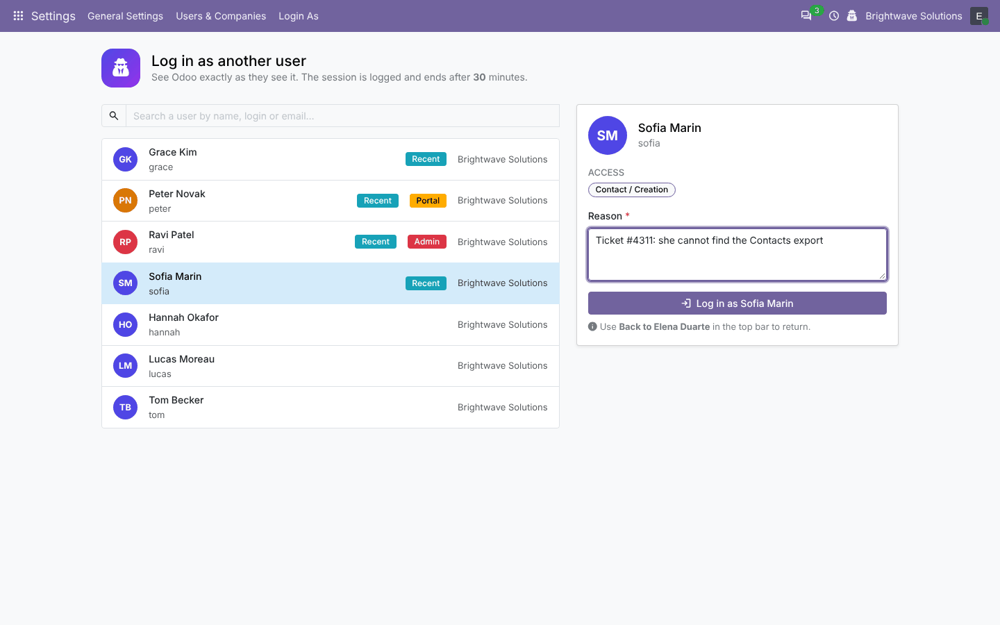
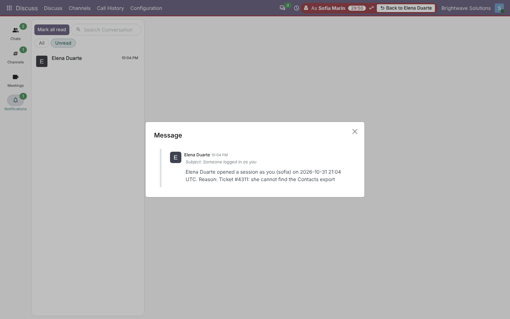
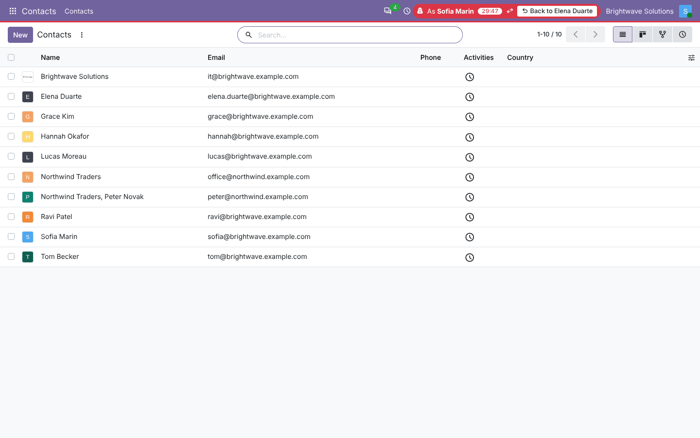
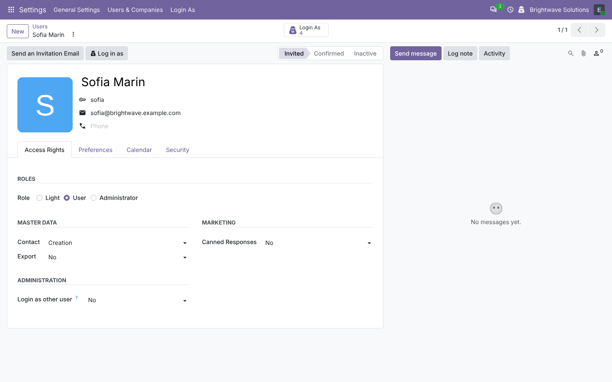
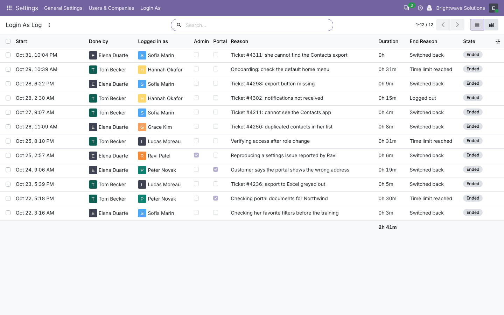
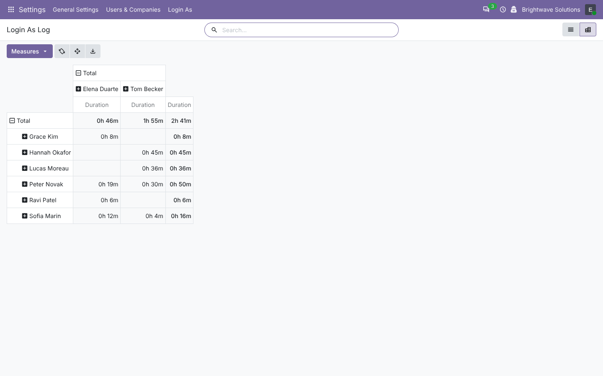
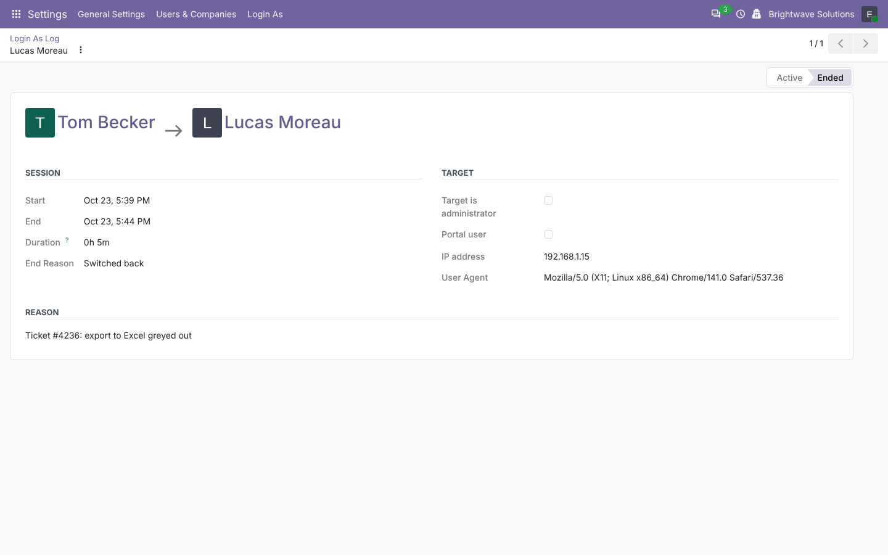
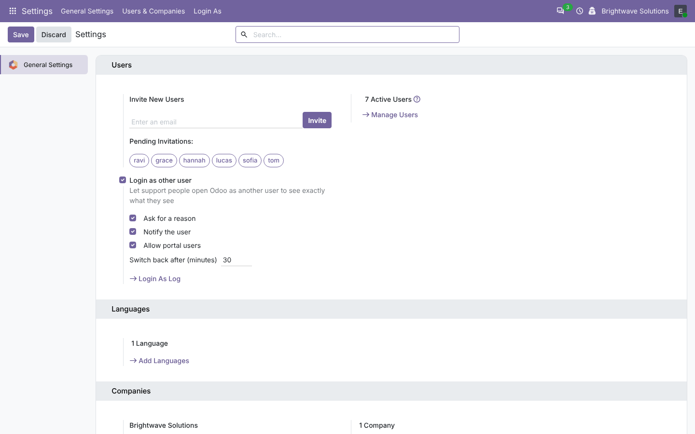
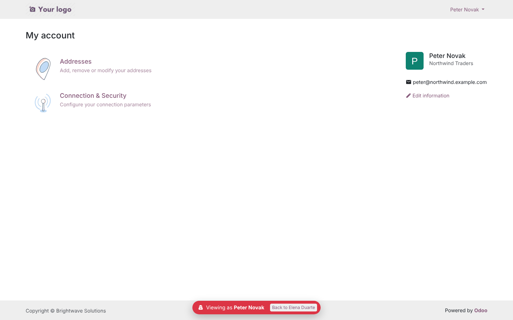

# Login As Other User

**Odoo 20.0** · LGPL-3 · Category: Administration

**See Odoo exactly as another user sees it.** Support people open a session as a colleague or a portal
customer in one click, give a reason, work with a red banner that shows who they are, and come back with
*Back to …*. Every session is logged.



## Features

- **Switch screen** (*Settings › Login As › Log in as a User*, or the spy icon in the top bar):
  - search users by name, login or e-mail;
  - badges for *Admin*, *Portal* and users you opened *Recently*;
  - the user's access (privileges and groups) and last login before you switch;
  - reason field, required or optional.
- **Log in as** button on the user form, and *Log in as* in the *Action* menu of the user list.
- **While logged in as someone else**:
  - red pill in the top bar: *As Sofia Marin*, a countdown, *Back to Elena Duarte*;
  - a red line under the menu bar;
  - switch straight to another user without going back first (the real person is still the one checked and
    logged);
  - portal and website pages show a floating *Viewing as … · Back to …* banner.
- **Rules on who can be opened**:
  - only members of *Login as other user / Allowed*;
  - never the superuser, the public user, archived users or yourself;
  - administrators only by administrators;
  - portal users only when allowed in the settings;
  - users of other companies only by administrators.
- **Time limit**: the session switches back by itself after N minutes (0 = no limit), on the server and in the
  browser.
- **Notification** to the user: *Elena Duarte opened a session as you … Reason: …* (inbox or e-mail, following
  the user's preference).
- **Audit log** (*Settings › Login As › Login As Log*):
  - who, as whom, reason, start, end, duration;
  - how it ended: switched back, switched to another user, logged out, time limit reached, session expired;
  - IP address and browser;
  - filters (running, admin and portal targets, mine), group by, pivot;
  - members see their own sessions, administrators see all.
- *Login As* smart button on the user form with the sessions done by or on that user.
- Hourly job that closes log lines of sessions that cannot be alive any more.

## Screenshots

| | |
| --- | --- |
| **Switch screen**<br> | **Logged in as Sofia: her inbox shows the notification**<br> |
| **Working as Sofia: banner, countdown, way back**<br> | **User form: Log in as + sessions**<br> |
| **Login As Log**<br> | **Log pivot (time per user)**<br> |
| **Log entry**<br> | **Settings**<br> |
| **Portal user: banner on the portal**<br> | |

## Installation

Add `20.0/` of this repository to your addons path and install **Login As Other User**.
- **Odoo dependencies**: `base_setup`, `mail`.
- **Python**: nothing extra.

## Configuration

1. *Settings › General Settings › Users › Login as other user*:
   - **Ask for a reason**;
   - **Notify the user**;
   - **Allow portal users**;
   - **Switch back after (minutes)**.

   All are on after installation, with a 60-minute limit; portal users are off.
2. *Settings › Users*: give **Login as other user: Allowed** to your support people. The administrator has it
   after installation.

## Technical overview

| Part | Role |
| --- | --- |
| `controllers/main.py` | `/login_as/start` (checks, log, notification, session switch), `/login_as/stop`, `/login_as/back` (portal), `/web/session/logout` closes the log |
| `res.users` | `_login_as_check()` (all the rules), `login_as_search()` (switch screen data), form actions |
| `login.as.log` | Audit log, `_close(reason)`, hourly `_cron_close_stale()` |
| `ir.http` | `session_info()['login_as']` for the web client; `_pre_dispatch()` ends sessions over the time limit |
| `static/src/login_as/` | Systray pill and switch screen (OWL) |
| `views/frontend_templates.xml` | Portal / website banner |

The real user is stored in the session (`login_as_origin`: id, name, log id, start time). The session id is
rotated at each switch, like a normal login.

## Odoo 20 notes

- Session helpers moved to `odoo.http.session` (`logout()`, `SESSION_LIFETIME`); `/web/session/logout` is POST
  only.
- Settings read with typed `get_bool()` / `get_int()`.
- Access rights and the log rules in `ir.access.csv`.
- OWL 3 (`proxy`, `useProps`, `this.` in templates) and Odoo 20 icons.

## Tests

```bash
tools/run_tests.sh 20.0 /path/to/odoo20 login_as_user
```

The tests cover:
- start and switch back (the session really becomes the other user's);
- the notification;
- the reason rule;
- every refusal (no group, feature off, yourself, superuser, public, archived, administrator, portal);
- administrators opening administrators and portal users;
- chained switches;
- the time limit, with and without limit;
- logout;
- the portal banner and *Back* link;
- search data and session info;
- log access rules and the cleanup job;
- user form actions;
- a browser tour (systray → search → reason → log in → back).

## Full guide

[docs/login_as_user.md](../../docs/login_as_user.md) · Odoo 19.0: [`19.0/login_as_user`](../../19.0/login_as_user)

---
Author: Aditya Shah · License: LGPL-3
