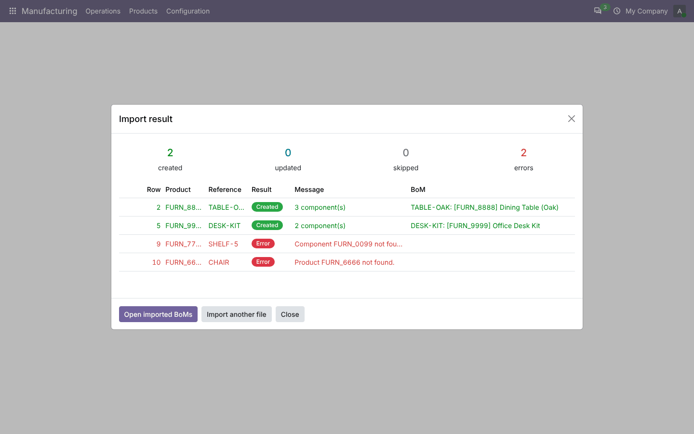
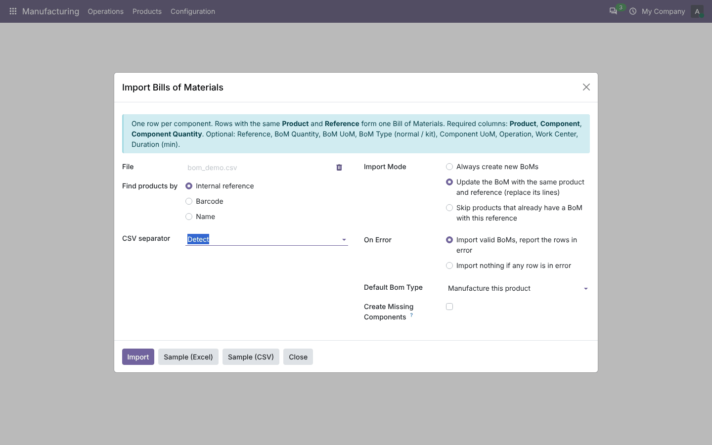
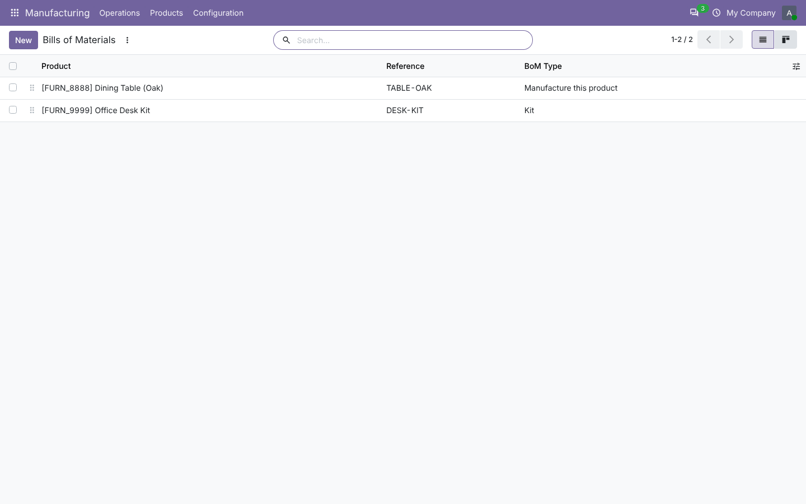
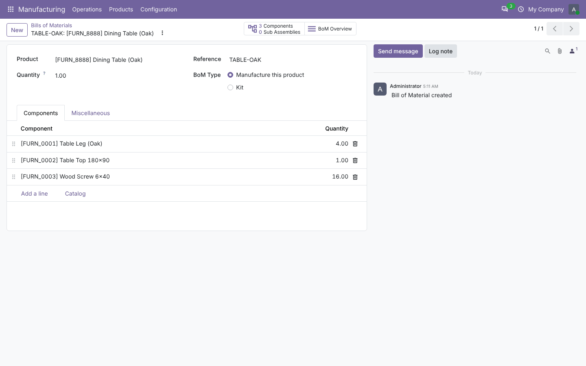

# Import Bills of Materials

**Odoo 20.0** · LGPL-3 · Category: Manufacturing

Import Bills of Materials from **CSV** or **Excel (.xlsx)**: one row per component, grouped into BoMs, with
operations and work centers, product matching by internal reference, barcode or name, update/skip modes and a
row-by-row result report.



## Features

- **CSV and Excel** files; CSV separator detected automatically (comma, semicolon, tab).
- **One row per component**: rows with the same *Product* and *Reference* form one BoM.
- **Columns**: Product, Component, Component Quantity (required); Reference, BoM Quantity, BoM UoM, BoM Type
  (normal / kit), Component UoM, Operation, Work Center, Duration (min) (optional). Header names are flexible
  (e.g. *Quantity*, *Unit*, *Code* are understood).
- **Product matching** by internal reference, barcode or name (falls back to the name); numeric codes from Excel still match.
- **Variants**: a BoM is variant-specific when the product's template has several variants.
- **Operations**: created on the BoM with their work center (created if missing) and duration; components are linked to their operation.
- **Modes**: always create, update the BoM with the same product and reference (lines replaced), or skip existing ones.
- **Errors**: import the valid BoMs and report rows in error, or import nothing when any row fails.
  Messages give the row number and the reason (unknown product/component/unit, invalid quantity, product used as its own component…).
- **Optional**: create missing components as storable products.
- **Sample files** (Excel and CSV) downloadable from the wizard.
- Access through a dedicated group *Import Bills of Materials* (given to Manufacturing administrators).

## Screenshots

| | |
| --- | --- |
| **Import wizard**<br> | **Imported Bills of Materials**<br> |
| **An imported BoM with its operation**<br> | **Result with created rows and errors**<br> |

## Installation

1. Add `20.0/` of this repository to your addons path.
2. Install **Import Bills of Materials** (depends on Manufacturing). Excel files use `openpyxl`, shipped with Odoo.

## Usage

1. **Manufacturing › Products › Import Bills of Materials** (group *Import Bills of Materials*).
2. Download a sample, fill it, upload it, pick how products are found and what to do with existing BoMs and errors.
3. Click **Import**: the result shows created / updated / skipped / error counts and every row; **Open imported BoMs** lists them.

Example file:

| Product | Reference | BoM Quantity | BoM Type | Component | Component Quantity | Component UoM | Operation | Work Center | Duration (min) |
| --- | --- | --- | --- | --- | --- | --- | --- | --- | --- |
| FURN_8888 | TABLE-V1 | 1 | normal | FURN_0001 | 4 | Units | Assembly | Assembly line | 30 |
| FURN_8888 | TABLE-V1 | 1 | normal | FURN_0002 | 1 | Units | Assembly | Assembly line | 30 |
| FURN_9999 | DESK-KIT | 1 | kit | FURN_0004 | 2 | Units | | | |

## Technical overview

| Model | Role |
| --- | --- |
| `mrp.bom.import.wizard` (transient) | Reads the file, validates each BoM group, writes BoMs (one savepoint per BoM), stores the result |
| `mrp.bom.import.result` (transient) | One result line per BoM or error row |

The unit field is detected at run time (`product_uom_id` in Odoo 19, `uom_id` in Odoo 20), so the code is the same in both versions.

## Tests

```bash
tools/run_tests.sh 20.0 /path/to/odoo20 mrp_bom_import
```

CSV and Excel, grouping, operations and units, matching by reference/barcode/name, error rows, both error policies,
missing components, update/skip/create modes, bad headers and file types, samples (which import cleanly), access rights.

## Full guide

[docs/mrp_bom_import.md](../../docs/mrp_bom_import.md)

---
Author: Aditya Shah · License: LGPL-3
