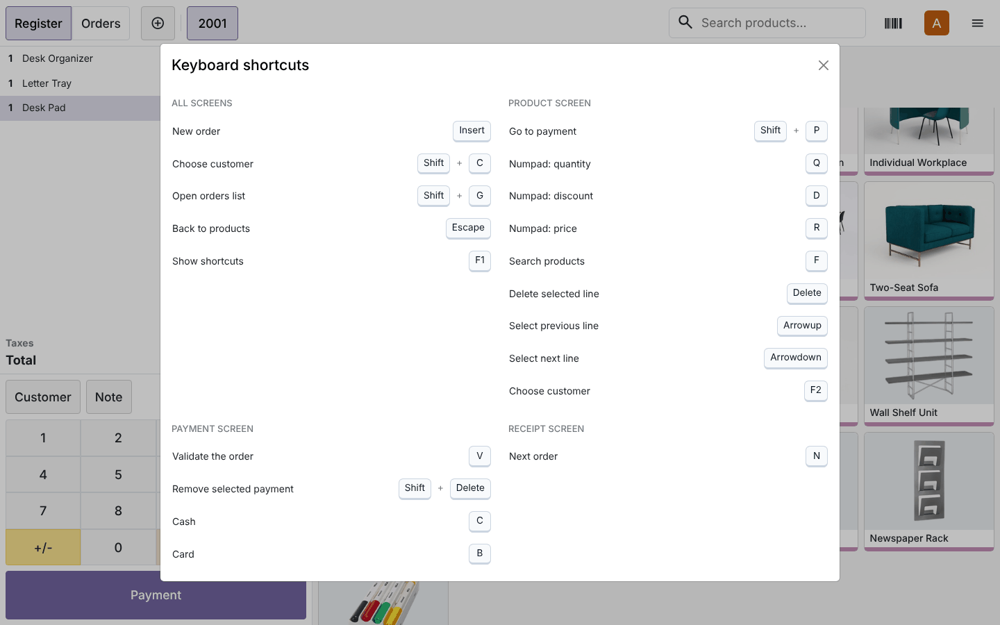
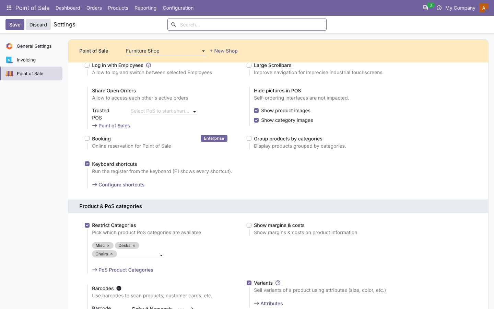
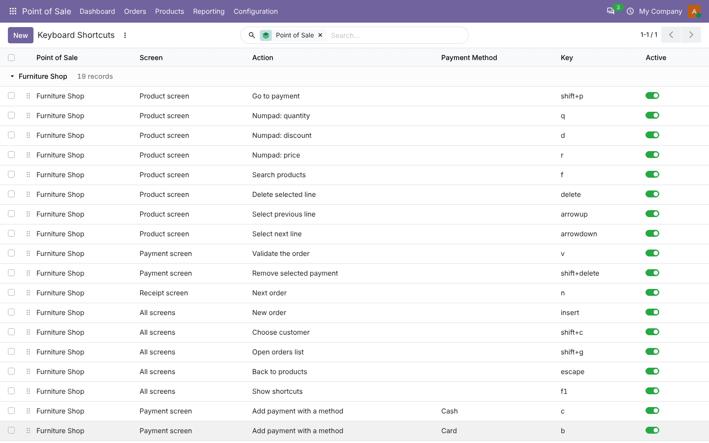
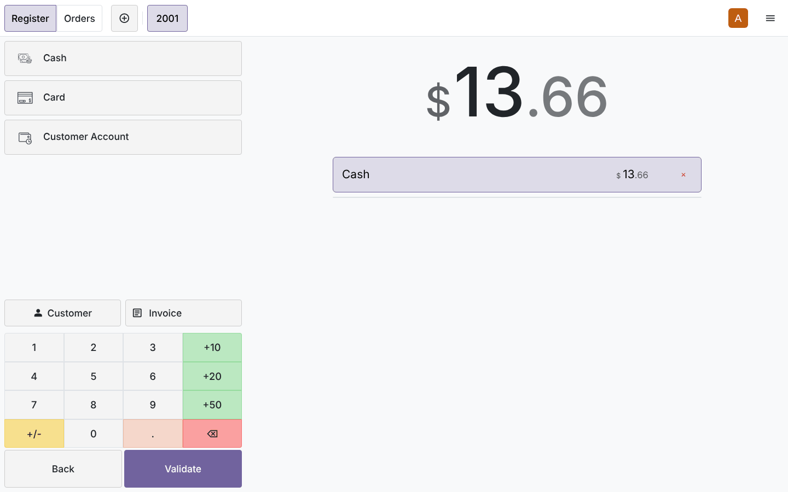

# POS Keyboard Shortcuts

**Odoo 20.0** · LGPL-3 · Category: Point of Sale

Run the **Point of Sale** from the keyboard. Each shop has its own list of shortcuts, scoped to a screen
(products, payment, receipt, orders list) or to all screens. Cashiers press **F1** to see the shortcuts that
apply to them.



## Features

- **Per-POS shortcuts**: one list per point of sale, editable in the backend (drag to reorder, archive to disable).
- **Screen scope**: the same key can do different things on different screens (`n` = next order on the receipt
  screen only). A shortcut for a specific screen takes priority over an *All screens* one with the same key.
- **17 actions**:
  - go to payment;
  - numpad quantity, discount and price modes;
  - focus the product search;
  - delete the selected line, and select the previous or next line;
  - add a payment line for a chosen **payment method**, remove the selected payment, and validate;
  - next order and new order;
  - choose customer, open the orders list, back to products;
  - show the help sheet.
- **Default set** in one click: a key for every action, plus `c` for Cash and `b` for Card (bank) on the payment
  screen. Running it again only adds what is missing.
- **Key format**: `Shift+P`, `ctrl + del` and `F2` are all accepted and stored as `shift+p`, `ctrl+delete` and `f2`.
  Unknown keys and duplicates on the same screen are refused.
- **Safe while typing**: plain keys are ignored while the cashier types in a field. Combinations with Ctrl or
  Alt, F-keys and Escape still work there. Open dialogs keep their own keys.
- **Help sheet (F1)**: every active shortcut, grouped by screen, with key caps.

## Screenshots

| | |
| --- | --- |
| **Setting in Point of Sale › Configuration › Settings**<br> | **Shortcut list (defaults loaded)**<br> |
| **F1 help sheet in the register**<br> | **`Shift+P` then `C`: payment screen with a cash line**<br> |

## Installation

1. Add `20.0/` of this repository to your addons path.
2. Install **POS Keyboard Shortcuts** (it depends on `point_of_sale` only).

## Configuration

1. **Point of Sale › Configuration › Settings**, choose the shop, then tick **Keyboard shortcuts** and click
   **Configure shortcuts**. If the shop has no shortcuts yet, the default set is loaded.
2. Change the keys, add shortcuts (for example `F2` = *Choose customer*), or archive the ones you don't want.
   A *payment method* shortcut needs the method to use.
3. Reopen the register (or reload it). Press **F1** to check the list.

All shortcuts of all shops: **Point of Sale › Configuration › Keyboard Shortcuts**.

## Default keys

| Screen | Key | Action |
| --- | --- | --- |
| Products | `Shift+P` | Go to payment |
| Products | `Q` / `D` / `R` | Numpad: quantity / discount / price |
| Products | `F` | Search products |
| Products | `Delete` | Delete the selected line |
| Products | `↑` / `↓` | Select the previous / next line |
| Payment | `C` / `B` | Add a Cash / Card payment line |
| Payment | `Shift+Delete` | Remove the selected payment line |
| Payment | `V` | Validate the order |
| Receipt | `N` | Next order |
| All | `Insert` | New order |
| All | `Shift+C` | Choose customer |
| All | `Shift+G` | Orders list |
| All | `Escape` | Back to products |
| All | `F1` | Show shortcuts |

## Technical overview

| Part | Role |
| --- | --- |
| `pos.shortcut` | Shop, screen, action, key (normalized, unique per shop and screen), payment method, sequence, active |
| `pos.config` | `shortcut_enabled`, `shortcut_ids`, *load defaults*; sends the active shortcuts to the register in the `pos.config` data (`_pos_shortcuts`) |
| `res.config.settings` | Setting and *Configure shortcuts* button |
| `PosShortcuts` (OWL) | Main component of the register. It listens to `keydown` on the window in the capture phase, finds the shortcut for the current screen and runs it through the POS store API |
| `ShortcutHelpDialog` (OWL) | F1 help sheet |

Access: POS users can read shortcuts; POS managers can create and change them.

## Tests

```bash
tools/run_tests.sh 20.0 /path/to/odoo20 pos_keyboard_shortcuts
```

Python tests cover key normalization, the default set and running it twice, the constraints (duplicate key,
missing payment method, unknown key) and the data sent to the register. They also check that nothing is sent
when the feature is off, and the settings button. A **browser tour** then uses only the keyboard in a real
register:
- F1 help;
- ↑ and Delete;
- Shift+P, C for cash, V to validate;
- N for the next order;
- Shift+G for the orders list, then Escape.

The test then checks that the order was paid in cash with one line.

## Full guide

[docs/pos_keyboard_shortcuts.md](../../docs/pos_keyboard_shortcuts.md)

---
Author: Aditya Shah · License: LGPL-3
