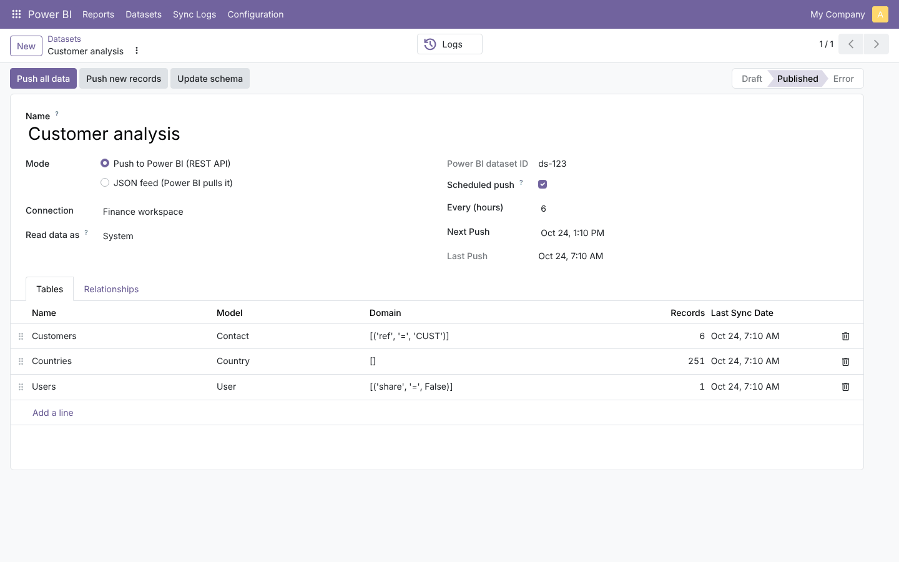
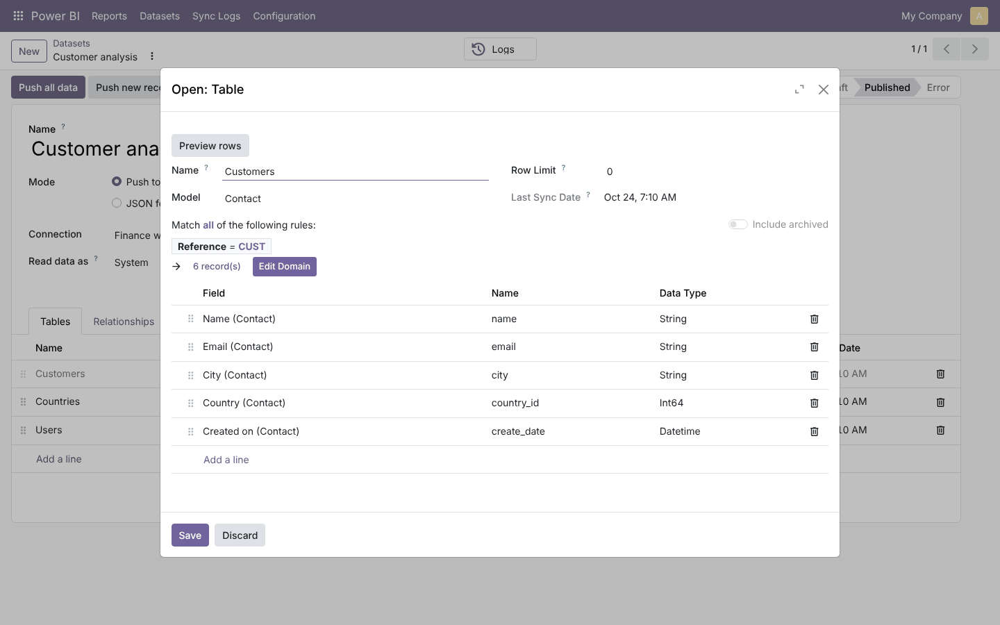
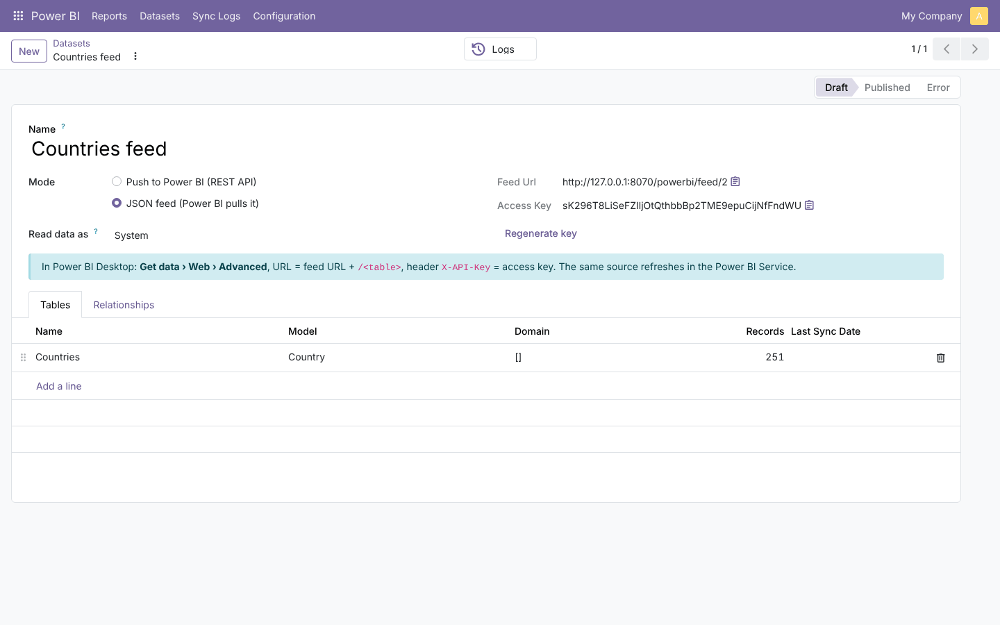
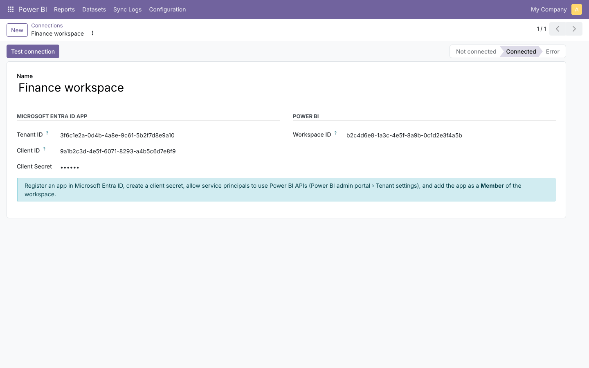
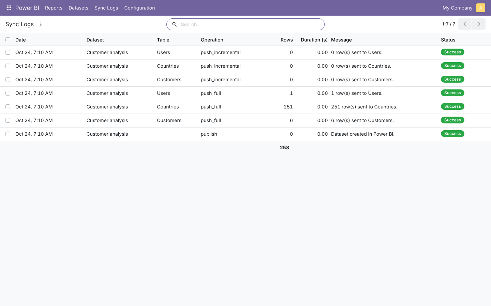
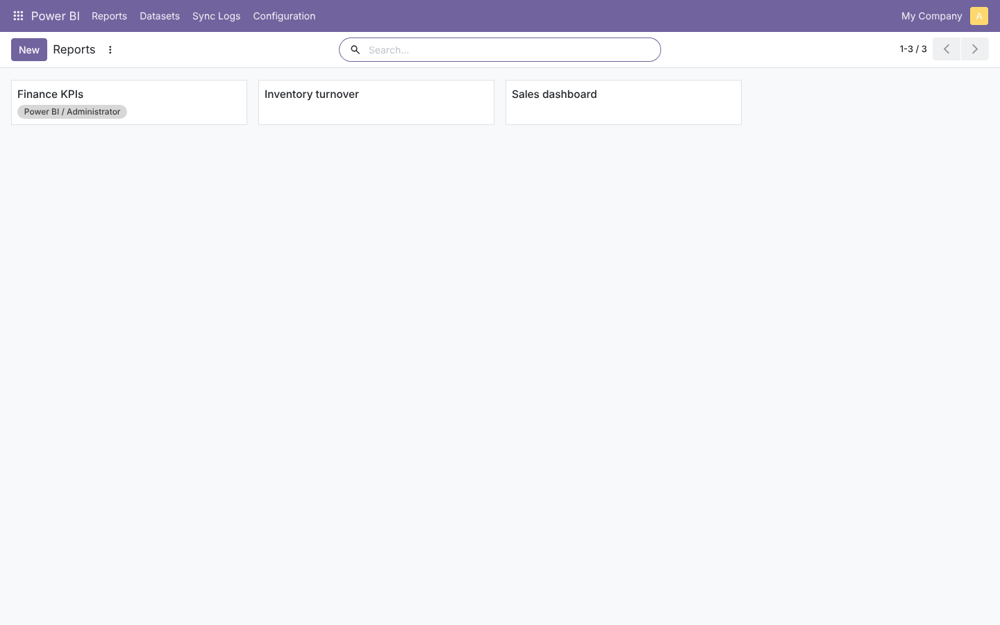

# Power BI Connector

**Odoo 20.0** · LGPL-3 · Category: Productivity

Get Odoo data into **Power BI** without exports or database access, and show Power BI reports inside Odoo.
Choose the models, fields and filters; then either **push** them to a Power BI dataset through the Power BI
REST API (scheduled), or let Power BI **pull** a secured **JSON feed**.



## Features

- **Datasets** made of **tables**: any Odoo model, a filter (domain editor), a row limit and the **columns** to send
  (char, text, html, selection labels, numbers, booleans, dates, many2one ids). An `id` key is always included.
- **Relationships**: a many2one column pointing to another table of the dataset becomes a Power BI relationship.
- **Push mode** (Microsoft Entra ID app / service principal): create the dataset, update table schemas, **full refresh**
  (delete + insert in batches of 10,000 rows) or **incremental** (records created since the last push), on demand or
  on a schedule (every N hours). Access tokens are cached.
- **Feed mode**: `/powerbi/feed/<dataset>/<table>` returns JSON rows, protected by a per-dataset API key
  (header `X-API-Key`); works in Power BI Desktop and with scheduled refresh in the Power BI Service.
- **Data security**: rows are read as the dataset's *Read data as* user, so Odoo access rights and record rules apply.
- **Reports in Odoo**: add Power BI report links; they open inside Odoo (secure embed, viewers sign in with their
  own Power BI account), visible to all Power BI users or to selected groups.
- **Sync logs**: every publish/push/feed call with rows, duration and errors.

## Screenshots

| | |
| --- | --- |
| **Table: model, filter and columns**<br> | **Feed dataset with URL and key**<br> |
| **Power BI connection**<br> | **Sync logs**<br> |



## Installation

1. Add `20.0/` of this repository to your addons path.
2. Install **Power BI Connector**. No extra Python package.

## Configuration

**Push mode**
1. Microsoft Entra ID › App registrations › New: note the *tenant ID* and *client ID*, create a *client secret*.
2. Power BI admin portal › Tenant settings: allow *service principals to use Power BI APIs* (for a security group containing the app).
3. In the Power BI workspace: *Manage access* › add the app as **Member**. Copy the workspace ID from its URL.
4. Odoo: **Power BI › Configuration › Connections › New**, then **Test connection**.
5. **Datasets › New** (mode *Push*): add tables and columns, **Publish to Power BI**, **Push all data**; tick *Scheduled push* to refresh automatically.

**Feed mode**
1. **Datasets › New** (mode *JSON feed*), add tables and columns, choose the *Read data as* user.
2. Power BI Desktop › *Get data* › *Web* › *Advanced*: URL = feed URL + `/<table name>`, header `X-API-Key` = the dataset key.

**Reports**: **Power BI › Reports › New**, paste the report link from Power BI; restrict to groups if needed.

## Technical overview

| Model | Role |
| --- | --- |
| `powerbi.connection` | Entra ID app credentials (admins only), workspace, token cache, REST client |
| `powerbi.dataset` | Mode, tables, schedule, feed key, relationships, logs |
| `powerbi.table` / `powerbi.column` | Model, domain, limit / field, column name, Power BI data type |
| `powerbi.report` | Report link → secure embed URL, group visibility (record rule) |
| `powerbi.log` | Operations, rows, duration, errors |

Groups: *Power BI / Report viewer* (reports) and *Power BI / Administrator* (everything).

## Tests

```bash
tools/run_tests.sh 20.0 /path/to/odoo20 powerbi_connector
```

The Power BI API is replaced by a fake: schema types and relationships, value conversion, token caching and renewal,
publish, batched full push, incremental push, schema update, error logging, scheduled push, validation, embed URL,
report visibility, feed (keys, tables, index, 404) and feed user rights.

## Full guide

[docs/powerbi_connector.md](../../docs/powerbi_connector.md)

---
Author: Aditya Shah · License: LGPL-3
