# Short URLs & QR Codes

**Odoo 20.0** · LGPL-3 · Category: Website

**Short links and QR codes for your website.** `https://your-site.com/s/spring` redirects to any page of the
site or any address. Each link has a QR code, an optional expiry date, a marketing channel with UTM tags, and
counts its clicks (device, browser, country, referrer). Rules create links automatically; website editors manage
the links of a page from the editor, and two snippets show the page's short link and QR code to visitors.

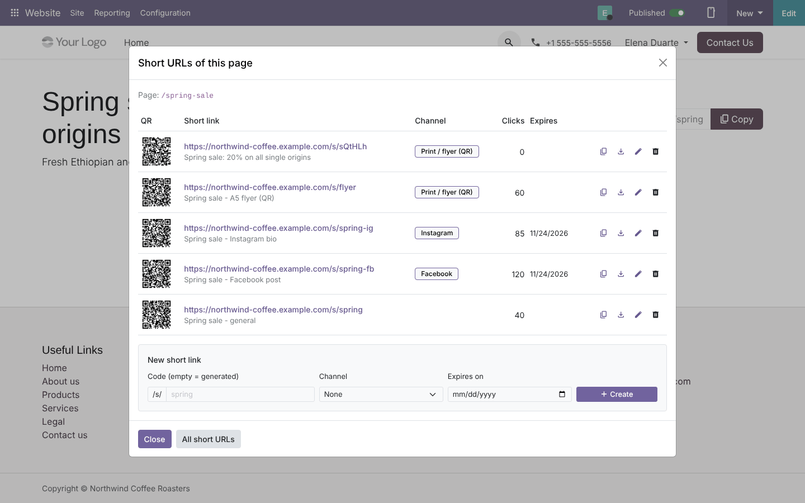

## Features

- **Short links** (*Website › Configuration › Short URLs*):
  - code generated (random letters and digits, or sequential numbers) or typed by hand (`spring-fb`);
  - target: a page of the website (`/shop?category=3`) or any http(s) address;
  - one website or all websites;
  - title, notes, expiry date, archive;
  - *New code* to change the code, *Open target*;
  - list grouped by target URL (one target, several links for several channels).
- **QR code** on every link: shown on the form, downloadable as PNG (any size), public URL
  `/short_urls/qr/<code>.png` for print or e-mail.
- **Marketing channels** (Facebook, Instagram, LinkedIn, Newsletter, Print / flyer by default) with UTM source and
  medium; with *Add UTM tags* the redirect adds `utm_source`, `utm_medium` and `utm_campaign`.
- **Click statistics** (*Website › Reporting › Short URL Clicks*):
  - date, device (desktop / mobile / tablet), browser, country, referrer site;
  - IP addresses kept only as a /24 network (privacy);
  - link previews and bots recorded separately and not counted;
  - graph, pivot, list, group by link, channel, device, country, referrer, day.
- **Expiry**: expired, archived and unknown codes show a friendly "link no longer available" page (HTTP 404).
- **Automatic rules**: a link (and QR code) for every record of a model that has a website page (pages, and
  products, blog posts, events … when those apps are installed), with a filter, published records only, website,
  channel, UTM and validity. Daily job + *Create the links now*.
- **Website editor**: *Site › This page › Short URLs* lists the links of the open page with their QR, clicks
  and expiry; copy, download the QR, edit the code, delete, create a new one (code, channel, expiry).
- **Snippets** (*Inner content*): **Short URL** (link of the page with a *Copy* button) and **Short URL QR**
  (QR code of the page).
- **Settings** (*Website › Configuration › Settings › Short URLs*): code style, code length, default validity.
- Access: website editors create and edit links; designers also delete them and manage channels and rules.

## Screenshots

| | |
| --- | --- |
| **Website editor: Short URLs of this page**<br> | **Snippets on the page**<br>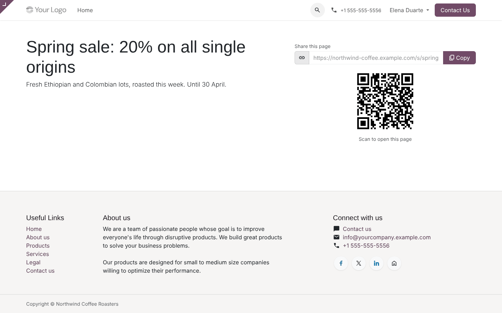 |
| **Short URLs**<br>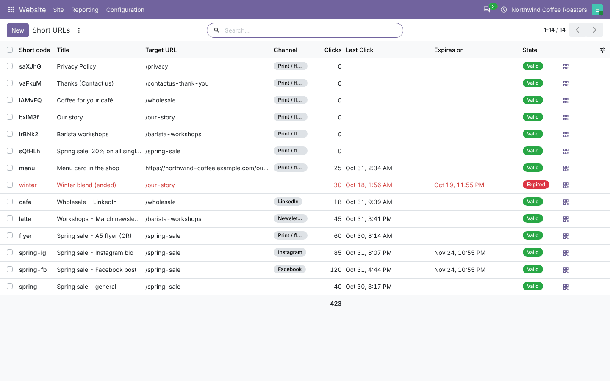 | **Grouped by target**<br>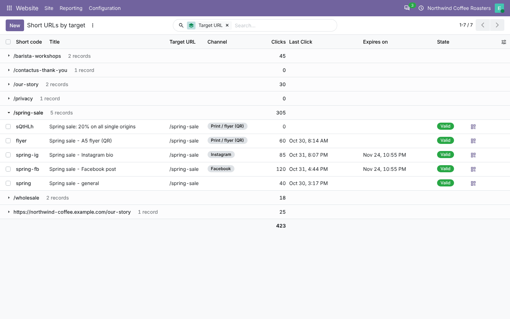 |
| **Short link with QR code**<br>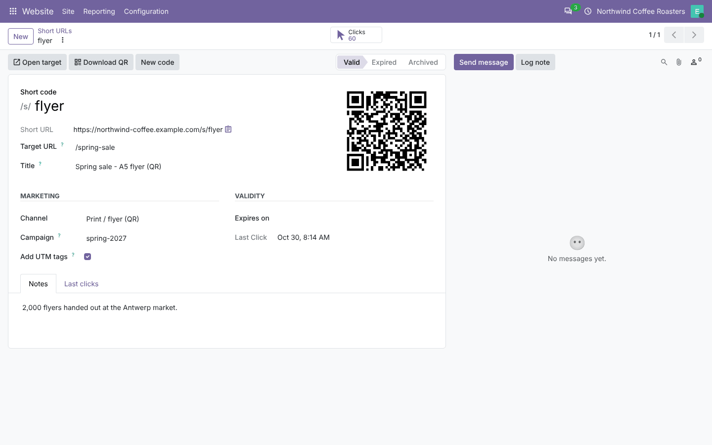 | **Clicks per day**<br>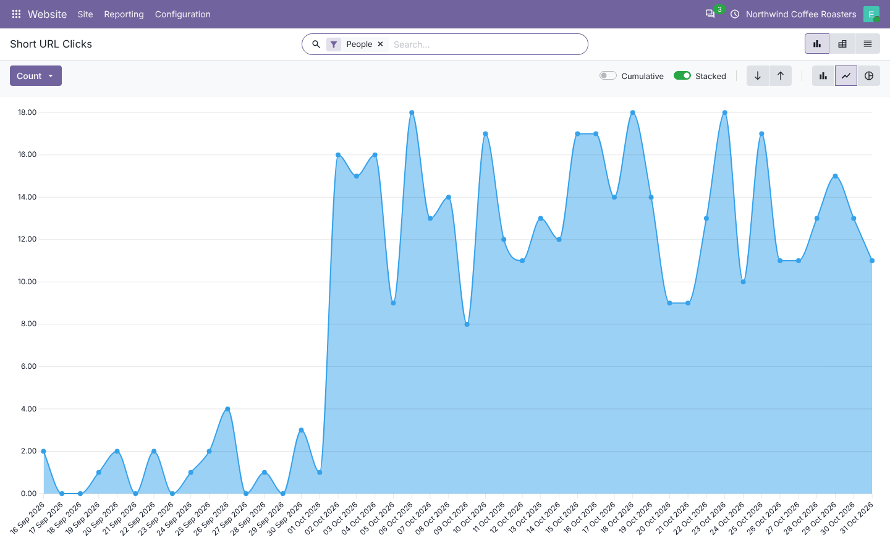 |
| **Clicks per link and device**<br>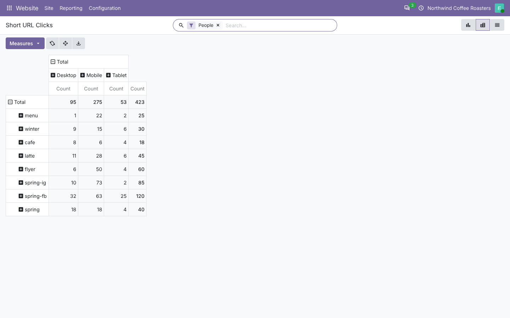 | **Automatic rule**<br>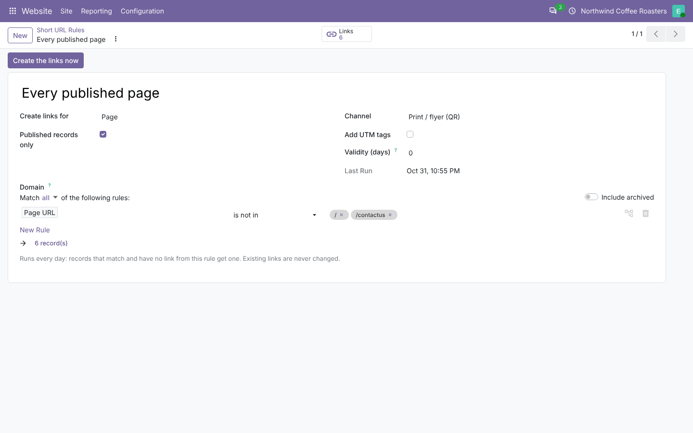 |
| **Channels and UTM**<br>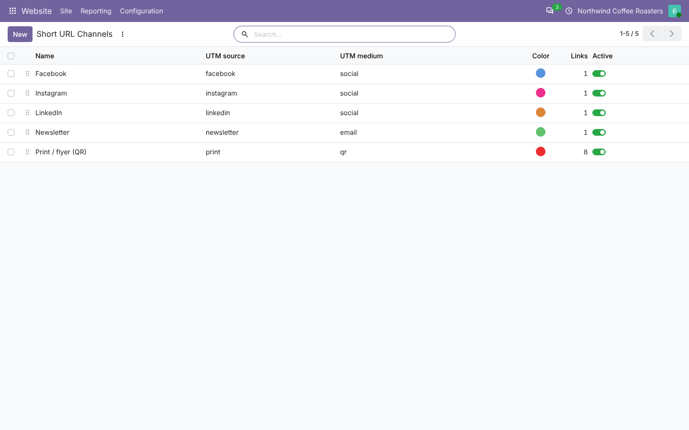 | **Settings**<br>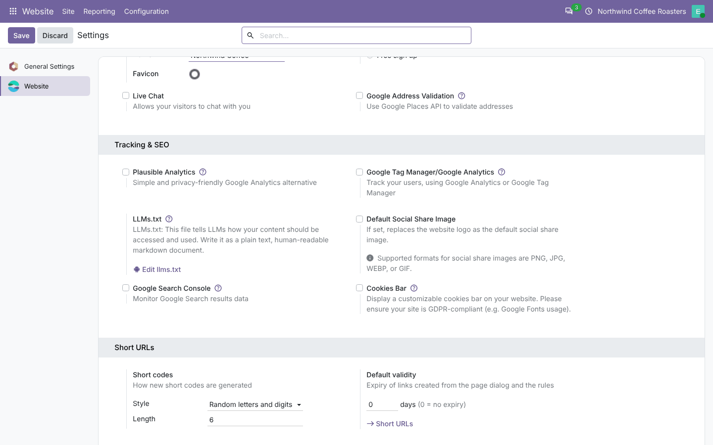 |
| **Expired link**<br>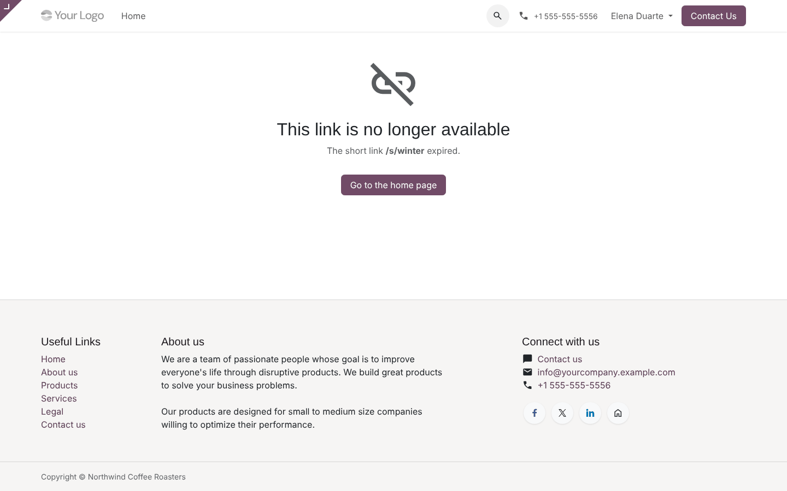 | |

## Installation

Add `20.0/` of this repository to your addons path and install **Short URLs & QR Codes**.
- **Odoo dependencies**: `website`, `mail`.
- **Python**: `qrcode` and `Pillow`, both already required by Odoo.

## Configuration

1. *Website › Configuration › Settings › Short URLs*: code style and length, default validity.
2. *Website › Configuration › Short URLs › Channels*: adapt the channels and their UTM values.
3. Optional: *Automatic rules* (for example *every published page*).
4. Check the website **domain** (*Website › Configuration › Websites*): short URLs and QR codes use it.

## Technical overview

| Part | Role |
| --- | --- |
| `short.url` | Link: code, target, website, channel / campaign / UTM, expiry, state, QR, clicks; page dialog and snippet helpers |
| `short.url.click` | One visit: date, network, device, browser, country, referrer, bot flag |
| `short.url.channel` | Marketing channel with UTM source / medium |
| `short.url.rule` | Automatic creation for records with a `website_url` |
| `website` | Code settings, code generator, base URL |
| `controllers/main.py` | `/s/<code>` (redirect + click), `/short_urls/qr/<code>.png`, `/short_urls/page_link` (snippets) |
| `static/src/backend/` | *Short URLs of this page* dialog (website editor menu) |
| `static/src/snippets/` | Snippet interaction |

## Odoo 20 notes

- The `website` model moved to `base`; the current website is `env.website` (with the default website as
  fallback).
- Binary fields take a base64 string (QR code).
- Dialog in OWL 3 (`useProps`, `proxy`), access rights and rule in `ir.access.csv`, Odoo 20 icons.

## Tests

```bash
tools/run_tests.sh 20.0 /path/to/odoo20 short_urls
```

The tests cover:
- generated codes (random, length, no ambiguous characters, sequence) and validation (codes, targets, duplicates);
- redirect, clicks (device, browser, referrer, network), bots not counted;
- UTM tags;
- expired, archived, unknown codes and global vs website links;
- QR code (form, PNG route, download);
- automatic rules (filter, published only, validity, idempotent, cron, invalid filter);
- page dialog methods;
- the snippet route (visitors vs designers) and access rights;
- new code;
- a browser tour on a page with both snippets.

## Full guide

[docs/short_urls.md](../../docs/short_urls.md) · Odoo 19.0: [`19.0/short_urls`](../../19.0/short_urls)

---
Author: Aditya Shah · License: LGPL-3
