# Warehouse Average Costing

**Odoo 20.0** · LGPL-3 · Category: Inventory

**One average cost per warehouse** for products that use the *Average Cost (AVCO)* method. A product bought
cheaper in Rotterdam than in Liège keeps two costs:
- deliveries leave each warehouse at that warehouse's cost (cost of goods sold);
- transfers carry the cost to the other warehouse;
- the company cost of the product is the quantity-weighted average of its warehouses.

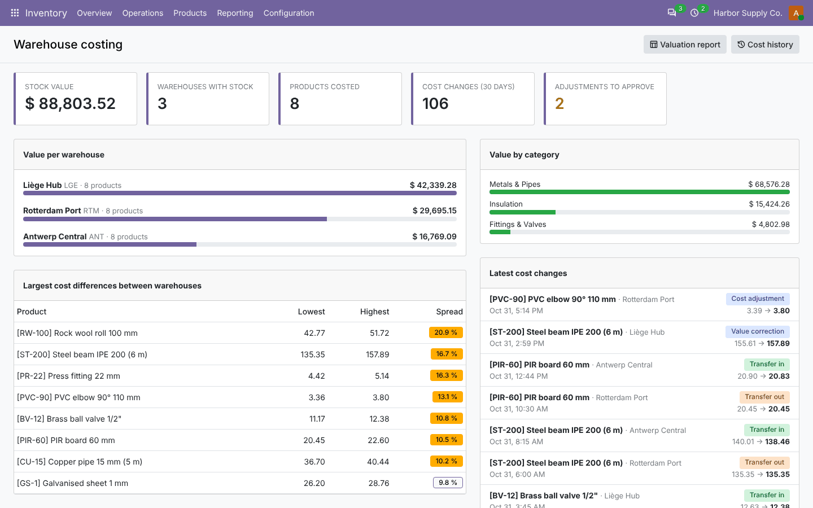

## Features

- **Warehouse cost ledger**: quantity, value and average cost per product and warehouse. Valued stock between
  two warehouses (transit locations) has its own *In transit* line.
- **Receipts**: goods enter at the move value Odoo computes (purchase price, bill, landed costs, product cost).
- **Deliveries**: the move value is the average cost of the warehouse the goods leave. It flows into the stock
  accounting entries and the cost of goods sold.
- **Inter-warehouse transfers**: one step, or two steps through a transit location. The goods keep the cost of
  the source warehouse; the company value does not change.
- **Value corrections**: when a receipt's value changes later (landed costs, vendor bill, *Adjust valuation*),
  the difference goes into the warehouse that received the goods.
- **Company cost**: `standard_price` = Σ warehouse values / Σ quantities. Odoo's own valuation and *Valuation by
  warehouse* use the warehouse values.
- **Cost adjustments** with optional **manager approval**: product, warehouse, new cost, reason, value impact,
  chatter and an approval activity for the manager.
- **Manual cost change** on the product: revalues every warehouse to the new cost.
- **Cost history**: every change with type (receipt, delivery, transfer in/out, correction, adjustment,
  revaluation, opening balance), quantity, unit cost, value, old and new average, transfer and user. List and
  pivot.
- **Valuation report**: summary per warehouse, detailed product × warehouse, or cost comparison between
  warehouses. Shown on screen (pivot/list), as Excel or as PDF.
- **Cost matrix (Excel)**: export product × warehouse costs, edit them, import them back as cost adjustments.
- **Dashboard**: stock value, warehouses, costed products, cost changes, pending approvals, value per warehouse
  and per category, largest cost differences, latest changes.
- **Product form**: *Warehouse Costs* tab and *Cost History* button.
- **Settings** (*Inventory › Settings › Valuation*): enable per company, approval, rebuild from the stock on hand.
- Multi-company rules, two access levels (*Warehouse Costing / User* and */ Manager*).

## Screenshots

| | |
| --- | --- |
| **Dashboard**<br> | **Warehouse costs**<br>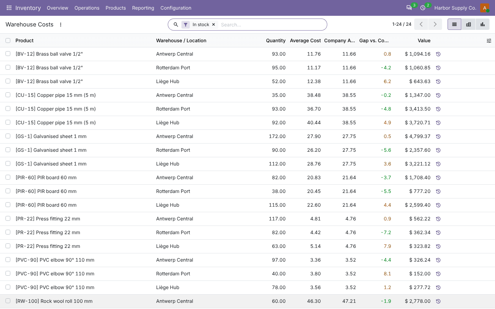 |
| **Valuation pivot**<br>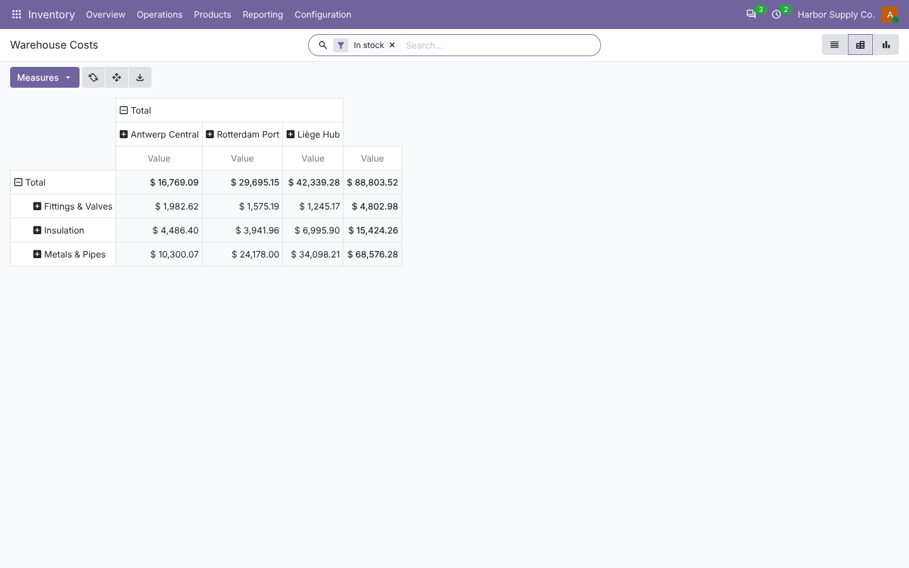 | **Product: warehouse costs tab**<br>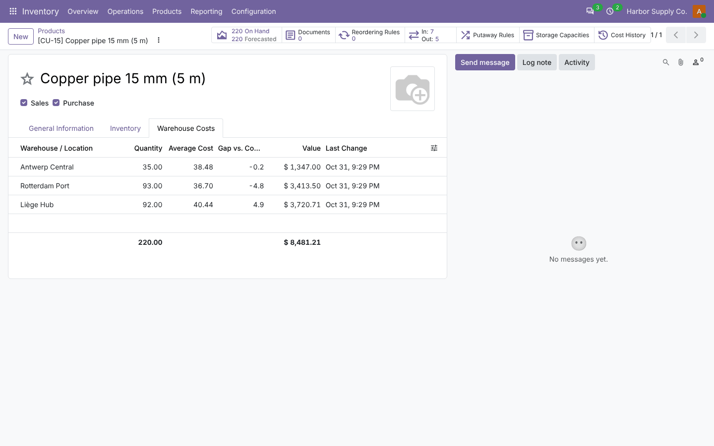 |
| **Cost history**<br>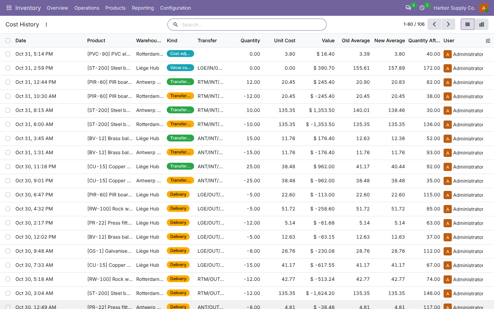 | **Cost adjustments**<br>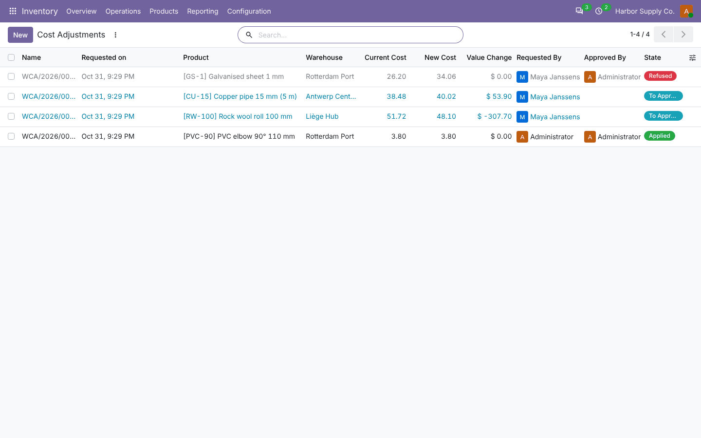 |
| **Adjustment waiting for approval**<br>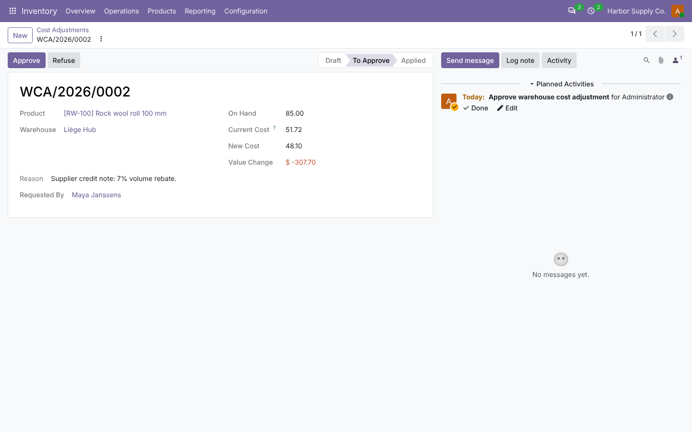 | **Valuation report options**<br>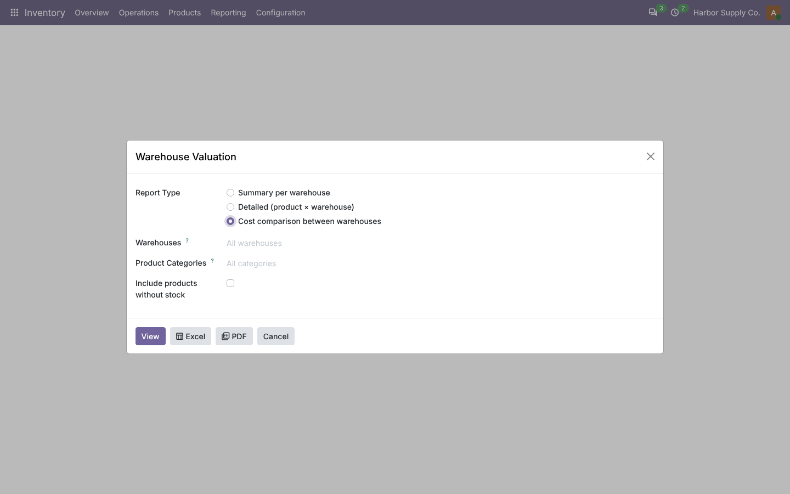 |
| **Cost comparison (pivot)**<br>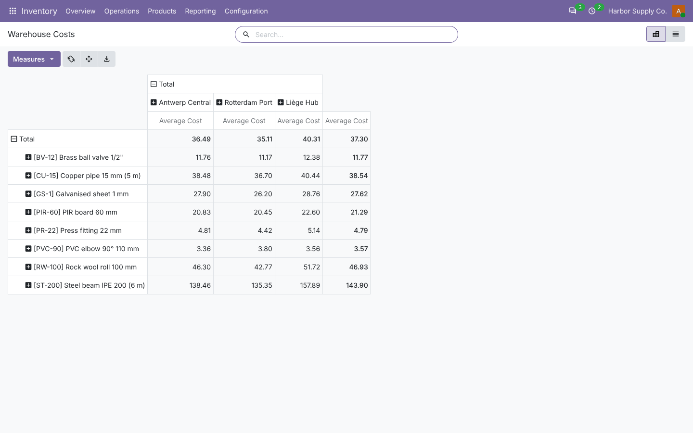 | **PDF: summary**<br>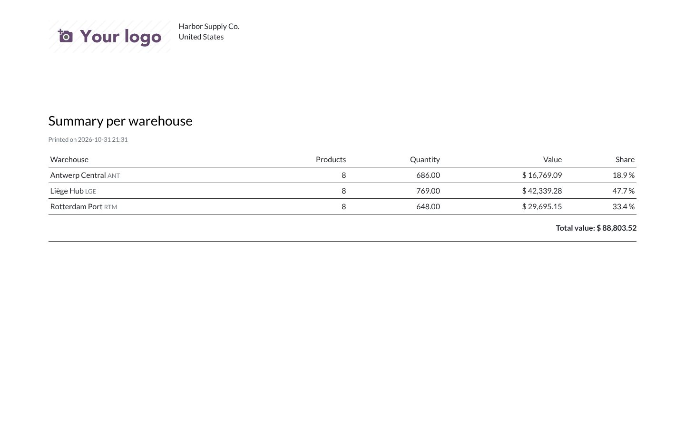 |
| **PDF: comparison**<br>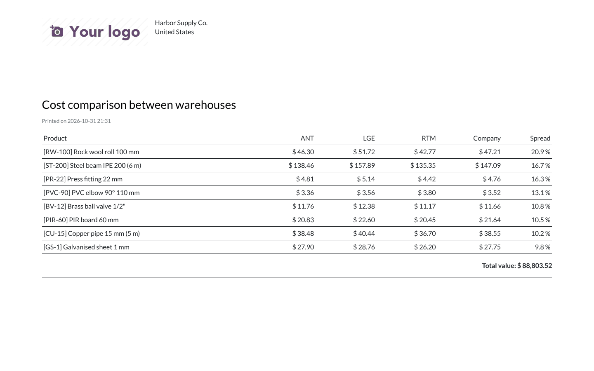 | **Cost matrix (Excel)**<br>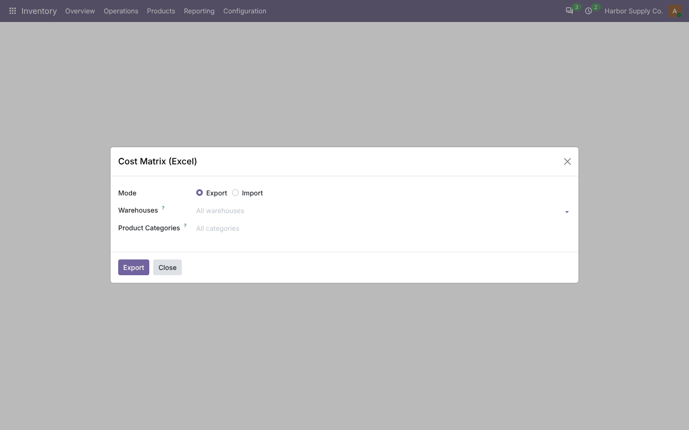 |
| **Settings**<br>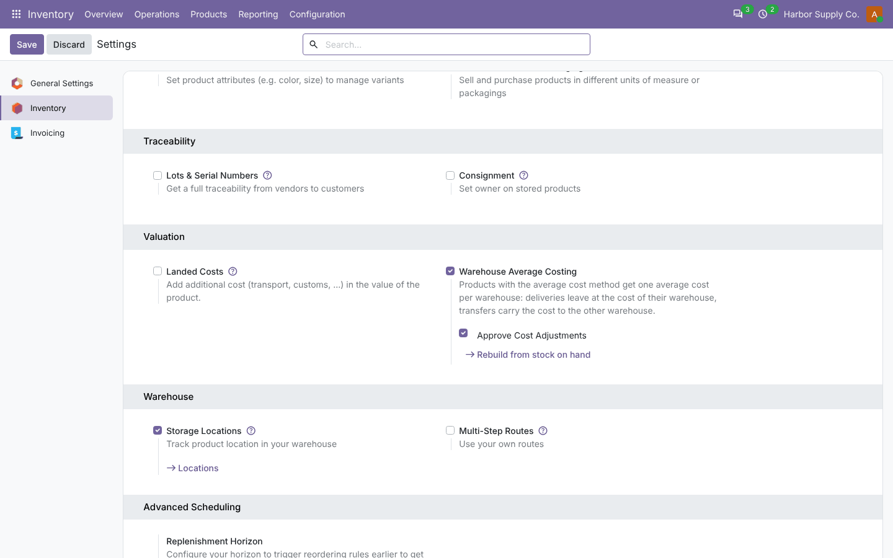 | |

## Installation

Add `20.0/` of this repository to your addons path and install **Warehouse Average Costing**.
- **Odoo dependencies**: `stock_account`.
- **Python**: `xlsxwriter` and `openpyxl`, both already required by Odoo.

## Configuration

1. *Inventory › Configuration › Product Categories*: set **Costing Method = Average Cost (AVCO)** on the
   categories to cost per warehouse.
2. *Inventory › Settings › Valuation*: enable **Warehouse Average Costing**. The first time, the warehouse costs
   are built from the stock on hand at the current product cost.
3. Optional: **Approve Cost Adjustments**, then give *Warehouse Costing / Manager* to the approvers.
4. Reports: *Inventory › Reporting › Warehouse Costing*.

## Technical overview

| Part | Role |
| --- | --- |
| `stock.warehouse.cost` | Ledger row per product × warehouse × company (`warehouse_id` empty = in transit); `_book()` applies a movement and logs it |
| `stock.warehouse.cost.line` | History of every change |
| `stock.move` | `_wh_sync()` books what a move changed per warehouse (idempotent), `_set_value()` values deliveries at the warehouse cost and books value corrections, `_action_done()` books transfers |
| `product.product` | Company cost from the ledger, revaluation on manual cost change, value per warehouse in the `warehouse_id` context |
| `stock.warehouse.cost.adjustment` | Requests, approval, application |
| `stock.warehouse.valuation.report`, `stock.warehouse.cost.matrix` | Reports (screen / Excel / PDF) and Excel import/export |
| `static/src/dashboard/` | Dashboard |

## Odoo 20 notes

- Odoo 20 values outgoing moves after validation and replays the company average when a past incoming value
  changes (`_correct_inventory_valuation`). Warehouse-costed products are left out of that replay: the new value
  goes into the warehouse that received the goods, like in 19.
- Creating a `product.value` re-values the remaining receipts in 20, so cost adjustments only post a chatter note
  with the new company cost (the warehouse ledger is the reference).
- Stock moves use `uom_id` (19: `product_uom`); binary wizard files are read with `bytes(value)`.
- Access rights in `ir.access.csv`; dashboard in OWL 3.

## Tests

```bash
tools/run_tests.sh 20.0 /path/to/odoo20 warehouse_avg_costing
```

The tests cover:
- receipts per warehouse and the company cost;
- deliveries at the warehouse cost;
- one-step and transit transfers;
- value corrections;
- manual cost change;
- negative stock;
- adjustments with approval;
- initialisation from the stock on hand;
- products and companies the module does not apply to;
- value per warehouse context;
- history dates;
- reports (data, Excel, PDF, screen);
- cost matrix round trip;
- dashboard;
- product views;
- a browser tour.

## Full guide

[docs/warehouse_avg_costing.md](../../docs/warehouse_avg_costing.md) · Odoo 19.0: [`19.0/warehouse_avg_costing`](../../19.0/warehouse_avg_costing)

---
Author: Aditya Shah · License: LGPL-3
