# WhatsApp (Whapi.Cloud)

**Odoo 20.0** · LGPL-3 · Category: Productivity / Discuss

**Chat with your customers on WhatsApp from Odoo.** The module connects a WhatsApp number through
[Whapi.Cloud](https://whapi.cloud) (an unofficial WhatsApp API gateway that links a phone like WhatsApp Web).
You get a live inbox in Odoo with groups, pictures, files, voice notes, replies, forwards and read ticks, plus
templates and a *Send by WhatsApp* action on contacts and on any document.

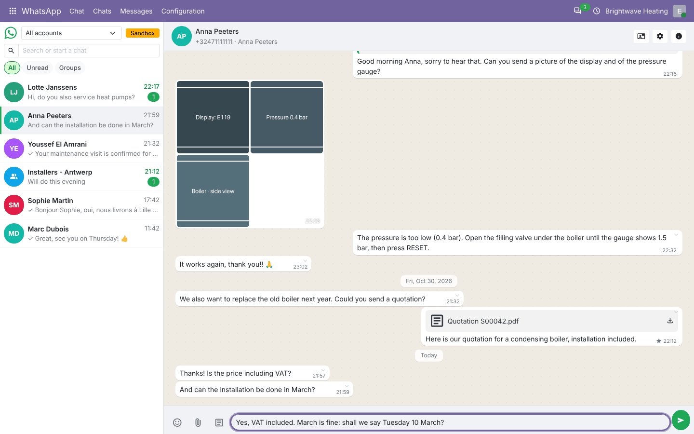

## Features

- **Live inbox** (*WhatsApp › Chat*):
  - chat list with search, *All / Unread / Groups* filters, unread counters, last message and time;
  - several accounts (one per WhatsApp number), with a selector;
  - new messages arrive live (Odoo bus) with a pop-up and, if allowed, a browser notification.
- **Conversation**:
  - text, emoji picker, pictures, videos, audio, documents, several files at once;
  - **voice notes** recorded in the browser;
  - consecutive pictures shown as an **album**;
  - **reply** to a message (quoted), **forward** to several chats at once, **star**, **delete for everyone**,
    **message info** (who received / read it, who has not read it yet in a group);
  - ticks: sent ✓, delivered ✓✓, read (blue ✓✓), failed (with the error and a *Retry* button);
  - deleted and edited messages from the customer are reflected;
  - contact templates inserted in one click.
- **Groups**:
  - info panel with description, participants and *Owner / Admin* badges;
  - add participants, remove them, make admin, dismiss as admin;
  - media and files of the chat, starred messages;
  - group log: joined, left, made admin, admin removed, with who did it.
- **Contacts**:
  - chats matched to contacts by phone number (+32…, 0032… or national numbers completed with the country
    code);
  - *WhatsApp* smart button on the contact;
  - every message copied in the contact's chatter (option).
- **Templates** (*Configuration › Templates*): text with placeholders (`{{ object.name }}`), optional PDF report
  and files, for any model. *Add to the Action menu* puts *WhatsApp: template name* on that model's records (quotes,
  invoices, orders … once those apps are installed).
- **Send by WhatsApp** wizard: one or many records, rendered per record, attaches the PDF, logs the message in
  the record's chatter, tells which records have no phone number.
- **Messages** (*WhatsApp › Messages*): kanban by status (Received, Sent, Delivered, Read, Failed, Deleted),
  list, form with read receipts, pivot.
- **Accounts**: token, *Check connection*, *Link a phone* (QR code), *Register webhook*, *Synchronise chats*,
  allowed users, groups on/off, chatter copy, notifications, ignored chats.
- **Sandbox mode**: nothing leaves Odoo; messages are marked as sent. For development and staging databases.
- Hourly connection check; two access levels (*WhatsApp / User*, */ Administrator*); multi-company.

## Screenshots

| | |
| --- | --- |
| **Inbox and conversation**<br> | **Group info: participants, media, log**<br>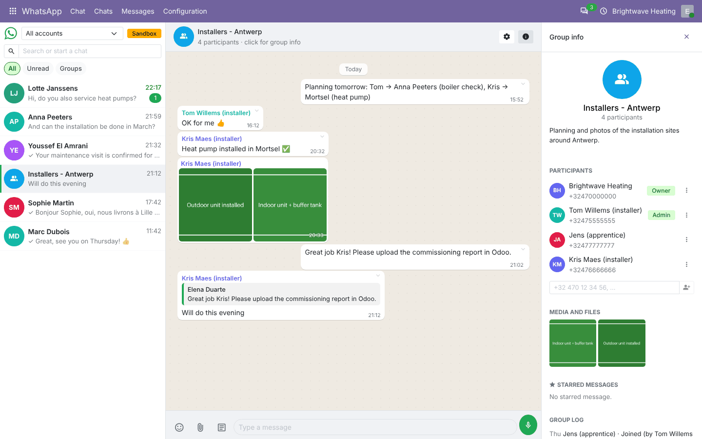 |
| **Message actions**<br>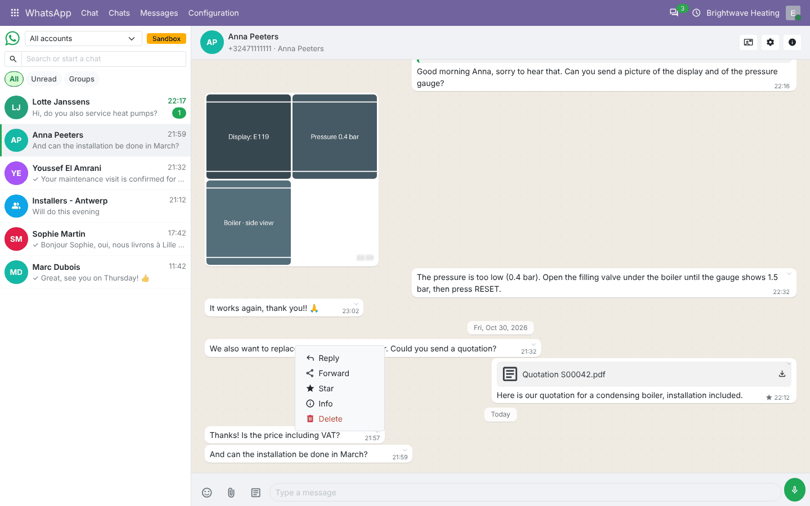 | **Forward to several chats**<br>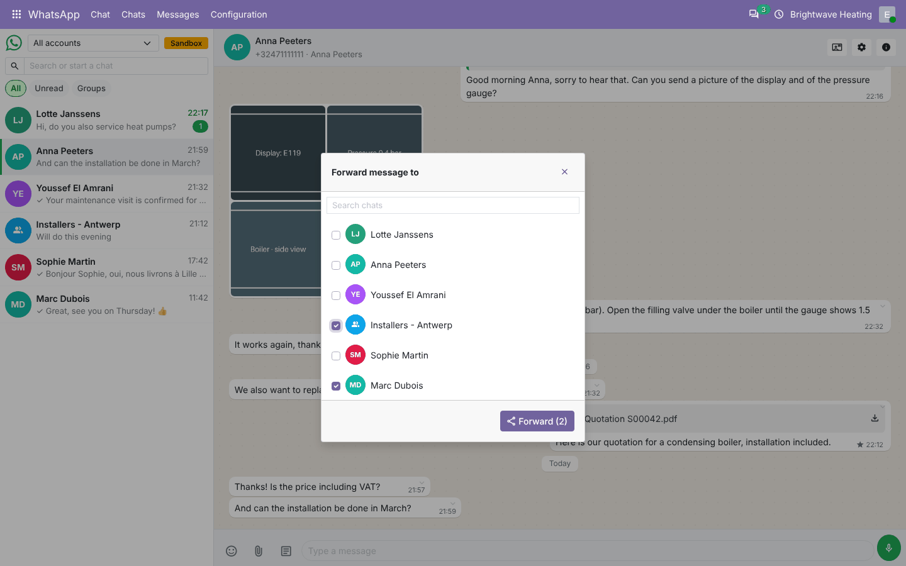 |
| **Message info (read receipts)**<br>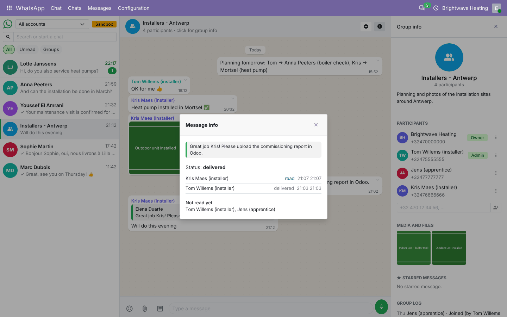 | **Emoji and templates**<br>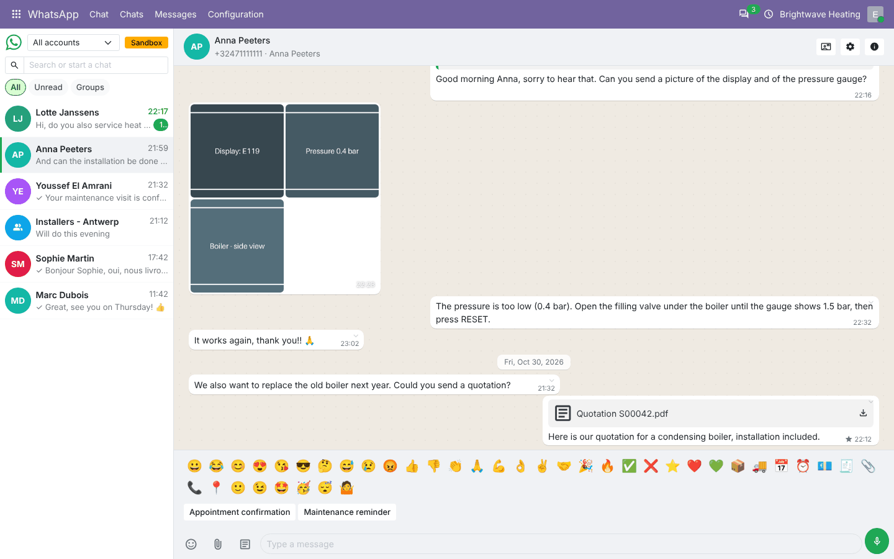 |
| **Messages by status**<br>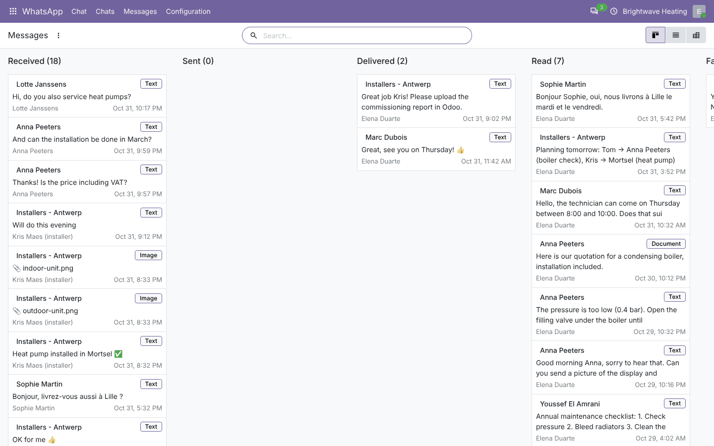 | **Failed message (retry)**<br>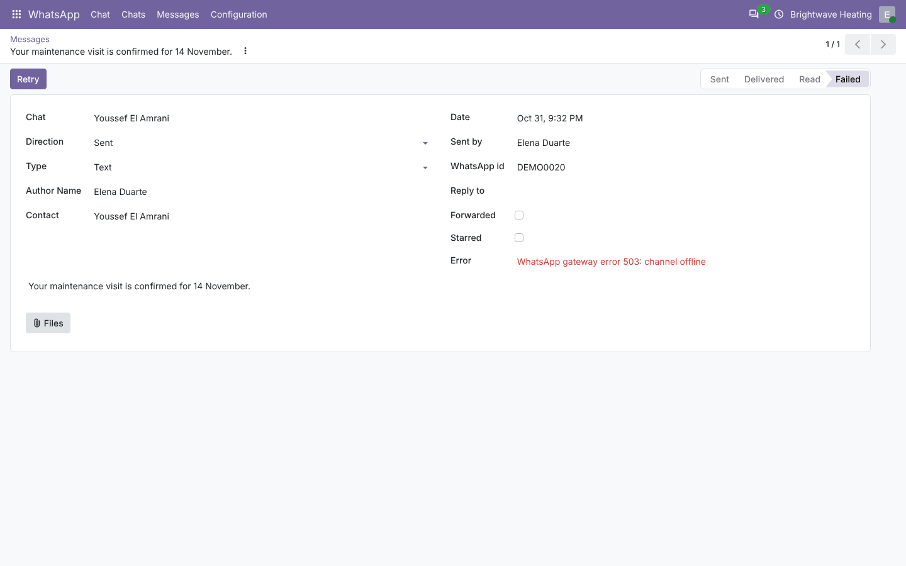 |
| **Account**<br>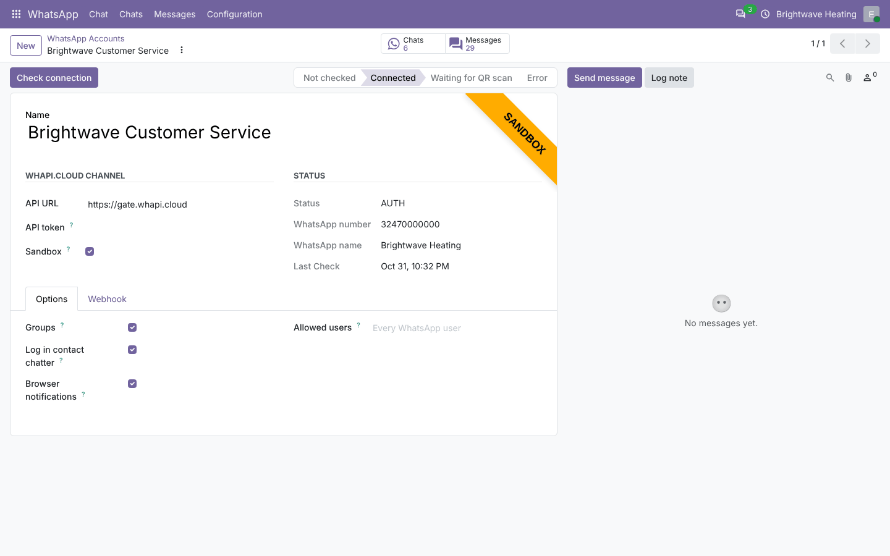 | **Webhook**<br>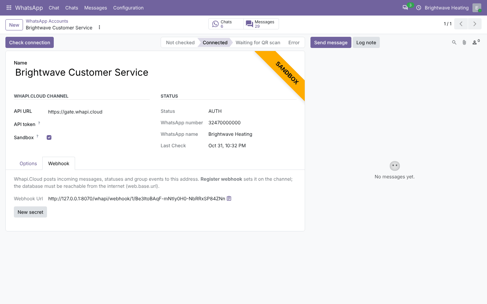 |
| **Template**<br>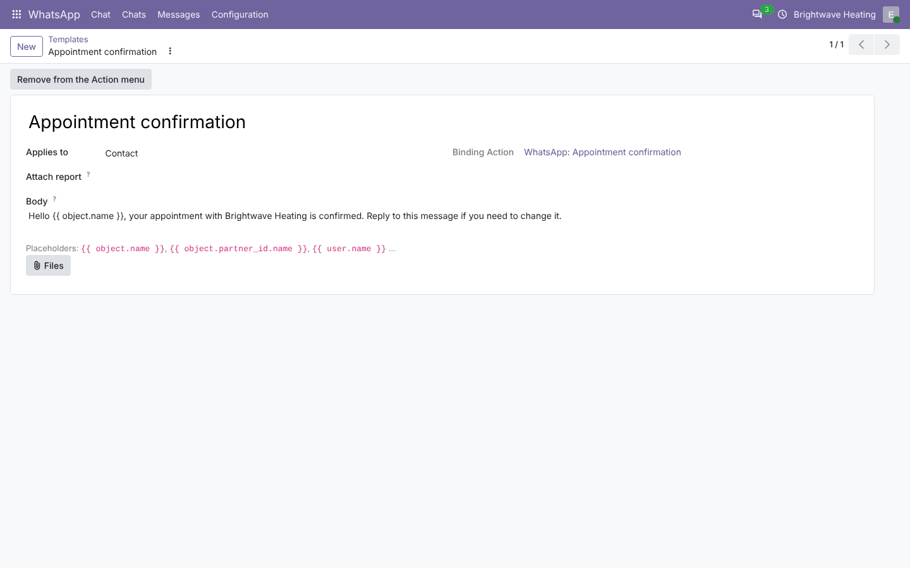 | **Contact: smart button and chatter**<br>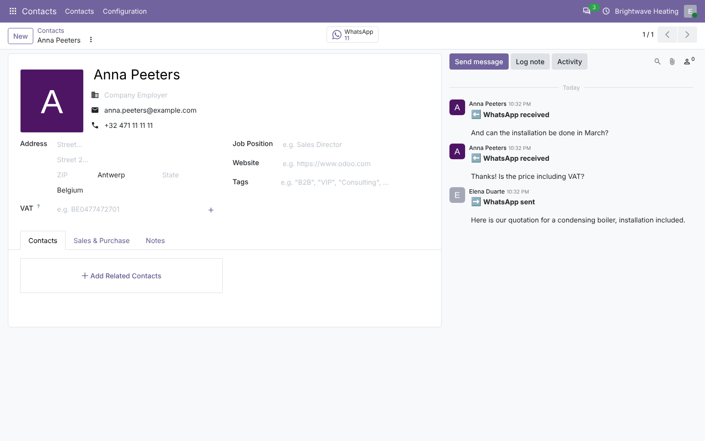 |
| **Send by WhatsApp**<br>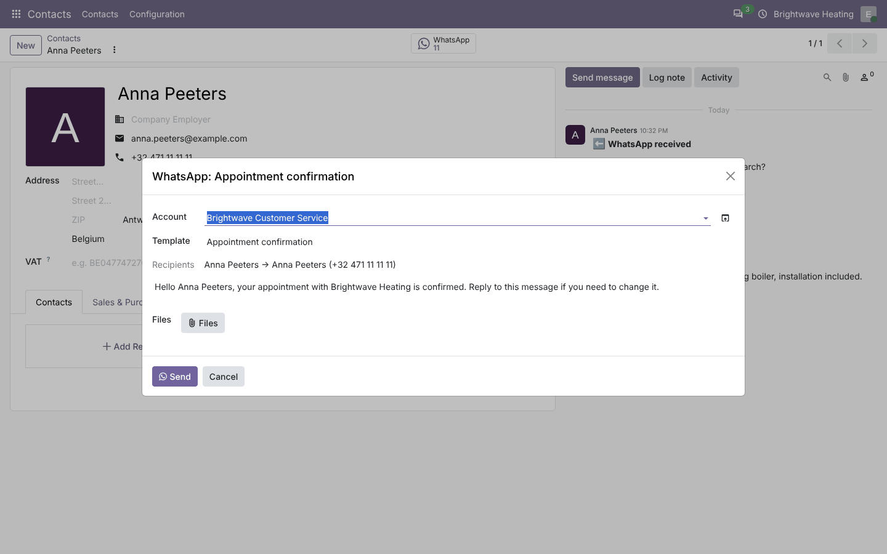 | **Chats**<br>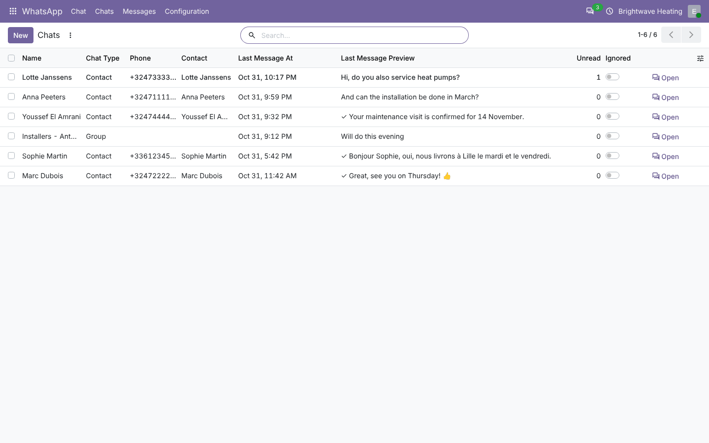 |

## Installation

Add `20.0/` of this repository to your addons path and install **WhatsApp (Whapi.Cloud)**.
- **Odoo dependencies**: `mail`.
- **Python**: `requests` (already required by Odoo).
- A Whapi.Cloud channel (free trial or paid plan) and a phone with WhatsApp.

## Configuration

1. On [panel.whapi.cloud](https://panel.whapi.cloud): create a channel and copy its **token**.
2. *WhatsApp › Configuration › Accounts › New*: name, token. Leave **Sandbox** off.
3. **Link a phone (QR)**, scan it with WhatsApp › *Linked devices*, then **Check connection** → *Connected*.
4. **Register webhook**: Whapi.Cloud will post messages, statuses and group events to
   `https://<your Odoo>/whapi/webhook/<account id>/<secret>`. Odoo must be reachable from the internet and
   `web.base.url` correct.
5. **Synchronise chats** once to load the existing chats and groups.
6. Options: allowed users, groups, chatter copy, notifications. Give *WhatsApp / User* to the people who chat.
7. Optional: templates, *Add to the Action menu*.

## Technical overview

| Part | Role |
| --- | --- |
| `whapi.account` | Channel: token, state, QR, webhook secret/URL, options; `_whapi_request()` (the only HTTP call), sandbox answers, `_whapi_process_webhook()` |
| `whapi.chat` (+ `.participant`, `.event`) | Chats and groups, partner matching, group management, chat screen data (`whapi_load_chats`, `whapi_load_messages`, `whapi_send`, …), bus notifications |
| `whapi.message` (+ `.status`) | Messages, sending (text / image / video / audio / voice / document), incoming parsing, media download, statuses, delete / edit actions, forward, star |
| `whapi.template`, `whapi.composer` | Templates (`mail.render.mixin`) and the *Send by WhatsApp* wizard |
| `controllers/main.py` | `POST /whapi/webhook/<account>/<secret>` |
| `static/src/chat/` | The inbox (OWL client action) |

## Odoo 20 notes

- Inbox in OWL 3: `proxy`, `useProps`, `signal.ref()`, `BusPlugin` / `NotificationPlugin`, `this.` in templates.
- Attachments read as `BinaryValue` (`bytes(attachment.raw)`); `web.base.url` read with `get_str()`.
- Access rights and record rules merged in `ir.access.csv`; Odoo 20 icons.

## Tests

```bash
tools/run_tests.sh 20.0 /path/to/odoo20 whatsapp_whapi
```

The Whapi.Cloud API is replaced by a fake in the tests (no network). They cover:
- connection, QR, webhook registration, chat and group sync;
- sending text, pictures and documents (payloads), replies, failures and retry;
- incoming webhooks: text, media download, replies, duplicates, wrong secret;
- statuses (never going back), edit / delete actions, messages sent from the phone;
- group receipts, participants events, add / remove / promote / demote;
- forward, star, delete, ignored chats;
- sandbox accounts;
- templates, the *Send by WhatsApp* wizard (several records, missing phone, PDF report), Action menu binding;
- access rules (allowed users, token hidden, non-WhatsApp users);
- chat screen data and paging;
- a browser tour (open a chat, reply to a message).

## Full guide

[docs/whatsapp_whapi.md](../../docs/whatsapp_whapi.md) · Odoo 19.0: [`19.0/whatsapp_whapi`](../../19.0/whatsapp_whapi)

---
Author: Aditya Shah · License: LGPL-3
