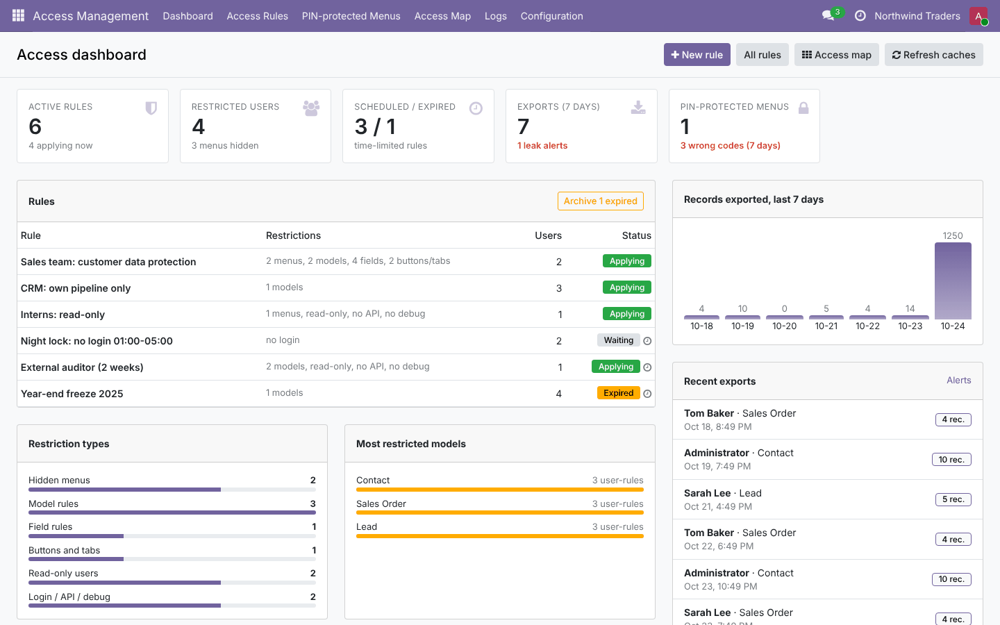
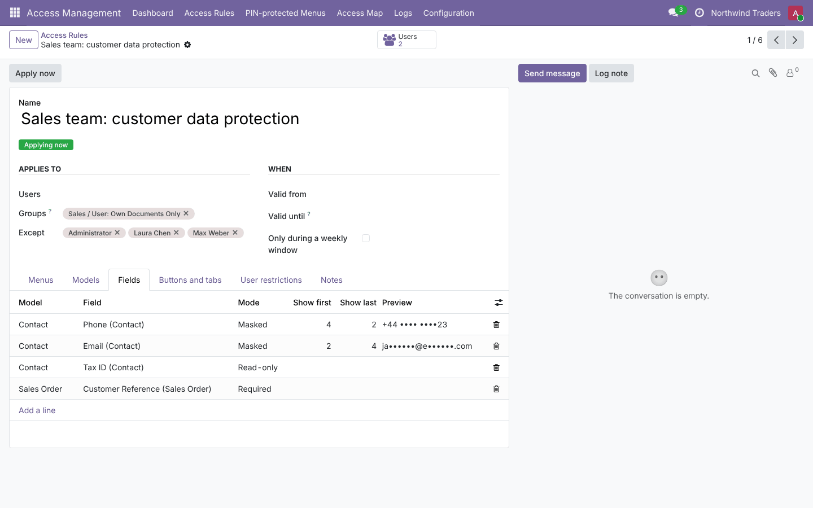
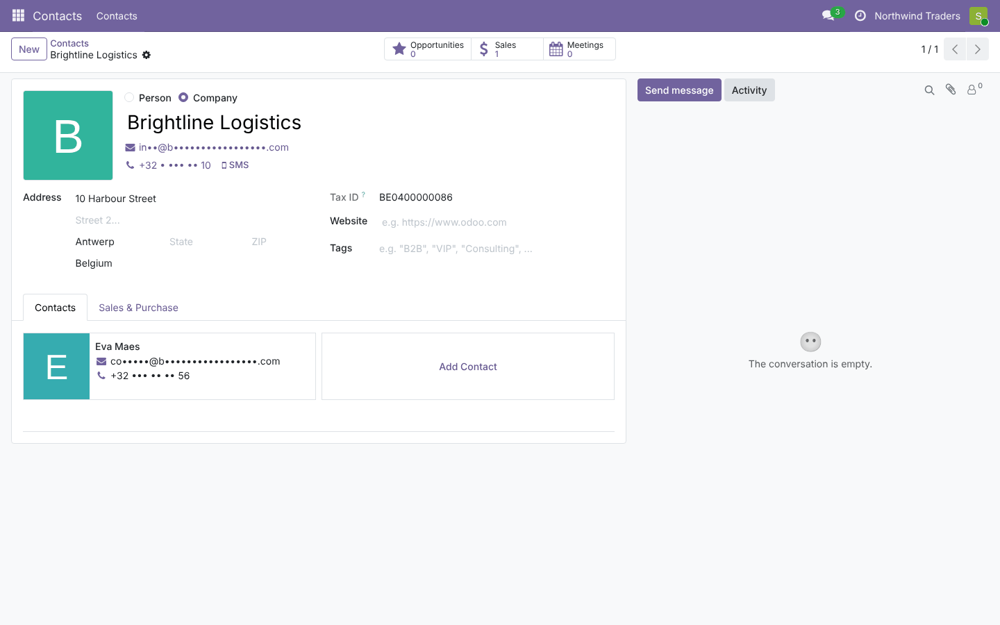
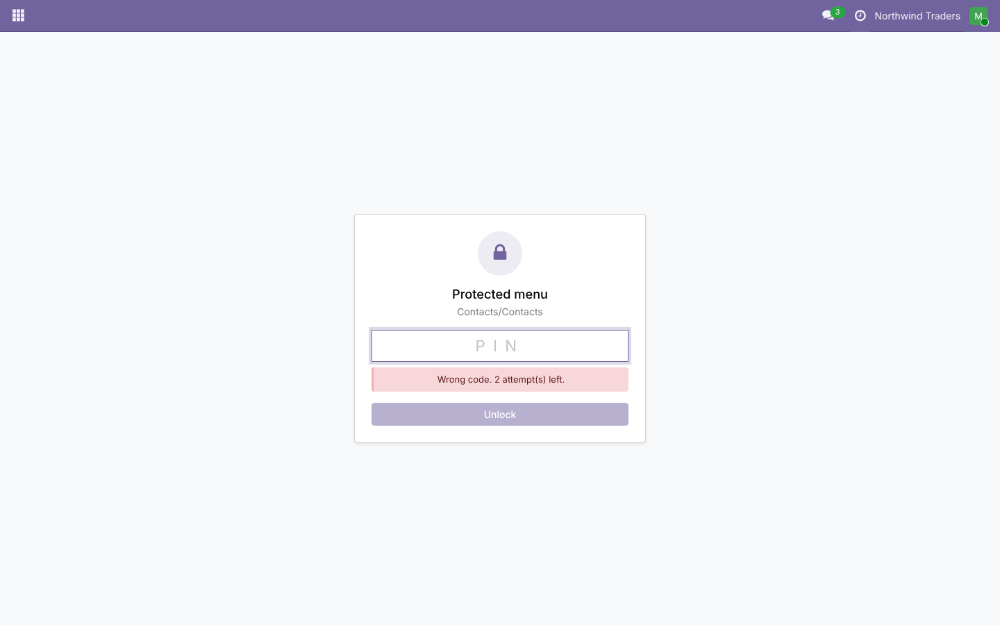
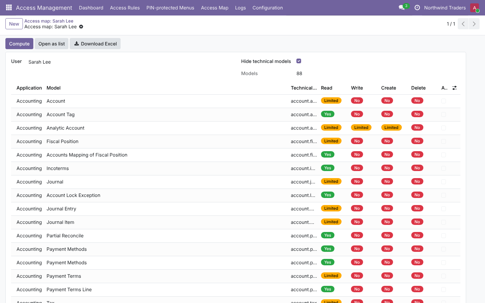

# Access Management (`access_management`)

Fine-grained access control for **Odoo 19.0 / 20.0**, on top of the standard groups. Rules apply to chosen users
or groups and can be limited in time. They can:
- hide menus;
- lock models or restrict them to some records;
- hide, lock, require or mask fields;
- hide buttons, tabs, chatter controls, reports, actions and search options;
- block export, import, archive and duplicate;
- make users read-only;
- disable developer mode;
- block the external API or logins.

The module also provides:
- PIN-protected menus;
- an export log with leak alerts;
- an access map with Excel export;
- JSON import / export of rules;
- a dashboard.

The code lives in:
- `19.0/access_management/`;
- `20.0/access_management/`.

---

## 1. Planning

### 1.1 Goal

Odoo's security works with groups, access rights (CRUD per model) and record rules. These are powerful but
coarse for day-to-day needs:
- "salespeople must not export customers";
- "the intern can look but not touch";
- "hide the cost price from this team";
- "nobody logs in at night";
- "the payroll menu needs a second code".

Each of these normally needs a custom module or new groups that multiply quickly.

This module lets an administrator express such needs as **rules**, without code. The rules are enforced on the
server, not only hidden in the interface.

### 1.2 Requirements

| # | Requirement |
| --- | --- |
| R1 | Rules for users and/or groups (implied groups included), with exceptions, companies, validity dates and weekly windows |
| R2 | Hide menus (and block their actions by URL) |
| R3 | Per model: block create / edit / delete / duplicate / archive / import / export; restrict records with a domain |
| R4 | Per field: hide, read-only, required, mask (partial reveal, per-record domain) |
| R5 | Hide buttons and tabs; refuse hidden buttons on the server |
| R6 | Chatter: hide it, or only send / log / activities / followers / attachments |
| R7 | Hide reports and bound actions; hide filters, group-bys and the search panel |
| R8 | User options: read-only, no developer mode, no external API, no login |
| R9 | PIN-protected menus with attempt limits, lockout and alerts |
| R10 | Export log with leak alerts and retention |
| R11 | Access map per user, exportable to Excel |
| R12 | Export / import rules as JSON, with a dry run |
| R13 | Dashboard |
| R14 | Same features and tests on Odoo 19 and 20 |

### 1.3 Scope (v1)

**In scope:** everything above.

**Out of scope:**
- field-level read security on every RPC call (masking applies to the web client's `web_read` and to exports);
- XML-RPC `write` checks for read-only fields (use *Block external API* for users who must not use the API);
- website / portal users (rules apply to internal users);
- IP-based restrictions;
- two-factor authentication (Odoo has its own).

### 1.4 Roles

| Role | Can |
| --- | --- |
| Access Management / Manager (implied by Settings administrators) | Rules, PIN locks, export log, attempts, access map, rule transfer, dashboard, settings |
| Restricted users | Work in Odoo with the rules that apply to them |

### 1.5 Acceptance criteria

- A rule on the group *Sales / Own Documents* with *No delete* on Contacts:
  - the *Delete* action disappears for salespeople;
  - deleting through the API raises an access error;
  - the administrator is not affected.
- A domain `[('user_id', '=', user.id)]` on Leads limits search, read and write to the user's leads, including
  through the API.
- A masked e-mail shows `in••@b•••••••.com` in forms, lists and exports. The stored value is unchanged, and the
  field cannot be written by that user.
- A PIN-protected menu shows a code prompt; the right code opens it, also from a bookmarked URL. Three wrong
  codes lock the user out for the lockout time and e-mail the alert recipients.
- An export of more than the threshold is logged as a leak alert and e-mailed.
- A rule with a weekly window becomes effective, or stops, within 5 minutes of the window boundary.

### 1.6 Screenshots

These are from Odoo 19. The Odoo 20 ones are in `20.0/access_management/static/description/screenshots/`.







---

## 2. Architecture

```
                         access.rule (+ model / field / element lines)
                                     │  is_effective (dates, weekly window; cron every 5 min)
                                     ▼
            access.rule._restrictions_for(uid, company)   ← ormcache, cleared on any rule change
            {menus, models: {ops, domains, flags, reports, actions}, fields: {mode, mask}, elements,
             readonly_user, no_debug, block_api, block_login}
                                     │
   ┌───────────────┬─────────────────┼─────────────────────┬─────────────────────────┬──────────────┐
   ▼               ▼                 ▼                     ▼                         ▼              ▼
ORM security    Menus            Views / data           HTTP                      Auth           Chatter
19: ir.rule.    ir.ui.menu.      base.get_view (arch),  /web/action/load          _check_        message_post
 _compute_domain _visible_menu_  get_views (toolbar),   (hidden-menu actions,      credentials    (chatter route),
20: base.        ids             fields_get, web_read   PIN prompt), call_button,  (login / API), mail.activity
 _access_domain                  (mask), web_save,      report routes, /access_    apikeys,       create
 (domains,                       export_data, load,     management/unlock          _handle_debug
 blocked ops,                    copy, archive
 read-only users)
```

### 2.1 Design decisions

- **One cached "restrictions" dictionary per user and company.**
  - Every hook reads it: views, ORM, menus, controllers. A user without rules costs a single cache lookup.
  - Any change to rules or lines clears the registry caches. The 5-minute cron clears them only when a rule
    starts or stops applying.
- **Security on the server, convenience in the views.**
  - Blocked operations and record domains are added to the ORM's own security domain: `ir.rule._compute_domain`
    on 19, `_access_domain` on 20. They therefore apply to searches, reads, writes, imports and the API alike.
  - View attributes only make the interface match what the server enforces: `create`, `edit`, `delete`,
    `duplicate`, `import`, `export_xlsx`, field and button `invisible` / `readonly` / `required`, and chatter
    markers.
- **Blocked operations use an always-false domain.** The standard access error is raised (with a note that
  Access Management restricted it). Nothing is patched in individual models.
- **Masking happens where data leaves the server**: `web_read`, which serves forms, lists and kanbans, and
  `export_data`.
  - Formatted companions are masked too (`phone_formatted`, `phone_sanitized`, `email_normalized`, and so on).
  - Masked fields become read-only, so a masked value is never saved back.
- **Hidden-menu actions are refused at `/web/action/load`** when no visible menu opens the same action. The same
  hook returns the PIN prompt client action for locked menus. After a good code, the session remembers the
  unlock for N minutes.
- **No lock-out.** Superuser and sudo are never restricted, the module's own models are exempt, and access
  managers always keep this application's menus.
- **Read-only users** cannot create, write or delete on business models. Technical models still work (`ir.*`,
  `mail.*`, `bus.*`, `res.users*`, ...), so login, preferences and chat keep working.
- **PIN codes are salted PBKDF2-SHA256 hashes** (120,000 iterations). They are compared in constant time and
  never read back.

---

## 3. Development

```
access_management/
├── controllers/main.py           action load (hidden menus, PIN prompt), call_button, reports, unlock
├── data/                         crons (rule schedules, log cleanup), alert e-mail templates
├── models/
│   ├── access_rule.py            rules, effective state, cached restrictions, security domain
│   ├── access_rule_lines.py      model / field / element lines, mask_value()
│   ├── base.py                   views, fields_get, web_read / web_save, export, import, copy, archive
│   ├── ir_rule.py                19: ir.rule._compute_domain · 20: base._access_domain
│   ├── ir_ui_menu.py, ir_http.py menus, developer mode
│   ├── res_users.py, mail.py     login / API blocking, smart button; chatter enforcement
│   ├── access_menu_lock.py       PIN locks and attempts
│   ├── access_export_log.py      export log, alerts, retention
│   └── access_dashboard.py       dashboard data
├── wizard/                       access map (+ Excel), rule import / export (JSON)
├── static/src/                   dashboard, PIN prompt, list export patch, styles
└── tests/                        33 tests + 2 tours
```

**Try it in a shell**

```python
Rule = env['access.rule']
rule = Rule.create({'name': 'No delete for Bob', 'user_ids': [(6, 0, bob.ids)],
                    'model_line_ids': [(0, 0, {'model_id': env['ir.model']._get('res.partner').id,
                                               'no_delete': True})]})
Rule.with_user(bob)._get_restrictions()['models']['res.partner']['ops']   # {'unlink'}
env['res.partner'].with_user(bob).search([]).unlink()                      # AccessError
```

**Extend**
- More model flags: add a boolean on `access.rule.model`, copy it in `_restrictions_for`, and use it in
  `base.py`, a controller, or the view processing (`_am_process_arch`).
- More exempt models (never restricted for read-only users): `READONLY_USER_EXEMPT` in `access_rule.py`.

---

## 4. Testing

```bash
tools/run_tests.sh 19.0 /path/to/odoo19 access_management
tools/run_tests.sh 20.0 /path/to/odoo20 access_management
```

| File | Covers |
| --- | --- |
| `test_rules.py` | Membership (groups, exceptions, companies, archived, sudo), dates and weekly windows with frozen time, blocked operations, *Read-only* shortcut, record domains (also with `user`), read-only users, hidden menus and actions with the manager exemption, login / API / API-key blocking, exempt models |
| `test_ui_restrictions.py` | View flags, hidden / read-only / required / masked fields (arch, `fields_get`, `web_read`, companions, `web_save`, export), mask domain and validation, tabs and buttons, chatter marker / removal and activities, toolbar actions, search filters, archive / import / export, x2many sub-views |
| `test_tools.py` | Export log merging, leak alert e-mail, retention; PIN hashing, attempts, lockout, alert, code change; access map and Excel; JSON export / dry run / import / skip / update / warnings; dashboard data and *Archive expired* |
| `test_http.py` | PIN prompt and unlock through `/web/action/load`; hidden-menu action refused; hidden button, duplicate and read-only field refused over JSON-RPC; chatter posting; developer mode; report route; tours: dashboard → rule, PIN unlock → list without *Export* |

**Manual test**
1. Create a rule for a test salesperson with *No export* on Contacts and a masked phone. Log in as that user:
   - the phones are masked;
   - *Export* is gone from the action menu;
   - `/web/export/...` calls fail.
2. Add a PIN lock on a menu. Open it: the prompt appears. Three wrong codes lock the menu and an e-mail goes to
   the alert address.
3. Give a weekly window ending in 10 minutes. Wait for the cron (or click *Apply now* after the boundary): the
   rule stops applying.

---

## 5. Deployment: dev → staging → production

1. **Dev:**
   - run the tests on both versions;
   - write the rules for the real cases first in a scratch database, with test users per profile.
2. **Staging:**
   - restore a copy of production and install the module;
   - import the rules with the JSON wizard (dry run first);
   - log in as one user of each profile and walk through their daily screens. Masks and hidden fields can
     surprise people who rely on them.
3. **Production:**
   - install the module, then import the rules (dry run, then import);
   - click *Apply now*;
   - tell users to reload the page (views and menus are cached in the browser until then).
4. **Safety:**
   - keep at least one administrator outside every rule (rules never apply to the superuser `__system__`);
   - prefer group-based rules to user lists;
   - give *Block login* rules a weekly window, never "always".
5. **Performance:**
   - restrictions are cached per user and company, so a user without rules costs one cache lookup;
   - record domains run on every search on that model, so keep them simple and indexed;
   - export logs are cleaned up after the retention period (90 days by default).
6. **Monitoring:**
   - dashboard: leak alerts and wrong PINs;
   - *Logs › Exports* and *PIN Attempts*;
   - the alert e-mails;
   - the server log (`access_management`).
7. **Rollback:**
   - archive a rule to lift it at once, or archive all rules;
   - uninstalling removes rules, locks and logs. Standard access rights and record rules are never modified (the
     module only adds its own manager group, implied by Settings administrators).

---

## 6. Odoo 19 vs Odoo 20

| Topic | 19.0 | 20.0 |
| --- | --- | --- |
| Record security hook | `ir.rule._compute_domain` | `ir.access` replaced rules and ACLs; `base._access_domain` |
| Access map rights | `ir.model.access.check` + `ir.rule._compute_domain` | `Model._access_domain(op)` |
| Access rights file | `ir.model.access.csv` | `ir.access.csv` |
| Settings | `get_param` / `set_param` | `get_int` / `get_str` / `set_int` |
| Cache decorator / invalidation | `tools.ormcache`, `registry.clear_cache()` | `api.ormcache`, `transaction.invalidate_ormcache()` |
| Binary fields | base64 in and out | base64 string in, `BinaryValue` out (`bytes(value)`) |
| Client actions | OWL 2: `static props`, `useRef`, `useState`, `t-model` | OWL 3: `useProps(standardActionServiceProps)`, `signal.ref()`, `proxy`, `t-on-input` |
| Phone display | `phone` | the widget shows `phone_formatted`, which is masked as a companion |

---

## 7. Known limitations

- **Interface refresh.** Views, menus and toolbars are cached by the browser: users see a change after reloading
  the page.
- **Masking scope.** Masking covers the web client (`web_read`) and exports. A user with API access could still
  `read` the field; combine masking with *Block external API*.
- **Read-only fields over XML-RPC.** They are enforced for the web client and JSON-RPC `write`, not for XML-RPC
  `write`.
- **Buttons by name.** Hidden buttons are matched by technical name, so two buttons with the same name on one
  model are hidden together.
- **Block login.** It refuses new logins only; sessions that are already open continue until they expire or the
  user logs out.
- **Record domains apply to every operation.** Records outside the domain are invisible, including in many2one
  dropdowns and reports.
