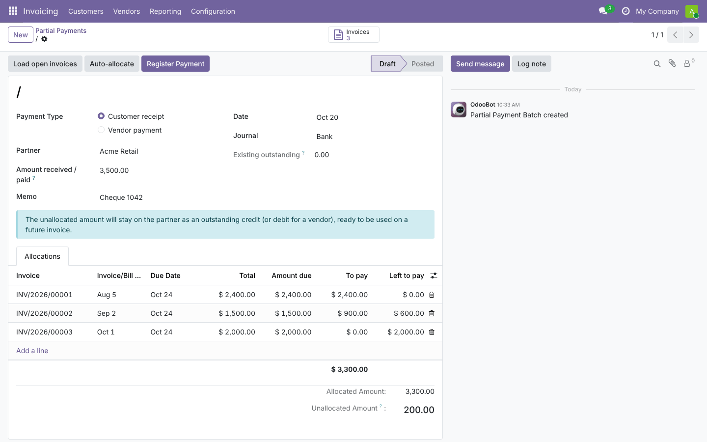
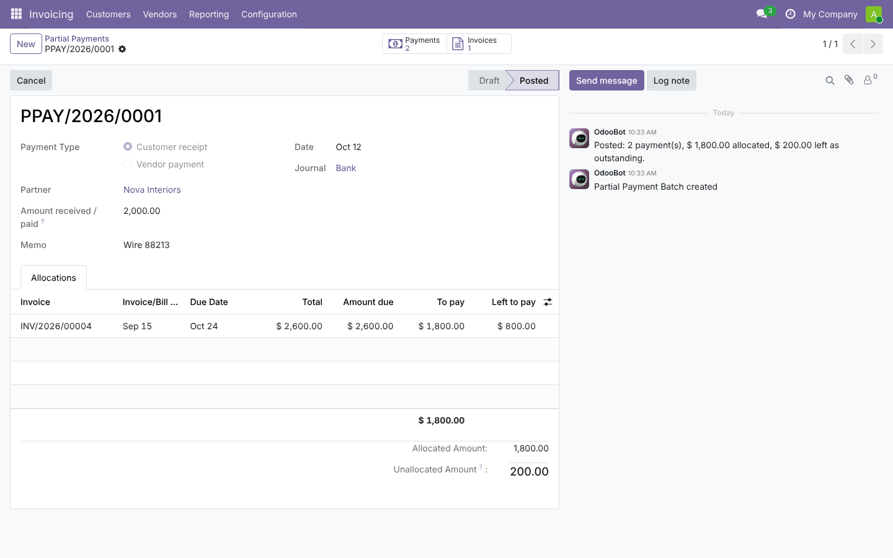
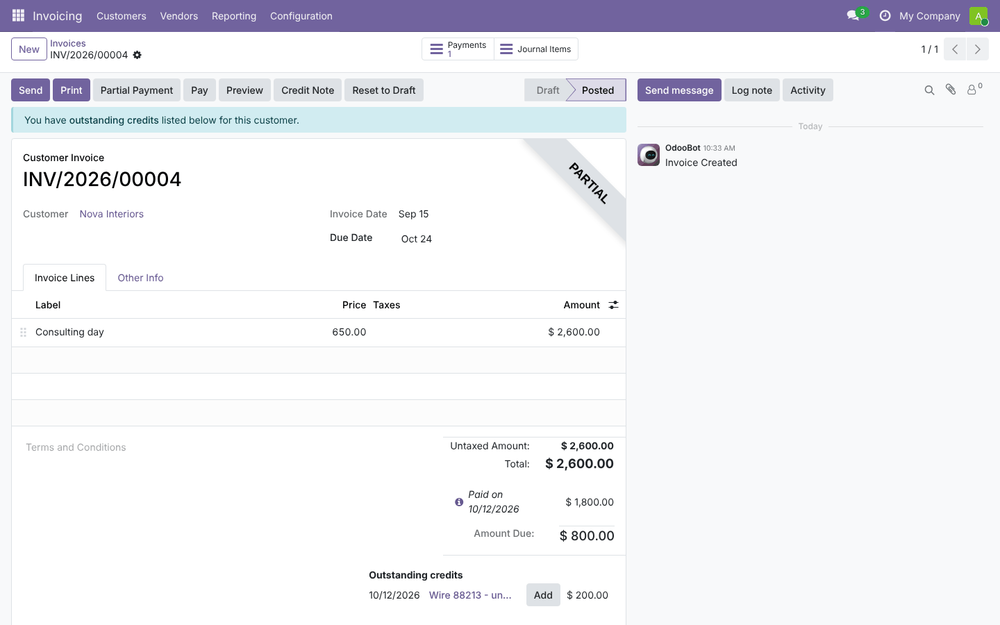
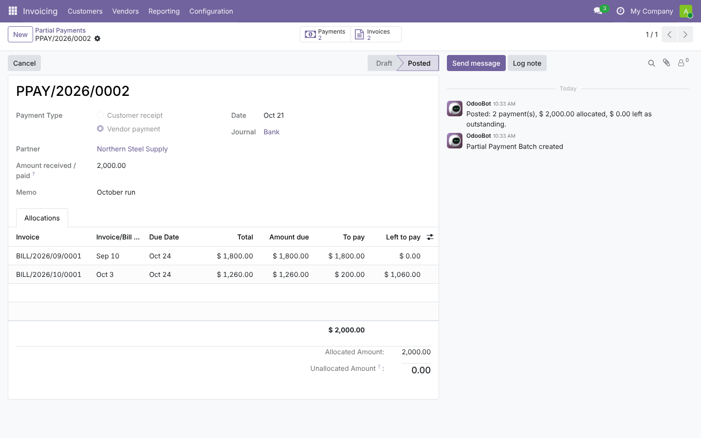
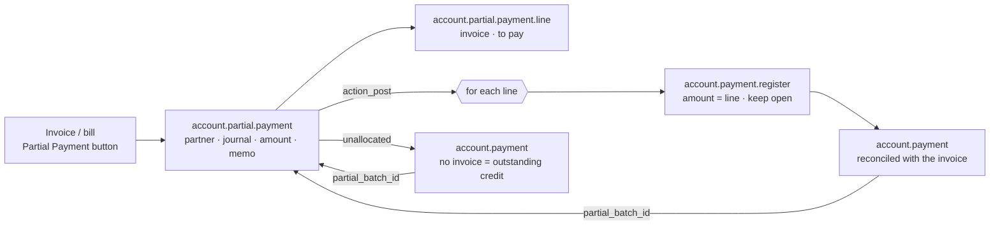

# Invoice Partial Payments (`account_invoice_partial_payment`)

This guide covers the whole life of the module: planning, architecture, development, testing, and deployment
from dev to production.
Module folders: [`19.0/account_invoice_partial_payment`](../19.0/account_invoice_partial_payment) and [`20.0/account_invoice_partial_payment`](../20.0/account_invoice_partial_payment).

---

## 1. Planning

### 1.1 Goal
Customers often send one transfer or cheque that covers several invoices, but not exactly. For example, a
3,500 cheque might pay the oldest invoice in full, part of the second, and leave 200 extra. Vendors are paid the
same way.

Odoo's *Register Payment* on several invoices pays each one **in full** in their order. Paying one invoice
partially is possible, but splitting one receipt with chosen amounts per invoice is not. The accountant needs
to say exactly how much goes where, and to keep the rest as a credit for later.

### 1.2 Requirements

| # | Requirement |
| --- | --- |
| R1 | One batch = one receipt/payment of a partner with a total amount, journal, date and memo |
| R2 | One allocation per invoice/bill with a free amount (≤ amount due) |
| R3 | Load all open documents of the partner; auto-allocate oldest due first |
| R4 | Unallocated amount stays as outstanding credit (customer) / debit (vendor) |
| R5 | Checks: total > 0, allocations ≤ total, ≤ amount due, partner/type/currency/state of each document, no duplicates |
| R6 | Start from an invoice (pre-filled) |
| R7 | History with numbering, links to payments and invoices, chatter |
| R8 | Cancel: payments cancelled, invoices reopened |
| R9 | Accounting must stay standard (reconciliation, cash-basis taxes, exchange differences, bank matching) |

### 1.3 Scope (v1)

| In scope | Out of scope (roadmap) |
| --- | --- |
| Customer invoices and vendor bills | Credit notes inside the batch (use the standard outstanding widget) |
| Same currency for the batch and its documents | Mixed currencies in one batch |
| Bank and cash journals | Payment-method-specific fields (checks printing, SEPA batches) |
| Payments per allocation + rest payment | One single payment entry for the whole batch |

### 1.4 Roles

| Role | Group | Can do |
| --- | --- | --- |
| Billing user | *Invoicing / Billing* (`account.group_account_invoice`) | Create, post, cancel batches |
| Auditor | *Read-only* (`account.group_account_readonly`) | Read batches |

### 1.5 Acceptance criteria
1. A 1,200 receipt allocated 700 + 400 to invoices of 1,000 and 500 leaves 300 and 100 due. A 100 credit then
   appears under *Outstanding credits* on the customer's invoices.
2. Allocating more than an invoice's amount due, or more than the receipt, is refused with a clear message.
3. Cancelling the batch brings both invoices back to their full amount.
4. The batch shows its number, 3 payments, 2 invoices and a chatter line with the formatted amounts.

### 1.6 Screenshots (Odoo 19; the Odoo 20 ones are in `20.0/account_invoice_partial_payment/static/description/screenshots/`)

| Draft batch | Posted batch |
| --- | --- |
|  |  |
| **Invoice after the batch** | **Vendor batch** |
|  |  |

---

## 2. Architecture



### 2.1 Design decisions
- **Standard payments, not hand-made reconciliations.** Each allocation goes through Odoo's own register-payment
  wizard with the exact amount and *keep open*. Reconciliation, cash-basis tax entries, exchange differences,
  early-payment rules and payment states are all Odoo's. The alternative is creating
  `account.partial.reconcile` rows by hand, and that skips those mechanisms.
- **The rest is a payment without an invoice**, so it shows as an outstanding credit (customer) or debit
  (vendor). Odoo's *Outstanding credits* widget offers it on future invoices.
- **Bank reconciliation**: the bank line of the full receipt is matched with the batch's payments, all with the
  same memo prefix. Odoo's reconciliation widget can match one statement line with several payments.
- **Validation in one place** (`_check_allocations`) with explicit messages. Zero lines are dropped when posting.
- **Amount due "before the batch"**: once posted, the line shows the amount that was due before the payment,
  plus *left to pay*. This keeps the batch readable later.
- **Context hygiene**: `default_*` keys from the invoice button are removed before creating payments
  (`clean_context`). Without this, they would leak into the payment wizard.

---

## 3. Development

```bash
./odoo-bin --addons-path=addons,/path/odoo-module/19.0 -d pp_dev -i account_invoice_partial_payment --dev=xml,reload
```
Use a chart of accounts (generic one is fine). Create a customer with three posted invoices and a vendor with two
bills; the build tooling's `shots/demo_account_invoice_partial_payment.py` does it.

Build order:
1. models and amounts;
2. checks;
3. posting via the payment wizard;
4. rest payment;
5. load and auto-allocate;
6. cancel and reset;
7. views and menus;
8. invoice button;
9. tests;
10. port to 20.

---

## 4. Testing

`tests/test_partial_payment.py` is based on `AccountTestInvoicingCommon`, which provides company, chart,
partners and journals. **All tests pass on both versions: 19.0 runs 7 tests and 20.0 reports 9, because it
counts its two standard web suites too.**

| Test | Checks |
| --- | --- |
| `test_customer_receipt_split_with_rest` | 1,200 → 700 + 400 + 100 rest: 3 posted payments, residuals 300/100, *partial* state, amounts due before the batch, left to pay, outstanding credit 100 on the partner, smart-button counts, `PPAY/` numbering |
| `test_full_payment_marks_invoice_paid` | Exact payment → *in payment/paid*, no rest payment |
| `test_vendor_bills` | Outbound payment, bill residual |
| `test_checks` | More than due, more than received, zero amount, wrong partner/type, double post, delete posted |
| `test_load_and_auto_allocate` | Loads open invoices, allocates oldest first (1,000 + 100), no duplicates on reload |
| `test_cancel_reopens_invoices` | Payments cancelled, invoice back to full, reset to draft unlinks payments |
| `test_button_on_invoice` | Pre-filled batch from the invoice (Form), posting with a changed amount |

```bash
tools/run_tests.sh 19.0 /path/to/odoo19 account_invoice_partial_payment
tools/run_tests.sh 20.0 /path/to/odoo20 account_invoice_partial_payment
```

Manual UAT:
- Taxes on payment (cash basis): check the tax entries for each partial payment.
- Reconcile the bank statement line of the full receipt with the batch payments.
- Use the rest credit on a new invoice through *Outstanding credits › Add*.
- Payment terms with early-payment discount: the batch keeps the invoice open and does not apply the discount.

---

## 5. Deployment: dev → staging → production

1. **Code**: add the module folder to the addons path on every worker, restart, then install
   *Invoice Partial Payments*.
2. **Staging** (copy of production):
   - replay one real multi-invoice receipt and compare the entries with what the accountant expects;
   - test cancel;
   - test bank matching.
3. **Production**:
   - install the module;
   - give billing users the *Invoicing / Billing* group (they already have it for invoices);
   - train the team on *Load open invoices* and *Auto-allocate*.
4. **Period closing**: batches are just payments, so the usual lock dates apply. Cancelling a batch in a locked
   period fails like any payment would.
5. **Rollback**: uninstall the module. Payments and reconciliations stay valid because they are standard; only
   the batch records and links disappear.

---

## 6. Odoo 19 vs Odoo 20

| Topic | 19.0 | 20.0 |
| --- | --- | --- |
| Access rights + company rule | `ir.model.access.csv` + `ir.rule` | `ir.access.csv` (company domain line) |
| Stat button icons | Font Awesome (`fa-money`, `fa-file-text-o`) | Material Symbols (`payments`, `article`) |
| `account.payment.register` / `account.payment` API used | same (`_create_payments`, `memo`, `date`, `action_post/draft/cancel`) | same |

The Python code, views and tests are the same in both versions.

## 7. Known limitations
- One payment is created per allocated invoice, plus one for the rest, instead of a single payment entry.
- Batch and invoices must share the batch currency.
- Credit notes are not part of the batch; apply them with Odoo's outstanding widget.
