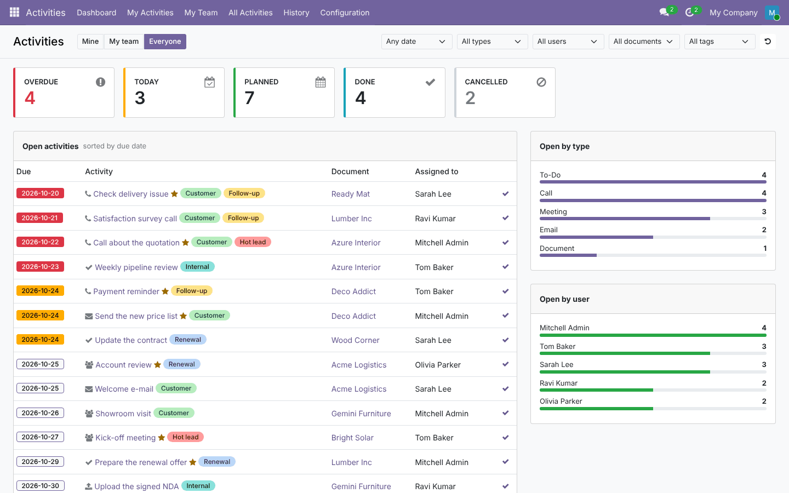
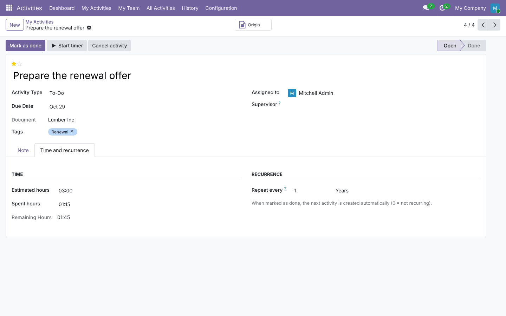
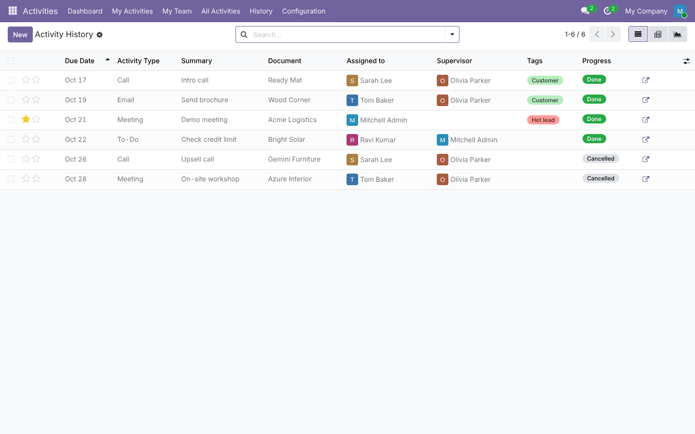

# Activity Management (`activity_management`)

An activity management app for **Odoo 19.0 and 20.0**. It covers the dashboard, history, cancellation with a
reason, done-with-feedback, supervisors, tags and priority, mass scheduling, recurring activities, time tracking
and reminder digests. It builds on Odoo's standard `mail.activity`, so it works with every model that has
activities.

The code lives in:
- `19.0/activity_management/`;
- `20.0/activity_management/`.

---

## 1. Planning

### 1.1 Goal

Odoo activities are good for one person on one document. They are weak for managing work:
- an activity disappears once it is done;
- a "cancelled" activity is simply deleted;
- there is no team view or dashboard, no recurrence and no reminders.

This module turns activities into a small task-management tool without replacing them. Every activity created
anywhere in Odoo (chatter, automated actions, other apps) shows up in the app.

### 1.2 Requirements

| # | Requirement |
| --- | --- |
| R1 | Dashboard: overdue / today / planned / done / cancelled counters, filters, open activities, breakdowns |
| R2 | Keep done and cancelled activities, with who did it, when, feedback or reason |
| R3 | Cancel with a mandatory reason; notify the assignee and the supervisor; reopen |
| R4 | Supervisor per user, copied to activities; "My team" scope |
| R5 | Tags and priority on activities |
| R6 | Schedule one activity on many records for many users at once, from the Action menu |
| R7 | Recurring activities |
| R8 | Estimated / spent hours and a timer |
| R9 | Daily reminder digest per user |
| R10 | Same features and tests on Odoo 19 and 20 |

### 1.3 Scope (v1)

**In scope:**
- everything above;
- list, kanban, calendar, pivot and graph views;
- settings page;
- access groups.

**Out of scope:**
- SLA policies;
- activity templates beyond Odoo's own "activity plans";
- external calendar sync;
- mobile push.

### 1.4 Roles

| Role | Group | Can |
| --- | --- | --- |
| User | `base.group_user` | Own activities, dashboard "Mine", history of own activities, mass scheduling on allowed models |
| Supervisor | `activity_management.group_activity_supervisor` | + "My team" scope and menu (activities of users they supervise or that name them as supervisor) |
| Manager | `activity_management.group_activity_manager` | + "Everyone", All Activities, configuration, settings |

Access to the activities themselves stays Odoo's: a user only sees activities on documents they can read.

### 1.5 Acceptance criteria

- Marking as done keeps the activity: it is archived, with `progress = done`, `done_by_id`, `date_done` and the
  feedback.
- Cancelling without a reason is refused. The activity is archived with `progress = cancelled`, and a note on
  the document names the reason and notifies the assignee and the supervisor.
- Dashboard counters equal the number of records in the list opened by clicking them.
- A plain user asking for scope `all` only gets their own activities.
- A recurring activity, when done, creates the next one at deadline + interval.
- The reminder job sends one message per user and does not repeat on the same day.
- All tests pass on 19.0 and 20.0, including a browser tour.

### 1.6 Screenshots

These are from Odoo 19. The Odoo 20 ones are in `20.0/activity_management/static/description/screenshots/`.





---

## 2. Architecture

```
mail.activity  (Odoo)                      res.users
  └─ inherited by activity_management         └─ activity_supervisor_id ─┐
       supervisor_id (computed from user, editable, stored) ◄────────────┘
       tag_ids ──► mail.activity.tag
       priority, progress (stored: open / done / cancelled)
       cancelled, cancel_reason, cancelled_by_id, done_by_id
       estimated_hours, spent_hours, remaining_hours, timer_start
       recurrence_interval / recurrence_unit, reminder_sent_on
       _action_done()            → stop timers, done_by, next recurring activity
       action_cancel_with_reason → archive + note on the document
       _cron_send_reminders      → daily digest
       get_dashboard_data        → JSON for the OWL dashboard

wizards: activity.done.wizard · activity.cancel.wizard · activity.mass.schedule (+ act_window bindings)
client action: activity_management.dashboard  (path /odoo/activity-dashboard)
```

### 2.1 Design decisions

- **Archive, don't delete.** Odoo 19 and 20 already archive done activities (`_action_done` → `action_archive`).
  We do the same for cancellations and add a stored `progress` (`active` + `cancelled`). History is then just
  `active_test=False` with a domain on `progress`, and the standard activity widgets keep ignoring archived
  rows.
- **Supervisor is computed and stored, but editable.** It comes from the assignee's supervisor, so team
  reporting is automatic, and it can be changed per activity.
- **Dashboard via one RPC** (`get_dashboard_data`). It returns counters, ready-made **domains** for each counter
  (so clicking a card opens exactly those records), breakdowns and filter options. Everything runs with the
  caller's rights; the scope is downgraded when the user lacks the group.
- **Mass scheduling bindings are data, not code.** The settings field creates or removes `ir.actions.act_window`
  bindings on the chosen models, so no model needs to be patched.
- **Recurrence on completion.** The next activity is created when the current one is done, not by a cron.
  Nothing piles up if nobody works on it.
- **Reminders as a digest.** One message per user per day via `message_notify`, which follows each user's
  notification preference (inbox or e-mail). `reminder_sent_on` prevents duplicates.
- **Switchable defaults.** In Odoo 19, an unchecked boolean setting deletes its parameter. Defaults that are "on"
  are therefore seeded by a `post_init_hook` instead of a code default, so they can really be switched off.
  Odoo 20 stores `False`, and the code uses typed getters.

---

## 3. Development

```
activity_management/
├── __init__.py                   post_init_hook (default settings)
├── __manifest__.py
├── data/ir_cron.xml              daily reminder job
├── models/
│   ├── mail_activity.py          the core (fields, done/cancel/reopen, timer, recurrence, reminders, dashboard)
│   ├── mail_activity_tag.py      tags, unique per company (UniqueIndex with COALESCE)
│   ├── res_users.py              supervisor / supervised users
│   └── res_config_settings.py    settings (config parameters + binding models)
├── wizard/                       done, cancel, mass schedule
├── views/                        activity views + actions, tags, users, settings, menus
├── security/                     groups + access (ir.model.access.csv in 19, ir.access.csv in 20)
├── static/src/dashboard/         OWL client action (js, xml, scss)
├── static/tests/tours/           dashboard tour
└── tests/                        13 tests
```

**Local setup**

```bash
python odoo-bin -d act_dev --addons-path=odoo/addons,addons,/path/to/odoo-module/19.0 \
    -i activity_management --dev=xml,reload
# open /odoo/activity-dashboard
```

**Extending**
- **Add a counter:** add a key to `counts` and `domains` in `get_dashboard_data`, and an entry to `KPIS` in
  `activity_dashboard.js`.
- **Other models in mass scheduling:** select them in the settings. Any model with activities works.
- **Hook on cancellation:** override `action_cancel_with_reason` and call `super()`.

---

## 4. Testing

```bash
tools/run_tests.sh 19.0 /path/to/odoo19 activity_management
tools/run_tests.sh 20.0 /path/to/odoo20 activity_management
```

| Test | Checks |
| --- | --- |
| `test_supervisor_and_progress` | Supervisor computed from the user, follows reassignment |
| `test_done_wizard_keeps_history` | Feedback, archived, `done`, `done_by_id`, searchable in history |
| `test_cancel_with_reason` | Empty reason refused, note on document with reason, assignee + supervisor notified, double cancel refused, reopen |
| `test_cancel_without_supervisor_notification` | The setting is on by default and can be switched off |
| `test_recurring_activity` | Next activity at +2 weeks with same type, user, tags, priority |
| `test_timer` | Spent / remaining hours; timer stops when done |
| `test_mass_schedule` | 2 records × 2 users = 4 activities, supervisor copied |
| `test_mass_schedule_binding_from_settings` | Binding created and removed from the settings |
| `test_reminder_digest` / `test_reminder_disabled` | One digest per user, due window, overdue included, not twice a day, off by default |
| `test_dashboard_data_and_scopes` | Counters, ordering, scopes and groups, model filter, period, KPI domains = counters |
| `test_tag_unique` | Duplicate tag refused |
| `test_dashboard_tour` (browser) | Dashboard → ✓ → feedback → counter drops → Done card opens the history |

**Manual check list**
1. Schedule an activity from a contact's chatter. It appears on the dashboard.
2. Mark it done with feedback. It moves to History.
3. Cancel another one. A note appears on the contact, and the supervisor gets a notification.
4. Set *repeat every 1 week*, mark it done, and check the new one.
5. Enable mass scheduling on Contacts, select 3 contacts, then *Action › Schedule activities*.
6. Enable reminders, run *Settings › Technical › Scheduled Actions › Activities: reminders and overdue digest*, and check the
   inbox.

---

## 5. Deployment: dev → staging → production

1. **Dev:**
   - run the tests on the target version;
   - install on a copy of production;
   - check the dashboard with real volumes (the queries are indexed on `progress`, `supervisor_id` and
     `date_deadline`).
2. **Staging:**
   - install the module;
   - create the groups' members (supervisors, managers);
   - set supervisors on users;
   - choose the mass-scheduling models;
   - leave reminders **off** until users are told.
3. **Production:**
   - install during low traffic. Adding the stored `progress` and `supervisor_id` columns computes them for
     existing activities, including archived ones. This is quick, but it runs one SQL update per batch on large
     databases.
   - Then enable reminders and pick the hour of the *Activities: reminders and overdue digest* job (default: daily). Make sure
     outgoing mail works if users get notifications by e-mail.
4. **Monitoring:**
   - server log for the cron;
   - *Discuss* inbox for digests.
5. **Rollback:**
   - uninstalling removes the added fields and tags;
   - activities themselves stay (they are Odoo's);
   - cancelled activities stay archived.

---

## 6. Odoo 19 vs Odoo 20

| Topic | 19.0 | 20.0 |
| --- | --- | --- |
| Access rights | `ir.model.access.csv` | `ir.access.csv` |
| Settings | `get_param`; unchecked boolean deletes the parameter | typed `get_bool` / `get_int`; `False` stored |
| `mail.activity._action_done` | returns `(messages, next_activities)` | returns `messages` |
| Activity type icons | Font Awesome classes (`fa-phone`) | Material Symbols names (`phone`) |
| OWL | 2: `useState`, `static props` | 3: `proxy`, no `static props`, `this.` in templates |
| QWeb | `t-esc` | `t-out` |
| View button icons | `fa-check` | `check` (Material Symbols) |

---

## 7. Known limitations

- Supervisors see their team's activities only on documents they can read (Odoo's record rules still apply).
- Recurrence is on completion only. A cancelled recurring activity does not create the next one.
- The timer is per activity and server-side. It is not a live clock on screen; the spent time updates when it
  stops.
- Reminder digests are sent once a day. The day is the server's, not each user's timezone.
- Mass scheduling refuses models the user cannot read, but creates the activities with the user's rights, so
  activity-level rules from other modules apply.
