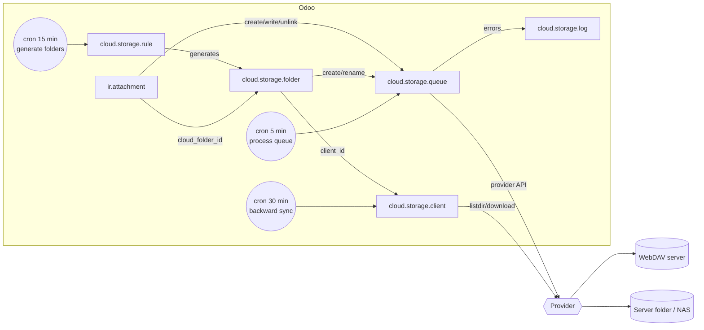
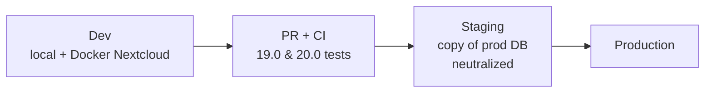

# Cloud Storage Sync (`cloud_storage_sync`)

End-to-end guide: planning, architecture, development, testing and deployment from dev to production.
Module folders: [`19.0/cloud_storage_sync`](../19.0/cloud_storage_sync) and [`20.0/cloud_storage_sync`](../20.0/cloud_storage_sync).

---

## 1. Planning

### 1.1 Goal
Give Odoo a document folder tree that is generated automatically from business records (customers, projects,
employees…) and kept in sync with an external storage, so files can be opened from Odoo **and** from the
storage's own apps (Nextcloud desktop/mobile, NAS shares, Finder/Explorer mounts).

### 1.2 Scope (v1)

| In scope | Out of scope (roadmap) |
| --- | --- |
| Folder rules per model, with filters, name expression, nested rules, default subfolders, max folders | Google Drive, OneDrive/SharePoint, Dropbox, Box, S3 back-ends |
| Manual folders with user / group restrictions | Portal / public sharing of folders |
| WebDAV back-end (Nextcloud, ownCloud, Synology, QNAP, TrueNAS, any WebDAV) | Tags on files, slideshow, mass actions |
| Server-folder back-end (local disk, mounted NAS, sync-client folder) | Database backup sync |
| Direct sync (Odoo → cloud), backward sync (cloud → Odoo), reverse sync (pull back) | Real-time sync (by design it is batched) |
| "Keep files only in the cloud" (link attachments to save filestore space) | |
| Sync queue with retries, logs, pause/resume | |
| File manager (folder tree + kanban), ZIP download of a folder | |

### 1.3 Users and roles

| Role | Group | Can do |
| --- | --- | --- |
| Employee | Internal User | Nothing new, files keep following record access |
| File manager user | *Cloud Storage / File Manager* | Browse folders/files, create manual folders, upload, download ZIP |
| Administrator | *Cloud Storage / Administrator* | Clients, folder rules, sync queue, logs, secrets |

### 1.4 Acceptance criteria
1. A rule on *Contacts* with a filter creates one folder per matching contact under `<root>/<rule name>/`.
2. A file attached to such a contact appears in the storage within one queue run.
3. Renaming the contact renames its folder in the storage; files keep working.
4. A file dropped into the folder from the storage appears on the contact after the backward sync.
5. A contact leaving the filter: its folder is archived, cloud-only files are pulled back first.
6. A storage outage never blocks users: tasks are retried, then marked failed and logged.

---

## 2. Architecture



### 2.1 Data model

| Model | Purpose | Key fields |
| --- | --- | --- |
| `cloud.storage.client` | A connection to one storage | `provider` (webdav/local), `root_folder`, credentials (admin-only), `browser_base_url`, `backward_sync`, `remove_local_binary`, `state` |
| `cloud.storage.rule` | Generates folders from records | `model_id`, `domain`, `name_expression`, `parent_id` + `parent_field_id` (nesting), `subfolder_names`, `max_folders` |
| `cloud.storage.folder` | Folder tree (`_parent_store`) | `res_model`/`res_id` (linked record, unique), `remote_path` (computed), `manual`, `user_ids`/`group_ids`, `sync_state` |
| `cloud.storage.queue` | Pending storage operations | `operation` (mkdir/upload/move/delete/pull), `priority`, `attempts`, `state` |
| `cloud.storage.log` | Sync history | `level`, `message`, links to folder/file |
| `ir.attachment` (extended) | Files | `cloud_folder_id`, `cloud_path`, `cloud_state` |

### 2.2 Key design decisions
- **Queue, not inline calls.** Creating an attachment never waits for the network; the cron processes tasks
  FIFO by priority, each inside a savepoint so one failure never rolls back the batch.
- **Providers behind one interface** (`models/providers.py`): `mkdir/upload/download/delete/move/listdir/exists/public_url`.
  Adding Google Drive or S3 later means adding a class to `PROVIDERS` and a selection value.
- **Paths are computed**, stored, and recursive (`remote_path` depends on the parent's), so a rename only
  enqueues one `move`, and file paths under it are rewritten when the move succeeds.
- **Field binaries are ignored** (`res_field` set: avatars, product images), only real documents sync.
- **Unique folder per record** enforced by a partial unique index (`res_model, res_id WHERE active`).
- **Loop protection**: every write done by the sync itself carries `cloud_storage_skip_sync` in the context.

### 2.3 Security
- Secrets (`webdav_password`, URLs, paths) are restricted to administrators at field level.
- Folder record rule: restricted manual folders are visible only to the listed users/groups; administrators see all.
- Files keep Odoo's attachment access: a file on a contact needs read access to that contact.
- ZIP download uses the caller's rights (`check_access` + regular searches), never `sudo` for listing.
- `LocalProvider` refuses paths that resolve outside its root (path traversal guard).

---

## 3. Development

### 3.1 Local setup
```bash
git clone https://github.com/Adityashah1409/odoo-module.git
git clone --depth 1 -b 19.0 https://github.com/odoo/odoo.git odoo19
python3 -m venv venv && . venv/bin/activate && pip install -r odoo19/requirements.txt
./odoo19/odoo-bin --addons-path=odoo19/addons,odoo-module/19.0 -d cs_dev -i cloud_storage_sync --dev=all
```
For a real WebDAV target during development: `docker run -d -p 8080:80 nextcloud` and use
`http://localhost:8080/remote.php/dav/files/<user>` as the WebDAV URL.

### 3.2 Build order (how the module was written)
1. `providers.py` with the Local back-end first (no network → fast feedback), then WebDAV.
2. `cloud.storage.client` (connection test, logging helper, provider factory).
3. `cloud.storage.folder` with computed `remote_path` and the queue hooks on create/write/unlink.
4. `cloud.storage.queue` with one `_run_<operation>` method per operation and retry handling.
5. `ir.attachment` hooks: folder assignment on create, re-upload on content change, move on folder change, delete on unlink.
6. `cloud.storage.rule` generation (root rules, then child rules, then retirement of obsolete folders).
7. Backward sync on the client, then views, menus, crons, security, and the ZIP controller.
8. Tests at each step (see §4), then the 19 → 20 port (see §6).

### 3.3 Extending: add a provider
```python
# models/providers.py
class S3Provider(BaseProvider):
    def mkdir(self, path): ...
    # implement the 8 methods
PROVIDERS['s3'] = S3Provider
```
Then add `('s3', 'Amazon S3')` to `cloud.storage.client.provider` and its credential fields + form page.

---

## 4. Testing

### 4.1 Automated tests (`tests/`)

| File | Covers |
| --- | --- |
| `test_folder_rules.py` | folder per record, name sanitizing, default subfolders, idempotency, rename → move, nested rules, retirement, max folders, invalid rule validation |
| `test_sync.py` | upload, unique file names, ignored field binaries, re-upload on change, cloud-only + pull back, delete propagation, manual folders + move, backward sync (new files/folders, missing files), pause, retries → failed → requeue, ZIP download (HTTP) |
| `test_webdav.py` | WebDAV request sequence (MKCOL/PUT/PROPFIND/MOVE), URL quoting, PROPFIND parsing, error mapping |
| `test_access.py` | folder restrictions, admin-only configuration and secrets, upload by file users, employees without the group |

Run them:
```bash
tools/run_tests.sh 19.0 /path/to/odoo19 cloud_storage_sync
tools/run_tests.sh 20.0 /path/to/odoo20 cloud_storage_sync
```
Result at release: **19.0: 24 tests, 0 failures. 20.0: 26 tests, 0 failures.** CI runs both on every PR.

### 4.2 Manual test plan (UAT)

| # | Step | Expected |
| --- | --- | --- |
| 1 | Configuration › Cloud Clients › New, WebDAV, fill URL/user/app password, *Test & Connect* | State *Connected*, `Odoo/` folder exists in the storage |
| 2 | Folder Rules › New: Contacts, filter *Is a company*, subfolders `Contracts, Invoices` | *Generate folders now* creates one folder per company |
| 3 | Attach a PDF to a company in its chatter | Within 5 min (or *Sync now*) the PDF is in `Odoo/<rule>/<company>/` |
| 4 | Rename the company | Folder renamed in the storage, PDF still opens |
| 5 | Drop a file in the folder from the Nextcloud app | After backward sync it is on the company |
| 6 | Enable *Keep files only in the cloud*, attach a new file | File becomes a link; filestore size does not grow |
| 7 | *Pull files back* | Files are binaries again |
| 8 | Stop the WebDAV server, attach a file | Task retried, then *Failed* after 5 attempts, error in Sync Logs; *Retry* after restart works |
| 9 | Create a manual folder restricted to one user | Other file-manager users do not see it |
| 10 | Folder › *Download ZIP* | ZIP with the folder tree |

---

## 5. Deployment: dev → staging → production



### 5.1 Pre-requisites
- No extra Python package (uses `requests` and `lxml` shipped with Odoo).
- A WebDAV account dedicated to Odoo (Nextcloud: create a user `odoo` and an **app password**).
- HTTPS on the storage; keep *Verify SSL* on in production.
- Server folder provider: the Odoo service user must own/write the target directory (`chown odoo: /mnt/nas/odoo`).

### 5.2 Staging
1. Restore a recent production backup on staging. Odoo.sh neutralizes crons; on-premise run
   `odoo-bin neutralize -d staging` so nothing writes to production storage.
2. Point the client to a **staging** storage root (e.g. `Odoo-staging`) before enabling crons.
3. Install the module, run the UAT table above, check *Sync Logs* is clean.
4. Measure: number of folders a rule will create (`max_folders` protects you), queue throughput.

### 5.3 Production rollout
1. Merge the PR into `main`; on Odoo.sh update the submodule and push to the production branch.
   On-premise: `git pull`, then `odoo-bin -d prod -u cloud_storage_sync --stop-after-init`, restart the service.
2. Create the client and **Test & Connect**.
3. Create rules one by one, starting with a small filter; watch the queue drain before adding more.
4. Enable *Keep files only in the cloud* only after a full backup of the storage exists.
5. Server timeouts: large first syncs run in the cron worker; keep `limit_time_real_cron` ≥ 900 s on-premise.

### 5.4 Monitoring and operations
- *Configuration › Sync Queue* filtered on *Failed*, and *Sync Logs* filtered on *Errors*.
- Logs are cleaned after `cloud_storage_sync.log_retention_days` (default 30), done tasks after 7 days.
- Retry policy: `cloud_storage_sync.max_attempts` (default 5) in System Parameters.
- Pause a client during storage maintenance; tasks wait and resume afterwards.

### 5.5 Rollback
1. On each client: *Pull files back* and let the queue finish (all files become binaries again).
2. Uninstall the module. Storage content is left untouched.

---

## 6. Odoo 19 vs Odoo 20

The 20.0 version is produced from 19.0 with `tools/port_19_to_20.sh` (Odoo 20's `upgrade_code` + extra fixes):

| Topic | 19.0 | 20.0 |
| --- | --- | --- |
| Access rights | `security/ir.model.access.csv` + `ir.rule` records | `security/ir.access.csv` (permissions and restrictions in one file) |
| Icons | Font Awesome (`fa-folder`) | Material Symbols (`icon="folder"`, `oi` classes) |
| Attachment content field in views | `datas` | `raw` (`datas` was removed) |
| `content_disposition` import | `odoo.http` | `odoo.http.stream` |
| System parameters | `get_param` / `set_param` | `get_str` / `set_str` (typed getters) |
| `res.partner.is_company` | stored boolean | computed from VAT (tests use `ref` instead) |

## 7. Known limitations
- Sync is batched (cron), not real time.
- Backward sync detects new/removed items by name; renames done directly in the storage appear as remove + add.
- One storage per folder tree; a folder cannot be synced to two clients at once.
