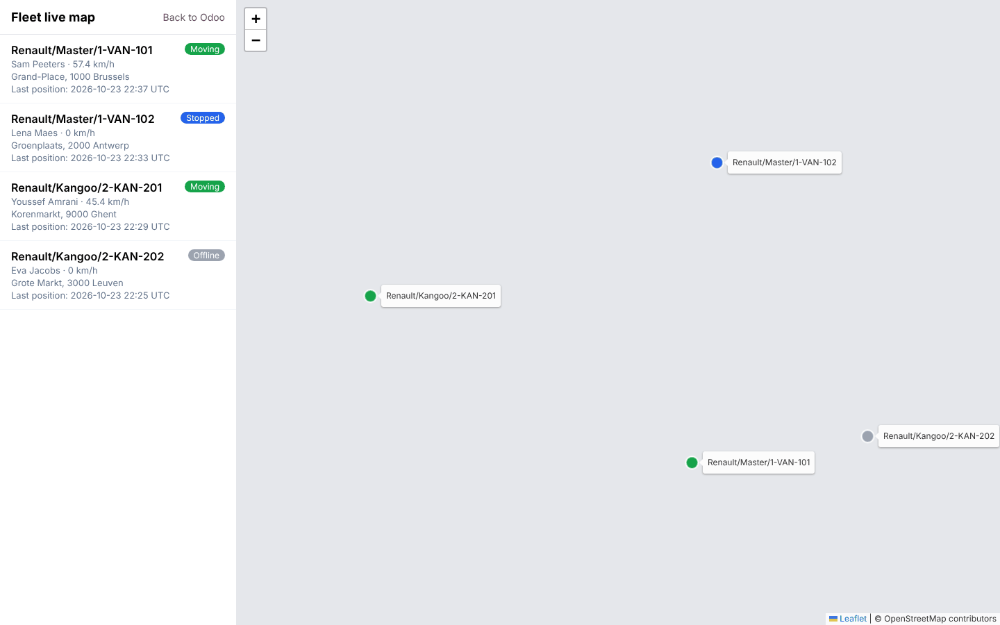
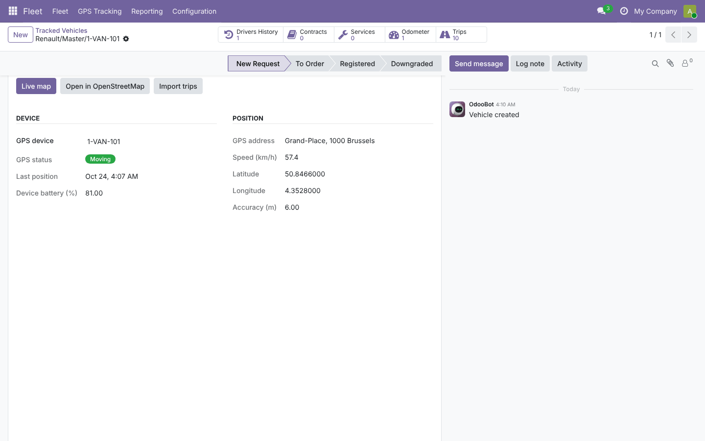
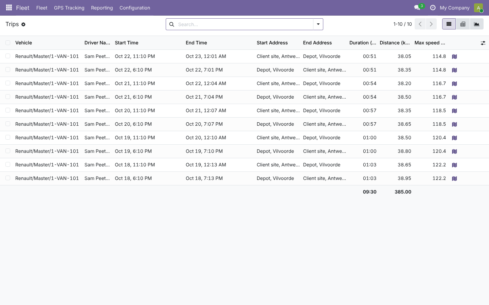
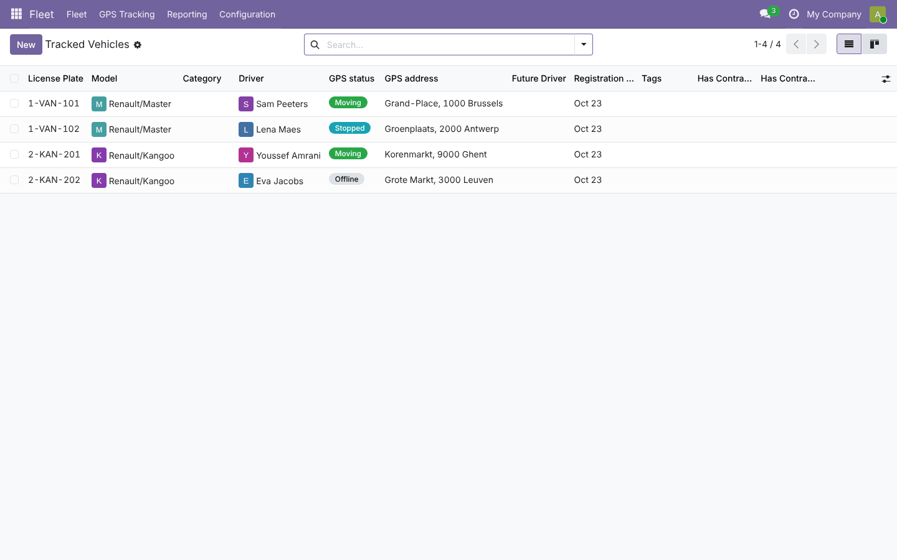
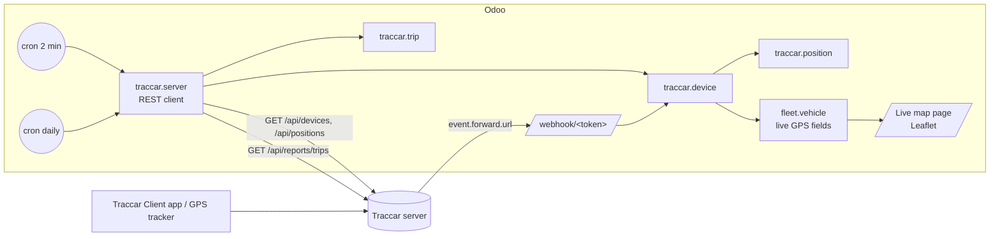

# Fleet GPS Tracking with Traccar (`fleet_traccar_tracking`)

End-to-end guide: planning, architecture, development, testing and deployment from dev to production.
Module folders: [`19.0/fleet_traccar_tracking`](../19.0/fleet_traccar_tracking) and [`20.0/fleet_traccar_tracking`](../20.0/fleet_traccar_tracking).

---

## 1. Planning

### 1.1 Goal
Fleet managers see, inside Odoo, where each vehicle is, whether it is moving, which trips it made and how far it
drove, without a separate tracking tool. GPS data comes from **Traccar** (open-source GPS server) fed by phones
running *Traccar Client* or by hardware trackers.

### 1.2 Scope (v1)

| In scope | Out of scope (roadmap) |
| --- | --- |
| Server connection (user/password or API token), several servers | Google Maps provider |
| Device import, auto-link by license plate, per-device tracking switch | Geofences, stops report, driver (iButton/RFID) assignment |
| Live positions every 2 min: lat/lon, address, speed, motion, battery, accuracy | Route replay animation |
| Live map of the fleet (bundled Leaflet, OpenStreetMap tiles), 30 s refresh | Mobile driver app inside Odoo |
| Trips report import (daily cron + wizard), list/pivot/graph | Fuel consumption analytics |
| Position history with retention | |
| Odometer readings from Traccar total distance | |
| Event/position forwarding webhook with secret URL, alarms on the chatter | |

### 1.3 Roles

| Role | Group | Can do |
| --- | --- | --- |
| Fleet officer | *Fleet / Officer* | Live map, vehicles GPS data, trips, positions, devices (read), import trips |
| Fleet administrator | *Fleet / Administrator* | Configure servers (credentials), import devices, link devices |

### 1.4 Acceptance criteria
1. *Test & Connect* shows *Connected* and the Traccar version; *Import devices* links devices whose identifier/name equals a license plate.
2. A phone with Traccar Client moves: within 2 minutes the vehicle shows *Moving*, its speed in km/h and its address.
3. A device that goes offline shows *Offline* on the vehicle and the map.
4. Yesterday's trips are in Odoo every morning with distance and duration.
5. Wrong webhook URLs are rejected (HTTP 403).

### 1.5 Screenshots (Odoo 19; Odoo 20 ones are in `20.0/fleet_traccar_tracking/README.md`)

| Live map (offline screenshot: no background tiles) | Vehicle GPS tab |
| --- | --- |
|  |  |
| **Trips** | **Tracked vehicles** |
|  |  |

---

## 2. Architecture



### 2.1 Data model

| Model | Key fields |
| --- | --- |
| `traccar.server` | `url`, `auth_type`, `username`/`password`/`token` (managers only), `auto_link_vehicles`, `update_odometer`, `keep_history_days`, `webhook_token` |
| `traccar.device` | `traccar_id` (unique per server), `unique_id`, `vehicle_id` (unique), `tracking_enabled`, `status`, `last_position_id` |
| `traccar.position` | `fix_time` (UTC), `latitude`, `longitude`, `speed` (km/h), `accuracy`, `battery_level`, `moving`, `address` |
| `traccar.trip` | `start_time`, `end_time`, `duration`, addresses, coordinates, `distance_km`, `average_speed`, `max_speed`, `driver_name` |
| `fleet.vehicle` + | `gps_latitude`, `gps_longitude`, `gps_speed`, `gps_fix_time`, `gps_motion_state`, `gps_address`, `gps_battery_level`, `gps_map_html` |

### 2.2 Design decisions
- **Unit normalization at the boundary**: Traccar speeds are knots → km/h; ISO times with offsets → naive UTC (Odoo convention); distances m → km.
- **Idempotent sync**: the last Traccar position id per device avoids duplicate history; trips are unique per device and start time.
- **Offline wins**: a device reported offline shows *Offline* even if its last position said it was moving.
- **No map JS dependency on Odoo's web client**: the live map is a standalone page served by a controller,
  so it works the same on Odoo 19 and 20 (no OWL code to port) and can be opened full-screen on a wall display.
- **Connection errors are saved, not raised**: *Test & Connect* returns a red notification so the *Error* state and message persist.
- **Webhook security**: a random 32-character token in the URL, regenerable; unknown tokens get HTTP 403.

---

## 3. Development

```bash
# a local Traccar for development
docker run -d --name traccar -p 8082:8082 -p 5055:5055 traccar/traccar:latest
# default login admin/admin; create a device with identifier = a license plate in Odoo
./odoo-bin --addons-path=addons,/path/odoo-module/19.0 -d gps_dev -i fleet_traccar_tracking --dev=all
```
Send a fake position (OsmAnd protocol on port 5055):
`curl "http://localhost:5055/?id=1-VAN-101&lat=50.8466&lon=4.3528&speed=30&batt=80"`

Build order: REST client and connection → devices + linking → positions and vehicle fields → trips + wizard →
odometer → live map controller (vendored Leaflet) → webhook → views/menus/crons → tests → port to 20.

---

## 4. Testing

`tests/test_traccar.py` mocks `TraccarServer._request` with fixtures (devices, positions with time zones and
attributes, trips). **19.0: 8 tests, 20.0: 10 reported, all passing.**

| Test | Checks |
| --- | --- |
| connect & import devices | state, version, auto-link by license plate, no duplicates |
| refresh positions | UTC conversion, km/h, motion, offline precedence, battery, address, map HTML, odometer log, no duplicate history |
| disabled tracking | ignored devices do not update vehicles |
| import trips | km, hours, km/h, request parameters in ISO UTC, no duplicates |
| connection error | error state and message saved, danger notification |
| access rights | officer reads devices but not credentials, cannot create servers |
| webhook (HTTP) | 403 on wrong token, position applied, alarm posted on the vehicle |
| live map (HTTP) | page served with Leaflet and vehicles, JSON feed filtered by vehicle |

Manual test plan with the Docker Traccar: create 2 devices, send positions with `curl` (moving and stopped), check the
map colors, stop sending for one device until Traccar marks it offline, import trips for the day, set
`event.forward.url` and trigger an overspeed alarm (Traccar › device › attributes `speedLimit`).

---

## 5. Deployment: dev → staging → production

1. **Prerequisites**: a reachable Traccar 5.x/6.x server over HTTPS; a dedicated Traccar user (read-only is enough
   for devices/positions/reports) or an API token; devices named/identified by license plate.
2. **Staging** (production copy, neutralized): connect to a *test* Traccar or a read-only user, import devices,
   verify links and one day of trips. Crons are disabled on neutralized databases: use the buttons.
3. **Production**:
   - Merge, update the code, `-u fleet_traccar_tracking`, restart.
   - Create the server, *Test & Connect*, *Import devices*, check unmatched devices.
   - Optionally tune *Traccar: refresh live positions* (default every 2 minutes) in Scheduled Actions.
   - Optionally configure forwarding in `traccar.xml` and restart Traccar.
4. **Volume**: one position per device per refresh. 50 vehicles × 720 refreshes/day ≈ 36,000 rows/day; keep
   `keep_history_days` reasonable (default 90).
5. **Monitoring**: server *Last error*, Scheduled Actions logs, device *Status*.
6. **Rollback**: archive the server (crons skip it) or uninstall; Traccar keeps its own history.

---

## 6. Odoo 19 vs Odoo 20

| Topic | 19.0 | 20.0 |
| --- | --- | --- |
| Access rights | `ir.model.access.csv` + multi-company `ir.rule` | everything in `ir.access.csv` |
| Icons | Font Awesome | Material Symbols |
| System parameters | `get_param` | `get_str` |
| Live map page, Python logic | identical | identical |

Porting note: Odoo 20's `upgrade_code` crashes in one pass when it deletes `security.xml` (rules only) before the icon
script runs; `tools/port_19_to_20.sh` runs it in two passes.

## 7. Known limitations
- OpenStreetMap tiles need internet access from the user's browser.
- Trips need Traccar's trips report (enabled by default) and motion detection on the device.
