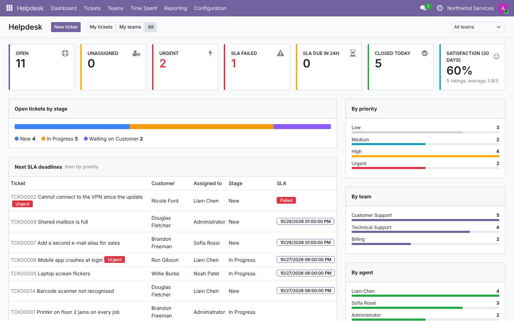
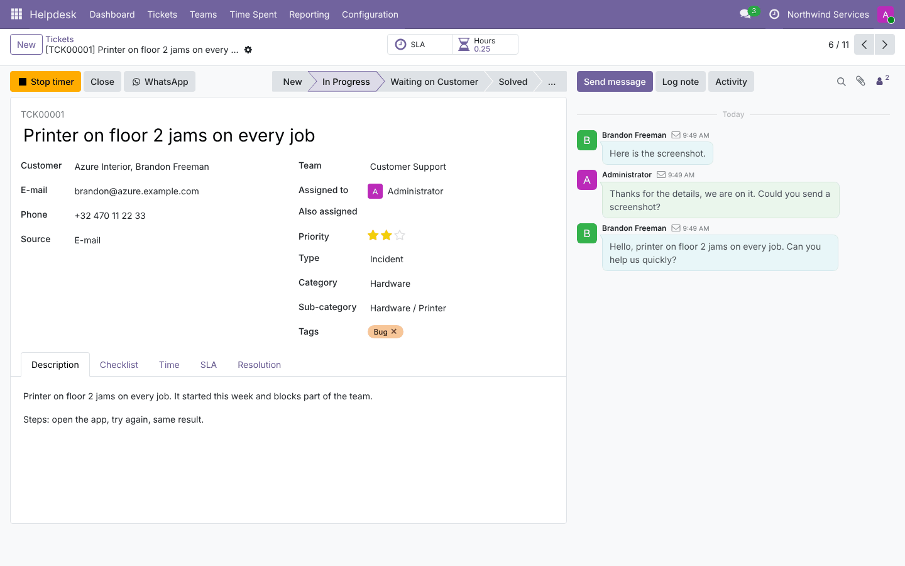
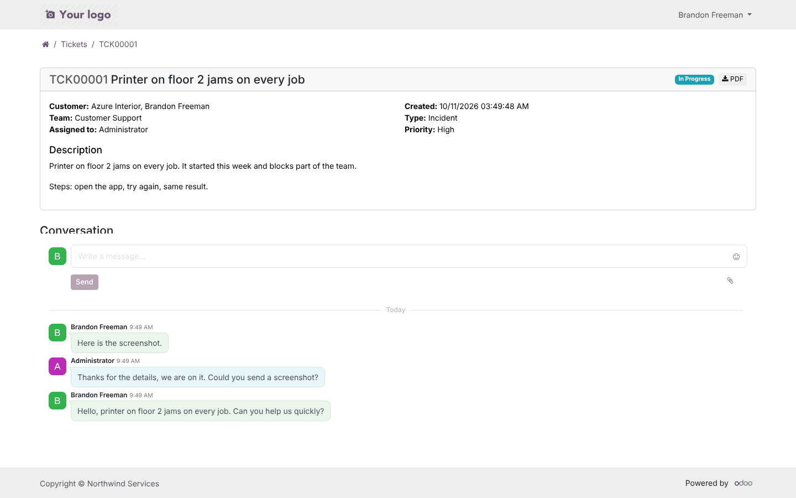

# Helpdesk Ticket Management (`helpdesk_ticket_management`)

A helpdesk for **Odoo 19.0 and 20.0 Community**. It covers:
- tickets, teams and stages;
- SLA policies on working hours;
- the e-mail gateway and the customer portal;
- ratings and automatic assignment;
- checklists, timers, merge and mass update, auto-close and WhatsApp;
- a dashboard.

The code lives in:
- `19.0/helpdesk_ticket_management/`;
- `20.0/helpdesk_ticket_management/`.

---

## 1. Planning

### 1.1 Goal

Odoo Community has no helpdesk app; the Enterprise one is paid and closed. Support teams on Community end up
using project tasks or a shared mailbox. Both lack SLAs, a customer portal for requests, ratings and support
metrics. This module gives them a dedicated, self-contained helpdesk.

### 1.2 Requirements

| # | Requirement |
| --- | --- |
| R1 | Tickets with reference, customer, team, assignee(s), priority, type, category / sub-category, tags, source |
| R2 | Teams with members, leader, default team, e-mail alias, working hours, assignment rules (manual, balanced, round robin) |
| R3 | Stages (shared or per team, closing, folded) with e-mail templates and colours |
| R4 | SLA policies (team, priority, type, tag, customer → stage within N working hours), per-ticket statuses, analysis |
| R5 | Tickets from e-mail, threaded replies, "who answered last", stage moves on replies, auto-close |
| R6 | Customer portal: list, detail with conversation, PDF, new-ticket form with attachments |
| R7 | Satisfaction ratings from the closing e-mail |
| R8 | Checklists, timers (several agents), manual time |
| R9 | Merge tickets, mass update, WhatsApp message |
| R10 | Dashboard and reports (tickets, SLA, time, ratings) |
| R11 | Access groups (user, team leader, administrator), portal and multi-company rules |
| R12 | Same features and tests on Odoo 19 and 20 |

### 1.3 Scope (v1)

**In scope:** everything above.

**Out of scope:**
- creating leads, quotations, purchase orders or invoices from a ticket (that would be a bridge module per app);
- products on tickets;
- live chat;
- a knowledge base;
- the WhatsApp Business API (the module opens WhatsApp with a prepared message instead).

### 1.4 Roles

| Role | Group | Sees / does |
| --- | --- | --- |
| Agent | Helpdesk / User | Tickets of their teams, assigned to them, followed, or without team; create / edit |
| Team leader | Helpdesk / Team Leader | + every ticket of the teams they lead; reporting menu |
| Administrator | Helpdesk / Administrator | All tickets, deletion, configuration, settings |
| Customer | Portal | Tickets of their company (or that they follow); create from the portal; converse |

### 1.5 Acceptance criteria

- An e-mail to a team alias creates a ticket in that team. The sender becomes a contact and gets the
  acknowledgement. Their reply lands on the same ticket.
- A public answer from support moves the ticket to *Waiting on Customer*. The customer's answer moves it back to
  *In Progress*.
- An SLA *4 working hours* on a 9–17 calendar, started Monday 15:00, is due Tuesday 11:00. One started Friday 16:00
  is due Monday 12:00.
- Reaching the target stage (or a later one, or closing) marks the SLA reached. Missing the deadline marks it
  failed, and it stays failed even if reached later.
- The *Solved* e-mail contains working rating links. A rating is stored and does not reopen the ticket.
- A portal user sees only their company's tickets, can create one with an attachment, and cannot edit tickets
  directly.
- The dashboard counters equal the lists they open.
- All tests pass on 19.0 and 20.0, including two browser tours.

### 1.6 Screenshots

These are from Odoo 19. The Odoo 20 ones are in `20.0/helpdesk_ticket_management/static/description/screenshots/`.





---

## 2. Architecture

```
                 e-mail (alias) ──► mail gateway ──► support.ticket.message_new / message_update
customer portal (/my/tickets) ──────────────────────► support.ticket (sudo create, token / rules for access)
                                                          │
support.team ── member_ids, leader_id, alias, calendar ──┤ _determine_user()  (balanced / round robin)
support.stage ── template_id, is_closed, color ──────────┤ _track_template → stage e-mail (+ rating links)
support.sla ── team, priority, types, tags, partners ────┤ _sla_apply() → support.ticket.sla (deadline via
                                                          │                 resource.calendar.plan_hours)
                                                          │ _sla_reach_stage() on stage change; cron → failed
support.ticket.checklist / support.time.entry ───────────┤ checklist progress, timers (per user)
rating.rating (rating.mixin) ────────────────────────────┘
crons: SLA deadlines (15 min), auto-close (daily)
OWL client action helpdesk_ticket_management.dashboard ── get_dashboard_data()
```

### 2.1 Design decisions

- **Own model names (`support.*`).** The Enterprise Helpdesk uses `helpdesk.*`. Using other names avoids any
  clash and makes the module installable on both editions.
- **SLA statuses as records.** One `support.ticket.sla` per policy and ticket gives a real history: deadline,
  reached on, lateness. It feeds a pivot report and keeps "reached late" distinct from "on time". The ticket
  stores the earliest open deadline and a failed flag for fast filters.
- **Working hours from `resource.calendar.plan_hours`.** This is Odoo's own engine, including public holidays.
  Times are passed as aware UTC datetimes, so the result does not depend on the server's local timezone.
- **Replies detected after posting** (`_message_post_after_hook`). Only public messages (`mt_comment`) count, and
  the author type decides (internal user = support). Internal notes, stage e-mails and ratings never count.
- **Stage moves on replies stay conservative.** The customer's first message does not move a new ticket, and a
  closed ticket is never reopened automatically.
- **Portal creation is `sudo` behind explicit validation.** Fields are whitelisted, team, type and category ids
  are checked against the allowed records, and the attachment size is checked. Portal users get read-only
  access with a record rule. Their messages go through the portal chatter (`_mail_post_access = 'read'`).
- **Defaults that can be switched off.** Odoo 19 deletes the parameter of an unchecked boolean setting, so "on"
  defaults are seeded by a `post_init_hook`. Odoo 20 stores `False`, and the code uses typed getters.

---

## 3. Development

```
helpdesk_ticket_management/
├── __init__.py                    post_init_hook (portal creation on, reply stages)
├── controllers/portal.py          /my/tickets, /my/tickets/<id> (+PDF), /my/tickets/new
├── data/                          sequence, e-mail templates, stages/types/default team, crons (+ portal card in 20)
├── models/
│   ├── support_ticket.py          the ticket
│   ├── support_team.py            teams, alias, assignment
│   ├── support_sla.py             policies + statuses
│   ├── support_stage.py / support_config.py / support_checklist.py / support_time_entry.py
│   ├── res_partner.py             ticket count + button
│   └── res_config_settings.py
├── wizard/                        merge, mass update, WhatsApp
├── report/                        PDF ticket
├── views/                         backend views, settings, portal templates, menus
├── security/                      groups, rules, access
├── static/src/dashboard/          OWL dashboard
├── static/tests/tours/            dashboard + portal tours
└── tests/                         28 tests
```

**Local setup**

```bash
python odoo-bin -d hd_dev --addons-path=odoo/addons,addons,/path/to/odoo-module/19.0 \
    -i helpdesk_ticket_management --dev=xml,reload
# backend: /odoo/helpdesk-dashboard   portal: /my/tickets
```

**Testing the e-mail gateway locally**

```bash
python odoo-bin shell -d hd_dev <<'PY'
raw = open('mail.eml').read()   # any raw e-mail
env['mail.thread'].message_process('support.ticket', raw, custom_values={'team_id': env.ref('helpdesk_ticket_management.team_support').id})
env.cr.commit()
PY
```

**Extending**
- **Another assignment rule:** extend `support.team._determine_user()` and the `assignment_method` selection.
- **More SLA criteria:** add a field on `support.sla` and extend `_matches()`. Call `_sla_apply()` when the
  matching ticket field changes (see `write`).
- **Bridge to CRM or Sales:** a small module depending on both, adding a button on the ticket.

---

## 4. Testing

```bash
tools/run_tests.sh 19.0 /path/to/odoo19 helpdesk_ticket_management
tools/run_tests.sh 20.0 /path/to/odoo20 helpdesk_ticket_management
```

| File | Covers |
| --- | --- |
| `test_ticket.py` | Defaults, sequence, name search, single default team, round robin / balanced / manual, close and reopen, team stages, checklist templates, multi-agent timers and the single-timer rule, partner counts, dashboard (KPI domains = counters), WhatsApp |
| `test_sla.py` | Working-hour deadlines (overnight, weekend, no calendar), matching by priority / type+tag / customer company, removal when no longer matching, reach / fail / late, closing |
| `test_mail.py` | Alias defaults, gateway creation (new contact, channel, description), threaded reply, reply tracking and stage moves, internal notes ignored, closed tickets stay closed, stage e-mails, rating links and rating, auto-close |
| `test_wizards.py` | Merge (messages, attachments, checklist, time, followers, priority, warning) and mass update |
| `test_security.py` | Agent / leader / admin rules, portal company rule, no portal writes |
| `test_portal.py` | Portal home card, list, detail, foreign ticket refused, HTML report, access token, new ticket with attachment, validation, size limit, switch-off |
| `test_tour.py` | Browser: dashboard → urgent → ticket → assign → timer; portal → new ticket → confirmation |

**Manual check list**
1. Set an alias domain, send an e-mail to `support@yourdomain`, reply from Odoo, then reply from the mailbox.
2. Create an SLA of 1 h. Wait, or run *Helpdesk: SLA deadlines*, and check the red badge.
3. Close a ticket, click a smiley in the *Solved* e-mail, and check *Reporting › Customer Ratings*.
4. Log in as a portal user, create a ticket with a file, and post a message.

---

## 5. Deployment: dev → staging → production

1. **Dev:**
   - run the tests on the target version;
   - install on a copy of production;
   - check the e-mail templates (logo, sender, wording).
2. **Staging:**
   - **Incoming mail:** configure an alias domain and the incoming mail server (or the catchall/alias forwarding
     of your MTA). Set each team's alias.
   - **Outgoing mail:** SPF/DKIM for the sender domain (acknowledgements and rating e-mails go to customers).
   - Teams, members, working hours (and public holidays in *Working Schedules*), stages, SLA policies, types and
     categories.
   - Grant the Helpdesk groups. Give customers portal access.
3. **Production:**
   - Install, then enable the aliases last, when everything is ready. Mail starts flowing immediately.
   - Crons: *Helpdesk: SLA deadlines* (every 15 min) and *Helpdesk: close tickets without customer answer* (daily).
   - Behind a reverse proxy, set `proxy_mode` and the right `web.base.url`. Portal links and rating links use it.
4. **Monitoring:**
   - dashboard (SLA failed, due in 24 h);
   - *SLA Analysis*;
   - *Settings › Technical › Emails* for bounces;
   - the server log for the crons.
5. **Rollback:**
   - disable the team aliases first, so no new tickets arrive;
   - uninstall if needed, which removes tickets and configuration (export them first).

---

## 6. Odoo 19 vs Odoo 20

| Topic | 19.0 | 20.0 |
| --- | --- | --- |
| Access rights | `ir.model.access.csv` | `ir.access.csv` |
| Portal home card | template inheriting `portal.portal_my_home` + `_prepare_home_portal_values` | `portal.entry` record + `_prepare_portal_counter_values` |
| CC on tickets | `mail.thread.cc` | removed (`_mail_thread_customer = True` instead) |
| Post hook | `_message_post_after_hook(message, msg_vals)` | `_message_post_after_hook(message)` |
| Stage e-mail | `_track_template(changes)` | `_track_template_parameters(tracked_fields)` |
| `message_process` | returns the record id | returns the record |
| Settings values | `get_param` (unchecked boolean = no parameter) | `get_bool` / `get_int` |
| Calendar timezone | `resource.calendar.tz` | company timezone |
| Report action | `report_file` accepted | `report_file` removed (not used) |
| `remaining_days` widget | date and datetime | date only (datetime shown as is) |
| Attachments | `datas` or `raw` | `raw` only (code uses `raw`) |
| OWL / icons | OWL 2, Font Awesome | OWL 3, Material Symbols |

---

## 7. Known limitations

- Only staff with an internal user count as "support" for reply tracking. A colleague replying from an external
  mailbox counts as the customer.
- SLA deadlines are computed from the ticket's creation. Changing the team calendar does not move existing
  deadlines.
- Agents of other teams see a ticket only when they follow it or it is assigned to them (by design of the
  record rules).
- WhatsApp opens `wa.me` with the message; it does not use the WhatsApp Business API, so delivery is not
  tracked.
- Merging keeps the chosen ticket. It does not create a new one.
- The portal "new ticket" form is for logged-in users. Anonymous visitors use the e-mail alias.
