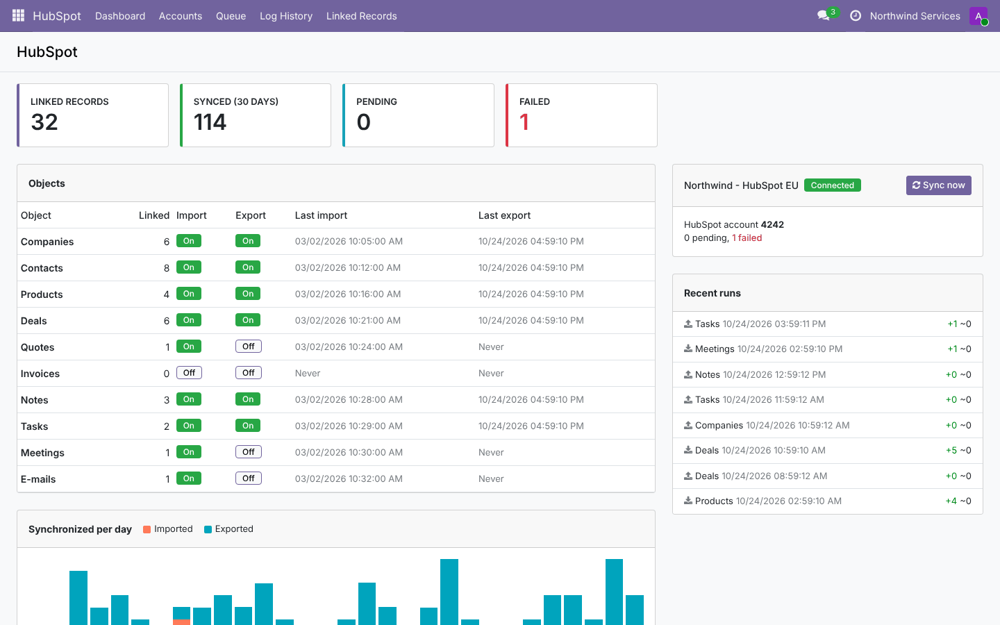
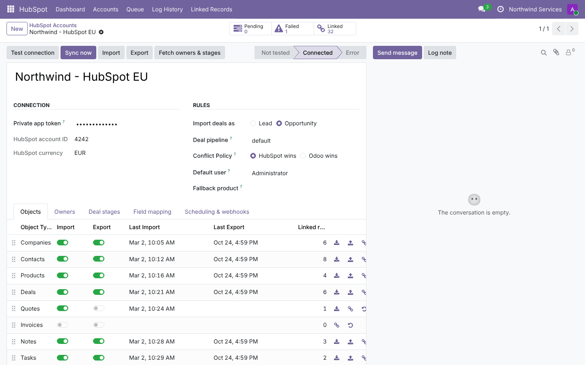
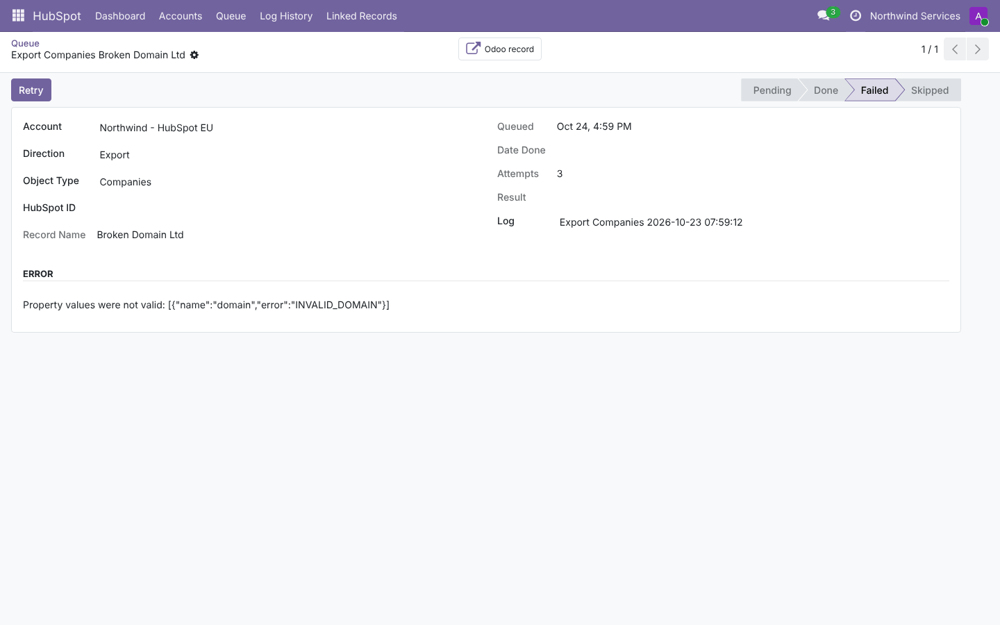

# HubSpot Connector (`hubspot_connector`)

A two-way synchronization between HubSpot CRM and **Odoo 19.0 / 20.0**. It covers companies, contacts,
products, deals, quotes, invoices, notes, tasks, meetings and e-mails. It runs through a job queue with retries,
signed webhooks, owner / stage / field mappings and a dashboard.

The code lives in:
- `19.0/hubspot_connector/`;
- `20.0/hubspot_connector/`.

---

## 1. Planning

### 1.1 Goal

Many companies run marketing and sales in HubSpot and operations (quotes, invoicing, delivery, support) in Odoo.
Without a connector, contacts, deals and their history are typed twice and drift apart.

The connector keeps both systems aligned automatically. It must be safe:
- no duplicates;
- no infinite update loops;
- no data lost on errors.

### 1.2 Requirements

| # | Requirement |
| --- | --- |
| R1 | Authenticate with a HubSpot private app token; test the connection; fetch owners and deal pipelines |
| R2 | Import and export, per object, independently switchable: companies, contacts, products, deals, quotes, invoices, notes, tasks, meetings, e-mails |
| R3 | Incremental runs (only changes), plus a manual full run |
| R4 | Keep associations: contact ↔ company, deal ↔ contact/company, quote/invoice ↔ customer + line items ↔ products, engagements ↔ their record |
| R5 | No duplicates (match on e-mail / domain / SKU) and no ping-pong between the systems |
| R6 | Queue with retries, error messages, rate-limit handling, manual retry |
| R7 | Mappings: owners ↔ users, HubSpot stages ↔ CRM stages, custom properties ↔ Odoo fields |
| R8 | Real-time updates through signed webhooks |
| R9 | Logs and a dashboard |
| R10 | Same features and tests on Odoo 19 and 20, no network needed for tests |

### 1.3 Scope (v1)

**In scope:** everything above.

**Out of scope:**
- HubSpot tickets, calls and marketing objects (forms, lists);
- custom HubSpot objects;
- file attachments;
- OAuth public-app distribution (private app tokens only);
- deletions from Odoo to HubSpot.

### 1.4 Roles

| Role | Can |
| --- | --- |
| HubSpot / Configuration Manager | Accounts, tokens, mappings, queue, logs, *Export to HubSpot* actions, dashboard |
| Other users | Work in Odoo as usual; their records are synchronized by the scheduled action |

### 1.5 Acceptance criteria

- With a valid token, *Test connection* stores the HubSpot account id and fetches owners (matched to users by
  e-mail) and pipelines (matched to CRM stages by name).
- A first import creates the companies, the contacts under their company and the deals linked to their contact.
  A second import with no change in HubSpot queues nothing.
- An existing Odoo contact with the same e-mail is linked, not duplicated, both ways.
- After an import, the next export sends nothing back. Changing a field in Odoo sends a PATCH with that record.
- HubSpot answering 400 marks the job failed after N attempts, with HubSpot's message. *Retry* processes it again.
- A webhook with a wrong signature or an old timestamp gets 401. A valid one queues the objects, and a deletion
  archives the Odoo record.

### 1.6 Screenshots

These are from Odoo 19. The Odoo 20 ones are in `20.0/hubspot_connector/static/description/screenshots/`.





---

## 2. Architecture

```
            ┌──────────────── scheduled action "HubSpot: synchronize" (15 min) ────────────────┐
            │  per account, per enabled object, in dependency order                            │
HubSpot ◄──►│  hubspot.object._queue_import(): search modified since last_import → jobs        │
 REST API   │  hubspot.object._queue_export(): Odoo records written since last_export → jobs   │
 (client)   │  hubspot.queue._process(): one savepoint per job, retries, errors                │
            └──────────────────────────────────────────────────────────────────────────────────┘
  webhook (signed) ──► /hubspot/webhook/<account> ──► jobs without payload (read when processed)

hubspot.sync (engine)
  _import_<object>(account, data, record)  -> (record, created|updated|unchanged)
  _export_<object>(account, record)        -> properties sent
  _after_export_<object>(...)              -> associations, line items
hubspot.record (link)  account · object type · HubSpot id ↔ model · id · fingerprint · extra
```

### 2.1 Design decisions

- **API client kept out of the ORM** (`hubspot_client.py`). It handles transport, retries (`429`, `5xx` with
  `Retry-After`), pagination, the 10,000-result search cap and the v4 association endpoints. It is tested on its
  own.
- **One link table** (`hubspot.record`) for every object, instead of a column on each model. It supports several
  HubSpot accounts, any number of models, and keeps extra data (line items created, associations done).
- **Fingerprint = the Odoo-side export values.** It is stored after every import or export:
  - an export is skipped when the values did not change;
  - an imported record is never sent back;
  - "Odoo changed since the last sync" can be detected for the conflict policy.
- **Incremental import on HubSpot's own modification date** (`hs_lastmodifieddate` / `lastmodifieddate`), with the
  last date kept per object. Export uses Odoo's `write_date` with a 5-minute overlap, so changes committed by
  long transactions are not missed. Duplicates from the overlap are removed by the fingerprint.
- **Dependency order.** Companies, then contacts, products, deals, quotes and invoices, then engagements. Missing
  associations are imported on demand (bounded depth). Exports create the associated company, contact or product
  first when that object is exported.
- **Write only what changed** (`_write_changed`). Unchanged imports do not touch `write_date` and do not trigger
  exports.
- **Engagements attach to one Odoo record**: the deal first, then the contact, then the company. Engagements of
  records that are not synchronized are *skipped*, with the reason.
- **Webhooks only queue work.** The signature is checked and the objects are read when processed. The endpoint
  stays fast, and HubSpot retries are harmless (duplicate jobs are merged).

---

## 3. Development

```
hubspot_connector/
├── controllers/webhook.py        signed endpoint
├── data/ir_cron_data.xml         synchronize (15 min), cleanup (daily)
├── models/
│   ├── hubspot_client.py         API client + helpers (dates, signature)
│   ├── hubspot_account.py        account, objects, scheduled sync, dashboard data
│   ├── hubspot_sync.py           mapping engine (all objects)
│   ├── hubspot_queue.py          jobs
│   ├── hubspot_record.py         links + fingerprint
│   ├── hubspot_metadata.py       owners, stages, field mappings, logs
│   └── hubspot_linked.py         HubSpot id/button on partner, lead, product, order, invoice
├── wizard/                       Export to HubSpot
├── views/                        account, queue/logs/links, buttons on records, menus
├── security/                     group + access + multi-company rule
├── static/src/dashboard/         OWL dashboard
└── tests/                        fake_hubspot.py + 28 tests
```

**Run locally without HubSpot**

`tests/fake_hubspot.py` is a small in-memory HubSpot. Patch `requests.request` in the client with it to try the
connector in a shell (the demo database for the screenshots is built this way):

```python
from unittest.mock import patch
from odoo.addons.hubspot_connector.tests.fake_hubspot import FakeHubspot, GOOD_TOKEN
fake = FakeHubspot(); fake.add('companies', {'name': 'Acme', 'domain': 'acme.example.com'})
with patch('odoo.addons.hubspot_connector.models.hubspot_client.requests.request', side_effect=fake.request):
    account = env['hubspot.account'].create({'name': 'Dev', 'access_token': GOOD_TOKEN})
    account.action_test_connection(); account.action_sync_now()
```

**Add an object**
1. Add a `SPECS` entry (model, modified property, properties, associations).
2. Write `_import_<type>`, `_export_<type>`, optionally `_after_export_<type>`.
3. Add the export domain and the type to `OBJECT_TYPES`.

**Add a standard property**: extend the `SPECS` properties and the import and export functions. Users can
already map custom properties without code (*Field mapping* tab).

---

## 4. Testing

```bash
tools/run_tests.sh 19.0 /path/to/odoo19 hubspot_connector
tools/run_tests.sh 20.0 /path/to/odoo20 hubspot_connector
```

| File | Covers |
| --- | --- |
| `test_client.py` | Connection and metadata (owners by e-mail, stages, won/lost), bad token, retry on 429 / 5xx, pagination and search, date and signature helpers |
| `test_import.py` | Companies / contacts / deals with associations and de-duplication, incremental runs, won and lost (lost from a won stage), deals as leads with on-demand import, products / quotes / invoices with line items and fallback product, confirmed orders left alone, notes / tasks / meetings / e-mails on the right record, orphan engagements skipped, task completion, custom mapping, both conflict policies, HTML escaping |
| `test_export.py` | Companies and contacts with association, internal users excluded, unchanged skipped, PATCH on change, no duplicate when the e-mail exists, recreation after deletion in HubSpot, deals with stages / won / lost and associations, quotes and invoices with line items replaced on change, notes / tasks (completed) / meetings, export wizard, export mapping, no ping-pong |
| `test_queue_webhook.py` | Failure → retry → failed → manual retry, savepoint isolation, cron, newer job replacing a pending one, dashboard data, access rights; webhooks accepted, de-duplicated, deletion, bad signature, replay, unknown account |
| `test_tour.py` | Browser: dashboard → *Sync now* → linked count → linked records |

**Manual test on a HubSpot sandbox**
1. Create a developer test account and a private app with the scopes listed in the README.
2. Create one company with two contacts, a deal and a note. *Import now* and check the records in Odoo.
3. Change the deal stage in Odoo, run *Export now*, and check HubSpot. Then run *Import now*: nothing should be
   queued.
4. Configure the webhook. Edit a contact in HubSpot; a job appears in the queue within seconds.

---

## 5. Deployment: dev → staging → production

1. **Dev:**
   - run the tests;
   - try against a **HubSpot developer test account**, never production;
   - decide the direction per object (often: contacts and companies both ways; deals both ways or HubSpot →
     Odoo; quotes and invoices Odoo → HubSpot).
2. **Staging:**
   - Restore a copy of production and connect it to a HubSpot **sandbox**.
   - Run a full import first (imports *before* enabling exports, to link the existing records by e-mail and
     domain).
   - Check the owners and stages mappings and the queue, then enable the exports.
3. **Production:**
   - Create the private app in the production portal and store the token in Odoo only. It is visible to the
     *Configuration Manager* group only.
   - Run *Import now* per object, in order. Check *Log History* and failed jobs.
   - Then switch on *Scheduled synchronization*.
   - **Webhooks**: the URL must be HTTPS and reachable, and `web.base.url` must match the public URL. The
     signature includes the full URL, so set `proxy_mode` behind a reverse proxy.
4. **Capacity:**
   - HubSpot private apps allow about 100 requests per 10 s (higher on Enterprise); the client backs off on 429.
   - Keep *Jobs per run* around 200–500.
   - A search returns at most 10,000 results; larger first imports continue on the next runs.
5. **Monitoring:**
   - dashboard (failed jobs);
   - *Queue* filtered on *Failed*;
   - *Log History*;
   - the server log (`hubspot_connector`).
6. **Rollback:**
   - switch off the account (*Scheduled synchronization*), or archive it;
   - links stay, so turning it back on resumes without duplicates;
   - uninstalling removes links, jobs and logs, but not the synchronized records.

---

## 6. Odoo 19 vs Odoo 20

| Topic | 19.0 | 20.0 |
| --- | --- | --- |
| Company partners | `is_company` writable (set on import) | `is_company` computed from the VAT; companies recognised by their HubSpot link, children or VAT |
| Access rights | `ir.model.access.csv` | `ir.access.csv` |
| Settings / parameters | `get_param` | `get_str` |
| Dashboard | OWL 2 (`useState`), Font Awesome | OWL 3 (`proxy`, `this.`), Material Symbols, `NotificationPlugin` |
| Everything else (CRM, sale, account, calendar, mail APIs used) | same code | same code |

---

## 7. Known limitations

- **Name split.** The contact name is split on the first space for first and last name. A compound first name
  ("Mary Ann Smith") is sent as "Mary" / "Ann Smith". You can map the fields yourself if needed.
- **Quotes and invoices.** HubSpot quotes need a template to be published. The connector creates them as drafts
  with line items. Invoice properties differ between HubSpot subscriptions; adjust them with *Field mapping*.
- **Imported documents are drafts.** Imported quotes update Odoo only while they are draft or sent, and imported
  invoices only while they are draft.
- **Deletions.** Deletions in Odoo are not sent to HubSpot. Deletions in HubSpot arrive only through webhooks
  (contacts, companies, deals, products).
- **No attachments.** Files attached to notes and e-mails are not transferred.
- **One pipeline for export.** All deals exported from Odoo go to the configured pipeline.
