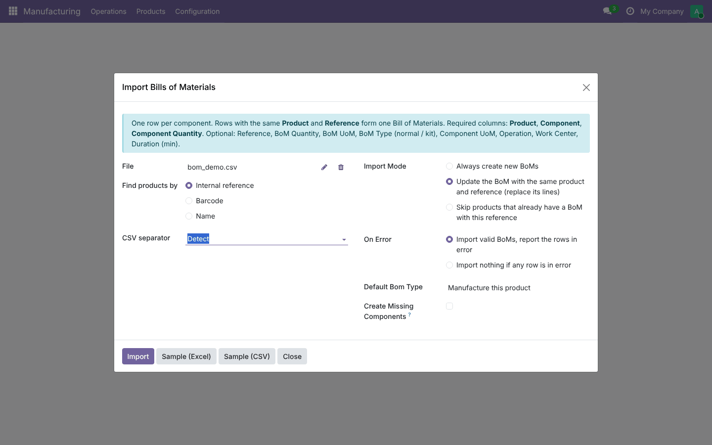
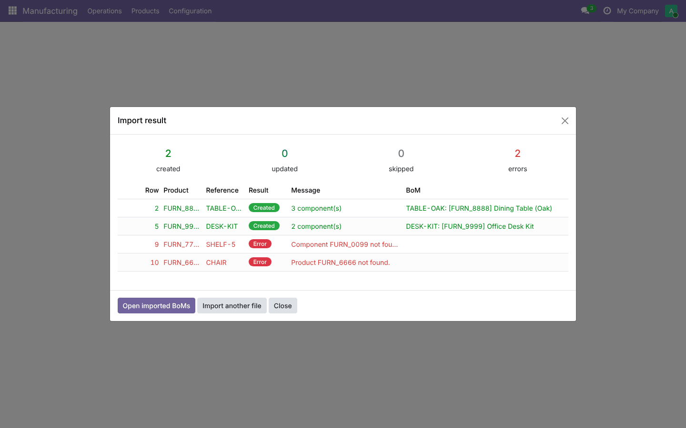
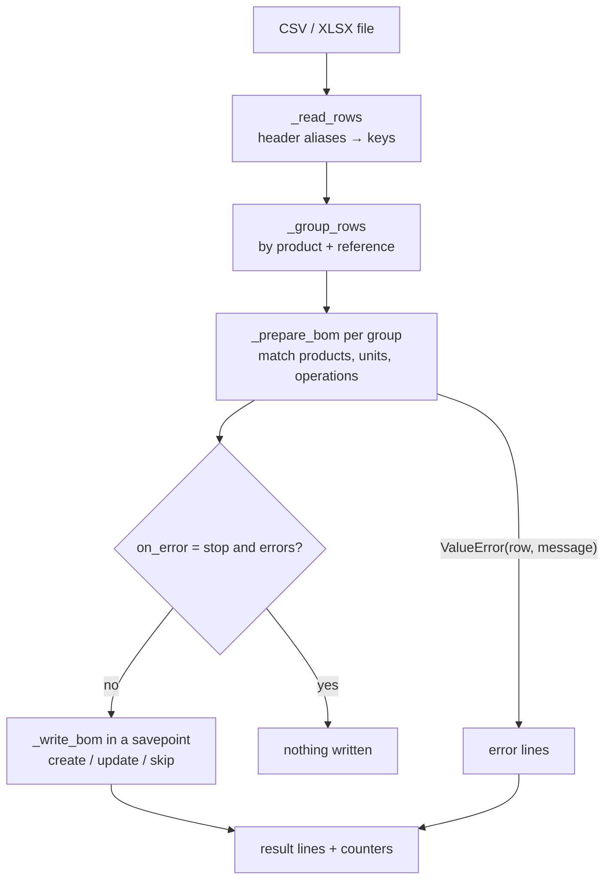

# Import Bills of Materials (`mrp_bom_import`)

End-to-end guide: planning, architecture, development, testing and deployment from dev to production.
Module folders: [`19.0/mrp_bom_import`](../19.0/mrp_bom_import) and [`20.0/mrp_bom_import`](../20.0/mrp_bom_import).

---

## 1. Planning

### 1.1 Goal
Load hundreds of Bills of Materials from a spreadsheet (CAD/PLM export, legacy ERP, engineering Excel) in one go,
with clear feedback on what was created and what was wrong, instead of typing them or fighting Odoo's generic
import with one-line-per-BoM and `bom_line_ids/...` column names.

### 1.2 Scope (v1)

| In scope | Out of scope (roadmap) |
| --- | --- |
| CSV (auto separator; UTF-8 or Windows-1252 as saved by Excel) and XLSX | XLS (old Excel), Google Sheets URL |
| Grouping rows into BoMs by product + reference | Multi-level BoM detection from indentation |
| Product matching by internal reference, barcode, name | Matching by product attribute values |
| BoM quantity, unit, type (normal / kit), reference | Subcontracting BoMs, by-products |
| Component quantity and unit (unit compatibility checked) | Component attribute filters ("apply on variants") |
| Operations with work center and duration, component ↔ operation link | Work center costs, operation instructions |
| Create / update (replace lines) / skip modes | Line-level merge |
| Report per row, skip-errors or all-or-nothing | Export of the error rows as a file |
| Create missing components | |

### 1.3 Roles
Group **Import Bills of Materials** (implies *Manufacturing / User*); every *Manufacturing / Administrator* gets it.

### 1.4 Acceptance criteria
1. The sample file imports without errors once its products exist.
2. A file with 1,000 component rows (≈100 BoMs) imports in under a minute.
3. Every error names the row and the reason; valid BoMs are still imported (default policy).
4. Re-importing the same file in *update* mode does not create duplicates.

### 1.5 Screenshots (Odoo 19; Odoo 20 ones are in `20.0/mrp_bom_import/README.md`)

| Wizard | Result |
| --- | --- |
|  |  |

---

## 2. Architecture



### 2.1 Design decisions
- **Two phases**: validate everything first (no writes), then write. That makes *all-or-nothing* trivial and
  keeps database writes out of the error path.
- **One savepoint per BoM** in the write phase, so a database constraint on one BoM never cancels the others.
- **Flexible headers**: a dictionary of aliases maps human column names to internal keys; unknown columns are ignored,
  missing required ones are listed with the columns found.
- **Excel numbers**: integral floats become integers before matching, so barcodes typed as numbers match.
- **Caches** for products, units and work centers keep large files fast.
- **Version-neutral code**: the BoM unit field is resolved at run time (`product_uom_id` → `uom_id` in Odoo 20),
  and the uploaded file is read whether Odoo returns base64 (19) or a `BinaryValue` (20).

---

## 3. Development

```bash
./odoo-bin --addons-path=addons,/path/odoo-module/19.0 -d bom_dev -i mrp_bom_import --dev=all
```
Download the sample from the wizard, create products with its internal references (`FURN_8888`, `FURN_0001`…)
or replace them with yours, and import it.

Build order: file readers → header mapping → grouping → validation per group (with `(row, message)` errors) →
writer with modes → result view (two-state wizard) → samples → security group → tests → port to 20.

---

## 4. Testing

`tests/test_bom_import.py`: **19.0: 12 tests, 20.0: 14 reported, all passing.**

| Test | Checks |
| --- | --- |
| CSV grouped BoMs | 2 BoMs from 4 rows, kit type, unit conversion (dozens), operation + work center + duration, line ↔ operation |
| semicolon + barcode | separator detection, barcode matching |
| name matching | match by product name |
| XLSX | Excel file, numeric barcodes, BoM quantity |
| errors per row | unknown component, bad quantity, unknown product, product as own component — with row numbers |
| skip vs stop | valid BoMs imported or nothing imported |
| missing components | storable product created with the code |
| modes | update replaces lines on the same BoM, skip leaves it, create adds a new one |
| bad file | missing columns, unsupported extension |
| samples | CSV and XLSX produced; the XLSX sample imports without errors |
| access | MRP users without the group cannot import; MRP managers can |

Manual UAT: import a real export from your PLM/Excel (first in *stop* mode to see all problems), fix the file,
re-import in *update* mode, open a few BoMs and compare with the source, run a manufacturing order on one.

---

## 5. Deployment: dev → staging → production

1. **PR + CI** green on 19.0 and 20.0.
2. **Staging** (copy of production): import the real file in *stop on error* mode; fix data; import again;
   check BoM counts and a sample of BoMs with the engineering team; check MO component lists.
3. **Production**: install/upgrade the module, give the group to the people who maintain BoMs,
   import with the validated file in *update* mode (re-runnable).
4. **Rollback**: BoMs created by the import can be archived from the list (filter by reference / creation date);
   *update* mode replaced lines, so keep the previous export (Odoo BoM export) before a big update.

---

## 6. Odoo 19 vs Odoo 20

| Topic | 19.0 | 20.0 |
| --- | --- | --- |
| Access rights | `ir.model.access.csv` | `ir.access.csv` |
| BoM / BoM line unit field | `product_uom_id` | `uom_id` (resolved at run time) |
| Binary field value | base64 bytes | `BinaryValue` (handled by `_file_content`) |

## 7. Known limitations
- The first sheet of a workbook is read; other sheets are ignored.
- BoM-level fields (quantity, type, unit) are read from the first row of each group.
