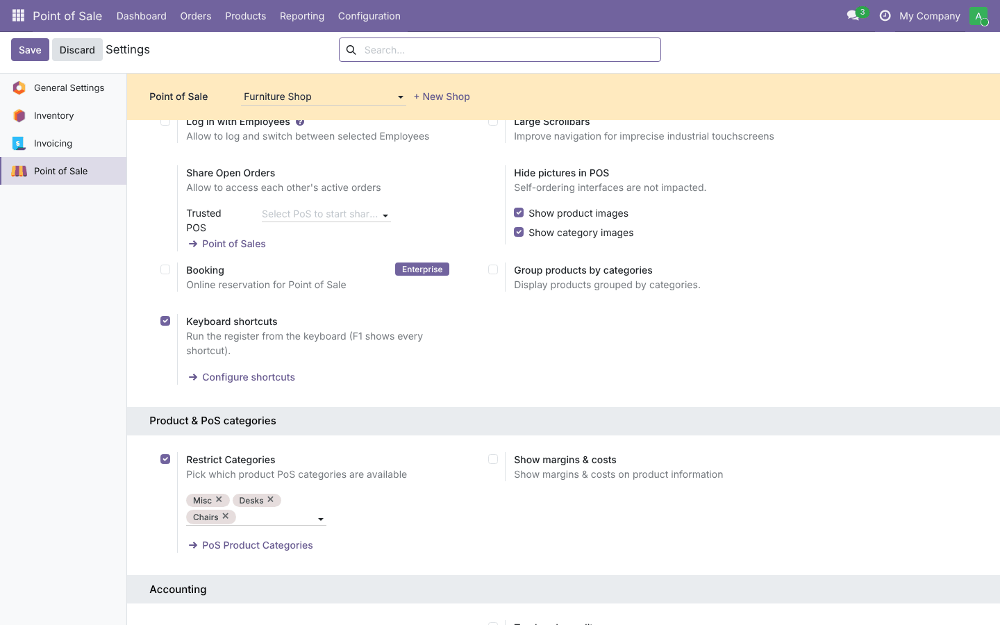
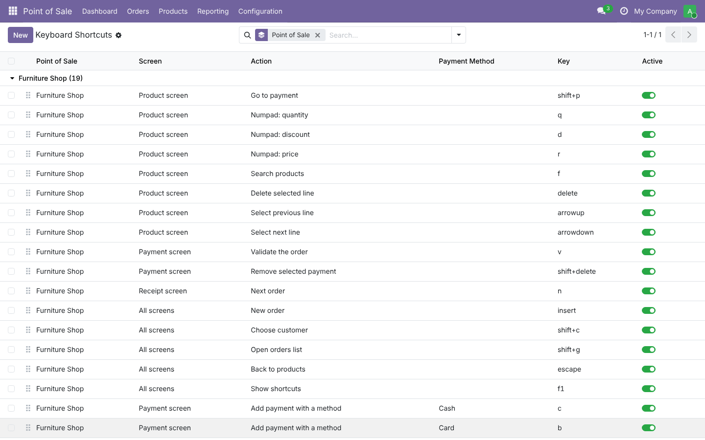
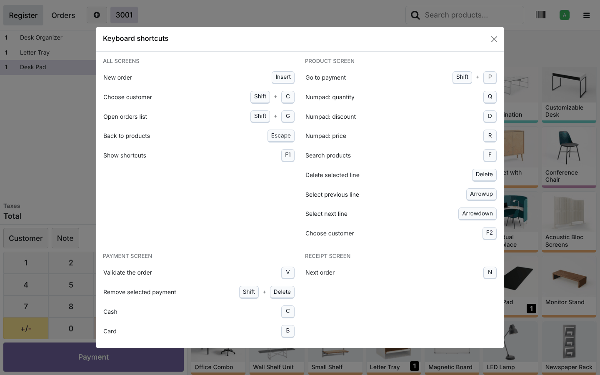
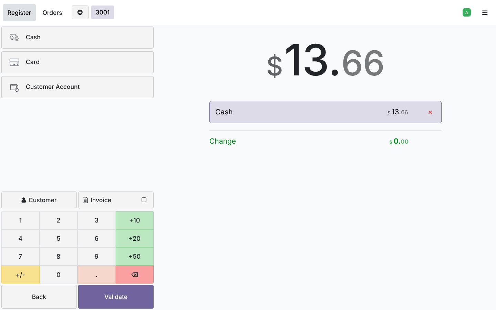
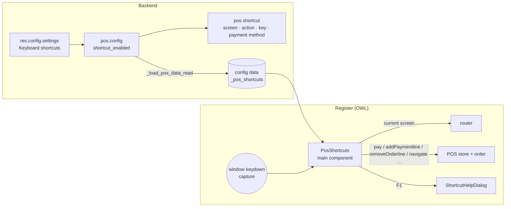

# POS Keyboard Shortcuts (`pos_keyboard_shortcuts`)

This guide covers the whole life of the module: planning, architecture, development, testing, and deployment
from dev to production.
Module folders: [`19.0/pos_keyboard_shortcuts`](../19.0/pos_keyboard_shortcuts) and [`20.0/pos_keyboard_shortcuts`](../20.0/pos_keyboard_shortcuts).

---

## 1. Planning

### 1.1 Goal
Cashiers at busy counters, especially those with a barcode scanner and a keyboard but no touch screen, should be
able to finish a sale without the mouse: add products, fix lines, take payment, validate and start the next
order. Each shop decides which keys do what.

### 1.2 Requirements

| # | Requirement |
| --- | --- |
| R1 | Shortcuts are configured per point of sale, in the backend, by POS managers |
| R2 | A shortcut applies to one screen or to all screens; the screen-specific one wins |
| R3 | Payment shortcuts add a line for a chosen payment method |
| R4 | Keys are entered freely (`Shift + P`, `ctrl+del`) and stored in one normalized form |
| R5 | No duplicate key on the same screen of the same shop |
| R6 | Typing in a field (search, customer, numpad input) must not trigger plain-letter shortcuts |
| R7 | Cashiers can see the active shortcuts (F1) |
| R8 | One click loads a sensible default set; running it again adds no duplicates |
| R9 | Turning the feature off removes every shortcut from the register |

### 1.3 Scope (v1)

| In scope | Out of scope (roadmap) |
| --- | --- |
| 17 actions on product, payment, receipt and orders screens | Shortcuts that open specific products or categories |
| Per-payment-method shortcuts | Per-cashier (employee) shortcut sets |
| Default set, key normalization, help sheet | Recording a key by pressing it in the backend form |
| Odoo 19.0 and 20.0 | Self-order kiosk and restaurant floor screens |

### 1.4 Roles

| Role | Group | Can do |
| --- | --- | --- |
| Cashier | *Point of Sale / User* | Use the shortcuts; read the list |
| Manager | *Point of Sale / Administrator* | Enable the feature, load defaults, create/edit/archive shortcuts |

### 1.5 Acceptance criteria
1. With defaults loaded, a cashier can take an order from product screen to the next order with the keyboard only.
2. `n` does nothing on the product screen and starts the next order on the receipt screen.
3. Typing `q` in the product search types a `q`; it does not switch the numpad mode.
4. Creating `Shift+P` twice for the same shop and screen is refused; `Shift+P` on another screen is allowed.
5. With the setting off, the register gets no shortcuts.

### 1.6 Screenshots (Odoo 19; the Odoo 20 ones are in `20.0/pos_keyboard_shortcuts/static/description/screenshots/`)

| Setting | Shortcut list |
| --- | --- |
|  |  |
| **F1 help sheet** | **Payment screen after `Shift+P`, `C`** |
|  |  |

---

## 2. Architecture



### 2.1 Design decisions
- **Data travels with `pos.config`.** Overriding `_load_pos_data_read` adds `_pos_shortcuts` to the config record
  the register already loads. No new model is registered in the POS data layer, so there is no extra request,
  and it works the same way in 19 and 20.
- **One global listener** in a `main_components` entry (a component with an empty template). The listener runs in
  the **capture phase**, so a shortcut is handled before the screen's own key handlers. The event is only stopped
  when an action actually ran (`run()` returns `false` when, for example, there is no line to delete), so the
  normal keys still work.
- **Screen-specific first, then *All screens*.** The router name (`ProductScreen`, `PaymentScreen`,
  `ReceiptScreen`/`FeedbackScreen`, `TicketScreen`) is mapped to the screen type.
- **Normalized keys** (`ctrl+alt+shift+key`, lower case, aliases such as `del`, `esc`, `up`). The same order is
  built from the `KeyboardEvent`, so a match is a simple string compare. Shift is ignored for symbols (`?`, `+`)
  because the symbol already implies it.
- **Only stable POS APIs are used.** These are `pay`, `numpadMode`, `addNewOrder`, `navigate`, `selectPartner`
  and `orderDone`, and on the order `selectOrderline`, `removeOrderline`, `addPaymentline`,
  `removePaymentline` and the `getSelected…` helpers. Validation clicks the real *Validate* button, so every
  check the POS makes (amount due, customer for invoices, and so on) still runs.
- **Guard rails.**
  - Key repeats are ignored.
  - Nothing runs while a dialog is open.
  - Plain keys are ignored in inputs; Ctrl/Alt, F-keys and Escape work everywhere, and Escape also leaves the
    field.

---

## 3. Development

```bash
./odoo-bin --addons-path=addons,/path/odoo-module/19.0 -d pos_dev -i pos_keyboard_shortcuts --dev=xml,qweb,reload
```
To create a demo shop with products, use *Point of Sale › Dashboard*, or run this in the Odoo shell:
`env['pos.config'].load_onboarding_furniture_scenario(with_demo_data=True)`.
Then use *Settings › Keyboard shortcuts › Configure shortcuts* and open the register.

Build order:
1. model and key normalization;
2. default set;
3. constraints;
4. data in `_load_pos_data_read`;
5. settings and list view;
6. OWL listener and actions, one by one, checked in the browser;
7. help dialog;
8. tests and tour;
9. port to 20.

Frontend files:

| File | Content |
| --- | --- |
| `static/src/app/pos_shortcuts.js` | `eventToKey`, `currentScreen`, `PosShortcuts` component and the action switch |
| `static/src/app/shortcut_help_dialog.js/.xml` | Help dialog grouped by screen, key caps |
| `static/src/app/pos_shortcuts.scss` | Key-cap style |
| `static/tests/tours/pos_shortcuts_tour.js` | Keyboard-only tour |

---

## 4. Testing

`tests/test_pos_shortcuts.py` is based on `TestPointOfSaleHttpCommon` (a shop with products, cash and bank
methods, and a cashier). **All tests pass on both versions: 19.0 runs 6 tests and 20.0 reports 8, because it
counts its two standard web suites too.**

| Test | Checks |
| --- | --- |
| `test_normalize_key` | Aliases, modifier order, `shift++`, F-keys; invalid keys raise |
| `test_defaults` | Feature on, every default present, `c` = cash method, running again adds nothing |
| `test_constraints` | Duplicate key on the same screen (SQL unique), payment method required, unknown key; same key on another screen allowed and normalized |
| `test_loaded_in_pos_data` | `_pos_shortcuts` in the config data with labels; empty when the feature is off |
| `test_settings_button` | Button loads defaults for a shop without shortcuts and opens its filtered list |
| `test_pos_tour` | Browser tour (below), then the order in the database has 1 line and was paid in cash |

Tour `pos_keyboard_shortcuts_tour` (keyboard only after adding two products):
1. F1 opens the help, then close it.
2. ↑ then Delete leaves one line.
3. Shift+P opens the payment screen.
4. C adds a cash line.
5. V validates the order.
6. N starts the next order.
7. Shift+G opens the orders list.
8. Escape goes back to products.

Run it:
```bash
tools/run_tests.sh 19.0 /path/to/odoo19 pos_keyboard_shortcuts
tools/run_tests.sh 20.0 /path/to/odoo20 pos_keyboard_shortcuts
```
The tour needs Chrome or Chromium and the Python package `websocket-client`. Without them Odoo skips it.

Manual UAT checklist:
- Use a physical keyboard and a barcode scanner, and check that the scanner input is not taken as shortcuts.
  Scanners type into the barcode buffer and are not focused in an input, so prefer keys with a modifier for
  shops that scan a lot.
- Two shops with different keys.
- An invoice order: V must still ask for the customer.
- Feature off.

---

## 5. Deployment: dev → staging → production

1. **Code**: add the module folder for your version to the addons path on every Odoo worker, then restart.
2. **Staging**:
   - install the module and load the defaults in one shop;
   - let one cashier test for a shift;
   - collect the keys that clash with habits or the scanner, and adjust them.
3. **Production**:
   - install the module (assets are rebuilt automatically) and enable it per shop;
   - copy the agreed keys from staging;
   - **close and reopen the POS sessions**, or reload the register, so the new configuration is loaded;
   - print the F1 sheet for the counter.
4. **Updates**: changing keys needs no upgrade; registers pick them up on the next reload. A code update needs
   `-u pos_keyboard_shortcuts` and a register reload so the new assets are served.
5. **Rollback**: untick the setting (the register gets no shortcuts after a reload), or uninstall the module. No
   POS data depends on it.

---

## 6. Odoo 19 vs Odoo 20

| Topic | 19.0 | 20.0 |
| --- | --- | --- |
| Access rights | `ir.model.access.csv` | `ir.access.csv` |
| Settings button icon | `oi-arrow-right` | Material Symbol `east` |
| OWL | OWL 2: `useExternalListener`, `static props` | OWL 3: `useListener` from `@odoo/owl`, `props = useProps({...})`, templates use `this.` |
| Current screen | `pos.router.state.current` | `pos.router.currentScreen()` (helper supports both) |
| Cash method | `type == 'cash'` (computed) | `type == 'cash'` (stored selection) |

Python code, views, the POS store APIs used and the tour are the same in both versions.

## 7. Known limitations
- Browser-reserved keys (Ctrl+W, Ctrl+T, F5 on some systems) cannot be overridden; the model accepts them, but the
  browser acts first.
- Keyboard layouts: the stored key is the produced character (`ev.key`), so on AZERTY `q` is the key labelled Q.
- Self-order and restaurant floor screens are not covered in v1.
