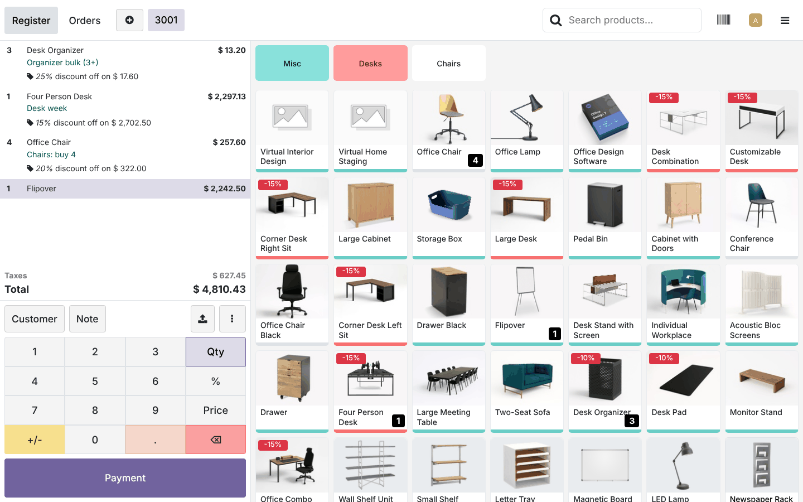
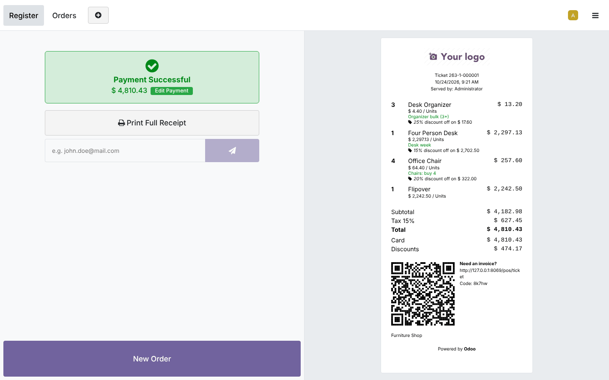
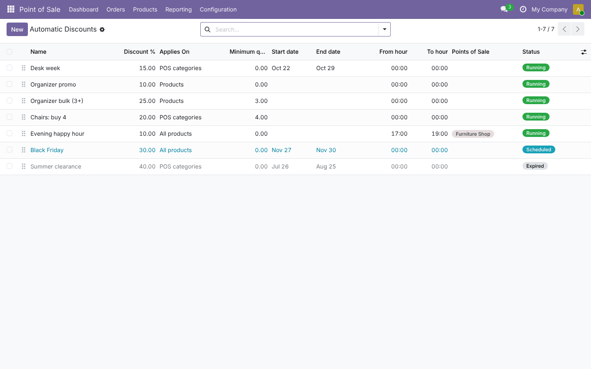
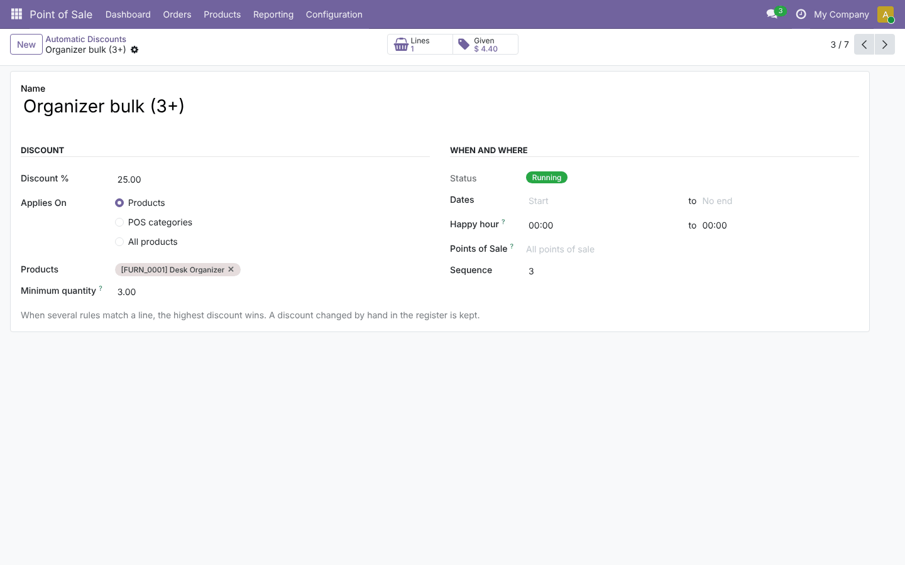
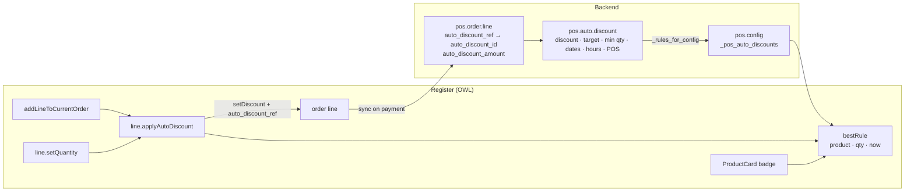

# POS Product Auto Discount (`pos_product_auto_discount`)

This guide covers the whole life of the module: planning, architecture, development, testing, and deployment
from dev to production.
Module folders: [`19.0/pos_product_auto_discount`](../19.0/pos_product_auto_discount) and [`20.0/pos_product_auto_discount`](../20.0/pos_product_auto_discount).

---

## 1. Planning

### 1.1 Goal
Shops run promotions: "-10% on organizers", "-25% from 3 units", "-15% on desks this week", "happy hour 17-19h".
In standard Odoo, the cashier must remember each one and type the discount by hand. Others need a pricelist per
case, and pricelists don't show the customer what they saved or report the cost of each promotion.

This module applies the right discount automatically and shows the saving on the screen and on the receipt. It
also tells the manager how much each promotion cost.

### 1.2 Requirements

| # | Requirement |
| --- | --- |
| R1 | Rules target products, POS categories (with sub-categories) or all products |
| R2 | Optional minimum quantity per line (quantity tiers) |
| R3 | Optional date range and daily hour window (happy hour, may cross midnight) |
| R4 | Optional restriction to some points of sale; multi-company safe |
| R5 | Several matching rules: the highest discount wins |
| R6 | Discount re-evaluated when the quantity changes; a manual discount by the cashier is never overwritten |
| R7 | Saving visible: product-card badge, rule name on the line and receipt, original price |
| R8 | Report: lines and amount given per rule |
| R9 | One switch per POS; expired rules and other shops' rules are not sent to the register |

### 1.3 Scope (v1)

| In scope | Out of scope (roadmap) |
| --- | --- |
| Percentage discount per line | Fixed-amount discounts, "buy X get Y" (use Odoo Loyalty) |
| Products / POS categories / all | Customer-specific rules (pricelists already do this) |
| Min qty, dates, hours, POS | Weekday selection |
| Badge, line/receipt name, report | Stacking several rules on one line |

### 1.4 Roles

| Role | Group | Can do |
| --- | --- | --- |
| Cashier | *Point of Sale / User* | Sells; sees discounts; may override a line discount by hand |
| Manager | *Point of Sale / Administrator* | Enables the feature, manages rules, reads the report |

### 1.5 Acceptance criteria
1. Adding a product with a 10% rule gives a 10% line with the rule name. At 3 units, a 25% tier replaces it.
2. A product without a rule and a product whose rule expired yesterday are sold at full price.
3. After the cashier types 5% on a line, changing its quantity keeps 5%.
4. After payment, the rule shows 1 line and the amount saved. The line list opens from the rule.
5. A rule for shop B is not applied in shop A.

### 1.6 Screenshots (Odoo 19; the Odoo 20 ones are in `20.0/pos_product_auto_discount/static/description/screenshots/`)

| Register | Receipt |
| --- | --- |
|  |  |
| **Rules** | **Rule with stats** |
|  |  |

---

## 2. Architecture



### 2.1 Design decisions
- **Line discount, not price change.** Odoo already shows "x% discount off on <original price>" on lines and
  receipts, totals the *Discounts* on the receipt, and books discounts normally. The module reuses all of that.
- **Rules travel with `pos.config`.** `_load_pos_data_read` adds the list of rules this register may use, so no
  new model is added to the POS data layer. The same code works in 19 and 20. Rules are filtered on the server
  (POS, company, not expired); dates and hours are checked in the register with its local clock, because a
  session can stay open for days.
- **The rule link is a plain integer from the register.** `auto_discount_ref` is in the order line's loaded
  fields. On the server, a stored compute turns it into the `auto_discount_id` many2one, which ignores deleted
  rules, and stores `auto_discount_amount`. That amount is the tax-included value saved, computed as
  `subtotal_incl × d / (100 − d)`. The report is a simple `_read_group`.
- **When it runs**:
  - after `addLineToCurrentOrder`, for every line of the order;
  - after `setQuantity`, for that line.
  
  Lines are skipped when they are refunds, combo children or reward lines, have qty ≤ 0, belong to a finalized
  order, or have a manual discount.
- **Manual discounts win.** `setDiscount` is patched. A call that does not come from the module marks the line as
  manual and clears its rule, so the report only counts automatic discounts.
- **Merging.** Odoo merges a new line into an existing one only when the discounts are equal. A new line
  (0%) must merge into an auto-discounted line (10%). Otherwise every click would create a new line, and the
  quantity tiers would never be reached. `canBeMergedWith` compares as if the discounts were equal in that case
  only.
- **Highest discount wins**; the sequence breaks ties. The badge only considers rules without a minimum quantity
  above 1.

---

## 3. Development

```bash
./odoo-bin --addons-path=addons,/path/odoo-module/19.0 -d pad_dev -i pos_product_auto_discount --dev=xml,qweb,reload
```
Demo shop: `env['pos.config'].load_onboarding_furniture_scenario(with_demo_data=True)` in the Odoo shell. Then
enable *Automatic discounts* and create a few rules (see `shots/demo_pos_product_auto_discount.py` in the build
tooling for the set used in the screenshots).

Build order:
1. rule model, constraints and status;
2. rules in the config data;
3. order line fields and computes;
4. JS rule matching (pure functions first: they are also tested from the tour);
5. order line patches;
6. merge fix;
7. badge and line name;
8. stats and line list;
9. tests and tour;
10. port to 20.

---

## 4. Testing

`tests/test_auto_discount.py` is based on `TestPointOfSaleHttpCommon`. **All tests pass on both versions: 19.0
runs 5 tests and 20.0 reports 7, because it counts its two standard web suites too.**

| Test | Checks |
| --- | --- |
| `test_rules_sent_to_register` | Only this shop's/global, non-expired rules; data shape; nothing when disabled; other shop gets its rule |
| `test_status` | Running / expired / scheduled |
| `test_constraints` | Discount 0 or > 100, negative min qty (SQL), missing products/categories, end before start, hour > 24 |
| `test_settings_button` | Opens the rules with the shop as default |
| `test_pos_tour` | Browser tour (below), then checks the saved order lines, the rule link, the amount given, the stats and the line list |

Tour `pos_auto_discount_tour`:
1. **Rule logic:** it calls the module's JS functions with fixed dates. It checks happy hours across midnight,
   that the end hour is excluded, parent categories, quantity tiers and start dates.
2. **Badges:** the -10% badge is shown, and there is none for an expired rule.
3. **Desk Organizer:** 10% with the rule name, then 25% at 3 units.
4. **Letter Tray:** sold at full price, because its rule has expired.
5. **Magnetic Board:** 20%, then a manual 5% that is kept at quantity 2.
6. **Payment:** pay by Bank and validate.

```bash
tools/run_tests.sh 19.0 /path/to/odoo19 pos_product_auto_discount
tools/run_tests.sh 20.0 /path/to/odoo20 pos_product_auto_discount
```
The tour needs Chrome or Chromium and the Python package `websocket-client`; without them Odoo skips it.

Manual UAT:
- Overlapping rules (product rule and category rule): the highest wins.
- A happy hour that starts while an order is open: the discount appears on the next quantity change.
- Refund of a discounted order: the refund lines keep the original discount and are not recomputed.
- Invoice an order and check the discount on the invoice lines.

---

## 5. Deployment: dev → staging → production

1. **Code**: add the module folder for your version to the addons path on every Odoo worker, then restart.
2. **Staging**:
   - install the module and enable it for one shop;
   - copy the planned promotions as rules;
   - test a full day: tiers, happy hour, receipts, closing the session and the accounting entries.
3. **Production**:
   - install the module and enable it per shop;
   - create the rules with **dates**, so promotions start and stop by themselves;
   - registers load the rules when they open or reload, so plan rule changes outside opening hours or ask
     cashiers to reload.
4. **Monitoring**: open each rule to see lines and the amount given. *Point of Sale › Reporting › Orders* gives the
   global discount view.
5. **Rollback**: untick the setting (nothing is sent to the register after a reload), or archive the rules.
   Discounts already sold stay on the orders.

Time zone: hours are compared with the **register device's local clock**. Make sure POS devices use the shop's
time zone.

---

## 6. Odoo 19 vs Odoo 20

| Topic | 19.0 | 20.0 |
| --- | --- | --- |
| Access rights | `ir.model.access.csv` | `ir.access.csv` |
| Icons (stat buttons, settings link) | Font Awesome / `oi-arrow-right` | Material Symbols (`shopping_basket`, `label`, `east`) |
| Template additions (inherited OWL templates) | `autoDiscountBadge`, `line.autoDiscountRule` | `this.autoDiscountBadge`, `this.line.autoDiscountRule` (OWL 3) |
| POS APIs used (`addLineToCurrentOrder`, `setDiscount`, `setQuantity`, `canBeMergedWith`, `getDiscount`, `ProductCard`) | same | same |

The Python code, the JS logic and the tour are the same in both versions.

## 7. Known limitations
- One rule per line (no stacking).
- Rules are loaded when the register opens; a new rule needs a reload.
- A line merged into a manually discounted line follows Odoo's normal rule (different discounts → separate lines).
