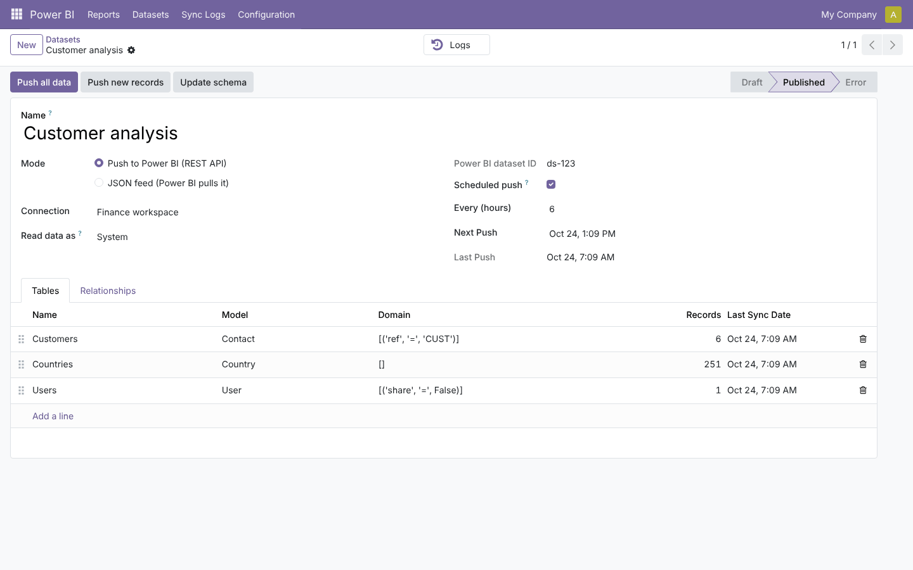
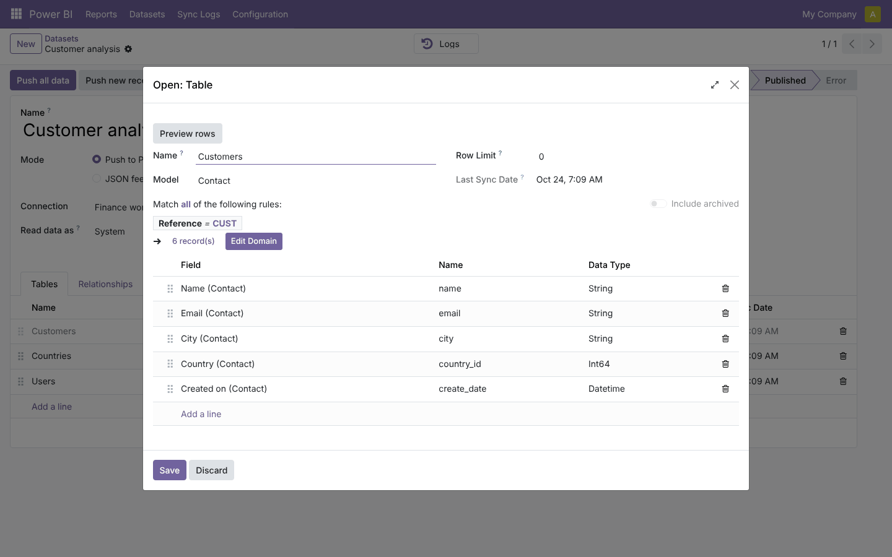
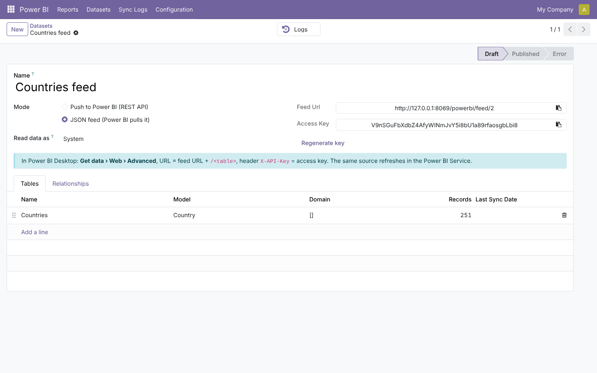
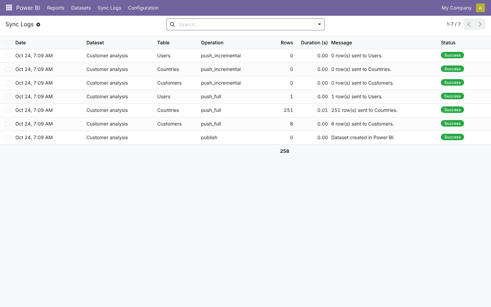
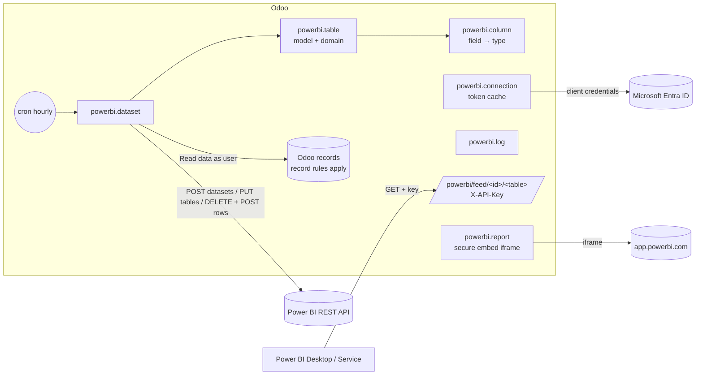

# Power BI Connector (`powerbi_connector`)

End-to-end guide: planning, architecture, development, testing and deployment from dev to production.
Module folders: [`19.0/powerbi_connector`](../19.0/powerbi_connector) and [`20.0/powerbi_connector`](../20.0/powerbi_connector).

---

## 1. Planning

### 1.1 Goal
Business analysts build Power BI reports on Odoo data that refresh by themselves, without CSV exports and without
opening the PostgreSQL database to the outside (impossible on Odoo.sh, risky on-premise). Managers read those
reports from inside Odoo.

### 1.2 Two delivery modes

| | Push (REST API) | JSON feed (pull) |
| --- | --- | --- |
| Who moves the data | Odoo, on demand or scheduled | Power BI, on refresh |
| Requirements | Entra ID app + workspace membership + tenant setting | Nothing in Azure |
| Volume | Push dataset limits (10k rows/POST, 1M rows/hour) | Size of a JSON response |
| Real-time dashboards | Yes (push datasets) | No (import refresh) |
| Typical use | KPIs, dashboards, near-real-time | Analysis models in Power BI Desktop |

### 1.3 Scope (v1)

| In scope | Out of scope (roadmap) |
| --- | --- |
| Tables from any model, domain, row limit, typed columns | Computed (non-stored) fields, one2many/many2many columns |
| Relationships from many2one columns | Microsoft Fabric eventhouses / KQL databases |
| Push: create dataset, schema update, full and incremental push, schedule | Upserts (push datasets only append or reset) |
| Feed: key-protected JSON per table + index | OData protocol |
| Reports embedded with secure embed (viewer's own Power BI login) | App-owns-data embedding with embed tokens |
| Logs, record-rule–aware data reading | |

### 1.4 Roles

| Role | Group | Can do |
| --- | --- | --- |
| Report viewer | *Power BI / Report viewer* | See the reports allowed to their groups |
| Administrator | *Power BI / Administrator* | Connections (secrets), datasets, keys, logs, all reports |

### 1.5 Acceptance criteria
1. A push dataset appears in the Power BI workspace with the defined tables, types and relationships.
2. *Push all data* replaces the table rows; the scheduled push runs every N hours.
3. A feed URL without the right key returns 403; with it, the rows the *Read data as* user can see.
4. A report restricted to a group is invisible to other viewers.

### 1.6 Screenshots (Odoo 19; Odoo 20 ones are in `20.0/powerbi_connector/README.md`)

| Push dataset | Table definition |
| --- | --- |
|  |  |
| **Feed dataset** | **Sync logs** |
|  |  |

---

## 2. Architecture



### 2.1 Design decisions
- **Service principal, client-credentials flow**: no user password stored; the token is cached until 5 minutes before expiry.
- **Full refresh = DELETE rows + POST in 10,000-row batches** (Power BI limits). Incremental = records *created*
  since the last push (push datasets cannot update rows, so it suits append-only data like journal items or logs).
- **Schema evolution**: *Update schema* sends `PUT tables/<name>` for every table (Power BI keeps the dataset id).
- **Typed conversion** in one function (`to_powerbi`): dates/datetimes as ISO UTC, selections as labels, HTML as text, many2one as id.
- **Feed security**: per-dataset random key compared in constant time; data read as a chosen user; failures logged.
- **Errors never raise in scheduled/remote paths**: they set the dataset state and write a log line.

---

## 3. Development

```bash
./odoo-bin --addons-path=addons,/path/odoo-module/19.0 -d pbi_dev -i powerbi_connector --dev=all
```
Feed mode needs no Azure: create a feed dataset and open
`http://localhost:8069/powerbi/feed/<id>/<table>?key=<key>` in the browser.
For push mode, use a Power BI trial tenant and a dedicated workspace.

Build order: models (dataset/table/column) and type mapping → rows conversion → feed controller (fast feedback) →
connection and token → publish/push/incremental/schema → logs and cron → reports → security → tests → port.

---

## 4. Testing

`tests/test_powerbi.py`: **19.0: 13 tests, 20.0: 15 reported, all passing.** The Power BI and Entra ID endpoints are
replaced by `FakePowerBI`, which records every call.

| Test | Checks |
| --- | --- |
| schema | column types, `id` key, relationship from `country_id` to the Countries table |
| rows | many2one id, selection label, boolean, ISO datetime |
| token | cached, renewed 5 minutes before expiry |
| publish + full push | POST dataset payload and auth header; DELETE then POSTs in batches; logs |
| incremental | only records created since the last push, no DELETE |
| schema update | PUT for each table |
| errors | state *error*, log with the API message, red notification on test connection |
| schedule | cron pushes due datasets only and computes the next run |
| validation | push without connection, invalid table names |
| reports | report link → embed URL with group and tenant; group visibility rule |
| feed (HTTP) | 403 without/with wrong key, rows, index with relationships, unknown table 404 |
| feed rights (HTTP) | feed user without access to a model gets 403 |

Manual UAT: connect a trial workspace, push a dataset of sales orders + customers, build a report in Power BI with the
relationship, schedule the push, add the report in Odoo and open it as a viewer.

---

## 5. Deployment: dev → staging → production

1. **Azure (once)**: app registration + secret (note its expiry date), tenant setting for service principals,
   app added as *Member* of a dedicated production workspace.
2. **Staging**: point a connection to a *staging* workspace; never push staging data to the production workspace.
   Feed keys of a restored database are the production ones: **regenerate them** on staging.
3. **Production**: install, create the connection, test, create datasets, publish, push, enable schedules.
   Create a technical user with read-only access to the needed models for *Read data as*.
4. **Monitoring**: *Sync Logs* filtered on errors; renew the client secret before it expires.
5. **Rollback**: disable schedules or archive datasets; datasets in Power BI stay until deleted there.

---

## 6. Odoo 19 vs Odoo 20

| Topic | 19.0 | 20.0 |
| --- | --- | --- |
| Access rights and report visibility rule | `ir.model.access.csv` + `ir.rule` | `ir.access.csv` |
| Icons | Font Awesome | Material Symbols |
| System parameter read | `get_param` | `get_str` |

## 7. Known limitations
- Power BI push datasets cannot update rows: use full refresh for data that changes.
- Secure embed needs viewers to have Power BI access (Pro or Premium/Fabric capacity) to the report.
- Incremental pushes select records by `create_date`, which is the start time of the transaction that created
  them. A record created by a transaction that started before a push and was committed after it is not sent
  by later incremental pushes. Schedule a full push from time to time (for example nightly) to catch such rows.
