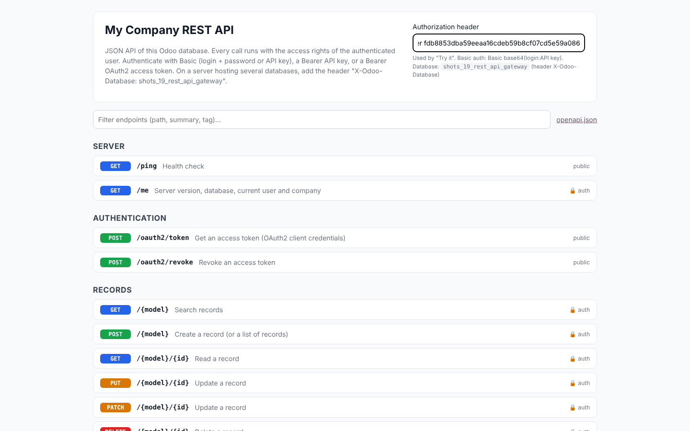
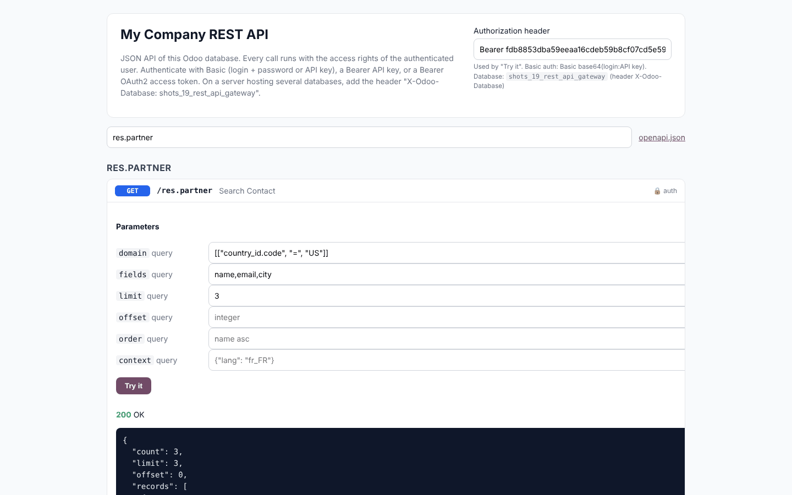
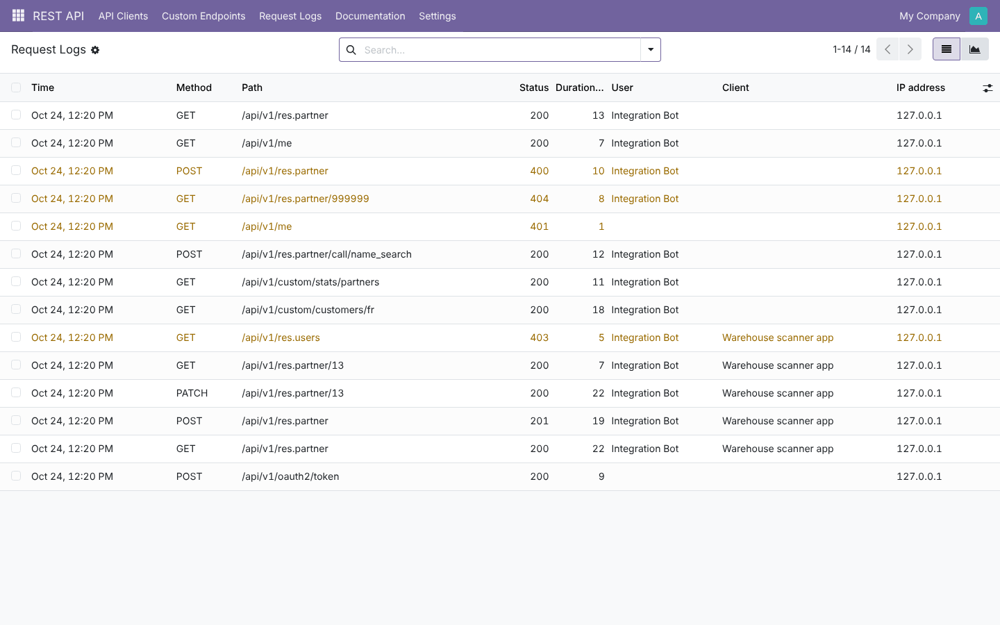
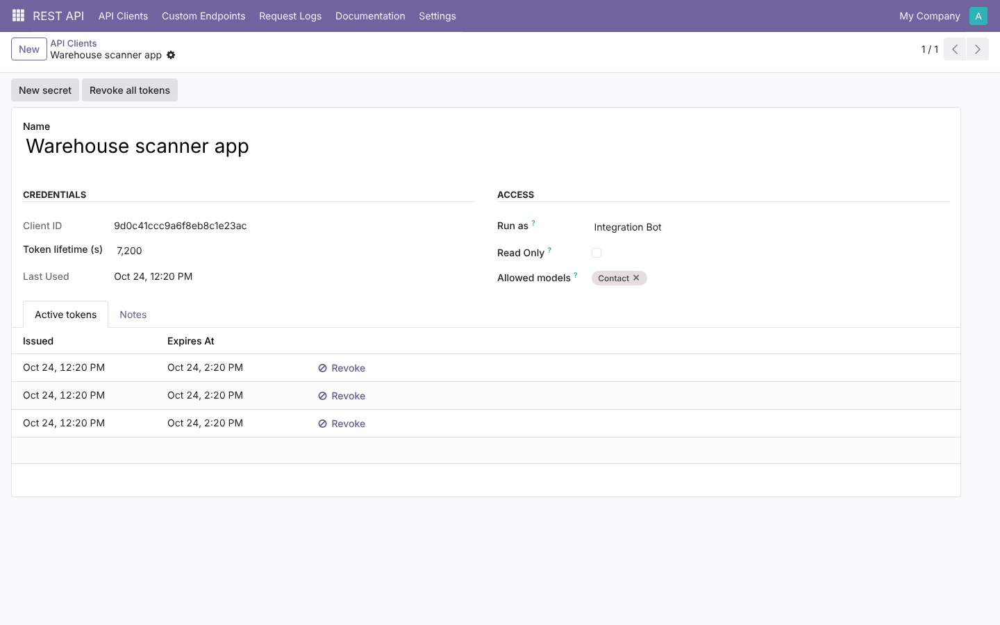
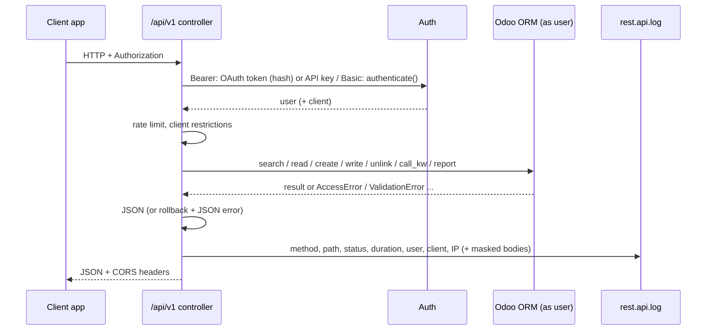

# REST API Gateway (`rest_api_gateway`)

This guide covers the whole life of the module: planning, architecture, development, testing, and deployment
from dev to production.
Module folders: [`19.0/rest_api_gateway`](../19.0/rest_api_gateway) and [`20.0/rest_api_gateway`](../20.0/rest_api_gateway).

---

## 1. Planning

### 1.1 Goal
Mobile apps, e-shops, warehouse scanners and integration platforms need a simple HTTP + JSON interface to Odoo.
Odoo's built-in XML-RPC / JSON-RPC works, but it is RPC-shaped (one endpoint, positional arguments), has no
OAuth2, no per-client restrictions, no request log and no browsable documentation.

This module adds a REST layer **without bypassing Odoo's security**: every call runs as a real user.

### 1.2 Requirements

| # | Requirement |
| --- | --- |
| R1 | Authenticate with Odoo API keys (Bearer or Basic), passwords (Basic) and OAuth2 client credentials |
| R2 | CRUD on any model through REST verbs; search with domain, fields, paging, order, context |
| R3 | Call public model methods; never private ones |
| R4 | Download binary fields; print reports (PDF/HTML) |
| R5 | Admins create custom endpoints (records, server action, sandboxed code) with path parameters |
| R6 | OpenAPI file and an interactive docs page with "Try it" and curl |
| R7 | Request log (bodies optional, secrets masked), retention |
| R8 | Rate limit per user and IP; CORS; page size cap |
| R9 | Clients restricted to models and/or read-only; secrets and tokens never stored in clear |
| R10 | JSON errors with meaningful HTTP codes; failed requests rolled back |

### 1.3 Scope (v1)

| In scope | Out of scope (roadmap) |
| --- | --- |
| OAuth2 client credentials | OAuth2 authorization code / PKCE, OAuth1 |
| API keys, Basic | Per-client IP allow-lists |
| Generic CRUD, method calls, files, reports | GraphQL, webhooks out |
| Custom endpoints (3 modes) | Endpoint versioning |
| OpenAPI 3.0 + built-in docs page | SDK generation |

### 1.4 Roles

| Role | Group | Can do |
| --- | --- | --- |
| API consumer | Any active user (API key) or an OAuth2 client | Whatever that user may do in Odoo |
| API administrator | *Settings* (`base.group_system`) | Clients, custom endpoints, logs, settings |

### 1.5 Acceptance criteria
1. A user without access to `ir.config_parameter` gets `403` on `/api/v1/ir.config_parameter`.
2. A read-only OAuth client gets `403` on POST and `200` on GET.
3. `_compute_display_name` cannot be called (`403`).
4. With a limit of 3 per minute, the 4th call returns `429` with `Retry-After`.
5. The log of `/oauth2/token` shows `client_secret=***`.
6. `/api/docs` "Try it" on `/ping` shows `200` and a curl command.

### 1.6 Screenshots (Odoo 19; the Odoo 20 ones are in `20.0/rest_api_gateway/static/description/screenshots/`)

| Docs | Try it |
| --- | --- |
|  |  |
| **Logs** | **Client** |
|  |  |

---

## 2. Architecture



### 2.1 Design decisions
- **The user's rights are the only security.**
  - After authentication the request switches to the user (`request.update_env(user=...)`), so ACLs, record
    rules and field groups apply.
  - OAuth clients act as a chosen user, which can be a dedicated integration user with minimal rights.
  - Clients can be restricted further: allowed models, read-only.
- **Reuse Odoo's auth.**
  - Basic auth calls `res.users.authenticate()` in non-interactive mode, like XML-RPC. This accepts a password
    or an API key and keeps Odoo's failed-login throttling.
  - Bearer values are checked as OAuth tokens first, then as API keys (`res.users.apikeys._check_credentials`,
    scope `rpc`).
- **Hashed secrets.** Client secrets and tokens are random (256 bits) and stored as SHA-256 hashes, compared in
  constant time. A new secret revokes the client's tokens.
- **Method calls go through `odoo.service.model.call_kw`.** These are the same rules as the web client:
  private methods, `@api.private` methods and class methods are refused.
- **Errors.** Every exception is caught and the transaction rolled back. Exceptions are mapped to HTTP codes
  (`AccessError` → 403, `MissingError` → 404, `UserError`/`ValidationError`/DB constraint → 400, unexpected →
  500 with a generic message), and the request is logged after the rollback.
- **Read-write routes.** Odoo makes `auth="none"` routes read-only by default (a replica-friendly cursor). The API
  writes logs and tokens, so all routes declare `readonly=False`.
- **Custom endpoints.**
  - The configuration is read as superuser; the data access runs as the caller (or superuser when chosen).
  - Python code runs in `safe_eval` like server actions.
  - Public endpoints run as the public user and cannot run code or actions as superuser.
- **Rate limiting** counts the caller's log rows of the last 60 seconds. It needs no extra table and works with
  several workers. Logs are always written (bodies optional) and cleaned daily.
- **Database selection** follows Odoo: one database per server (`--db-filter`), or the `X-Odoo-Database` header.
  The docs page uses its own cookie (same origin) and shows the header in its curl commands.
- **No external assets.** The docs page is plain HTML, CSS and JavaScript, and works on servers without
  internet access.

---

## 3. Development

```bash
./odoo-bin --addons-path=addons,/path/odoo-module/19.0 -d api_dev -i rest_api_gateway --dev=xml,reload
# API key: Preferences > Account Security > New API key
curl -H "Authorization: Bearer <key>" http://localhost:8069/api/v1/me
```
Open `http://localhost:8069/api/docs` (log in first, or enable public documentation).

Build order:
1. auth;
2. JSON plumbing and error mapping;
3. CRUD;
4. method calls;
5. files and reports;
6. OAuth2 clients and tokens;
7. logs and rate limit;
8. CORS;
9. custom endpoints;
10. OpenAPI;
11. docs page;
12. backend views;
13. tests;
14. port.

---

## 4. Testing

`tests/test_rest_api.py` (`HttpCase`) makes real HTTP calls to the test server. **19.0: 11 tests; 20.0: 13 reported
(11 + 2 standard web suites); all pass.**

| Test | Checks |
| --- | --- |
| `test_ping_and_authentication` | Public ping; missing / wrong credentials → 401 with `WWW-Authenticate`; Bearer key; Basic password and Basic key; wrong Basic |
| `test_crud` | Create → 201, search with domain/fields, read (no binaries by default), update, delete, 404 after delete, batch create |
| `test_access_rights_and_errors` | 403 on `ir.config_parameter`, unknown model 404, invalid domain/fields/JSON 400, constraint → 400 `integrity_error`, errors logged |
| `test_call_method` | `name_search` (model method), `read` with ids, private method → 403 |
| `test_oauth2_client_credentials` | Hashed secret, wrong secret / unsupported grant, token, `/me` shows client, allowed models, read-only, revoke |
| `test_custom_endpoints` | Records with `{param}`, code with body/params, server action on ids, 404, public as public user vs superuser, validation |
| `test_logs_rate_limit_and_masking` | `client_secret=***`, secret absent from logs, 4th call → 429 + `Retry-After` |
| `test_download_and_report` | PNG download with MIME type, non-binary field → 400, HTML report, unknown report 404 |
| `test_openapi_docs_and_cors` | Docs private by default (401), OpenAPI paths and schemas, title with anonymous request, docs page, CORS preflight + origin filtering |
| `test_docs_page_try_it` | Headless Chrome: docs page lists operations, "Try it" on `/ping` → 200 |
| `test_cleanup_cron` | Old logs deleted |

Beyond the unit tests, the demo database was exercised with real HTTP calls on Odoo 19 and 20 (`requests`, no
cookies). This covered ping, OAuth token, search, create, patch, read, a 403 on a forbidden model, custom
endpoints, a method call, and the 401, 404 and 400 cases. Those calls are what the log screenshots show.

---

## 5. Deployment: dev → staging → production

1. **Install** the module on staging first. Create a **dedicated integration user** with only the rights the
   integration needs. Prefer an OAuth client acting as that user to personal keys.
2. **Reverse proxy:**
   - serve HTTPS only (credentials travel in headers);
   - keep `proxy_mode = True` so logs and rate limits see the real client IP;
   - allow `Authorization` headers through.
3. **Database:** use `--db-filter` (one database per domain), or have clients send `X-Odoo-Database`.
4. **Settings in production:**
   - rate limit (e.g. 120/min);
   - CORS origins (exact origins, avoid `*`);
   - body logging **off** unless debugging (bodies can contain personal data);
   - retention (30 days);
   - documentation private.
5. **Secrets:** generate the client secret in production, give it to the integrator once (it is shown once), and
   rotate it with *New secret* (this revokes tokens).
6. **Monitoring:** *Request Logs* (filter *Errors*, graph per day) and the server log for 500 errors.
7. **Rollback:** archive a client or endpoint to cut it off immediately, or uninstall the module. Odoo data is
   untouched.

---

## 6. Odoo 19 vs Odoo 20

| Topic | 19.0 | 20.0 |
| --- | --- | --- |
| Access rights | `ir.model.access.csv` | `ir.access.csv` |
| Settings values | `get_param` / `set_param` | typed `get_int` / `get_bool` / `get_str` |
| API key scope | keys without scope also accepted | exact scope `rpc` (keys from the UI have it) |
| Field metadata | `comodel_name` on every field | only on relational fields (code uses `getattr`) |
| Binary values written in tests | bytes or base64 | base64 string or `BinaryValue` |
| QWeb | `t-esc` | `t-out` |
| `odoo.http` | module | package (same imports) |

## 7. Known limitations
- OAuth2 is client credentials only; user-facing flows (authorization code) are on the roadmap.
- The rate limit window is fixed at 60 seconds.
- Reports in PDF need wkhtmltopdf on the server (HTML always works).
