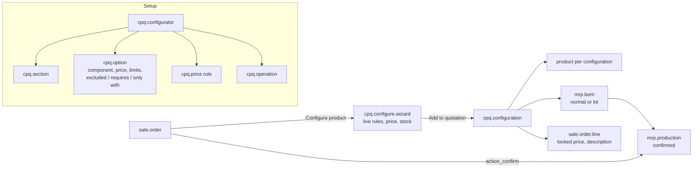

# CPQ Product Configurator (`sale_cpq_configurator`)

End-to-end guide: planning, architecture, development, testing and deployment from dev to production.
Module folders: [`19.0/sale_cpq_configurator`](../19.0/sale_cpq_configurator) and [`20.0/sale_cpq_configurator`](../20.0/sale_cpq_configurator).

---

## 1. Planning

### 1.1 Goal
Companies selling made-to-order products (furniture, machines, enclosures, PCs…) need sales people to produce a
correct quote in minutes: only valid combinations, a price that follows the company's rules, and a production
order that matches what was sold — without an engineer re-typing the BoM.

### 1.2 Scope (v1)

| In scope | Out of scope (roadmap) |
| --- | --- |
| Configurators with steps (single/multi choice, required) and component options | Portal / eCommerce configuration |
| Exclusions, requirements, conditional availability | Formula-based quantities (e.g. legs = width / 40) |
| Fixed / percentage surcharges, quantity-break discounts | Pricelist-dependent option prices, approvals |
| Live price breakdown and component stock | 3D / image previews |
| Product + BoM + operations per configuration | Reconfiguring an existing line (re-run the wizard instead) |
| MO on confirmation (manufacture) or kit delivery | Sub-assemblies (multi-level configured BoMs) |

### 1.3 Roles

| Role | Group | Can do |
| --- | --- | --- |
| Sales person | *Sales / User* | Configure products on quotations, read configurators and configurations |
| Sales administrator | *Sales / Administrator* | Create and edit configurators, rules, prices, operations |
| Manufacturing user | *Manufacturing / User* | Read configurations behind MOs |

### 1.4 Acceptance criteria
1. Invalid combinations cannot be added to a quotation; the reason is shown while configuring.
2. The unit price equals base + options + rules, and does not change when the quantity on the line changes.
3. Confirming the order creates one confirmed MO per configured line with the selected components (manufacture), or
   a delivery with the components (kit).
4. The quotation PDF shows the chosen options (line description).

### 1.5 Screenshots (Odoo 19; Odoo 20 ones are in `20.0/sale_cpq_configurator/README.md`)

| Configuration wizard | Quotation |
| --- | --- |
|  |  |
| **Configurator** | **Manufacturing order** |
|  |  |

---

## 2. Architecture



### 2.1 Design decisions
- **One product + BoM per configuration.** Odoo picks BoMs by product; a dedicated product makes kits explode
  correctly and MOs use the right BoM without custom stock logic. The product carries the configuration
  reference (`CPQ00001`) as internal reference, so it is traceable everywhere (stock, invoices, reports).
- **The wizard is fully computed**: rules, breakdown and problems are compute fields depending on the lines, so the
  UI updates live without JavaScript (identical on Odoo 19 and 20).
- **Validation twice**: shown live as a warning, enforced when adding to the quotation.
- **Locked price**: configured lines skip `_compute_price_unit`, so pricelists and quantity changes keep the configured price.
- **Version-neutral BoM code**: the BoM line unit field is resolved at run time (`product_uom_id` in 19, `uom_id` in 20).

---

## 3. Development

```bash
./odoo-bin --addons-path=addons,/path/odoo-module/19.0 -d cpq_dev -i sale_cpq_configurator --dev=all
```
Build order: configurator models and form → wizard lines and rule checks → pricing and breakdown → configuration
record, product/BoM/operations generation → sale order button, price lock, confirmation hook → kit path → stock → tests → port.

Extending price logic: override `cpq.configure.wizard._price_details()` (returns rows, rules, total).
Extending rules: override `_check_rules()` and append messages.

---

## 4. Testing

`tests/test_cpq.py`: **19.0: 11 tests, 20.0: 13 reported, all passing.**

| Test | Checks |
| --- | --- |
| defaults and price | default options, base + options, no problems |
| price rules | conditional surcharge + quantity-break discount: 1220 → 1270 → 1143 |
| rules | required step, single choice, exclusion, quantity limits, blocking on add |
| visibility | option only available with another one |
| add to quotation | price, description, configuration reference, product, BoM components, operations filtered by option, price locked |
| confirm | confirmed MO with the right quantity, components and origin |
| kit | phantom BoM, no MO, delivery moves of the components |
| cancel / confirmed | configurations cancelled with the quotation; no configuration on confirmed orders |
| form | wizard opened from the quotation action and saved through the form |
| stock | free quantity and shortage flag |
| access | sales user reads configurators but cannot edit them |

Manual UAT: build a real configurator with the product team, quote 10 typical customer requests, compare prices
with the current price list, confirm two orders and run the MOs to the end (component consumption, finished product).

---

## 5. Deployment: dev → staging → production

1. **PR + CI** green on 19.0 and 20.0.
2. **Staging**: install, create the real configurators (or import them), let sales people quote for a week;
   check MO components with production.
3. **Production**: install, recreate/export the validated configurators, give *Sales / Administrator* to the people
   maintaining them, train sales people on the *Configure product* button.
4. **Data**: each configuration creates a product; archive old configured products periodically (filter internal
   reference `CPQ`), they stay on historical orders.
5. **Rollback**: uninstalling keeps orders, products and BoMs; configurations and configurators are removed.

---

## 6. Odoo 19 vs Odoo 20

| Topic | 19.0 | 20.0 |
| --- | --- | --- |
| Access rights | `ir.model.access.csv` | `ir.access.csv` |
| Icons | Font Awesome | Material Symbols |
| BoM line unit field | `product_uom_id` | `uom_id` (resolved at run time) |
| Wizard, rules, pricing | identical | identical |

## 7. Known limitations
- Option prices are in the company currency and ignore pricelists (the configured price is fixed on the line).
- Changing a configurator does not update existing configurations.
