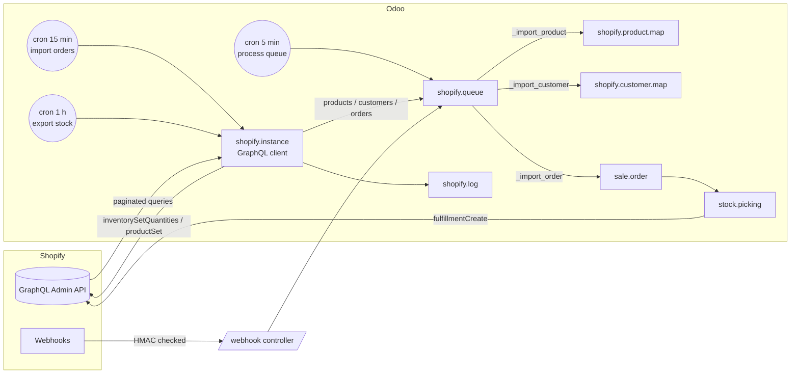

# Shopify Sync (`shopify_sync`)

End-to-end guide: planning, architecture, development, testing and deployment from dev to production.
Module folders: [`19.0/shopify_sync`](../19.0/shopify_sync) and [`20.0/shopify_sync`](../20.0/shopify_sync).

---

## 1. Planning

### 1.1 Goal
Run a Shopify store with Odoo as the back office: orders flow into Sales and Inventory, stock levels flow back
to Shopify, deliveries mark Shopify orders fulfilled, and nothing is typed twice.

### 1.2 Scope (v1)

| In scope | Out of scope (roadmap) |
| --- | --- |
| Several stores per database, each with its company, warehouse, pricelist, team | OAuth public-app install flow (v1 uses a custom-app token) |
| Product import (options → attributes, variants), matching by mapping / SKU / barcode | Images, metafields, collections, multi-language |
| Product export (create/update with variants) via `productSet` | Price export per market / catalogs |
| Customer import (default address), email matching | B2B companies, customer segments |
| Order import with status filter, addresses, shipping, discounts | Shopify tax lines mapping (Odoo taxes of products are used) |
| Auto-confirm, auto-invoice paid orders | Payment registration, payouts, refunds and returns |
| Cancellation sync (Shopify → Odoo) | Abandoned checkouts, Shopify POS orders |
| Stock export per location (free / on hand / forecasted) | Kit (BoM) stock computation |
| Fulfillment export with tracking number | Partial fulfillments line by line |
| Webhooks with HMAC verification, sync queue, retries, logs, dashboard | |

### 1.3 Roles

| Role | Group | Can do |
| --- | --- | --- |
| Sales user with Shopify access | *Shopify / User* | See dashboard, mappings, queue, logs, retry failed items |
| Shopify admin | *Shopify / Administrator* | Configure stores (token, secret), import/export, export products |

### 1.4 Acceptance criteria
1. *Test & Connect* imports the store's locations and shows *Connected*.
2. A paid order placed in Shopify appears as a confirmed sale order within 15 minutes (immediately with webhooks),
   with the right customer, lines, shipping and discount.
3. Validating its delivery marks the Shopify order fulfilled.
4. Stock changes in Odoo reach Shopify within an hour.
5. An order with an unknown SKU never blocks the others: it fails alone, with a readable reason, and can be retried.
6. Webhooks with a wrong signature are rejected (HTTP 401).

### 1.5 Screenshots (Odoo 19; Odoo 20 ones are in `20.0/shopify_sync/README.md`)

| Dashboard | Store |
| --- | --- |
|  |  |
| **Imported order** | **Failed queue item** |
|  |  |

---

## 2. Architecture



### 2.1 Data model

| Model | Key fields |
| --- | --- |
| `shopify.instance` | `shop_url`, `access_token`*, `webhook_secret`*, `api_version`, company/warehouse/pricelist/team, `import_financial_statuses`, `auto_confirm_order`, `auto_create_invoice`, `create_missing_products`, `stock_field`, last import dates (*admins only) |
| `shopify.location` | `shopify_id`, `warehouse_id`, `export_stock` |
| `shopify.product.map` | `shopify_product_id`, `shopify_variant_id` (unique per store), `inventory_item_id`, `product_id`, `sku` |
| `shopify.customer.map` | `shopify_customer_id` (unique per store), `partner_id` |
| `shopify.queue` | `data_type`, `source` (import/webhook), `payload`, `state`, `message`, `attempts`, created record |
| `sale.order` + | `shopify_instance_id`, `shopify_order_id` (unique per store), `shopify_order_name`, statuses |

### 2.2 Design decisions
- **GraphQL Admin API only** (REST product APIs are legacy). Queries live in `models/queries.py`.
- **Incremental imports** with `updated_at:>'<last import>'` filters and cursor pagination.
- **Everything incoming goes through the queue**, each line in a savepoint: one bad order never rolls back the batch.
- **Webhooks are thin**: the controller checks the signature and stores the id; orders are re-read through GraphQL,
  so imports and webhooks share one code path and one data shape.
- **Idempotency**: unique constraints on order and mapping ids; re-importing updates statuses instead of duplicating.
- **Shopify prices win**: line prices are forced to the Shopify amounts even if a pricelist would compute others.

---

## 3. Development

### 3.1 Local setup
```bash
./odoo-bin --addons-path=addons,/path/odoo-module/19.0 -d shop_dev -i shopify_sync --dev=all
```
Use a Shopify **development store** (Partners dashboard) with a custom app; never develop against production.
To receive webhooks locally, expose Odoo with a tunnel (e.g. `cloudflared tunnel --url http://localhost:8069`)
and register the tunnel URL + `/shopify_sync/webhook/<store id>`.

### 3.2 Build order
1. GraphQL client (`_graphql`, `_paginate`, error mapping) and *Test & Connect* + locations.
2. Mapping models and product import (match by mapping → SKU → barcode → create template with attributes).
3. Customer import, then order import (partner, addresses, lines, shipping, discount, workflow).
4. Queue with savepoints/retries; crons; webhook controller with HMAC.
5. Exports: stock (`inventorySetQuantities`), fulfillment on `_action_done`, products (`productSet`).
6. Views, dashboard, security; tests with an in-memory fake of the API (`tests/common.py`).

---

## 4. Testing

### 4.1 Automated
`tests/test_shopify.py` (14 tests on 19.0, 16 reported on 20.0, all passing) uses `FakeShopify`, which answers each
GraphQL document from fixtures and records mutations:

| Test | Checks |
| --- | --- |
| connection & locations | state, currency, locations mapped to the default warehouse |
| product import | template with Size attribute, 2 variants + simple product, SKUs, inventory items, no duplicates on re-import, SKU matching |
| missing products | queue lines fail with the SKU in the message when auto-create is off |
| customers | email matching (case-insensitive), address and country |
| order workflow | confirmed order, lines/shipping/discount prices, posted invoice, delivery created, no duplicate on re-import |
| status filter & cancel | pending order skipped, cancelled order cancels the sale order |
| unknown SKU + retry | fails, then succeeds after the product exists |
| currency mismatch | order in USD vs EUR pricelist fails clearly |
| stock export | quantities per location/inventory item |
| fulfillment | validating the delivery sends `fulfillmentCreate` |
| product export | options, variants, mappings created |
| webhooks (HTTP) | 401 on bad signature, 200 + queue line, order created after processing; product webhook |

```bash
tools/run_tests.sh 19.0 /path/to/odoo19 shopify_sync
tools/run_tests.sh 20.0 /path/to/odoo20 shopify_sync
```

### 4.2 Manual test plan on a development store

| # | Step | Expected |
| --- | --- | --- |
| 1 | Test & Connect | *Connected*, locations listed, map them to warehouses |
| 2 | Import products | Variants in *Catalog › Products*, existing SKUs matched |
| 3 | Place a test order (Bogus Gateway) | After *Import orders* (or webhook), confirmed SO with addresses |
| 4 | Validate the delivery with a tracking number | Order shows *Fulfilled* in Shopify |
| 5 | Receive stock in Odoo, *Export stock* | Shopify inventory updated |
| 6 | Cancel an unshipped order in Shopify | Odoo order cancelled |
| 7 | Order with a SKU unknown in Odoo (auto-create off) | Failed queue item; create the product, *Retry* |
| 8 | Send a webhook with a wrong secret | Rejected, warning in server log |

---

## 5. Deployment: dev → staging → production

1. **Dev**: development store + tunnel, module installed with `--dev=all`.
2. **PR + CI**: tests on 19.0 and 20.0 must be green.
3. **Staging** (copy of production, neutralized): connect a *development store* (never the live store) and replay the
   manual test plan. On Odoo.sh staging, crons are neutralized; run imports with the buttons.
4. **Production**:
   - Merge, update the submodule / `git pull`, `-u shopify_sync`, restart.
   - Create the store with the live custom-app token; set `order_import_from` to the go-live date to avoid importing history.
   - Map locations, set the pricelist in the store currency, shipping/discount products if you want your own.
   - Import products first (check the mapping list), then customers, then turn on order import and stock export.
   - Register webhooks last.
5. **Monitoring**: dashboard *Failed* counter, *Monitoring › Sync Queue* (failed) and *Logs* (errors).
   Rate limits (HTTP 429) are transient: the queue retries.
6. **Rollback**: disable the crons and webhooks, archive the store. Orders already imported stay in Odoo.

---

## 6. Odoo 19 vs Odoo 20

| Topic | 19.0 | 20.0 |
| --- | --- | --- |
| Access rights | `ir.model.access.csv` + `ir.rule` | `ir.access.csv` |
| Icons | Font Awesome | Material Symbols |
| `web.base.url` read | `get_param` | `get_str` |
| Everything else | identical code | identical code |

## 7. Known limitations
- Taxes: Odoo product taxes are applied; Shopify tax lines are not mapped (set taxes on products/fiscal positions to match).
- Per-variant price differences are not imported (template price = first variant price).
- One Shopify location per warehouse mapping; kits are exported as their own stock.
