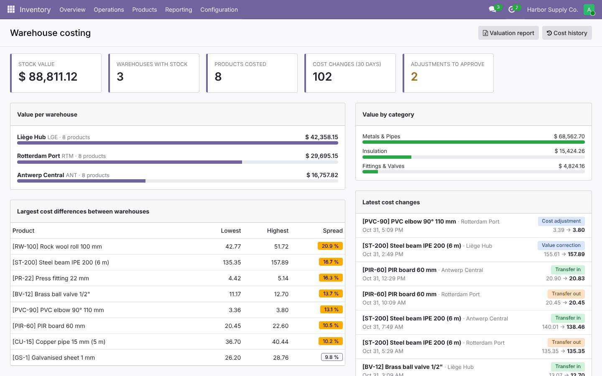
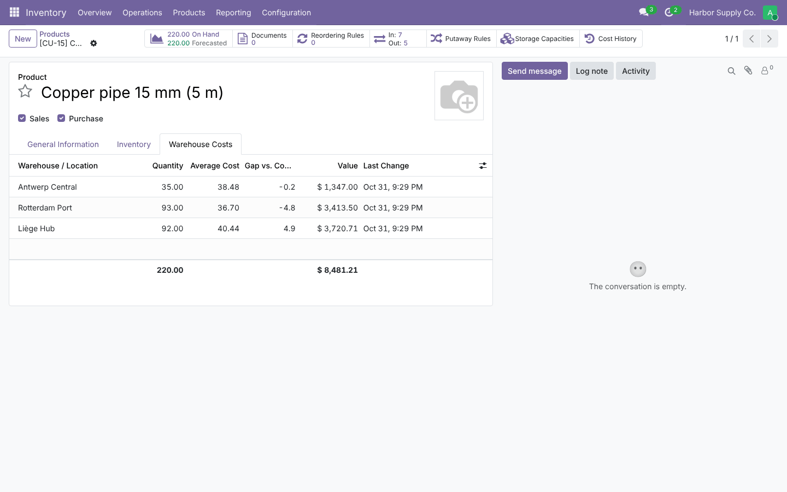
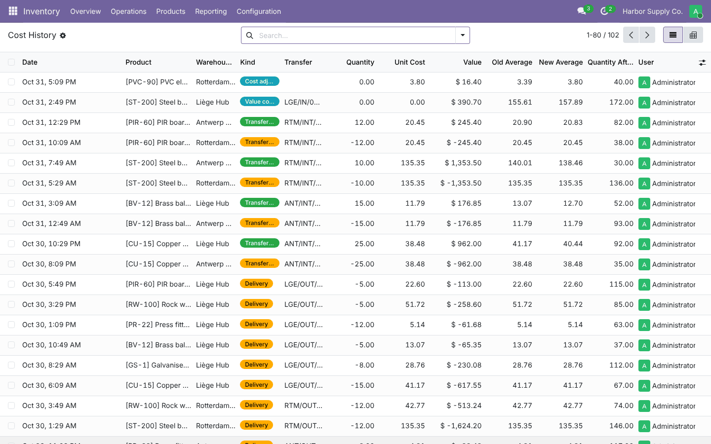
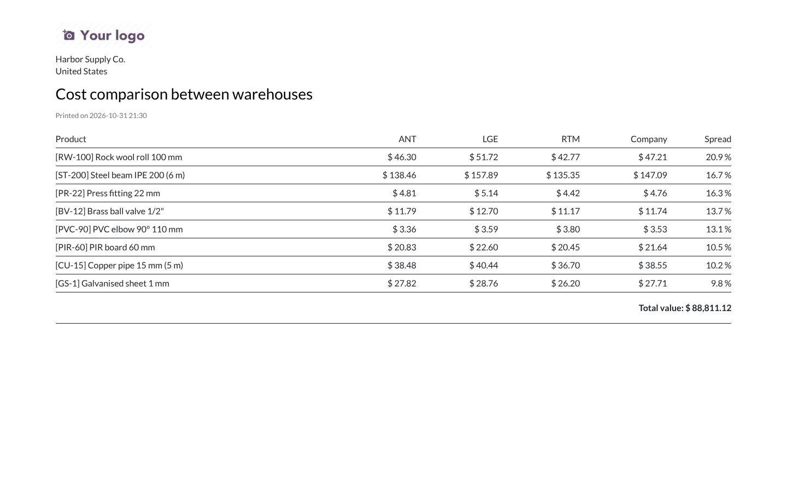

# Warehouse Average Costing (`warehouse_avg_costing`)

Keeps **one average cost per warehouse** for products using the *Average Cost (AVCO)* method in **Odoo 19.0 /
20.0**:
- deliveries are valued at the cost of the warehouse they leave;
- inter-warehouse transfers carry the cost;
- the company cost is the quantity-weighted average of the warehouses.

The module also provides cost adjustments with approval, a cost history, valuation reports (screen, Excel, PDF),
an Excel cost matrix and a dashboard.

The code lives in:
- `19.0/warehouse_avg_costing/`;
- `20.0/warehouse_avg_costing/`.

---

## 1. Planning

### 1.1 Goal

Standard AVCO keeps one cost per product and company. When the same product is bought in several places, its
true cost differs per warehouse because of freight, duties and local suppliers. With one company cost:
- margins per site are wrong;
- a cheap port warehouse hides an expensive inland one;
- transfers silently mix the costs.

The module keeps the standard accounting flow, with one change: the value of goods leaving a warehouse is the
average cost *of that warehouse*.

### 1.2 Requirements

| # | Requirement |
| --- | --- |
| R1 | Average cost, quantity and value per product × warehouse, updated by receipts, deliveries and transfers |
| R2 | Deliveries valued at the warehouse cost (stock moves, journal entries, cost of goods sold) |
| R3 | Transfers between warehouses (one step or via transit) carry the source cost; company value unchanged |
| R4 | Later value changes of receipts (landed costs, bills, manual valuation) go to the receiving warehouse |
| R5 | Company cost = weighted average of the warehouses; Odoo's valuation reports stay consistent |
| R6 | Cost adjustments per warehouse, optionally approved by a manager |
| R7 | Cost history with old and new averages |
| R8 | Valuation reports: summary, detailed, comparison; screen, Excel, PDF |
| R9 | Excel export / import of the cost matrix |
| R10 | Dashboard; per-company activation; initial build from the stock on hand |
| R11 | Same features and tests on Odoo 19 and 20 |

### 1.3 Scope (v1)

**In scope:** everything above.

**Out of scope:**
- FIFO and standard-cost products;
- lot-valuated products;
- historical "valuation at date" per warehouse (Odoo's at-date report replays the company average);
- landed costs on internal transfers.

### 1.4 Roles

| Role | Can |
| --- | --- |
| Inventory user (implies *Warehouse Costing / User*) | See warehouse costs, history and reports; request cost adjustments |
| *Warehouse Costing / Manager* | Approve or refuse adjustments, apply them directly, import cost matrices, rebuild the ledger |

### 1.5 Acceptance criteria

- Receiving 100 units at 10 into warehouse A and 50 at 14 into B gives costs 10 and 14 and a company cost of
  11.33.
- Delivering 30 units from B values the move at 420 (30 × 14). B keeps 20 units worth 280, and the company cost
  becomes 10.67.
- Transferring 50 units from A to B moves 500 of value to B (B's average becomes 12). The company cost does not
  change.
- Raising the value of A's receipt by 200 (landed cost) raises A's average to 12, not B's.
- With approval on, an inventory user's adjustment waits in *To Approve* and a manager applies it. The history
  shows the old and new averages.

### 1.6 Screenshots

These are from Odoo 19. The Odoo 20 ones are in `20.0/warehouse_avg_costing/static/description/screenshots/`.






---

## 2. Architecture

```
stock.move validated ──► stock_account values the move (move.value)
        │                    │  outgoing: _set_value()  ──► override: value = Σ qty × warehouse average
        │                    │  incoming: _set_value()  ──► override: book receipt / value correction
        ▼                    ▼
 _action_done() ──► move._wh_sync(): per move line, source and destination "bucket"
                     (warehouse id, TRANSIT for company transit locations, None = not valued)
                     target qty per bucket − already booked qty per bucket ⇒ deltas
                     negatives first (leave at bucket average), positives:
                       transfer → at the cost that left the source  ·  receipt → move value / qty
        │
        ▼
 stock.warehouse.cost (ledger row)  ──_book()──►  stock.warehouse.cost.line (history)
        │
        ▼
 product._wh_sync_standard_price(): standard_price = Σ value / Σ qty  (no automatic revaluation)
```

### 2.1 Design decisions

- **A ledger next to Odoo's valuation, not a replacement.**
  - Odoo still computes receipt values (PO price, bills, landed costs) and posts the journal entries.
  - The module only replaces the value of outgoing moves, and keeps `standard_price` equal to the ledger
    average. Odoo's valuation report, periodic closing and *Valuation by warehouse* therefore match the ledger.
- **Buckets.**
  - Each warehouse is a bucket.
  - Company transit locations form an *In transit* bucket, so two-step transfers keep the value while the goods
    travel.
  - Non-valued locations (suppliers, customers, inventory loss, consignment stock) are outside all buckets.
- **Idempotent booking.** `_wh_sync()` compares what a move put in or took out of each bucket with what the
  history already holds for that move, and books only the difference. Validation, re-valuation and quantity
  corrections can all call it safely.
- **Outgoing value = booked value.**
  - The value of a delivery is the sum of its booked out lines.
  - A later re-valuation of the same move returns the same value. The cost of goods sold never drifts.
- **Value corrections stay in their warehouse.** When an incoming move gets a new value, the difference against
  the booked value is added to the receiving warehouse (as long as stock is left there).
- **Negative stock** follows Odoo's AVCO rule:
  - goods leaving an empty warehouse go out at its last average (or the company cost);
  - the next receipt resets the average.
- **Company cost, not company revaluation.** Writing `standard_price` with `disable_auto_revaluation` avoids
  double revaluation entries. A *manual* cost change on the product is treated as a revaluation of every
  warehouse to that cost.

---

## 3. Development

```
warehouse_avg_costing/
├── models/
│   ├── stock_warehouse_cost.py         ledger, history, _book(), initialisation
│   ├── stock_move.py                   buckets, _wh_sync(), out values, value corrections
│   ├── product.py                      company cost, manual revaluation, warehouse context value (20: replay)
│   ├── stock_warehouse_cost_adjustment.py  requests and approval
│   ├── res_company.py, res_config_settings.py
│   └── dashboard.py
├── wizard/                             valuation report (screen/Excel/PDF), cost matrix (Excel)
├── report/                             QWeb PDF
├── views/, security/, data/            views, groups and rules, sequence
├── static/src/dashboard/               OWL dashboard
└── tests/                              17 tests + tour
```

**Try it in a shell**

```python
company = env.company; company.warehouse_costing = True
categ = env['product.category'].create({'name': 'AVCO', 'property_cost_method': 'average'})
p = env['product.product'].create({'name': 'Pipe', 'is_storable': True, 'categ_id': categ.id})
# receive / deliver with pickings, then:
env['stock.warehouse.cost'].search([('product_id', '=', p.id)]).read(['warehouse_id', 'quantity', 'avg_cost', 'value'])
```

**Extend**
- Another source of value corrections: make it change the incoming move's value, and `_set_value()` books the
  difference automatically.
- Another report: use `stock.warehouse.valuation.report._report_data()`, which feeds all three formats.

---

## 4. Testing

```bash
tools/run_tests.sh 19.0 /path/to/odoo19 warehouse_avg_costing
tools/run_tests.sh 20.0 /path/to/odoo20 warehouse_avg_costing
```

| File | Covers |
| --- | --- |
| `test_costing.py` | Receipts per warehouse and company cost; deliveries at the warehouse cost; one-step transfer (and moves inside one warehouse); two-step transit; value correction on a receipt; manual cost change; negative stock; adjustments with approval, refusal and direct application; initialisation from quants through the settings; FIFO products and disabled companies ignored; value in the `warehouse_id` context; history dates |
| `test_tools.py` | Valuation report data, Excel and PDF for the three types, screen action; cost matrix export → edit → import; dashboard data; product tab and history action; browser tour (dashboard → report → comparison pivot) |

**Manual test**
1. Two warehouses, an AVCO product. Buy 10 at 10 for warehouse A and 10 at 20 for B (two purchase orders).
2. Sell 5 from B and check the delivery's value (100) and the journal entry if valuation is real-time.
3. Transfer 5 from A to B. A keeps 5 × 10 and B gets 10 units worth 150.

---

## 5. Deployment: dev → staging → production

1. **Dev:**
   - run the tests;
   - check that the product categories to cost per warehouse use AVCO.
2. **Staging:**
   - restore a copy of production and install the module;
   - enable it in *Inventory › Settings › Valuation*. The ledger starts from the stock on hand at the current
     product cost (one *Opening balance* line per product and warehouse);
   - post a few receipts, deliveries and transfers and compare the valuation report with *Inventory ›
     Reporting › Valuation*.
3. **Production:**
   - enable it at a period start (month or quarter), after the last closing;
   - export the cost matrix once as a reference;
   - if the opening costs per warehouse are known, import them as adjustments.
4. **Performance:** each validated move adds a few indexed reads and writes (one ledger row per warehouse
   touched, one history line). The dashboard and reports read the ledger, not the stock moves.
5. **Monitoring:**
   - dashboard (pending approvals, cost spreads);
   - cost history filtered on *Cost changes*;
   - negative stock rows (*Negative stock* filter).
6. **Rollback:**
   - disable the setting: new moves are valued by standard AVCO again, and the ledger stays for reference;
   - uninstalling removes the ledger and history (stock moves and journal entries are untouched).

---

## 6. Odoo 19 vs Odoo 20

| Topic | 19.0 | 20.0 |
| --- | --- | --- |
| When outgoing values are set | before the move is done (`_set_value` then `_action_done`) | after (`_action_done` then `_set_value`); the same override works for both |
| Past value changes | `_set_value()` on the receipt | `_set_value(recompute_date)` replays the company average (`_correct_inventory_valuation`); warehouse-costed products are excluded from that replay |
| Adjustment trace in Odoo's valuation | `product.value` record written | not written (in 20 it would re-value the remaining receipts); chatter note instead |
| Stock move unit field | `product_uom` | `uom_id` |
| Binary wizard files | base64 | `bytes(BinaryValue)` |
| Access rights | `ir.model.access.csv` + rules | `ir.access.csv` |
| Dashboard | OWL 2 | OWL 3 (`proxy`, `this.` in templates) |

---

## 7. Known limitations

- **AVCO only.** FIFO, standard-cost and lot-valuated products keep Odoo's standard behaviour.
- **At-date valuation.** Odoo's "valuation at date" report replays the company average and does not split it per
  warehouse; the cost history gives the warehouse view over time.
- **Corrections after the stock is gone.** If a receipt's value changes after all its goods left the warehouse,
  the difference is logged but not capitalised.
- **Landed costs on internal transfers** are not spread to the destination warehouse.
- **Consignment stock** (owner ≠ company) is ignored, like in Odoo's valuation.
