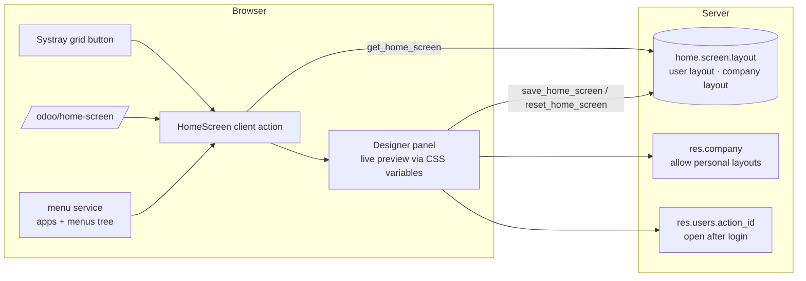

# Home Screen Designer (`web_home_screen_designer`)

This guide covers the whole life of the module: planning, architecture, development, testing, and deployment
from dev to production.
Module folders: [`19.0/web_home_screen_designer`](../19.0/web_home_screen_designer) and [`20.0/web_home_screen_designer`](../20.0/web_home_screen_designer).

---

## 1. Planning

### 1.1 Goal
In Odoo Community, users land on the last app they used, and the only app list is a small dropdown. Companies
want a branded start page that shows every app at a glance and finds any menu quickly. Each user should be able
to arrange it, while the company keeps a common default.

### 1.2 Requirements

| # | Requirement |
| --- | --- |
| R1 | Full home screen with clock, date, greeting and app grid; reachable from the top bar and by URL |
| R2 | Search over apps and menus (with their path); keyboard: Enter opens, Escape clears |
| R3 | Background: default, gradients, uploaded picture; overlay and blur |
| R4 | Layout: columns, spacing, icon size and radius, text size, names, tile style, hover effect |
| R5 | Reorder and hide apps (visual only, rights unchanged) |
| R6 | Live preview; save personal or company layout; reset to company; cancel |
| R7 | Admin decides whether users may save personal layouts |
| R8 | Optional: open the home screen after login |
| R9 | Robust: unknown keys ignored, numbers clamped, wrong types refused, record rules on layouts |

### 1.3 Scope (v1)

| In scope | Out of scope (roadmap) |
| --- | --- |
| Home screen, search, designer, personal/company layouts | Sidebar "apps bar" inside apps |
| 8 gradients + uploaded picture | Theme colors / dark mode palette |
| Reorder with arrows, hide/show | Drag and drop reordering |
| Open after login | Auto-refresh of views |

### 1.4 Roles

| Role | Group | Can do |
| --- | --- | --- |
| User | *Internal User* | Use the home screen; save/reset a personal layout (if allowed) |
| Administrator | *Settings* (`base.group_system`) | Save the company layout, allow/forbid personal layouts |

### 1.5 Acceptance criteria
1. A new user sees the company layout. After they save a personal layout, only they see it.
2. Typing "inv" shows the Invoicing and Inventory apps and menus such as *Invoicing / Customers / Invoices*.
3. A hidden app no longer appears on the home screen, but its menus stay reachable from Odoo's apps menu.
4. With personal layouts turned off, every user sees the company layout and cannot save their own.
5. A non-admin cannot save the company layout (server-side check).

### 1.6 Screenshots (Odoo 19; the Odoo 20 ones are in `20.0/web_home_screen_designer/static/description/screenshots/`)

| Home | Search |
| --- | --- |
|  |  |
| **Designer** | **Designer options** |
|  |  |

---

## 2. Architecture



### 2.1 Design decisions
- **Client action, not a theme.** The home screen is a normal backend action (`ir.actions.client` with path
  `home-screen`). It works in Community and Enterprise and does not replace Odoo's own menus.
  `/odoo/home` cannot be used: Odoo already has a `home` client action, and the router would resolve to it.
- **Apps and menus come from the menu service**, through `computeAppsAndMenuItems`. That data is already
  filtered by access rights, so hiding an app is purely visual and no data can leak.
- **Layout = one record**, per user or per company, enforced by two partial unique indexes. Resolution order
  is personal → company → defaults, and the server returns the effective layout plus its scope.
- **App order and hidden apps are stored as menu XML IDs**, not database ids, so a layout keeps working after
  modules are reinstalled. Unknown apps keep Odoo's order after the ordered ones, so newly installed apps
  appear.
- **CSS custom properties** (`--hs-icon`, `--hs-gap`, …) and modifier classes drive the look. The preview is
  just a state change; nothing is re-fetched.
- **Server validation** (`_clean_values`):
  - only known keys are accepted;
  - numbers are clamped to their ranges, and columns 1–2 become 3;
  - selections are checked;
  - lists must contain strings;
  - pictures are limited to 2560×1600 by the Image field.
- **Security**:
  - users have read-only access on layouts and write through the API, after rights checks;
  - a record rule limits reading to their own layout and their companies' layouts;
  - the company layout needs `base.group_system`.

---

## 3. Development

```bash
./odoo-bin --addons-path=addons,/path/odoo-module/19.0 -d hs_dev -i web_home_screen_designer --dev=xml,qweb,reload
```
Install a few apps (CRM, Sales, Inventory, …) to get a realistic grid, then open `/odoo/home-screen`.

Build order:
1. layout model, defaults and cleaning;
2. API and rights;
3. client action with the static grid;
4. clock, greeting and search;
5. CSS variables;
6. designer controls;
7. app order and visibility;
8. save, reset and cancel;
9. systray button;
10. tests and tour;
11. port to 20.

---

## 4. Testing

`tests/test_home_screen.py` uses `HttpCase`. **All tests pass on both versions: 19.0 runs 6 tests and 20.0
reports 8, because it counts its two standard web suites too.**

| Test | Checks |
| --- | --- |
| `test_defaults` | Default scope and values, first name, 8 gradients, not admin |
| `test_company_then_personal_then_reset` | Company layout seen by users; personal overrides for one user only; reset returns to company |
| `test_clean_values` | Clamping (icon 500 → 128, columns 2 → 3, gap −5 → 0), booleans, unknown keys dropped; wrong gradient, list type and number type refused |
| `test_rights` | Non-admin cannot save the company layout; record rule; company switch off → company layout shown and personal save refused |
| `test_open_on_login_and_image` | Home action set and unset on the user; background picture URL |
| `test_home_screen_tour` | Browser tour (below), then checks the saved record |

Tour `web_home_screen_designer_tour`:
1. Checks the apps, clock and greeting.
2. Searches an app (only *Settings* left), then a menu (*Users*).
3. Opens the designer and chooses the sunset gradient. The preview class changes.
4. Sets 4 columns, hides *Apps* and moves *Settings* first.
5. Clicks *Save for me*. *Apps* is hidden.
6. Opens *Settings* from its tile.

```bash
tools/run_tests.sh 19.0 /path/to/odoo19 web_home_screen_designer
tools/run_tests.sh 20.0 /path/to/odoo20 web_home_screen_designer
```

Manual UAT:
- Phone width: the grid wraps.
- A picture background with dark overlay.
- A multi-company user switching companies sees each company's layout.
- A user without the Settings group cannot see *Save for company*.

---

## 5. Deployment: dev → staging → production

1. **Code**: add the module folder to the addons path on every worker, then restart. Install the module; assets
   rebuild automatically.
2. **Staging**:
   - an administrator designs the company layout: gradient or brand picture, hide technical apps, order the main
     ones;
   - decide whether users may personalize;
   - test with a normal user.
3. **Production**:
   - install the module and recreate or save the company layout;
   - optionally ask users to switch on *Open after login*. An admin can also set the user's *Home Action* to
     **Home** in the user form for everybody.
4. **Pictures**: use compressed JPG/WebP images under 1 MB. They are stored as attachments of the layout record.
5. **Rollback**: uninstall the module. Users with the home screen as home action fall back to the default action.

---

## 6. Odoo 19 vs Odoo 20

| Topic | 19.0 | 20.0 |
| --- | --- | --- |
| Access + record rule | `ir.model.access.csv` + `ir.rule` | `ir.access.csv` with a domain column (same rule) |
| State | `useState` | `proxy` |
| Notifications | `useService("notification")` | `usePlugin(NotificationPlugin)` |
| Props | `static props` | none (OWL 3) |
| Templates | bare names, `t-esc` | `this.` prefix, `t-out` |
| Icons | Font Awesome | Material Symbols (`oi` + `data-icon`) |
| Search input | explicit `t-att-value` + `t-on-input` (same in both; OWL 3 has no `t-model` without a directive) | same |
| Systray action | `useService("action")` | `useService("action")` |

Menu service, `computeAppsAndMenuItems`, the Python code and the tour are the same in both versions.

## 7. Known limitations
- Reordering uses arrows (no drag and drop yet).
- Gradient presets are fixed in SCSS; a picture covers any other need.
- The designer does not change Odoo's colors (top bar, buttons).
